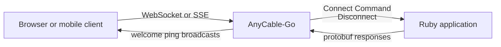
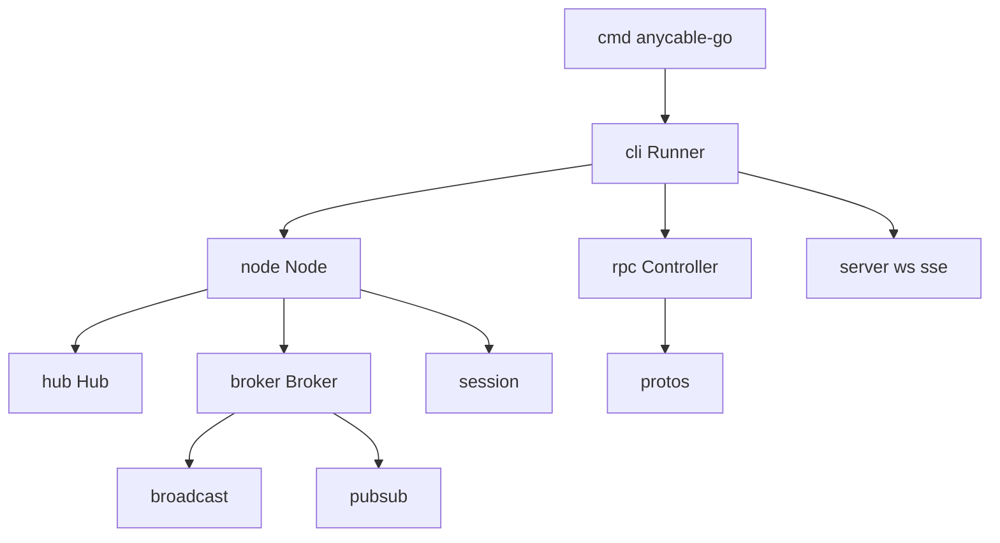

# 00 -- What AnyCable-Go is: a Go server that replaces Action Cable

AnyCable-Go is a Go implementation of an Action Cable server. Action Cable is the WebSocket framework inside Ruby on Rails. A browser opens a WebSocket to an Action Cable server. The server keeps that connection open and pushes messages to it. The Ruby `anycable` gem lets a Rails application use AnyCable-Go instead of the built-in Ruby server.

The reason is scale. Ruby processes are heavy. Each open WebSocket in a Ruby Action Cable server holds a Ruby thread or fiber. AnyCable-Go is one compiled Go process. It holds many connections with much less memory. The Ruby application stays the source of truth for business logic. AnyCable-Go calls it over Remote Procedure Call (RPC).

The source lives in a directory named `src.Ruby`, but the code is Go. The module declares this:

```go
// Source: go.mod, lines 1-5
module github.com/anycable/anycable-go

go 1.27.0

toolchain go1.27.3
```

The version is `1.6.20`. It is the default in the version package and matches the top of the changelog.

```go
// Source: version/version.go, lines 9-21
func init() {
	if version == "" {
		version = "1.6.20"
	}

	if modifier != "" {
		version = version + "-" + modifier
	}

	if sha != "" {
		version = version + "-" + sha
	}
}
```

## The problem it solves

A Rails application needs two-way messages. It must push a message to a browser without the browser asking first. Ruby Action Cable does this with a WebSocket server. But Ruby holds a thread per connection, so the server needs many machines as the user count grows.

AnyCable-Go splits the work. The Go server owns the network. The Ruby application owns the commands. The two talk over protobuf RPC. The Go server is the only process the client sees.

The whole shape is small:



The client speaks the Action Cable protocol. The server speaks the same protocol to the client and the AnyCable protocol to Ruby. See [01-wire-protocol.md](./01-wire-protocol.md).

## The three binaries

The repository builds three programs. The `Makefile` names the outputs.

- `anycable-go` is the standalone server.
- `embedded-cable` embeds AnyCable in a Go HTTP server.
- `gobench` is a benchmark tool.

The main entry point for the server is small. It builds a runner from the command line and starts it.

```go
// Source: cmd/anycable-go/main.go, lines 21-46
func main() {
	c, err, ok := cli.NewConfigFromCLI(os.Args)
	if err != nil {
		log.Fatalf("%v", err)
	}
	if ok {
		os.Exit(0)
	}

	opts := []cli.Option{
		cli.WithName("AnyCable"),
		cli.WithDefaultRPCController(),
		cli.WithDefaultBroker(),
		cli.WithDefaultSubscriber(),
		cli.WithDefaultBroadcaster(),
		cli.WithTelemetry(),
	}

	runner, err := cli.NewRunner(c, opts)

	if err != nil {
		fmt.Printf("%+v\n", err)
		os.Exit(1)
	}

	err = runner.Run()
```

The options wire together the controller (RPC), the broker (history and presence), the subscriber (pub/sub), the broadcaster, and telemetry. The runner in `cli/` assembles them into one process.

## The package map

The code is split into small packages, one per concern. The entry point is `cli`. It builds a `node`, and the node coordinates the rest.



- `node` is the application core. It owns sessions and commands.
- `hub` is the in-memory fan-out engine. It is covered in [03-hub-and-subscriptions.md](./03-hub-and-subscriptions.md).
- `broker` holds stream history, presence, and session cache.
- `rpc` calls the Ruby application over protobuf. It is covered in [05-rpc-layer.md](./05-rpc-layer.md).
- `broadcast` and `pubsub` move messages between nodes over Redis or NATS. They are covered in [04-broadcasts-pubsub.md](./04-broadcasts-pubsub.md).
- `ws` and `sse` are the two transports. They are covered in [06-transports.md](./06-transports.md).

## The Aha Moment

**Aha:** AnyCable-Go is not a Rails server written again. It is a protocol bridge. The Go side keeps the WebSocket, the hub of streams, and the pub/sub fan-out. The Ruby side keeps the application logic. The whole contract between them is three RPC calls: Connect, Command, and Disconnect. Everything else — history, presence, resume, broadcast — is layered around those three calls.

Continue to [01-wire-protocol.md](./01-wire-protocol.md).
