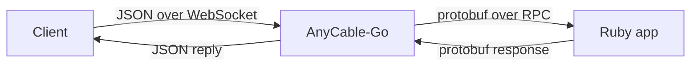
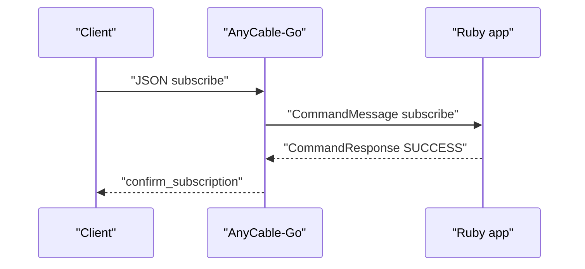

# 01 -- The wire protocol: protobuf over WebSocket, Action Cable JSON

AnyCable-Go uses two protocols. The client speaks Action Cable JSON over WebSocket. The server speaks protobuf over RPC to the Ruby application. The Go process translates between the two.

The client protocol is the Action Cable subprotocol. The constants are in `common`.

```go
// Source: common/common.go, lines 34-41
const (
	ActionCableV1JSON    = "actioncable-v1-json"
	ActionCableV1ExtJSON = "actioncable-v1-ext-json"
)

func ActionCableProtocols() []string {
	return []string{ActionCableV1JSON, ActionCableV1ExtJSON}
}
```

These names are WebSocket subprotocols. The client sends a message as a JSON object. The fields are `command`, `identifier`, and `data`. Commands include `subscribe`, `unsubscribe`, `message`, `ping`, and `pong`.

The server-to-client messages are also JSON. The type names are fixed:

```go
// Source: common/common.go, lines 58-78
const (
	WelcomeType    = "welcome"
	PingType       = "ping"
	PongType       = "pong"
	DisconnectType = "disconnect"
	ConfirmedType  = "confirm_subscription"
	RejectedType   = "reject_subscription"
	// Not supported by Action Cable currently
	UnsubscribedType = "unsubscribed"
	ErrorType        = "error"

	HistoryConfirmedType = "confirm_history"
	HistoryRejectedType  = "reject_history"

	PresenceInfoType  = "info"
	PresenceJoinType  = "join"
	PresenceLeaveType = "leave"
	PresenceType      = "presence"

	WhisperType = "whisper"
)
```

## The RPC side

The Ruby application does not speak WebSocket. It speaks protobuf. The contract is one service with three methods.

```go
// Source: etc/rpc.proto, lines 7-11
service RPC {
  rpc Connect (ConnectionRequest) returns (ConnectionResponse) {}
  rpc Command (CommandMessage) returns (CommandResponse) {}
  rpc Disconnect (DisconnectRequest) returns (DisconnectResponse) {}
}
```

The `Connect` call authenticates the connection. The `Command` call carries `subscribe`, `unsubscribe`, and `message` actions. The `Disconnect` call tells the Ruby app that the client went away. The generated Go types live in `protos/`.

The Go side builds these protobuf messages from the session environment. For example, a command message becomes a `CommandMessage`.

```go
// Source: protocol/protocol.go, lines 21-34
func NewCommandMessage(env *common.SessionEnv, command string, channel string, identifiers string, data string) *pb.CommandMessage {
	msg := pb.CommandMessage{
		Command:               command,
		Env:                   buildChannelEnv(channel, env),
		Identifier:            channel,
		ConnectionIdentifiers: identifiers,
	}

	if data != "" {
		msg.Data = data
	}

	return &msg
}
```

Each protobuf request carries an `Env` object. The `Env` holds the request URL, headers, and connection and channel state. The Ruby app reads these to reconstruct the client's context.

## The two lanes

The client lane and the RPC lane never share a wire format. The Go server is the translator.



A `subscribe` command travels this path. The client sends a JSON `subscribe`. The node reads it and calls `rpc.Controller.Subscribe`. The controller builds a protobuf `CommandMessage` with command `subscribe`. Ruby answers with a `CommandResponse`. The node converts that response into a `confirm_subscription` JSON reply for the client.

The state carried between the two lanes matters. The session environment stores the connection state (`cstate`) and channel state (`istate`). Ruby can change these values. The node merges them back on every response.

## The status codes

The protobuf has three statuses: `SUCCESS`, `FAILURE`, and `ERROR`. `SUCCESS` means the command was accepted. `FAILURE` means the command was rejected, for example an unauthorized subscription. `ERROR` means the application raised an error. The Go side maps these to client-visible replies: a rejected subscription becomes `reject_subscription`, and an error becomes `error`.

The translation is in `protocol.ParseCommandResponse`.



## Cross-References

- [05-rpc-layer.md](./05-rpc-layer.md) — how the protobuf RPC calls are made and retried.
- [03-hub-and-subscriptions.md](./03-hub-and-subscriptions.md) — how stream subscriptions use the channel identifiers from the wire protocol.

## The Aha Moment

**Aha:** The wire protocol is not the product. It is the boundary. Everything the client can do is encoded as a small JSON message, and everything Ruby can say is encoded as a small protobuf response. The Go process only shuffles state: it copies the client's headers and identifier into the RPC, and copies Ruby's `streams`, `transmissions`, and state back into JSON. That is why the server can stay thin while the application stays in Ruby.

Continue to [02-connection-lifecycle.md](./02-connection-lifecycle.md).
