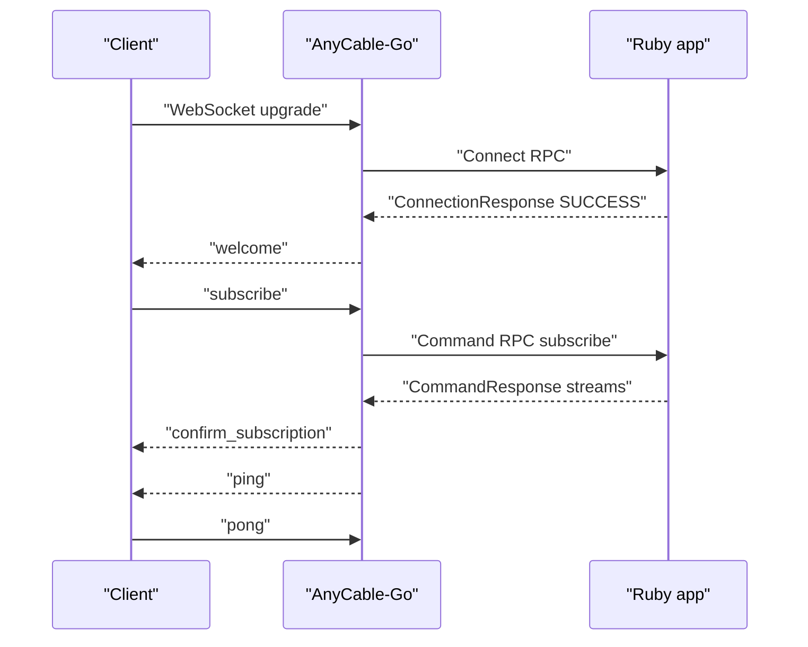
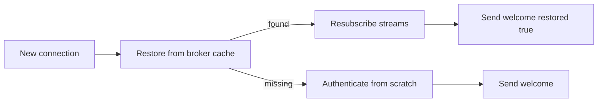

# 02 -- The connection lifecycle: handshake to welcome to disconnect

A connection starts as an HTTP upgrade. The WebSocket handler upgrades the request, builds a session, and hands it to the node.

```go
// Source: cli/cli.go, lines 556-585
func (r *Runner) defaultWebSocketHandler(n *node.Node, c *config.Config, l *slog.Logger) (http.Handler, error) {
	extractor := server.DefaultHeadersExtractor{Headers: c.RPC.ProxyHeaders, Cookies: c.RPC.ProxyCookies}
	if c.JWT.Enabled() {
		extractor.AuthHeader = c.JWT.HeaderKey()
	}
	return ws.WebsocketHandler(common.ActionCableProtocols(), &extractor, &c.WS, r.log, func(wsc *websocket.Conn, info *server.RequestInfo, callback func()) error {
		wrappedConn := ws.NewConnection(wsc)

		opts := []node.SessionOption{}
		opts = append(opts, r.sessionOptionsFromWSConfig(&c.WS)...)
		opts = append(opts, r.sessionOptionsFromProtocol(wsc.Subprotocol())...)
		opts = append(opts, r.sessionOptionsFromParams(info)...)

		session := node.NewSession(n, wrappedConn, info.URL, info.Headers, info.UID, opts...)

		if session.AuthenticateOnConnect() {
			_, err := n.Authenticate(session)

			if err != nil {
				return err
			}
		}

		wsc.SetPongHandler(func(appData string) error {
			session.HandleNativePong()
			return nil
		})

		return session.Serve(callback)
	}), nil
}
```

The session starts two goroutines. One reads messages. One writes messages. The write path uses a queue so the read path never blocks on a slow socket.

```go
// Source: node/session.go, lines 293-318
func NewSession(node *Node, conn Connection, url string, headers *map[string]string, uid string, opts ...SessionOption) *Session {
	session := BuildSession(conn, common.NewSessionEnv(url, headers))
	session.metrics = node.metrics
	session.executor = node
	session.broker = node.broker
	session.pingInterval = time.Duration(node.config.PingInterval) * time.Second
	session.pingTimestampPrecision = node.config.PingTimestampPrecision
	session.sendNativePing = node.config.EnableNativePing
	session.uid = uid

	ctx := node.log.With("sid", session.uid)

	session.Log = ctx

	for _, opt := range opts {
		opt(session)
	}

	if !session.inactive {
		go session.SendMessages()

		session.startTimers()
	}

	return session
}
```

## The handshake

The node calls `Authenticate`. That method calls the controller, which calls the Ruby `Connect` RPC. If Ruby accepts the connection, the node marks the session as authenticated and registers it with the hub.

```go
// Source: node/node.go, lines 361-372
	res, err := n.controller.Authenticate(s.closeCtx, s.GetID(), s.env)

	if s.IsClosed() {
		s.Log.Debug("skip authenticate result: closed")
		return nil, nil
	}

	if res == nil && err == nil {
		return nil, nil
	}

	s.Log.Debug("controller authenticate", "response", res, "err", err)
```

On success the node sends a `welcome` message with the session identifier. The client can now subscribe to channels.

## Pings and timeouts

A session runs a timer loop. The timers schedule five events: handshake deadline, presence refresh, resume refresh, ping, and pong deadline. The ping message keeps the connection alive and detects dead peers.



If the client does not answer pings, the server disconnects it with reason `no_pong`. If the client's write queue overflows, the reason is `too_slow`. If it never authenticates, the reason is `idle_timeout`.

## Resume

A client can resume after a dropped connection. The session stores its subscriptions and state in the broker's cache. On reconnect, the node restores the cached session and resubscribes to streams. The welcome message then carries `restored: true`.



## Disconnect

Disconnect happens for many reasons. A normal close, a failed read, a remote command, or a server restart. The session sends a `disconnect` message with a reason and a `reconnect` flag. Then it calls the `Disconnect` RPC so Ruby can clean up.

The disconnect RPC is rate-limited. It is not called inline for every close. Instead the node enqueues it on the disconnector, covered in [09-embedding-and-extras.md](./09-embedding-and-extras.md).

## The Aha Moment

**Aha:** A session is not the WebSocket. It is a small state machine with two queues and five timers. The WebSocket is only the wire under the session. The node talks to the session through a narrow interface: read a message, write a message, close. That separation is why the same session logic works for SSE and for the embedded mode, and why the RPC disconnect can be delayed without blocking the close.

Continue to [03-hub-and-subscriptions.md](./03-hub-and-subscriptions.md).
