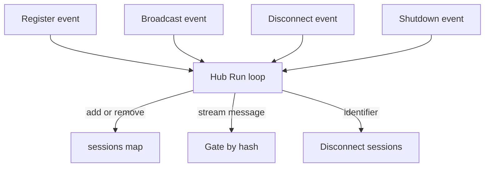
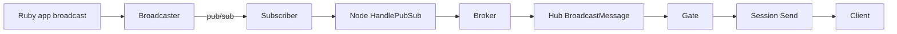

# 03 -- The hub: sharded fan-out for stream subscriptions

The hub is the in-memory engine that delivers broadcasts to sessions. It answers one question: given a stream name, which sessions are subscribed, and what should each receive.

The hub does not hold sessions in one big map per stream. It splits them into shards called gates. A stream name is hashed to pick a gate.

```go
// Source: hub/hub.go, lines 381-389
func index(stream string, size int) int {
	if size == 1 {
		return 0
	}

	hash := fnv.New64a()
	hash.Write([]byte(stream))
	return int(hash.Sum64() % uint64(size))
}
```

The hash is FNV-64a, a fast non-cryptographic hash. Every operation on a stream goes to the same gate, so a gate can lock only its own streams.

## The gates

A gate keeps two maps. One maps a stream to its sessions. The other maps sessions to their streams. A broadcast to a stream first checks whether any session is subscribed. If not, the gate drops it without allocating.

```go
// Source: hub/gate.go, lines 47-63
func (g *Gate) Broadcast(streamMsg *common.StreamMessage) {
	stream := streamMsg.Stream

	ctx := g.log.With("stream", stream)

	ctx.Debug("schedule broadcast", "message", streamMsg)

	g.mu.RLock()
	if _, ok := g.streams[stream]; !ok {
		ctx.Debug("no sessions")
		g.mu.RUnlock()
		return
	}
	g.mu.RUnlock()

	g.sender <- streamMsg
}
```

Each gate has a sender channel with a buffer of 256 messages. A broadcast loop reads from that channel and performs the delivery.

```go
// Source: hub/gate.go, lines 117-126
func (g *Gate) broadcastLoop(ctx context.Context) {
	for {
		select {
		case <-ctx.Done():
			return
		case msg := <-g.sender:
			g.performBroadcast(msg)
		}
	}
}
```

## One message, many identifiers

A session can subscribe to the same stream with several identifiers. Each identifier is a channel instance. The gate must send the message once per identifier. It builds one encoded message per identifier and reuses it across sessions that share the identifier.

```go
// Source: hub/gate.go, lines 144-157
	for _, row := range rows {
		if exclude != "" && row.session.GetID() == exclude {
			continue
		}

		if msg, ok := buf[row.id]; ok {
			bdata = msg
		} else {
			bdata = buildMessage(streamMsg, row.id)
			buf[row.id] = bdata
		}

		row.session.Send(bdata)
	}
```

The `exclude` check supports the `exclude_socket` metadata, used by whispers so a sender does not receive its own message.

## The whole hub

The hub itself is a single select loop. It processes four kinds of events: register a session (add or remove), broadcast to a stream, disconnect by identifier, and shutdown.



Subscriptions go through the node, then the broker, then the hub. The node records the stream in the broker so other nodes also learn about it. Then it tells the hub to map the session to the stream.

```go
// Source: hub/hub.go, lines 276-291
func (h *Hub) SubscribeSession(session HubSession, stream string, identifier string) {
	h.gates[index(stream, h.gatesNum)].Subscribe(session, stream, identifier)

	h.mu.Lock()
	defer h.mu.Unlock()

	sid := session.GetID()

	if _, ok := h.sessions[sid]; !ok {
		h.sessions[sid] = NewHubSessionInfo(session)
	}

	h.sessions[sid].AddStream(stream, identifier)

	h.log.With("sid", sid).Debug("subscribed", "identifier", common.FilteredIdentifier(identifier), "stream", stream)
}
```

## Remote disconnect

A remote node can ask this node to disconnect all sessions for an identifier. The command arrives over pub/sub as a `RemoteCommandMessage`. The hub finds the sessions by identifier and closes them. This supports features like "sign out this user everywhere."

The full broadcast path from Ruby to client is drawn here:



The broker step stores history and then fans out. How a subscription reaches the hub from Ruby is covered in [05-rpc-layer.md](./05-rpc-layer.md).

## The Aha Moment

**Aha:** The hub is a hash table of shards, not a fan-out tree. The expensive part of a broadcast is locking and iterating subscribers. Sharding by stream name makes each lock tiny and each gate independent, so many streams broadcast in parallel on separate goroutines. The hub's own single loop only routes events to the right gate; the gates do the actual per-message work.

Continue to [04-broadcasts-pubsub.md](./04-broadcasts-pubsub.md).
