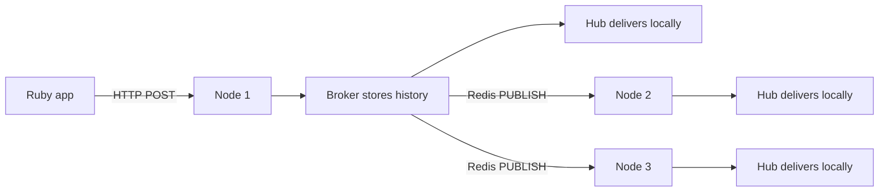
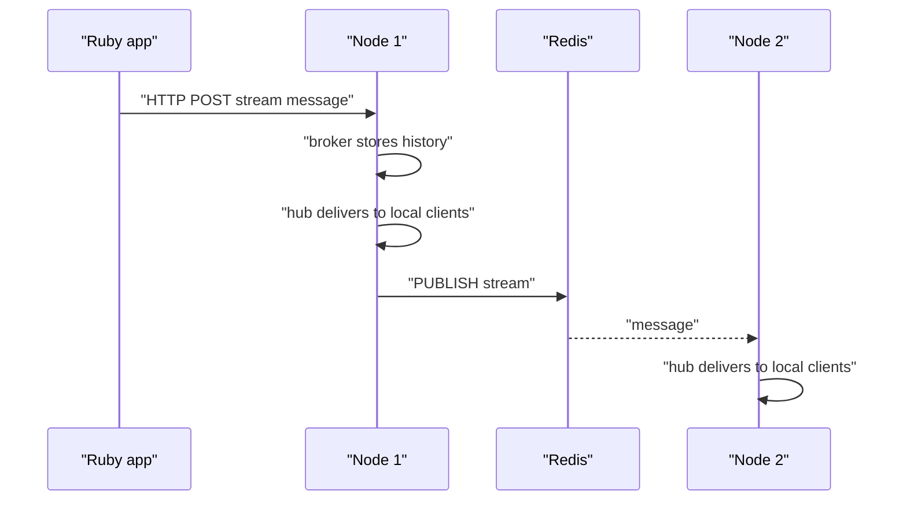

# 04 -- Broadcasts and pub/sub: fan-out over NATS or Redis

A broadcast is a message to a stream. Any client subscribed to that stream receives it. In a single process, the hub delivers it. In a cluster, one node receives the broadcast and must share it with the other nodes. AnyCable-Go uses Redis pub/sub or NATS for that fan-out.

The entry points are the broadcast adapters. A broadcast arrives over HTTP, Redis, or NATS. The HTTP adapter is the simplest to read.

```go
// Source: broadcast/http.go, lines 194-232
func (s *HTTPBroadcaster) Handler(w http.ResponseWriter, r *http.Request) {
	if s.enableCORS {
		// Write CORS headers
		server.WriteCORSHeaders(w, r, s.allowedHosts)

		// Respond to preflight requests
		if r.Method == http.MethodOptions {
			w.WriteHeader(http.StatusOK)
			return
		}
	}

	if r.Method != "POST" {
		s.log.Debug("invalid request method", "method", r.Method)
		w.WriteHeader(422)
		return
	}

	if s.authHeader != "" {
		if r.Header.Get("Authorization") != s.authHeader {
			w.WriteHeader(401)
			return
		}
	}

	body, err := io.ReadAll(r.Body)

	if err != nil {
		s.log.Error("failed to read request body")
		w.WriteHeader(422)
		return
	}

	if err = s.node.HandleBroadcast(body); err == nil {
		w.WriteHeader(201)
	} else {
		w.WriteHeader(501)
	}
}
```

The body is one JSON message. `node.HandleBroadcast` parses it with `common.PubSubMessageFromJSON`, which tells a `StreamMessage`, a batch of them, or a `RemoteCommandMessage` apart.

## The broker in the middle

The node does not send a broadcast straight to the hub. It sends it to the broker. The broker stores history and then fans out.

```go
// Source: broker/memory.go, lines 306-320
func (b *Memory) HandleBroadcast(msg *common.StreamMessage) (err error) {
	if msg.Meta != nil && msg.Meta.Transient {
		b.broadcaster.Broadcast(msg)
		return
	}

	offset := b.add(msg.Stream, msg.Data)

	msg.Epoch = b.GetEpoch()
	msg.Offset = offset

	b.broadcaster.Broadcast(msg)

	return
}
```

A transient message skips history. A normal message gets an offset and an epoch, is stored, and then broadcast. The `broadcaster` here is the pub/sub subscriber, which publishes the message to other nodes.

## The pub/sub subscribers

The subscriber is the transport between nodes. The Redis subscriber uses the rueidis client and a dedicated pub/sub connection.

```go
// Source: pubsub/redis.go, lines 183-199
func (s *RedisSubscriber) Publish(stream string, msg interface{}) {
	s.clientMu.RLock()

	if s.client == nil {
		s.clientMu.RUnlock()
		return
	}

	ctx := context.Background()
	client := s.client

	s.clientMu.RUnlock()

	s.log.With("channel", stream).Debug("publish message", "data", msg)

	client.Do(ctx, client.B().Publish().Channel(stream).Message(string(utils.ToJSON(msg))).Build())
}
```

Each stream is a Redis channel. A node subscribes to a channel only when at least one local client is subscribed to that stream. The broker tracks that with a `StreamsTracker`. When the last client unsubscribes, the node unsubscribes from the Redis channel. This keeps the fan-out to only the streams that matter.

## The full path

Here is the path of one broadcast in a cluster of three nodes.



The receiving nodes call `HandlePubSub`, which parses the message and calls `node.Broadcast`. That path bypasses the broker, because history was already stored by the originating node.



## Embedded NATS

AnyCable-Go can also run its own NATS server inside the process. The `enats` package wraps the NATS server library. It supports clustering, gateways, and JetStream.

```go
// Source: enats/enats.go, lines 124-136
	opts := &server.Options{
		Host:       u.Hostname(),
		Port:       int(port),
		Debug:      s.config.Debug,
		Trace:      s.config.Trace,
		ServerName: s.serverName(),
		Cluster:    clusterOpts,
		Gateway:    gatewayOpts,
		Routes:     routes,
		NoSigs:     true,
		JetStream:  s.config.JetStream,
		MaxPayload: int32(s.config.MaxPayload),
	}
```

The embedded NATS mode removes the need for a separate NATS cluster. It is especially useful for a single binary deployment.

## Cross-References

- [03-hub-and-subscriptions.md](./03-hub-and-subscriptions.md) — the in-memory hub that delivers each broadcast locally.
- [09-embedding-and-extras.md](./09-embedding-and-extras.md) — the REST API endpoint for publishing broadcasts.

## The Aha Moment

**Aha:** The pub/sub layer is deliberately dumb. It moves bytes from one node to others. All the intelligence — history, offsets, presence, session cache — lives in the broker above it. The subscriber's only job is to replicate a message to peers and hand it to the node. That split is why the broker can be swapped between memory and NATS while the pub/sub layer stays Redis or NATS independently.

Continue to [05-rpc-layer.md](./05-rpc-layer.md).
