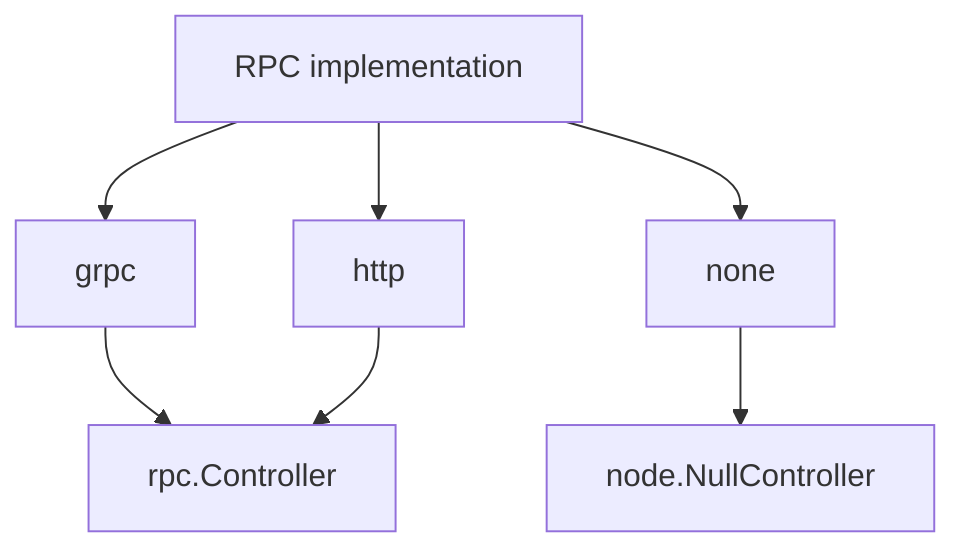
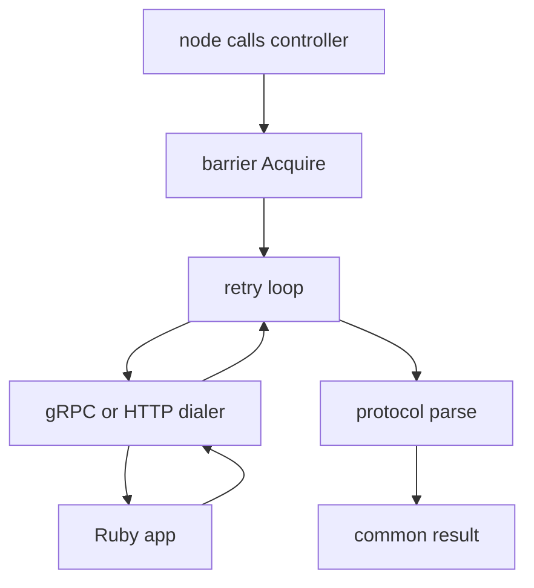

# 05 -- The RPC layer: calling back into Ruby, with retries

The RPC controller is the Go side's only link to the Ruby application. It implements the `node.Controller` interface: Authenticate, Subscribe, Unsubscribe, Perform, and Disconnect. Each of those becomes a protobuf call.

The controller has three implementations: gRPC, HTTP, and none. gRPC and HTTP share the `rpc.Controller`; `none` is `node.NewNullController`, selected by `--norpc`. The default host is a gRPC address, and the concurrency default is slightly below the Ruby server's default.



```go
// Source: rpc/config.go, lines 72-85
func NewConfig() Config {
	return Config{
		ProxyHeaders:   []string{"cookie"},
		Concurrency:    defaultRPCConcurrency,
		EnableTLS:      false,
		TLSVerify:      true,
		Host:           defaultRPCHost,
		Implementation: "",
		// TODO(v2): Change the default in v2 to some 5s or whatever
		RequestTimeout:     0,
		HTTPRequestTimeout: 0,
		CommandTimeout:     3000,
	}
}
```

The `defaultRPCConcurrency` is 28, defined just above as slightly less than the Ruby gRPC server's default. A fixed-size barrier limits how many RPC calls run at once. This prevents `ResourceExhausted` errors from Ruby.

## The retry loop

RPC calls can fail. The controller retries only two gRPC codes: `ResourceExhausted` and `Unavailable`. Retries use exponential backoff, doubling the delay each attempt.

```go
// Source: rpc/rpc.go, lines 571-611
		code := st.Code()

		if code == codes.DeadlineExceeded {
			c.metrics.CounterIncrement(metricsRPCTimeouts)
		}

		if !(code == codes.ResourceExhausted || code == codes.Unavailable) {
			return nil, err
		}

		c.log.With("sid", sid).Debug("RPC failed", "code", st.Code(), "error", st.Message())

		interval := retryUnavailableInterval

		if st.Code() == codes.ResourceExhausted {
			interval = retryExhaustedInterval
			if !wasExhausted {
				attempt = 0
				wasExhausted = true
			}
			c.barrier.Exhausted()
		} else if wasExhausted {
			wasExhausted = false
			attempt = 0
		}

		delayMS := int64(math.Pow(2, float64(attempt))) * interval
		delay := time.Duration(delayMS)

		c.metrics.CounterIncrement(metricsRPCRetries)

		select {
		case <-time.After(delay * time.Millisecond):
		case <-ctx.Done():
			if lastSeenErr != nil {
				return nil, errorx.DecorateMany("retry interrupted", ctx.Err(), lastSeenErr)
			}
			return nil, ctx.Err()
		}

		attempt++
```

The interval for `Unavailable` is 100 milliseconds. The interval for `ResourceExhausted` is 10 milliseconds. On exhaustion the controller calls `barrier.Exhausted()`, which is a no-op hook: `FixedSizeBarrier.Exhausted()` is empty and is the only implementation.

## One call, end to end

The `Authenticate` method shows the shape of every call. It acquires the barrier, builds a `Connect` request, retries, and parses the response.

```go
// Source: rpc/rpc.go, lines 336-362
	op := func(ctx context.Context) (interface{}, error) {
		ctx, cancel := c.newRequestContext(ctx, sid)
		defer cancel()

		return c.client.Connect(ctx, protocol.NewConnectMessage(env))
	}

	c.metrics.CounterIncrement(metricsRPCCalls)

	response, err := c.retry(sctx, sid, op)

	if errors.Is(err, context.Canceled) {
		c.metrics.CounterIncrement(metricsRPCCanceled)
		return nil, nil
	}

	if err != nil {
		c.metrics.CounterIncrement(metricsRPCFailures)

		return nil, err
	}

	if r, ok := response.(*pb.ConnectionResponse); ok {
		reply, err := protocol.ParseConnectResponse(r)

		return reply, err
	}
```

The `newRequestContext` adds two metadata values to every call: the session identifier and the protocol version `v1`.

## The mruby metrics printer

The `mrb` package embeds an mruby virtual machine through cgo, but it is not an RPC backend. There is no `node.Controller` implementation in `mrb/`; the package only exposes a VM (`NewEngine`, `LoadString`, `Eval`, `Version`). Its only runtime consumer is the custom metrics formatter `RubyPrinter` in `metrics/custom_printer.go`. When `metrics_log_formatter` points at a Ruby script, the writer loads the script into mruby and calls its `MetricsFormatter.call` method to format each snapshot:

```go
// Source: metrics/custom_printer.go, lines 56-73
func (p *RubyPrinter) Print(snapshot map[string]uint64) {
	rhash, _ := p.engine.VM.LoadString("{}")

	hash := rhash.Hash()

	for k, v := range snapshot {
		hash.Set(mruby.String(k), mruby.Int(v))
	}

	result, err := p.mrbModule.Call("call", rhash)

	if err != nil {
		p.log.Error("mruby call failed", "error", err)
		return
	}

	p.log.Info(result.String())
}
```

The VM itself is thin. `LoadString` compiles and runs a snippet:

```go
// Source: mrb/mrb.go, lines 70-99
func (engine *Engine) LoadString(contents string) error {
	engine.mu.Lock()
	defer engine.mu.Unlock()

	ctx := mruby.NewCompileContext(engine.VM)
	defer ctx.Close()

	filename, err := nanoid.Nanoid()

	if err != nil {
		return err
	}

	ctx.SetFilename(fmt.Sprintf("%s.rb", filename))

	parser := mruby.NewParser(engine.VM)
	defer parser.Close()

	if _, err = parser.Parse(contents, ctx); err != nil {
		return err
	}

	parsed := parser.GenerateCode()

	if _, err = engine.VM.Run(parsed, nil); err != nil {
		return err
	}

	return nil
}
```

The `//go:build` line at the top of the file restricts it to `darwin && mrb` or `linux && mrb`. Without the tag, `mrb.Supported()` returns false — used only in the startup banner and telemetry — and `metrics.NewCustomPrinter` is replaced by a stub that returns an "unsupported" error instead of a `RubyPrinter`.

## The layers

The RPC path is a stack of small pieces:



The barrier protects Ruby. The retry loop hides transient failures. The protocol package maps protobuf to the Go `common` types. See [01-wire-protocol.md](./01-wire-protocol.md) for those types.

## The Aha Moment

**Aha:** The RPC layer's real product is backpressure. The barrier caps concurrent calls so Ruby never sees more load than it can serve, and the retry loop turns a `ResourceExhausted` into a short, bounded wait instead of a dropped message. The protobuf encoding is almost trivial by comparison; the hard part is keeping a steady, bounded stream of work flowing into a slower Ruby process.

Continue to [06-transports.md](./06-transports.md).
