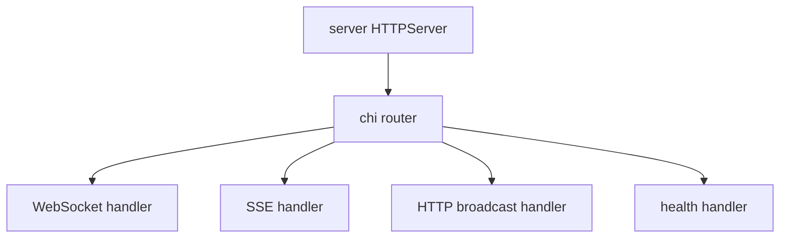
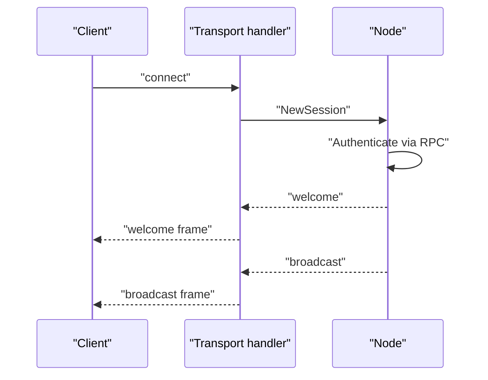

# 06 -- The transports: WebSocket and SSE

AnyCable-Go serves two transports. WebSocket is the primary one. Server-Sent Events (SSE) is the fallback for clients that cannot open a WebSocket.

The WebSocket handler upgrades an HTTP request with the gorilla WebSocket library. It sets the read limit, negotiates the Action Cable subprotocol, and hands the connection to a session.

```go
// Source: ws/handler.go, lines 17-42
func WebsocketHandler(subprotocols []string, headersExtractor server.HeadersExtractor, config *Config, l *slog.Logger, sessionHandler sessionHandler) http.Handler {
	return http.HandlerFunc(func(w http.ResponseWriter, r *http.Request) {
		ctx := l.With("context", "ws")

		upgrader := websocket.Upgrader{
			CheckOrigin:       CheckOrigin(config.AllowedOrigins),
			Subprotocols:      subprotocols,
			ReadBufferSize:    config.ReadBufferSize,
			WriteBufferSize:   config.WriteBufferSize,
			EnableCompression: config.EnableCompression,
		}

		rheader := map[string][]string{"X-AnyCable-Version": {version.Version()}}
		wsc, err := upgrader.Upgrade(w, r, rheader)
		if err != nil {
			ctx.Debug("WebSocket connection upgrade failed", "error", err)
			return
		}

		info, err := server.NewRequestInfo(r, headersExtractor)
		if err != nil {
			CloseWithReason(wsc, websocket.CloseAbnormalClosure, err.Error())
			return
		}

		wsc.SetReadLimit(config.MaxMessageSize)
```

The response includes an `X-AnyCable-Version` header. Origin checking is optional and disabled when no allowed origins are configured.

## SSE

SSE is a one-way stream. The client opens an HTTP connection and the server writes `data:` lines. The SSE handler sets the streaming headers, subscribes the session to the requested channels, and then waits.

```go
// Source: sse/handler.go, lines 48-59
		w.Header().Set("X-AnyCable-Version", version.Version())
		if r.ProtoMajor == 1 {
			// An endpoint MUST NOT generate an HTTP/2 message containing connection-specific header fields.
			// Source: RFC7540.
			w.Header().Set("Connection", "keep-alive")
		}
		w.Header().Set("Content-Type", "text/event-stream; charset=utf-8")
		w.Header().Set("X-Content-Type-Options", "nosniff")
		w.Header().Set("X-Accel-Buffering", "no")
		w.Header().Set("Cache-Control", "private, no-cache, no-store, must-revalidate, max-age=0") // HTTP 1.1
		w.Header().Set("Pragma", "no-cache")                                                       // HTTP 1.0
		w.Header().Set("Expire", "0")
```

The `X-Accel-Buffering: no` header tells nginx not to buffer the stream. The `Cache-Control` header tells the browser and proxies to not cache it.

## Encoders

Both transports use the same message types but different encoders. The JSON encoder is the WebSocket default.

```go
// Source: encoders/json.go, lines 19-25
func (JSON) Encode(msg EncodedMessage) (*ws.SentFrame, error) {
	b, err := json.Marshal(&msg)
	if err != nil {
		panic("Failed to build JSON 😲")
	}
	return &ws.SentFrame{FrameType: ws.TextFrame, Payload: b}, nil
}
```

The SSE encoder wraps the same JSON in SSE framing. A message becomes `data:` lines, an event type line, and optionally an `id:` and `retry:` line.

```go
// Source: sse/encoder.go, lines 85-104
	if msgType != "" {
		if e.RawData {
			return nil, nil
		}

		payload = "event: " + msgType + "\n" + payload
	}

	if reply, ok := msg.(*common.Reply); ok {
		if reply.Offset > 0 && reply.Epoch != "" && reply.StreamID != "" {
			payload += "\nid: " + fmt.Sprintf("%d%s%s%s%s", reply.Offset, lastIdDelimeter, reply.Epoch, lastIdDelimeter, reply.StreamID)
		}
	}

	if msgType == "disconnect" {
		dmsg, ok := msg.(*common.DisconnectMessage)
		if ok && !dmsg.Reconnect {
			payload += "\nretry: " + fmt.Sprintf("%d", retryNoReconnect)
		}
	}
```

The SSE `id:` line carries the stream offset, epoch, and stream name. A client can resume by sending `Last-Event-ID` back.

## The server wrapper

Both transports ride on the same HTTP server. The `server` package wraps the standard library `http.Server` with a chi router and a shared port registry. Multiple handlers can attach to the same port because `ForPort` returns the same server for the same port.



## The flow for each transport



The transport only formats bytes. The session and node do the real work, as shown in [02-connection-lifecycle.md](./02-connection-lifecycle.md).

## The Aha Moment

**Aha:** A transport is a codec plus a lifecycle, nothing more. WebSocket and SSE differ only in how they frame bytes and how they detect disconnection. Because both produce the same `ws.SentFrame` and consume the same `common.Message`, the node, hub, broker, and RPC controller never know which transport a client uses. Adding a transport means writing an encoder and a handler, not touching the core.

Continue to [07-configuration-cli.md](./07-configuration-cli.md).
