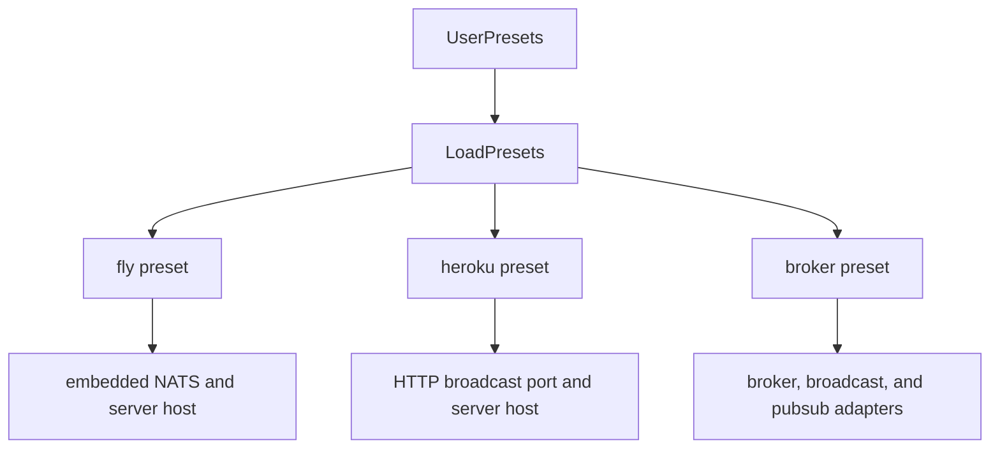
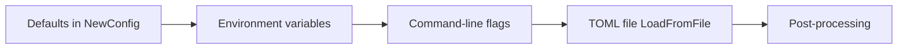

# 07 -- Configuration and CLI: flags, env vars, and TOML

AnyCable-Go configures itself from three sources: command-line flags, environment variables, and a TOML file. All three feed one `Config` struct.

The `Config` struct is a tree of sub-configs, one per package.

```go
// Source: config/config.go, lines 33-69
type Config struct {
	ID                   string `toml:"node_id"`
	UserProvidedID       bool
	Secret               string                      `toml:"secret"`
	BroadcastKey         string                      `toml:"broadcast_key"`
	SkipAuth             bool                        `toml:"noauth"`
	PublicMode           bool                        `toml:"public"`
	BroadcastAdapters    []string                    `toml:"broadcast_adapters"`
	PubSubAdapter        string                      `toml:"pubsub_adapter"`
	UserPresets          []string                    `toml:"presets"`
	Log                  logger.Config               `toml:"logging"`
	Server               server.Config               `toml:"server"`
	App                  node.Config                 `toml:"app"`
	WS                   ws.Config                   `toml:"ws"`
	RPC                  rpc.Config                  `toml:"rpc"`
	Broker               broker.Config               `toml:"broker"`
	Redis                rconfig.RedisConfig         `toml:"redis"`
	LegacyRedisBroadcast broadcast.LegacyRedisConfig `toml:"redis_pubsub_broadcast"`
	RedisBroadcast       broadcast.RedisConfig       `toml:"redis_stream_broadcast"`
	NATSBroadcast        broadcast.LegacyNATSConfig  `toml:"nats_broadcast"`
	HTTPBroadcast        broadcast.HTTPConfig        `toml:"http_broadcast"`
	RedisPubSub          pubsub.RedisConfig          `toml:"redis_pubsub"`
	NATSPubSub           pubsub.NATSConfig           `toml:"nats_pubsub"`
	NATS                 nconfig.NATSConfig          `toml:"nats"`
	DisconnectorDisabled bool
	DisconnectQueue      node.DisconnectQueueConfig `toml:"disconnector"`
	Metrics              metrics.Config             `toml:"metrics"`
	JWT                  identity.JWTConfig         `toml:"jwt"`
	EmbeddedNats         enats.Config               `toml:"embedded_nats"`
	SSE                  sse.Config                 `toml:"sse"`
	Streams              streams.Config             `toml:"streams"`
	Pusher               pusher.Config              `toml:"pusher"`
	DS                   ds.Config                  `toml:"ds"`
	API                  api.Config                 `toml:"api"`

	ConfigFilePath string
}
```

The `toml` tags map the struct fields to file keys. The same names, with underscores, become environment variables under the `ANYCABLE_` prefix.

## From the command line

The CLI parser is urfave/cli. `NewConfigFromCLI` builds a flag list, one group per sub-config.

```go
// Source: cli/options.go, lines 61-68
func NewConfigFromCLI(args []string, opts ...cliOption) (*config.Config, error, bool) {
	c := config.NewConfig()

	if _, err := os.Stat(CurrentConfigPath); err == nil {
		args = append([]string{args[0], "--config-path", CurrentConfigPath}, args[1:]...)
	} else if _, err := os.Stat(DefaultConfigPath); err == nil {
		args = append([]string{args[0], "--config-path", DefaultConfigPath}, args[1:]...)
	}
```

The default config file is auto-detected. If `./anycable.toml` exists, it is loaded. Otherwise `/etc/anycable/anycable.toml` is loaded.

The flag groups are appended one by one:

```go
// Source: cli/options.go, lines 103-125
	flags = append(flags, serverCLIFlags(&c, &path)...)
	flags = append(flags, sslCLIFlags(&c)...)
	flags = append(flags, broadcastCLIFlags(&c, &broadcastAdapters)...)
	flags = append(flags, brokerCLIFlags(&c)...)
	flags = append(flags, redisCLIFlags(&c)...)
	flags = append(flags, redisBroadcastCLIFlags(&c)...)
	flags = append(flags, httpBroadcastCLIFlags(&c)...)
	flags = append(flags, natsCLIFlags(&c)...)
	flags = append(flags, rpcCLIFlags(&c, &headers, &cookieFilter, &noRPC)...)
	flags = append(flags, disconnectorCLIFlags(&c)...)
	flags = append(flags, logCLIFlags(&c)...)
	flags = append(flags, metricsCLIFlags(&c, &metricsFilter, &mtags)...)
	flags = append(flags, wsCLIFlags(&c)...)
	flags = append(flags, pingCLIFlags(&c)...)
	flags = append(flags, jwtCLIFlags(&c, &jwtIdKey, &jwtIdParam, &jwtIdEnforce)...)
	flags = append(flags, signedStreamsCLIFlags(&c, &turboRailsKey, &cableReadyKey, &turboRailsClearText, &cableReadyClearText)...)
	flags = append(flags, statsdCLIFlags(&c)...)
	flags = append(flags, embeddedNatsCLIFlags(&c, &enatsRoutes, &enatsGateways)...)
	flags = append(flags, sseCLIFlags(&c)...)
	flags = append(flags, pusherCLIFlags(&c)...)
	flags = append(flags, dsCLIFlags(&c)...)
	flags = append(flags, apiCLIFlags(&c)...)
	flags = append(flags, miscCLIFlags(&c, &presets)...)
```

The `misc` group covers presets. A preset is a named bundle of settings that turns on several features at once, for example the `broker` preset.



## The precedence

Configuration is applied in a fixed order. The code starts with defaults from `config.NewConfig()`. Environment variables are applied first, then command-line flags. Then the `Before` hook runs `LoadFromFile`, which decodes the TOML file over those values — so the file is applied last and overrides flags and environment variables. Post-processing fills in derived values after that.

The full pipeline:



The post-processing step fills in derived values. For example, the HTTP broadcast secret can be generated from the application secret, and the pub/sub adapter can be inferred from the broker choice.

## Logging

Logging is part of the configuration. The logger supports text and JSON formats.

```go
// Source: logger/logger.go, lines 12-46
func InitLogger(format string, level string) (slog.Handler, error) {
	logLevel, err := parseLevel(level)

	if err != nil {
		return nil, err
	}

	var handler slog.Handler

	switch format {
	case "text":
		{
			opts := &tint.Options{
				Level:       logLevel,
				NoColor:     !utils.IsTTY(),
				TimeFormat:  "2006-01-02 15:04:05.000",
				ReplaceAttr: transformAttr,
			}
			handler = tint.NewTextHandler(os.Stdout, opts)
		}
	case "json":
		{
			handler = slog.NewJSONHandler(os.Stdout, &slog.HandlerOptions{Level: logLevel})
		}
	default:
		{
			return nil, fmt.Errorf("unknown log format: %s.\nAvaialable formats are: text, json", format)
		}
	}

	logger := slog.New(handler)
	slog.SetDefault(logger)

	return handler, nil
}
```

The text handler uses the tint library for colored output. The `transformAttr` function converts errors to messages so stack traces stay out of logs.

## Cross-References

- [08-telemetry-metrics.md](./08-telemetry-metrics.md) — how metrics, logging, and telemetry read the same config.
- [06-transports.md](./06-transports.md) — how the WebSocket and SSE sub-configs are used.

## The Aha Moment

**Aha:** Configuration is one struct, serialized three ways. Every package reads its own sub-config and nowhere else. The CLI layer does not know what a field means; it only knows how to map a flag or an environment variable onto a field of the tree. That single source of truth is why `--print-config` can emit a complete TOML file, and why the embedded mode can reuse the exact same config with no CLI at all.

Continue to [08-telemetry-metrics.md](./08-telemetry-metrics.md).
