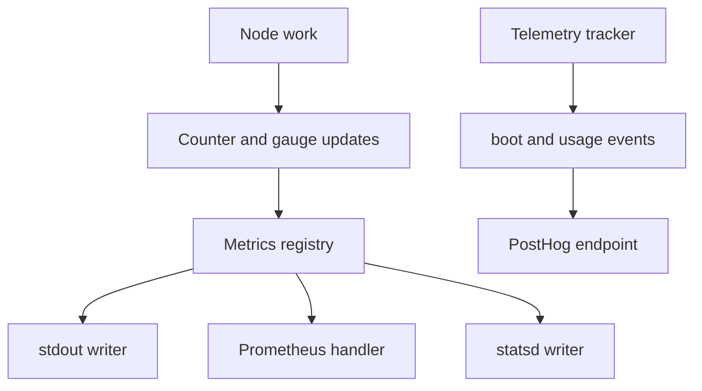
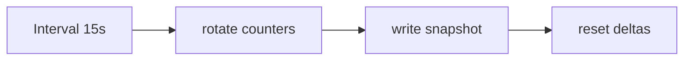

# 08 -- Metrics, logging, and telemetry: observability of a connection server

AnyCable-Go exposes three kinds of observability: metrics, logs, and telemetry. Metrics are numbers. Logs are events. Telemetry is a small, anonymized report sent to the AnyCable team.

Metrics are counters and gauges. The `Metrics` type holds a registry of both and a set of writers that periodically print them.

```go
// Source: metrics/metrics.go, lines 53-100
func NewFromConfig(config *Config, l *slog.Logger) (*Metrics, error) {
	var metricsPrinter IntervalWriter

	writers := []IntervalWriter{}

	if config.LogEnabled() {
		if config.LogFormatterEnabled() {
			customPrinter, err := NewCustomPrinter(config.LogFormatter, l)

			if err == nil {
				metricsPrinter = customPrinter
			} else {
				return nil, err
			}
		} else {
			metricsPrinter = NewBasePrinter(config.LogFilter, l)
		}

		writers = append(writers, metricsPrinter)
	}

	instance := NewMetrics(writers, config.RotateInterval, l)

	if config.Tags != nil {
		instance.tags = config.Tags
	}

	if config.HTTPEnabled() {
		if config.Host != "" && config.Host != server.Host {
			srv, err := server.NewServer(config.Host, strconv.Itoa(config.Port), server.SSL, 0)
			if err != nil {
				return nil, err
			}
			instance.server = srv
		} else {
			srv, err := server.ForPort(strconv.Itoa(config.Port))
			if err != nil {
				return nil, err
			}
			instance.server = srv
		}

		instance.httpPath = config.HTTP
		instance.server.SetupHandler(instance.httpPath, http.HandlerFunc(instance.PrometheusHandler))
	}

	return instance, nil
}
```

A writer can log to stdout, expose Prometheus over HTTP, or send to statsd. The Prometheus handler runs at a configurable path.

## What is measured

The node registers a set of gauges and counters on startup. On a timer, it samples the runtime and the hub.

```go
// Source: node/node.go, lines 1207-1227
func (n *Node) collectStatsOnce() {
	n.metrics.GaugeSet(metricsGoroutines, uint64(runtime.NumGoroutine()))

	var m runtime.MemStats
	runtime.ReadMemStats(&m)
	n.metrics.GaugeSet(metricsMemSys, m.Sys)

	if DetailedMemMetrics {
		n.metrics.GaugeSet(metricsHeapSys, m.HeapSys)
		n.metrics.GaugeSet(metricsStackSys, m.StackSys)

		n.metrics.GaugeSet(metricsHeapAlloc, m.HeapAlloc)
		n.metrics.GaugeSet(metricsHeapIdle, m.HeapIdle)
		n.metrics.GaugeSet(metricsHeapReleased, m.HeapReleased)
	}

	n.metrics.GaugeSet(metricsClientsNum, uint64(n.hub.Size()))
	n.metrics.GaugeSet(metricsUniqClientsNum, uint64(n.hub.UniqSize()))
	n.metrics.GaugeSet(metricsStreamsNum, uint64(n.hub.StreamsSize()))
	n.metrics.GaugeSet(metricsDisconnectQueue, uint64(n.disconnector.Size()))
}
```

Counters are incremented inline during work. For example, `client_msg_total` counts incoming messages, and `broadcast_msg_total` counts broadcasts. RPC counters are registered in the RPC controller and incremented around each call.

## Telemetry

Telemetry is opt-in through a build-time token. The tracker sends two events: `boot` and `usage`. The `boot` event reports features and platform. The `usage` event reports the peak client count and memory observed over a window.

```go
// Source: telemetry/telemetry.go, lines 130-147
func (t *Tracker) Send(event string, props map[string]interface{}) {
	t.logger.Debug("send telemetry event", "event", event)

	// Avoid storing IP address
	props["$ip"] = nil
	props["distinct_id"] = t.id
	props["cluster-fingerprint"] = t.fingerprint
	props["event"] = event

	ctx, cancel := context.WithTimeout(context.Background(), 1*time.Second)
	defer cancel()

	payload, err := json.Marshal(props)

	if err != nil {
		t.logger.Debug("failed to marshal telemetry payload", "err", err)
		return
	}
```

The tracker sets the IP address to nil so it never stores client IPs. The cluster fingerprint is a SHA-256 digest of the deployment's environment and configuration, not of user data.

The feature set reported at boot is drawn from the config:

```go
// Source: telemetry/telemetry.go, lines 251-268
	props.Set("deploy", guessPlatform())

	// Features
	props.Set("has-secret", t.config.Secret != "")
	props.Set("no-auth", t.config.SkipAuth)
	props.Set("jwt", t.config.JWT.Enabled())
	props.Set("public-streams", t.config.Streams.Public)
	props.Set("turbo", t.config.Streams.Turbo)
	props.Set("cr", t.config.Streams.CableReady)
	props.Set("enats", t.config.EmbeddedNats.Enabled)
	props.Set("broadcast", strings.Join(t.config.BroadcastAdapters, ","))
	props.Set("pubsub", t.config.PubSubAdapter)
	props.Set("broker", t.config.Broker.Adapter)
	props.Set("ssl", t.config.Server.SSL.Available())
	props.Set("mrb-printer", t.config.Metrics.LogFormatterEnabled())
	props.Set("statsd", t.config.Metrics.Statsd.Enabled())
	props.Set("prom", t.config.Metrics.HTTPEnabled())
	props.Set("rpc-impl", t.config.RPC.Impl())
```

None of these are user data. They are booleans and feature names.

## The observability flow



The metrics registry is shared by the node, sessions, and the RPC controller. Each component increments its own counters. The writers rotate on a fixed interval, defaulting to 15 seconds.



## Cross-References

- [07-configuration-cli.md](./07-configuration-cli.md) — how the metrics and telemetry settings are configured.
- [05-rpc-layer.md](./05-rpc-layer.md) — the RPC counters and retries that feed the registry.

## The Aha Moment

**Aha:** Metrics and telemetry answer different questions with the same data. Metrics are the operator's live dashboard: how many clients, how many messages, how much memory. Telemetry is the maintainer's slow signal: which features do people actually enable, on which platforms, at what peak load. Both read from one registry, so there is no second instrumentation pass — telemetry only samples gauges that the node already maintains.

Continue to [09-embedding-and-extras.md](./09-embedding-and-extras.md).
