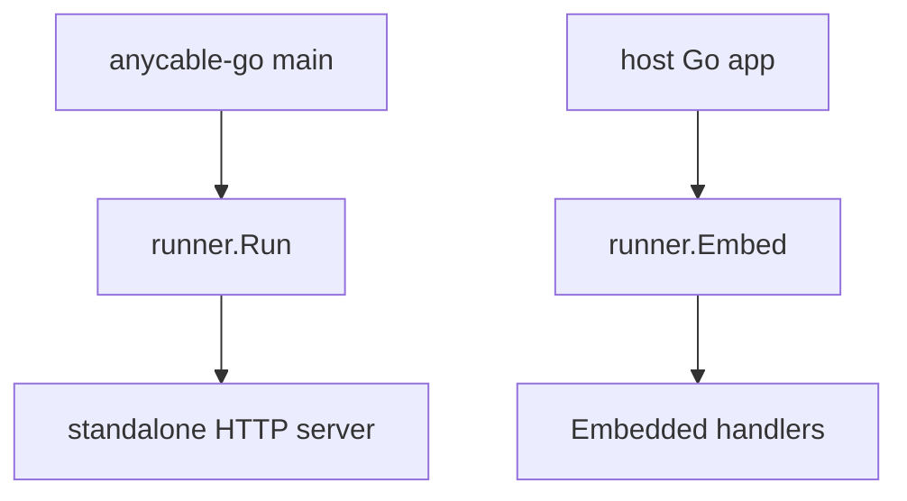
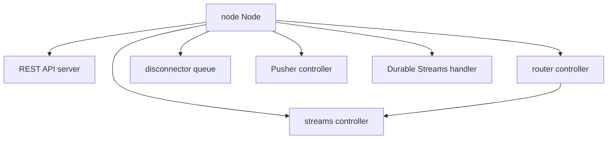

# 09 -- Embedding and the extras: REST API, signed streams, Pusher

AnyCable-Go is not only a standalone binary. It can be embedded into another Go program. The `cli.Runner` has an `Embed` method that starts the node and returns an `Embedded` value with HTTP handlers.

```go
// Source: cli/embed.go, lines 70-86
func (r *Runner) Embed() (*Embedded, error) {
	r.announceDebugMode()
	mrubySupport := r.initMRuby()

	r.log.Info(fmt.Sprintf("Starting embedded %s %s%s (open file limit: %s)", r.name, version.Version(), mrubySupport, utils.OpenFileLimit()))

	appNode, err := r.runNode()
	if err != nil {
		return nil, err
	}

	embed := &Embedded{n: appNode, r: r}

	go r.startMetrics(r.metrics)

	return embed, nil
}
```

The returned value exposes three handlers: WebSocket, SSE, and HTTP broadcast. The `cmd/embedded-cable` example shows how to mount them on the standard library mux.

```go
// Source: cmd/embedded-cable/main.go, lines 65-69
	http.Handle("/cable", wsHandler)
	http.Handle("/sse", seeHandler)
	http.Handle("/broadcast", broadcastHandler)

	go http.ListenAndServe(":8080", nil) // nolint:errcheck,gosec
```



## The REST API

The `api` package adds a REST endpoint for publishing broadcasts and reading presence. The publish endpoint mirrors the HTTP broadcast handler but adds a presence route.

```go
// Source: api/server.go, lines 87-93
	publishPath := s.conf.Path + "/publish"
	s.server.SetupHandler(publishPath, http.HandlerFunc(s.PublishHandler))

	presencePath := s.conf.Path + "/presence/*"
	s.server.SetupHandler(presencePath, http.HandlerFunc(s.PresenceHandler))

	return nil
```

The presence handler is GET-only and answers `GET /api/presence/<stream>/users` with the current list of present clients, read from the broker.

## Signed streams

The `streams` package lets a client subscribe to a stream without going through Ruby. The stream name is signed with the application secret, so the server can verify it.

```go
// Source: streams/controller.go, lines 55-95
func (c *Controller) Subscribe(ctx context.Context, sid string, env *common.SessionEnv, ids string, identifier string) (*common.CommandResult, error) {
	request, stream, err := c.VerifiedStream(identifier)

	if err != nil {
		c.log.With("identifier", common.FilteredIdentifier(identifier)).Debug("subscription failed", "error", err)

		return &common.CommandResult{
				Status:        common.FAILURE,
				Transmissions: []string{common.RejectionMessage(identifier)},
			},
			err
	}

	if request.SignedStreamName != "" {
		c.log.With("identifier", common.FilteredIdentifier(identifier)).Debug("subscribed verified", "stream", stream)
	} else {
		c.log.With("identifier", common.FilteredIdentifier(identifier)).Debug("", "stream", stream)
	}

	var state map[string]string

	if request.whisper {
		state = make(map[string]string)
		state[common.WHISPER_STREAM_STATE] = stream
	}

	if request.presence {
		if state == nil {
			state = make(map[string]string)
		}
		state[common.PRESENCE_STREAM_STATE] = stream
	}

	return &common.CommandResult{
		Status:             common.SUCCESS,
		Transmissions:      []string{common.ConfirmationMessage(identifier)},
		Streams:            []string{stream},
		DisconnectInterest: -1,
		IState:             state,
	}, nil
}
```

The `router` package routes a channel name to a specific controller. The `streams` package builds three controllers from that idea: signed streams, Turbo Streams, and CableReady.

## The disconnector

The Disconnect RPC is rate-limited. A `DisconnectQueue` throttles the calls to a fixed rate, defaulting to 100 per second.

```go
// Source: node/disconnect_queue.go, lines 76-89
func (d *DisconnectQueue) Run() error {
	throttle := time.NewTicker(d.rate)
	defer throttle.Stop()

	for {
		select {
		case session := <-d.disconnect:
			<-throttle.C
			d.node.DisconnectNow(session) //nolint:errcheck
		case <-d.shutdown:
			return nil
		}
	}
}
```

When the server shuts down, the queue drains what remains one by one.

## The optional features map

The extras attach to the same node in different ways:



Each is optional. Each is enabled by configuration and wired in the runner's `Run` or `Embed` path.

## Cross-References

- [06-transports.md](./06-transports.md) — the WebSocket and SSE handlers exposed by Embed().
- [04-broadcasts-pubsub.md](./04-broadcasts-pubsub.md) — the HTTP broadcast handler exposed by Embed().

## The Aha Moment

**Aha:** The whole server is a library with a `main` on top. The `cli.Runner` builds the node and its dependencies; the `anycable-go` binary is just the default wiring, and `embedded-cable` is a smaller wiring that drops the standalone server. The extras — API, signed streams, Pusher, Durable Streams — are not bolted on. They are additional controllers and handlers that plug into the same node interface, so each one is small and independently testable.

Continue to [README.md](./README.md).
