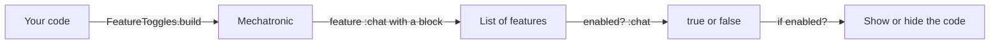
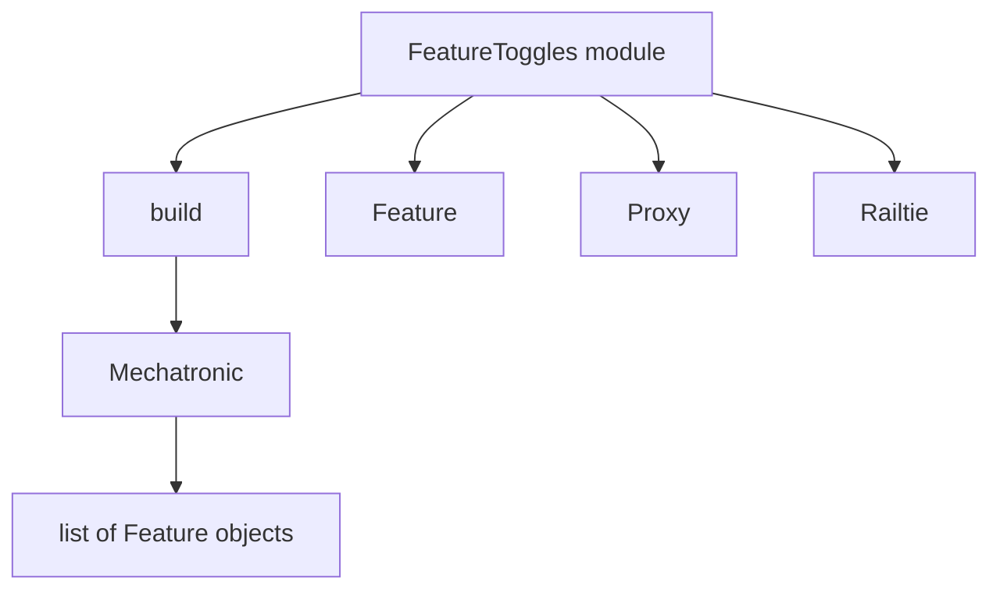

# 00 -- Feature Toggles: pending features gated by Ruby code

FeatureToggles is a small Ruby gem. It manages features that take longer than
one release cycle to finish. You ship the code behind a toggle. You switch the
toggle per user or per environment. You do not deploy again.

A feature is a name plus a Ruby block. The block is the resolver. It returns
true or false. Your code asks "is this feature enabled?" and gates itself on
the answer.

Some descriptions call the config a YAML file. The source has no YAML. No file
under `lib/` or `spec/` reads YAML. The config is a Ruby Domain-Specific
Language (DSL). Prefer the source: the config is Ruby code.

The gem is version 1.2.1. The gemspec summary is "This gem provides a mechanism
for pending features." The whole library is six files under `lib/`:

- `feature_toggles.rb` — the entry point.
- `feature_toggles/mechatronic.rb` — the toggle container.
- `feature_toggles/feature.rb` — one declared feature.
- `feature_toggles/proxy.rb` — a bound view returned by `for`.
- `feature_toggles/railtie.rb` — the Rails integration.
- `feature_toggles/version.rb` — the version constant.

## The entry point

`FeatureToggles.build` is the only public entry point on the module. It builds a
`Mechatronic` object from a block, from file paths, or from both.

```ruby
# Source: lib/feature_toggles.rb, lines 6-12
module FeatureToggles
  module_function

  def build(file_paths = nil, &block)
    Mechatronic.new(file_paths, &block)
  end
end
```

The version constant is the one the gemspec reads:

```ruby
# Source: lib/feature_toggles/version.rb, lines 3-5
module FeatureToggles
  VERSION = "1.2.1"
end
```

The README shows the shape of a full usage:

```ruby
# Source: README.md, lines 32-48
features = FeatureToggles.build do
  # define env var prefix to enable features
  # globally by passing MY_PREFIX_BAR=1
  env "MY_PREFIX"

  feature :bar do
    user.can_bar?
  end

  feature :foo do |user: nil|
    !user.nil? && user.can_foo?
  end
end

features.enabled?(:bar)
features.enabled?(:bar, user: user)
features.for(user: user).enabled?(:foo)
```

## The big picture



The flow is one direction. You declare features once at load time. You ask
about them many times at run time.



`Mechatronic` is the center. `Feature` holds one declaration. `Proxy` is a
bound view returned by `for`. `Railtie` wires the gem into Rails.

## The Aha Moment

**Aha:** FeatureToggles is not a flag store and not a database. It is a list of
named Ruby blocks plus one predicate that runs the right block. A feature here
is executable code, so "is it enabled?" means "call this block and coerce the
result to a boolean."

## Cross-References

- [01-config-dsl.md](./01-config-dsl.md) — how `env` and `feature` declare a toggle.
- [03-runtime-api.md](./03-runtime-api.md) — how `enabled?` and `for` gate code.

Continue to [01-config-dsl.md](./01-config-dsl.md).
