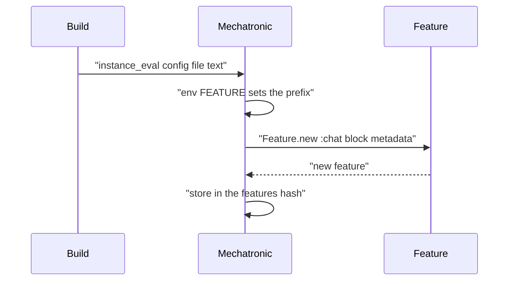
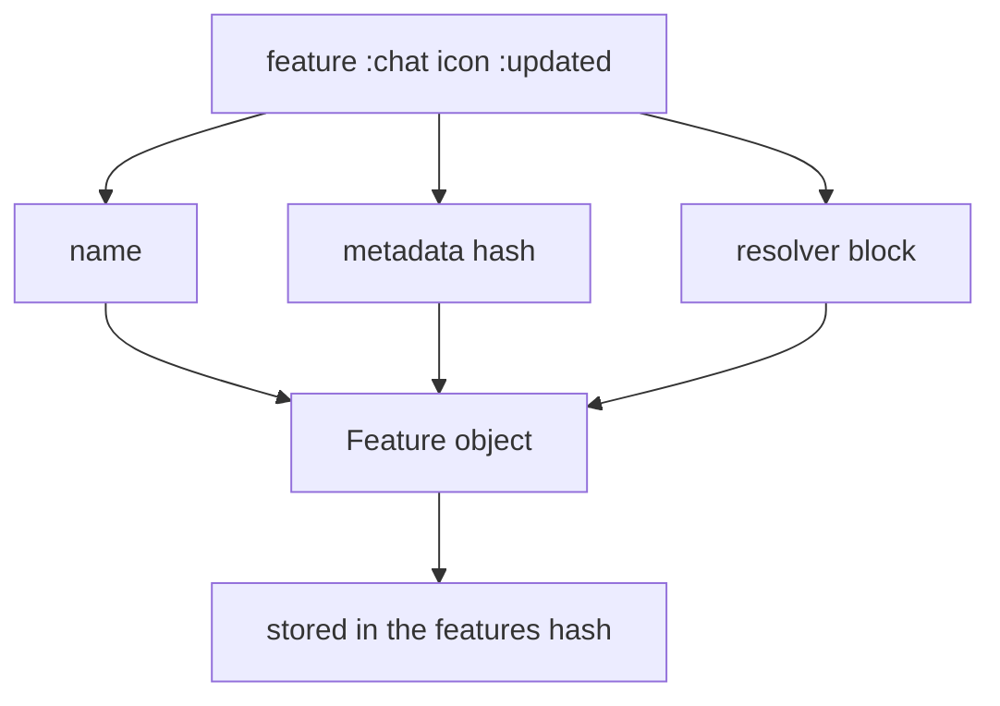

# 01 -- The DSL: declaring env and features

The config is Ruby code. `FeatureToggles.build` evaluates a block, or reads
files, in the context of a `Mechatronic` object. The Domain-Specific Language
(DSL) methods `env` and `feature` are plain method calls on that object.

`instance_eval` is the mechanism. It runs the block, or each file's text, with
`self` set to the `Mechatronic` instance. That is why `env` and `feature` need
no receiver.

```ruby
# Source: lib/feature_toggles/mechatronic.rb, lines 13-21
def initialize(definition_file_paths = nil, &block)
  @features = {}

  definition_file_paths&.each do |file|
    instance_eval(File.read(file), file)
  end

  instance_eval(&block) if block
end
```

The second argument to `instance_eval` is the file name. Ruby uses it in stack
traces, so an error in a config file points at that file.

## `env` and `feature`

Two DSL methods exist. `env` stores an environment variable prefix. `feature`
declares one toggle.

```ruby
# Source: lib/feature_toggles/mechatronic.rb, lines 23-31
def env(val)
  @env_prefix = val
end

def feature(name, **metadata, &block)
  raise(ArgumentError, "Flag #{name} already exists") if @features.key?(name)

  features[name] = Feature.new(name, block, **metadata)
end
```

`feature` takes a name, optional metadata, and a block. The block is the
resolver. It is stored without being called. A second declaration with the same
name raises `ArgumentError`.

A config file looks like this:

```ruby
# Source: README.md, lines 79-84 (config/features.rb example)
# config/features.rb
env "FEATURE"

feature :chat do |user: nil|
  user&.features.include?("chat")
end
```

The block receives keyword arguments. The caller of `enabled?` supplies them.
So the resolver can depend on the current user.

## Metadata

Metadata is a set of keyword arguments after the name.

```ruby
# Source: README.md, lines 131-133
feature :manual_quantity_backsync, icon: :updated, description: "Manual quantity sync for imported products" do |user: nil|
  !!user&.features&.fetch("manual_quantity_backsync", false)
end
```

The gem stores the keywords in a hash on the `Feature`. It does not interpret
them. See [02-feature-object.md](./02-feature-object.md).

## How the DSL runs



The whole config file is one pass. Each `feature` line appends one `Feature`
object to an insertion-ordered hash.



## The Aha Moment

**Aha:** The config file is not data. It is a Ruby script run inside the toggle
object. `env` and `feature` are ordinary method calls, so the toggle and the
logic that decides it sit in one expression. Any Ruby is allowed, and nothing
is parsed.

## Cross-References

- [00-overview.md](./00-overview.md) — the entry point and the big picture.
- [02-feature-object.md](./02-feature-object.md) — the object a declaration builds.
- [04-loading-and-rails.md](./04-loading-and-rails.md) — how files reach this DSL.

Continue to [02-feature-object.md](./02-feature-object.md).
