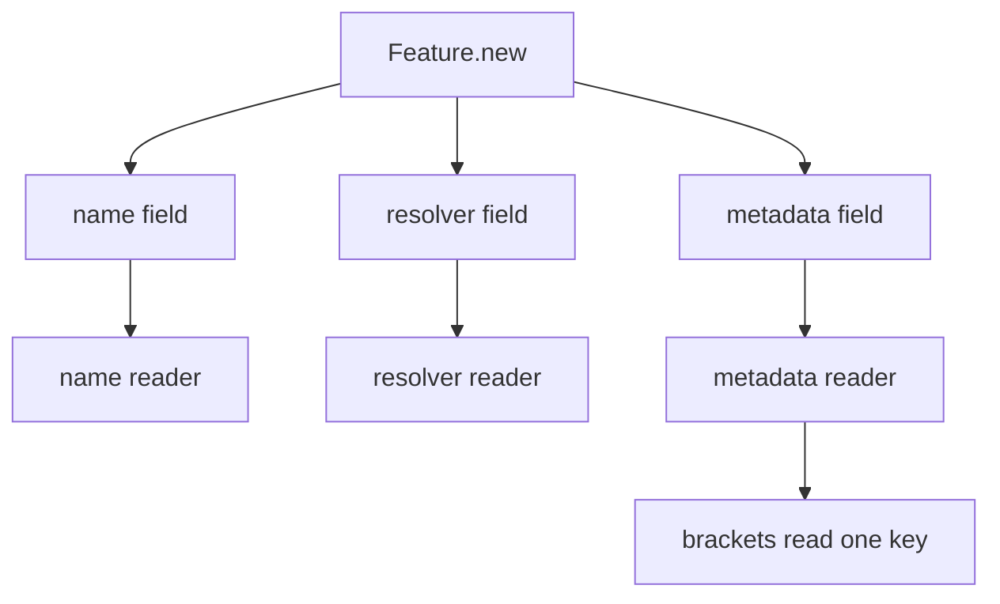
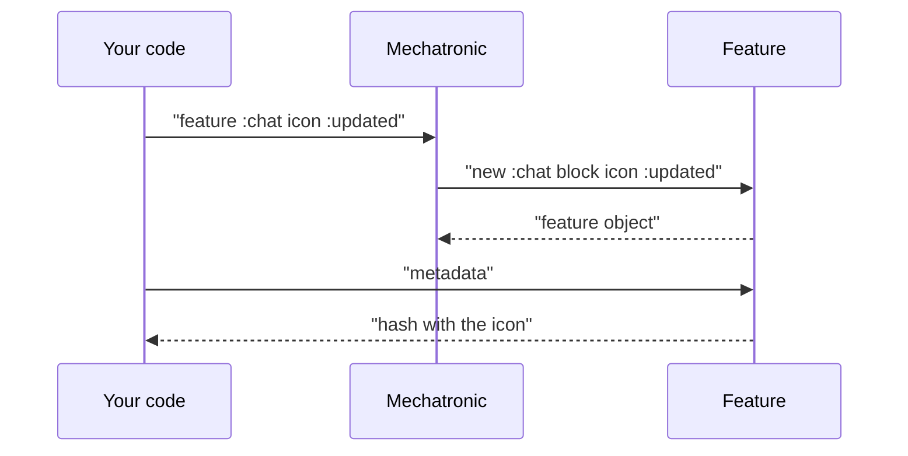

# 02 -- The Feature: a name, a resolver, and metadata

`Feature` is the smallest class in the gem. It is a value object with three
readers and one method. It holds what a declaration said. It never decides
anything.

```ruby
# Source: lib/feature_toggles/feature.rb, lines 3-17
module FeatureToggles
  class Feature
    def initialize(name, resolver, **metadata)
      @name = name
      @resolver = resolver
      @metadata = metadata
    end

    attr_reader :name, :resolver, :metadata

    def [](key)
      @metadata[key]
    end
  end
end
```

The whole class is these lines. There is no hidden behavior.

`Mechatronic#feature` builds one:

```ruby
# Source: lib/feature_toggles/mechatronic.rb, lines 27-31
def feature(name, **metadata, &block)
  raise(ArgumentError, "Flag #{name} already exists") if @features.key?(name)

  features[name] = Feature.new(name, block, **metadata)
end
```

The block becomes `resolver`. The keyword arguments become `metadata`.

## The three readers

`name` is whatever you passed. It can be a symbol or a string. The gem does not
normalize it.

`resolver` is the block. It is a `Proc`. It is stored raw and called later by
`Mechatronic#enabled?`.

`metadata` is the keyword hash. `[]` reads one key:

```ruby
# Source: spec/lib/feature_toggles/feature_spec.rb, lines 18-27
describe "#metadata" do
  it { expect(subject.metadata).to eq(metadata) }
end

describe "#[]" do
  it "returns metadata value by key" do
    expect(subject[:foo]).to eq(:bar)
    expect(subject[:baz]).to be_nil
  end
end
```

The test builds the subject with `{foo: :bar, baz: nil}`. So `subject[:foo]`
is `:bar` and `subject[:baz]` is `nil`.



The readers just return the stored values. No computation happens here.



## The Aha Moment

**Aha:** A feature never decides. It holds a name, a block, and some metadata.
The decision happens only when `Mechatronic#enabled?` calls the resolver. So
one feature can give a different answer for each set of arguments, and the
metadata is read-only data for admin panels and documentation.

## Cross-References

- [01-config-dsl.md](./01-config-dsl.md) — the declaration that builds a Feature.
- [03-runtime-api.md](./03-runtime-api.md) — the code that finally calls the resolver.

Continue to [03-runtime-api.md](./03-runtime-api.md).
