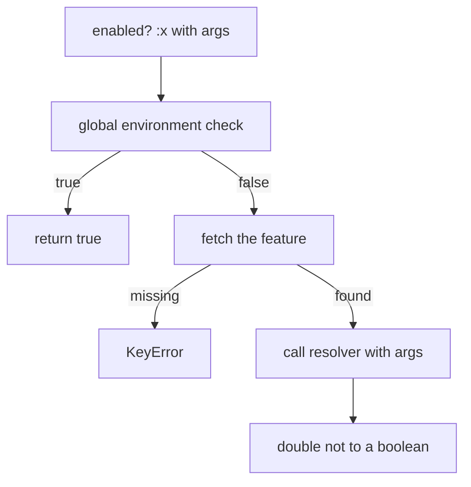
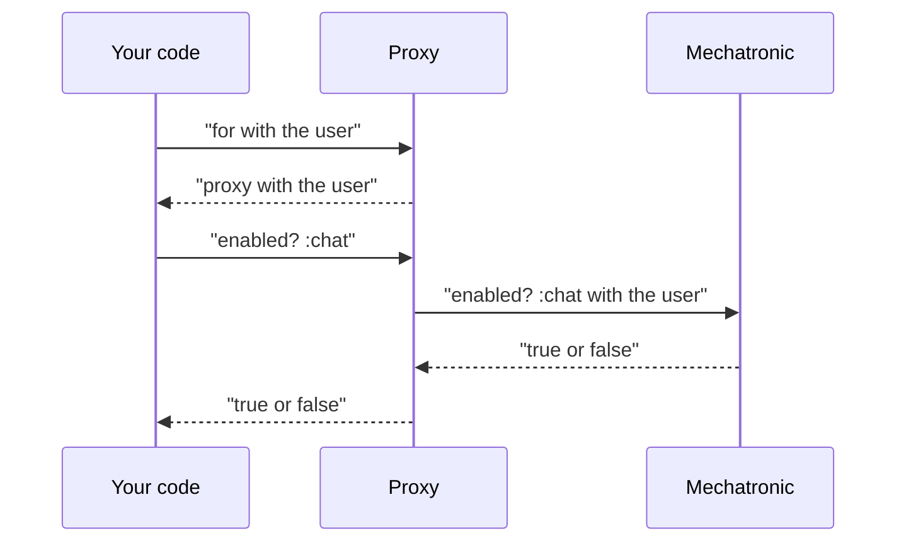

# 03 -- The runtime API: asking whether a feature is on

The run-time Application Programming Interface (API) is small. The main method
is `enabled?`. It returns true or false. The rest of the API packages arguments
and reports.

## `enabled?`

```ruby
# Source: lib/feature_toggles/mechatronic.rb, lines 37-39
def enabled?(feature, *args, **kwargs)
  enabled_globally?(feature) || !!features.fetch(feature).resolver.call(*args, **kwargs)
end
```

Two parts. First, a global environment-variable check. Second, the resolver
block. The double `!!` forces any truthy or falsy value into plain true or
false.

`features.fetch(feature)` raises `KeyError` for an unknown name. But the global
check runs first. If it is true, the short-circuit skips the fetch. So an
unknown name returns true only when a matching environment variable is on.

## The global override

```ruby
# Source: lib/feature_toggles/mechatronic.rb, lines 10-11
# Which env variables should be considered truthy
POSSIBLE_ENABLING_VALUES = %w[true on yes 1].freeze
```

```ruby
# Source: lib/feature_toggles/mechatronic.rb, lines 69-72
def enabled_globally?(feature)
  env_prefix &&
    POSSIBLE_ENABLING_VALUES.include?(ENV["#{env_prefix}_#{feature.upcase}"])
end
```

Set the prefix with `env`. Then a variable named `PREFIX_NAME` with the value
`true`, `on`, `yes`, or `1` turns the feature on for everyone. `ENV` always
returns a string or `nil`, so `"1"` matches the list item `"1"`.

The spec proves it. Its `subject` is built with `env "TEST_FEATURE"` and two features (spec lines 58-66), so the variable `TEST_FEATURE_X` maps to `:x`:

```ruby
# Source: spec/lib/feature_toggles/mechatronic_spec.rb, lines 78-86
context "with env vars" do
  before { ENV["TEST_FEATURE_X"] = "1" }
  after { ENV.delete("TEST_FEATURE_X") }

  specify do
    expect(subject.enabled?(:x)).to eq true
    expect(subject.enabled?(:y)).to eq false
  end
end
```

`feature(:x)` is normally false. With `TEST_FEATURE_X=1` it becomes true.
`feature(:y)` stays false because no variable is set for it.



## `for` and the Proxy

`for` binds arguments. It returns a `Proxy` that re-applies them to every call.

```ruby
# Source: lib/feature_toggles/mechatronic.rb, lines 41-43
def for(*args, **kwargs)
  Proxy.new(self, *args, **kwargs)
end
```

```ruby
# Source: lib/feature_toggles/proxy.rb, lines 11-21
def enabled?(feature)
  toggle.enabled?(feature, *args, **kwargs)
end

def to_a
  toggle.to_a(*args, **kwargs)
end

def to_h
  toggle.to_h(*args, **kwargs)
end
```

`features.for(user: user).enabled?(:chat)` is the common Rails pattern. The
Proxy forwards only `enabled?`, `to_a`, and `to_h`. It does not forward `for`
or `each`.

## Reports and the collection

Two methods report the whole toggle list:

```ruby
# Source: lib/feature_toggles/mechatronic.rb, lines 45-55
def to_a(*args, **kwargs)
  names.map do |feature|
    {feature: feature, enabled: enabled?(feature, *args, **kwargs)}
  end
end

def to_h(*args, **kwargs)
  features.map do |feature, _|
    [feature, enabled?(feature, *args, **kwargs)]
  end.to_h
end
```

`to_a` gives an array of hashes. `to_h` gives a name-to-boolean hash. Both
apply the same arguments to every feature. They read two private helpers:

```ruby
# Source: lib/feature_toggles/mechatronic.rb, lines 33-35
def names
  features.keys
end
```

`names` returns the keys. `features` is a private `attr_reader` over the
`@features` hash, declared at line 67.



One trap. `Mechatronic` includes `Enumerable` and defines its own `to_a` and
`to_h`. These override `Enumerable`'s versions. So `to_a` is not the list of
`Feature` objects. It is the report. To walk the real collection, use `each`
(which yields `Feature` objects); `names` gives just the keys. `first`, `map`,
and `count` still use `each`, so they yield `Feature` objects:

```ruby
# Source: lib/feature_toggles/mechatronic.rb, lines 57-63
def each
  if block_given?
    features.values.each { |f| yield f }
  else
    features.values.to_enum
  end
end
```

## The Aha Moment

**Aha:** `to_a` and `to_h` look like collection methods but they are reports.
Each maps every feature name to its current boolean. The real collection is
`each`, which yields `Feature` objects. And `enabled?` is two words: the global
environment variable OR your block, with `!!` forcing a plain true or false.

## Cross-References

- [02-feature-object.md](./02-feature-object.md) — the object whose resolver is called here.
- [04-loading-and-rails.md](./04-loading-and-rails.md) — how the toggle list is built before this API runs.
- [00-overview.md](./00-overview.md) — the big picture this API serves.

Continue to [04-loading-and-rails.md](./04-loading-and-rails.md).
