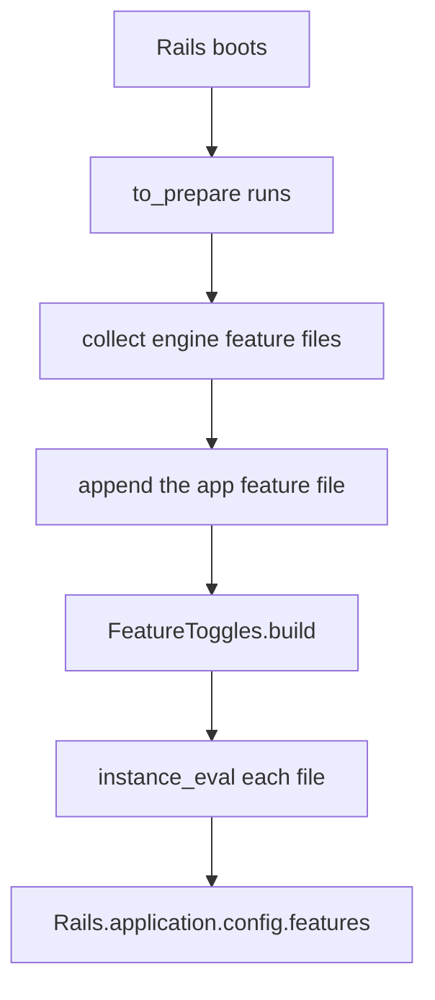
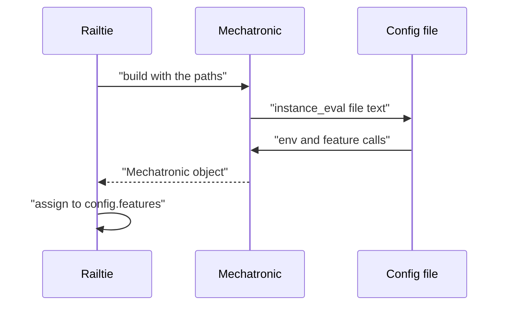

# 04 -- Loading config files and the Rails Railtie: one loader for Ruby and Rails

`FeatureToggles.build` takes file paths. Each file is read and evaluated in the
context of one `Mechatronic` object. The same loader serves plain Ruby and
Rails.

## Reading files

```ruby
# Source: lib/feature_toggles/mechatronic.rb, lines 13-21
def initialize(definition_file_paths = nil, &block)
  @features = {}

  definition_file_paths&.each do |file|
    instance_eval(File.read(file), file)
  end

  instance_eval(&block) if block
end
```

`instance_eval(File.read(file), file)` does two things. It runs the file's text
as Ruby with `self` set to the `Mechatronic` object. It also passes the file
name as the second argument, so Ruby prints that name in error stack traces.

Files run in the order given. Order matters. The `feature` method raises
`ArgumentError` on a duplicate name. So the first file that declares a name
wins, and a later file with the same name fails.

## The Rails Railtie

The gem ships a Railtie. It is required only when Rails is loaded:

```ruby
# Source: lib/feature_toggles.rb, line 14
require "feature_toggles/railtie" if defined?(Rails)
```

The Railtie makes `Rails.features` point at `Rails.application.config.features`
and loads every `config/features.rb` it can find:

```ruby
# Source: lib/feature_toggles/railtie.rb, lines 5-32
module Rails
  class << self
    delegate :features, to: "application.config"
  end
end

module FeatureToggles
  class Railtie < ::Rails::Railtie
    config.to_prepare do
      paths = []

      ::Rails.application.railties.each do |railtie|
        next unless railtie.respond_to?(:root)

        file = railtie.root.join("config", "features.rb")
        next unless file.exist?

        paths << file.to_s
      end

      # Rails-root features must be last to override engines' configuration
      file = ::Rails.root.join("config", "features.rb")
      paths << file.to_s if file.exist?

      Rails.application.config.features = FeatureToggles.build(paths.uniq)
    end
  end
end
```

`config.to_prepare` runs at boot and again before each request in development.
So the toggle list is rebuilt when code reloads.

The block collects `config/features.rb` from every railtie that responds to
`root`. Then it appends the application's own `config/features.rb` from
`Rails.root`. `paths.uniq` removes duplicate paths. The application file is
last.

One comment and the code disagree. The comment says the Rails-root file
"must be last to override engines' configuration". But `feature` raises
`ArgumentError` on a duplicate name. A later file cannot override. It fails the
boot. Prefer the code: the root file can add new features, but it cannot
redefine an engine's feature.

The spec fixtures show one engine feature and two application features:

```ruby
# Source: spec/internal/engines/foo/config/features.rb, line 3
feature(:foo_x) { |a: nil| a == 0 }
```

```ruby
# Source: spec/internal/config/features.rb, lines 3-5
feature(:x) { false }

feature(:y) { |a: nil| a == 0 }
```

The names do not collide. The Railtie spec expects all three to resolve:

```ruby
# Source: spec/lib/feature_toggles/railtie_spec.rb, lines 8-18
specify "without params", :aggregate_failures do
  expect(subject.enabled?(:x)).to eq false
  expect(subject.enabled?(:y)).to eq false
  expect(subject.enabled?(:foo_x)).to eq false
end

specify "with params", :aggregate_failures do
  expect(subject.enabled?(:x, a: 0)).to eq false
  expect(subject.enabled?(:y, a: 0)).to eq true
  expect(subject.enabled?(:foo_x, a: 0)).to eq true
end
```

## The load path





## The Aha Moment

**Aha:** Plain Ruby and Rails share one loader. Rails adds only two things: a
search for every `config/features.rb` file and a `to_prepare` hook that
rebuilds the list on reload. The railtie comment says the root file overrides
engines, but the code raises on a duplicate name, so the root file cannot
override. It can only add.

## Cross-References

- [01-config-dsl.md](./01-config-dsl.md) — the DSL the files contain.
- [03-runtime-api.md](./03-runtime-api.md) — the API that runs after loading.

Continue to [README.md](./README.md).
