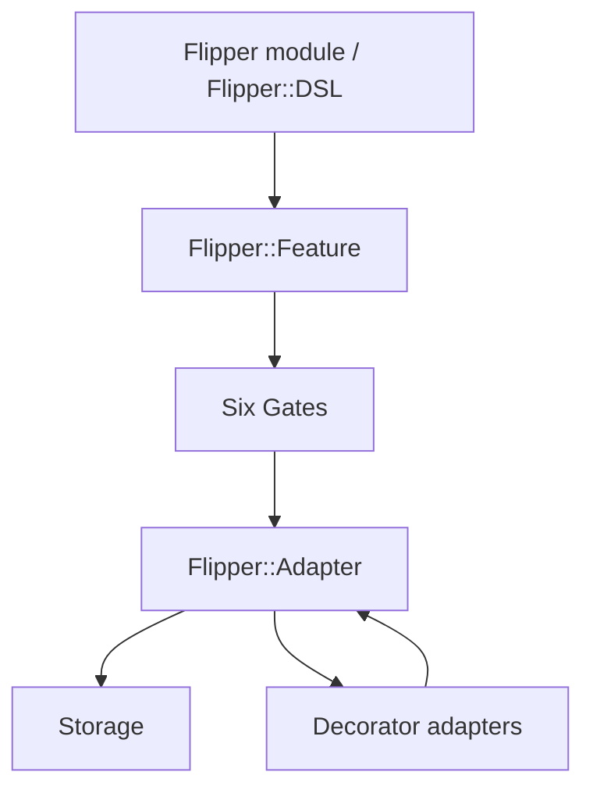
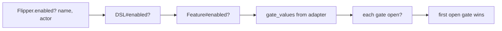

# 00 -- Flipper: one flag question, many storage backends

Flipper is a Ruby feature-flag library. A feature flag is a named switch in your code. You ask one question: is this feature on right now? You ask it the same way no matter where the answer is stored.

The repo is a monorepo of twelve gems. The core gem is `flipper`, version 1.4.2 (see `lib/flipper/version.rb`). Around it sit eleven adapter and front-end gems: `flipper-active_record`, `flipper-redis`, `flipper-sequel`, `flipper-mongo`, `flipper-moneta`, `flipper-dalli`, `flipper-active_support_cache_store`, `flipper-rollout`, `flipper-api`, `flipper-ui`, and `flipper-cloud`. All paths in this exploration are under `/Users/darkvoid/GitSources/src.Ruby/flipper/` unless stated otherwise.

The simplest use looks like this:

```ruby
# Source: README.md, lines 70-74
if Flipper.enabled?(:search, current_user)
  puts 'Search away!'
else
  puts 'No search for you!'
end
```

The module `Flipper` is the entry point. `Flipper.new(adapter)` builds a DSL (domain-specific language). `Flipper.enabled?`, `Flipper.enable`, and friends are forwarded to a per-thread default instance:

```ruby
# Source: lib/flipper.rb, lines 58-69 (trailing comment omitted)
def_delegators :instance,
               :enabled?, :enable, :disable,
               :enable_expression, :disable_expression,
               :expression, :add_expression, :remove_expression,
               :enable_actor, :disable_actor,
               :enable_group, :disable_group,
               :enable_percentage_of_actors, :disable_percentage_of_actors,
               :enable_percentage_of_time, :disable_percentage_of_time,
               :features, :feature, :[], :preload, :preload_all,
               :adapter, :adapter_stack, :add, :exist?, :remove, :import, :export,
               :memoize=, :memoizing?, :read_only?,
               :sync, :sync_secret
```

Those methods land on a `Flipper::DSL`, which holds the adapter and finds or builds one `Feature` per name:

```ruby
# Source: lib/flipper/dsl.rb, lines 39-51
def enabled?(name, *args)
  feature(name).enabled?(*args)
end

def enable(name, *args)
  feature(name).enable(*args)
end
```

## The layering

Flipper is not a flat pile of methods. It is four layers, each with one job.



The DSL is a thin finder of `Feature` objects. A `Feature` owns one flag name and does `enable`, `disable`, and `enabled?`. Six stateless Gates answer `open?` for that check: boolean, actor, group, percentage of actors, percentage of time, and expression. The Adapter persists and reads the raw gate values. Decorator adapters wrap other adapters to add memoization, instrumentation, strictness, failover, and caching.

One check threads through the whole stack:



## The storage contract in one place

Every adapter, from memory to a cloud HTTP call, promises the same shape. A feature's stored values are one hash of six keys:

```ruby
# Source: lib/flipper/adapter.rb, lines 10-19
def default_config
  {
    boolean: nil,
    groups: Set.new,
    actors: Set.new,
    expression: nil,
    percentage_of_actors: nil,
    percentage_of_time: nil,
  }
end
```

The `boolean` key holds on or off for everyone. The `groups` and `actors` keys hold sets. The two percentage keys hold numbers. The `expression` key holds a condition tree. This hash is the whole storage format. The rest of the library is logic around reading and writing it.

## The map of this exploration

- [01-feature-flag-core-api.md](./01-feature-flag-core-api.md) — the flag, actors, and the core enable/disable/enabled? API.
- [02-adapter-storage-contract.md](./02-adapter-storage-contract.md) — the adapter contract and the Memory reference.
- [03-groups-percentage-rollouts.md](./03-groups-percentage-rollouts.md) — groups and deterministic percentage bucketing.
- [04-gate-layer.md](./04-gate-layer.md) — the six gates and the check evaluation.
- [05-adapter-stack-instrumentation.md](./05-adapter-stack-instrumentation.md) — the decorator stack.
- [06-activerecord-redis-adapters.md](./06-activerecord-redis-adapters.md) — two real storage backends.
- [07-expressions.md](./07-expressions.md) — the condition-tree gate.
- [08-cloud-api-ui.md](./08-cloud-api-ui.md) — the cloud, API, and UI front ends.
- [09-composition.md](./09-composition.md) — how the parts fit together in a Rails app.

## Cross-References

- The core API and the actor type: [01-feature-flag-core-api.md](./01-feature-flag-core-api.md).
- The storage contract in full: [02-adapter-storage-contract.md](./02-adapter-storage-contract.md).

## The Aha Moment

**Aha:** Flipper's whole product is one frozen hash with six keys. The DSL, the Feature, the six Gates, and every adapter all exist only to move values into and out of that hash. Because the hash is the contract, any store that can hold a hash can be a flag backend — memory for tests, a database for production, or an HTTP call to a cloud service — and the code that asks `enabled?` never changes.

Continue to [01-feature-flag-core-api.md](./01-feature-flag-core-api.md).
