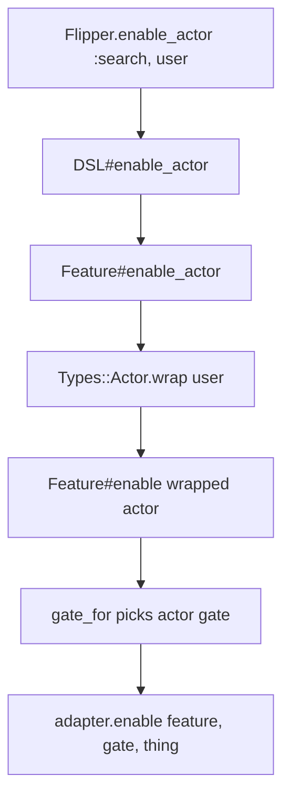
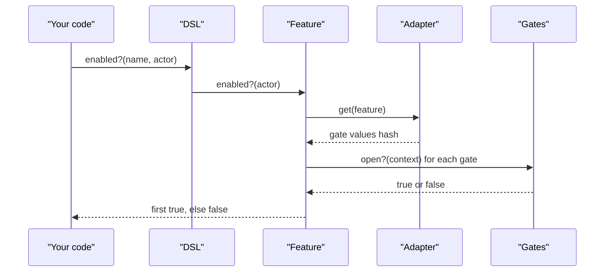

# 01 -- The feature flag and the core API: enable, disable, enabled?

A feature flag is a name plus a set of stored gate values. The name is a string or symbol, such as `:search`. The values say who can see it. You change the values with `enable` and `disable`. You ask the result with `enabled?`.

The public surface is small. `Flipper.enable(:search)` turns the feature on for everyone. `Flipper.enabled?(:search)` returns the answer. The module-level calls go to a per-thread default instance:

```ruby
# Source: lib/flipper.rb, lines 45-54
def instance
  Thread.current[:flipper_instance] ||= configuration.default
end

def instance=(flipper)
  Thread.current[:flipper_instance] = flipper
end
```

The instance is a `Flipper::DSL`, built by `Flipper.new(adapter, options)`:

```ruby
# Source: lib/flipper.rb, lines 12-14
def new(adapter, options = {})
  DSL.new(adapter, options)
end
```

`Flipper.configure` sets up a global adapter and a default block. The default is a Memory adapter until you change it:

```ruby
# Source: lib/flipper/configuration.rb, lines 3-6
def initialize(options = {})
  @builder = AdapterBuilder.new { store Flipper::Adapters::Memory }
  @default = -> { Flipper.new(@builder.to_adapter) }
end
```

## Targeting something specific

`enable` and `disable` take one optional "thing". The thing decides which gate stores it. Pass `true` for everyone, an actor object for one user, a group name for a set, or an expression hash for a condition. A bare number is not a thing: no gate protects a plain integer, so `Flipper.enable(:search, 25)` raises `GateNotFound`. Percentages use their own methods. The Feature wraps the thing in a type and picks the right gate:

```ruby
# Source: lib/flipper/feature.rb, lines 55-76
def enable(thing = true)
  enable_thing(thing, validate_expression: true)
end

def disable(thing = false)
  instrument(:disable) do |payload|
    adapter.add self

    gate = gate_for(thing)
    wrapped_thing = gate.wrap(thing)
    payload[:gate_name] = gate.name
    payload[:thing] = wrapped_thing

    adapter.disable self, gate, wrapped_thing
  end
end
```

A percentage is written through a dedicated method, which wraps the number in a
type before `enable` sees it:

```ruby
# Source: lib/flipper/feature.rb, lines 195-196
def enable_percentage_of_actors(percentage)
  enable Types::PercentageOfActors.wrap(percentage)
end
```

`Flipper.enable_percentage_of_actors(:search, 25)` turns the feature on for 25%
of actors. `enable_percentage_of_time` wraps a `Types::PercentageOfTime` the
same way.

The actor case is the common one. An actor is any object that responds to `flipper_id`. The `Types::Actor` wrapper reads that identifier into a string value:

```ruby
# Source: lib/flipper/types/actor.rb, lines 11-20
def initialize(actor)
  raise ArgumentError, 'actor cannot be nil' if actor.nil?

  unless actor.respond_to?(:flipper_id)
    raise ArgumentError, "#{actor.inspect} must respond to flipper_id, but does not"
  end

  @actor = actor
  @value = actor.flipper_id.to_s
end
```

A module supplies a default `flipper_id` for objects with an `id`:

```ruby
# Source: lib/flipper/identifier.rb, lines 13-15
def flipper_id
  "#{self.class.name};#{id}"
end
```

So `User.new(99)` with `Flipper::Identifier` included has the identifier `"User;99"`.

## The flow of one enable call



The DSL simply forwards to the Feature. `Feature#enable_actor` wraps the user, then calls `enable`, which finds the gate that protects actors and writes to the adapter:

```ruby
# Source: lib/flipper/feature.rb, lines 159-167
def enable_actor(actor)
  enable Types::Actor.wrap(actor)
end
```

## The flow of one check

`enabled?` reads the stored values once, then asks each gate whether it is open:

```ruby
# Source: lib/flipper/feature.rb, lines 109-127
def enabled?(*actors)
  actors = wrap_actors(actors)

  instrument(:enabled?, thing: actors&.first, actors: actors) do |payload|
    context = FeatureCheckContext.new(
      feature_name: @name,
      values: gate_values,
      actors: actors
    )

    if open_gate = gates.detect { |gate| gate.open?(context) }
      payload[:gate_name] = open_gate.name
      true
    else
      false
    end
  end
end
```



## Cross-References

- The gate layer that decides `open?`: [04-gate-layer.md](./04-gate-layer.md).
- How the adapter stores those values: [02-adapter-storage-contract.md](./02-adapter-storage-contract.md).

## The Aha Moment

**Aha:** `enable` and `enabled?` are two different questions handled by the same objects. `enable` is a write: wrap the thing in a type, find the gate that protects it, and store the value. `enabled?` is a read: load all six values once, then let the gates vote. The symmetry comes from the fact that a "thing" already knows its gate — a boolean goes to the boolean gate, an actor to the actor gate, a wrapped percentage to a percentage gate — so there is one generic `enable` and thin wrappers that only build the right type.

Continue to [02-adapter-storage-contract.md](./02-adapter-storage-contract.md).
