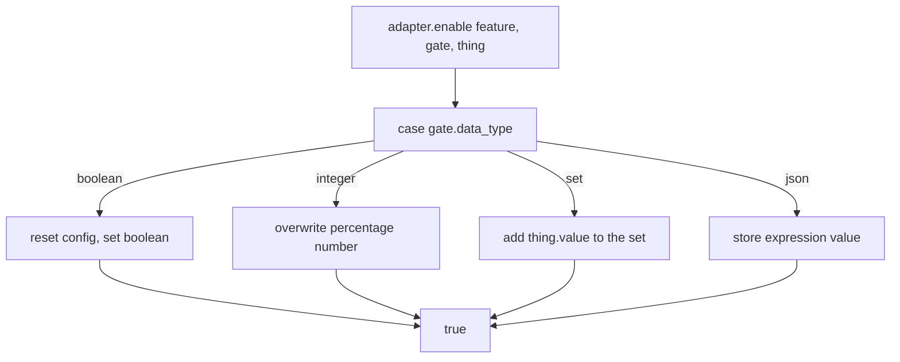
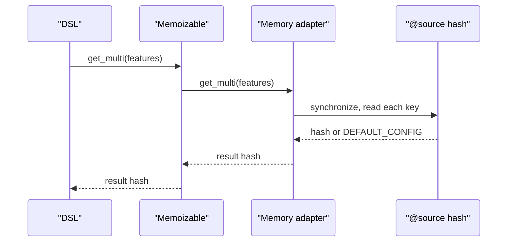

# 02 -- The adapter contract: memory as the reference

An adapter is any Ruby object that includes `Flipper::Adapter` and implements a small set of methods. The Feature and the Gates never talk to a store directly. They talk to the adapter. The contract is eleven methods.

The read side: `features` (the set of known names), `get` (one feature's gate values), `get_multi` (several at once), `get_all` (everything). The write side: `add`, `remove`, `clear`, `enable`, `disable`. The transfer side: `import` and `export`. Of these, `features`, `get`, `add`, `remove`, `clear`, `enable`, and `disable` must be implemented (they are undefined in `lib/flipper/adapter.rb`); `get_multi`, `get_all`, `import`, and `export` have default implementations.

The `Flipper::Adapter` module supplies defaults and two helpers. The default name is derived from the class name, and `adapter_stack` prints the chain of wrapped adapters:

```ruby
# Source: lib/flipper/adapter.rb, lines 72-75 and 85-91
def name
  @name ||= self.class.name.split('::').last.split(/(?=[A-Z])/).join('_').downcase.to_sym
end

def adapter_stack
  if respond_to?(:adapter) && adapter
    "#{name} -> #{adapter.adapter_stack}"
  else
    name.to_s
  end
end
```

So `Flipper::Adapters::ActiveRecord` is named `:active_record`, and a memoized wrapper over it prints `"memoizable -> active_record"`.

## Memory as the reference

The Memory adapter is the reference implementation. It stores everything in one hash, keyed by feature name, and each value is the default config hash. Unknown features get a frozen shared config:

```ruby
# Source: lib/flipper/adapters/memory.rb, lines 11-13
# Private: Shared frozen config for unknown features. Gate values
# returned by get are treated as read-only.
DEFAULT_CONFIG = default_config.each_value(&:freeze).freeze
```

A read returns the stored hash or that frozen default:

```ruby
# Source: lib/flipper/adapters/memory.rb, lines 46-48
def get(feature)
  synchronize { @source[feature.key] } || DEFAULT_CONFIG
end
```

The write path is the interesting part. `enable` and `disable` switch on the gate's `data_type` — `:boolean`, `:integer`, `:set`, or `:json` — because each type stores differently. A boolean resets the whole config and sets the boolean key. An integer overwrites the number. A set adds the value. A JSON value stores the expression tree:

```ruby
# Source: lib/flipper/adapters/memory.rb, lines 65-85
def enable(feature, gate, thing)
  synchronize do
    @source[feature.key] ||= default_config

    case gate.data_type
    when :boolean
      @source[feature.key] = default_config
      @source[feature.key][gate.key] = thing.value.to_s
    when :integer
      @source[feature.key][gate.key] = thing.value.to_s
    when :set
      @source[feature.key][gate.key] << thing.value.to_s
    when :json
      @source[feature.key][gate.key] = thing.value
    else
      raise "#{gate} is not supported by this adapter yet"
    end

    true
  end
end
```



A mutex wraps every operation when the adapter is built thread-safe (the default), so a shared Memory adapter is safe across threads. The initializer accepts a source hash and normalizes it:

```ruby
# Source: lib/flipper/adapters/memory.rb, lines 16-19
def initialize(source = nil, threadsafe: true)
  @source = Typecast.features_hash(source)
  @lock = Mutex.new if threadsafe
end
```

## The storage format

The adapter does not invent its own format. `default_config` is the format, and `Typecast.features_hash` normalizes anything coming in so keys are symbols, arrays become sets, and values are coerced to strings:

```ruby
# Source: lib/flipper/typecast.rb, lines 91-108
def self.features_hash(source)
  normalized_source = {}
  (source || {}).each do |feature_key, gates|
    normalized_source[feature_key] ||= {}
    gates.each do |gate_key, value|
      normalized_value = case value
      when Array, Set
        value.to_set
      when Hash
        value
      else
        value ? value.to_s : value
      end
      normalized_source[feature_key][gate_key.to_sym] = normalized_value
    end
  end
  normalized_source
end
```



## Cross-References

- The raw values are shaped back into types by GateValues in [04-gate-layer.md](./04-gate-layer.md).
- Two real adapters implement this same contract over a database and Redis in [06-activerecord-redis-adapters.md](./06-activerecord-redis-adapters.md).

## The Aha Moment

**Aha:** The adapter contract is the storage format. `default_config` is not just a helper — it is the serialized state of every flag in the system, and `enable`/`disable` are just a `case` statement over the four data types (`boolean`, `integer`, `set`, `json`). Any backend can implement Flipper by translating those four writes and three reads onto its own primitives. Memory does it with a hash and a mutex; everything else is the same contract over a bigger store.

Continue to [03-groups-percentage-rollouts.md](./03-groups-percentage-rollouts.md).
