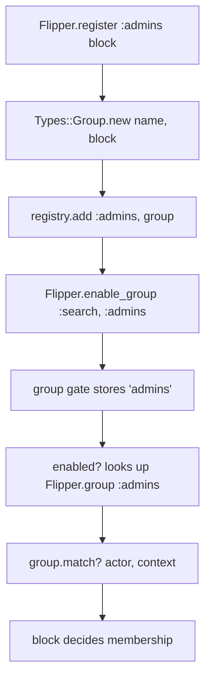
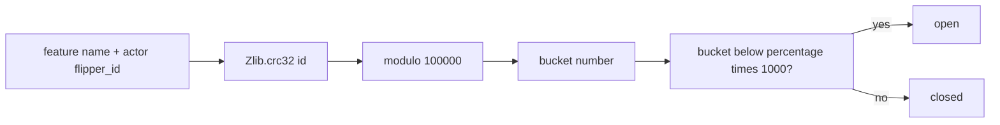

# 03 -- Groups and percentage rollouts: targeting many actors

Boolean and actor gates target everyone or one actor. Two more gates target many actors at once: groups and percentage of actors. A group is a named predicate. A percentage is a deterministic bucket over actor identifiers. A fifth gate, percentage of time, is random per check.

## Groups

A group is a name plus a block that answers whether an actor belongs. You register it once:

```ruby
# Source: lib/flipper.rb, lines 133-139
def register(name, &block)
  group = Types::Group.new(name, &block)
  groups_registry.add(group.name, group)
  group
rescue Registry::DuplicateKey
  raise DuplicateGroup, "Group #{name.inspect} has already been registered"
end
```

The block may take one argument (the actor) or two (the actor and the check context). `Types::Group` detects the arity at registration time and calls accordingly:

```ruby
# Source: lib/flipper/types/group.rb, lines 24-37
def match?(actor, context)
  if @single_argument
    @block.call(actor)
  else
    @block.call(actor, context)
  end
end

NO_PARAMS_IN_RUBY_3 = [[:req], [:rest]]
def call_with_no_context?(block)
  return true if block.parameters == NO_PARAMS_IN_RUBY_3

  block.arity.abs == 1
end
```

`Flipper.group(name)` looks the group up by name, and falls back to an unregistered group whose block always returns false. This is why enabling an unregistered group is safe but matches nobody:

```ruby
# Source: lib/flipper.rb, lines 176-178
def group(name)
  groups_registry.get(name) || Types::Group.new(name)
end
```



## Percentage of actors

A percentage rollout enables a feature for a stable fraction of actors. The gate hashes the feature name plus the actor identifier with CRC32, and takes the result modulo 100000 to compare against the percentage:

```ruby
# Source: lib/flipper/gates/percentage_of_actors.rb, lines 32-53
def open?(context)
  return false unless context.actors?

  percentage = context.values.percentage_of_actors
  return false if percentage <= 0
  return true if percentage >= 100

  actors = context.actors
  id = if actors.size == 1
    "#{context.feature_name}#{actors.first.value}"
  else
    "#{context.feature_name}#{actors.map(&:value).sort.join}"
  end
  Zlib.crc32(id) % (100 * SCALING_FACTOR) < percentage * SCALING_FACTOR
end
```

The constant `SCALING_FACTOR` is 1000, so percentages carry up to three decimal places. The gate sorts multiple actor values before hashing, so the same set of actors hashes the same way regardless of order. CRC32 is deterministic, so the same actor always lands in the same bucket across processes and restarts. This is the property that makes a "2 percent rollout" meaningful.



## Percentage of time

Percentage of time does not bucket anyone. It compares a random number against the percentage on every check:

```ruby
# Source: lib/flipper/gates/percentage_of_time.rb, lines 25-30
def open?(context)
  percentage = context.values.percentage_of_time
  return false if percentage <= 0
  return true if percentage >= 100
  rand < (percentage / 100.0)
end
```

A 10 percent of time flag returns true about one time in ten, independent of the actor. This suits rate-limiting or canary sampling, not stable per-user rollouts.

## The percentage type

All percentage values share one guard. The value must be a number from 0 through 100, inclusive, and is converted with `Typecast.to_number` first:

```ruby
# Source: lib/flipper/types/percentage.rb, lines 6-15
def initialize(value)
  value = Typecast.to_number(value)

  if value < 0 || value > 100
    raise ArgumentError,
          "value must be a positive number less than or equal to 100, but was #{value}"
  end

  @value = value
end
```

`PercentageOfActors` and `PercentageOfTime` are empty subclasses of `Percentage` (`lib/flipper/types/percentage_of_actors.rb` and `lib/flipper/types/percentage_of_time.rb`). The subclass name is what routes a number to the right gate.

## Cross-References

- The group and percentage gates run inside the check loop described in [04-gate-layer.md](./04-gate-layer.md).
- The expression gate and its condition tree: [07-expressions.md](./07-expressions.md).

## The Aha Moment

**Aha:** A percentage rollout is a hash function, not a random draw. Flipper computes `Zlib.crc32(feature + flipper_id)` and compares the bucket to the threshold. That makes the rollout stable: one actor is always in or always out, which is what a gradual rollout needs. Percentage of time is the opposite — it is a coin flip per check — and that single difference is why the two gates have different names despite both being called "percentage."

Continue to [04-gate-layer.md](./04-gate-layer.md).
