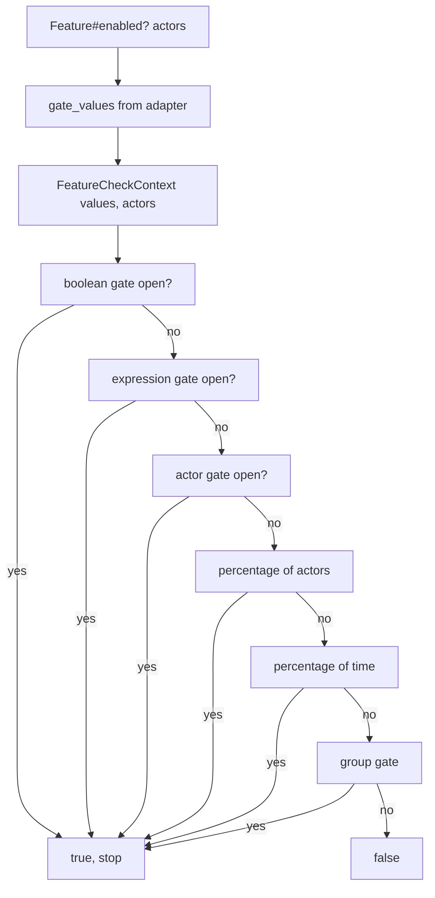
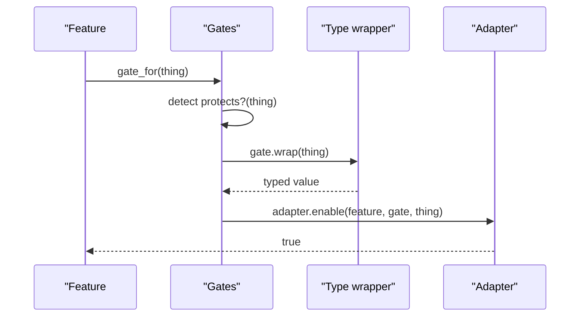

# 04 -- The gate layer: how a check is evaluated

A gate answers one question: is this feature open for this context? There are six gates: boolean, expression, actor, percentage of actors, percentage of time, and group. Gates hold no state, so every feature shares the same six instances:

```ruby
# Source: lib/flipper/feature.rb, lines 15-22
GATES_HASH = {
  boolean: Gates::Boolean.new,
  expression: Gates::Expression.new,
  actor: Gates::Actor.new,
  percentage_of_actors: Gates::PercentageOfActors.new,
  percentage_of_time: Gates::PercentageOfTime.new,
  group: Gates::Group.new,
}.freeze
```

The base class declares the interface every gate implements:

```ruby
# Source: lib/flipper/gate.rb, lines 8-44 (doc comments omitted)
def name
  raise 'Not implemented'
end

def key
  raise 'Not implemented'
end

def data_type
  raise 'Not implemented'
end

def enabled?(value)
  raise 'Not implemented'
end

def open?(context)
  false
end

def protects?(actor)
  false
end

def wrap(actor)
  actor
end
```

Three ideas live in these methods. `name` labels the gate. `key` names the slot in the storage hash (`:actors`, `:groups`, and so on). `data_type` tells the adapter how to store it. `enabled?` answers whether the stored value alone is non-empty (used for feature state). `open?` answers the live check. `protects?` routes a "thing" to the gate that handles it. `wrap` turns the thing into a typed value.

## Two steps: wrap the thing, then check the context

A write call does not name the gate. It passes a thing, and `gate_for` finds the gate whose `protects?` matches:

```ruby
# Source: lib/flipper/feature.rb, lines 445-447
def gate_for(actor)
  gates.detect { |gate| gate.protects?(actor) } || raise(GateNotFound, actor)
end
```

For example, the actor gate protects objects the actor type can wrap, and the group gate protects group types and symbols:

```ruby
# Source: lib/flipper/gates/actor.rb, lines 40-42
def protects?(actor)
  Types::Actor.wrappable?(actor)
end
```

```ruby
# Source: lib/flipper/gates/group.rb, lines 39-41
def protects?(thing)
  thing.is_a?(Types::Group) || thing.is_a?(Symbol)
end
```

A read call builds a context and lets every gate vote:



The first open gate wins. That order is fixed: boolean, expression, actor, percentage of actors, percentage of time, group. Order matters for short-circuiting and for which gate is reported as the winner.

## Shaping raw values

The adapter returns a hash of raw values. `GateValues` shapes each one into a usable type, so the gates never see strings when they expect sets or numbers:

```ruby
# Source: lib/flipper/gate_values.rb, lines 13-20
def initialize(adapter_values)
  @boolean = Typecast.to_boolean(adapter_values[:boolean])
  @actors = Typecast.to_set(adapter_values[:actors])
  @groups = Typecast.to_set(adapter_values[:groups])
  @expression = adapter_values[:expression]
  @percentage_of_actors = Typecast.to_number(adapter_values[:percentage_of_actors])
  @percentage_of_time = Typecast.to_number(adapter_values[:percentage_of_time])
end
```

The context carries the feature name, those values, and the wrapped actors, plus convenience readers:

```ruby
# Source: lib/flipper/feature_check_context.rb, lines 13-21 (comment omitted)
def initialize(feature_name:, values:, actors:)
  @feature_name = feature_name
  @values = values
  @actors = actors
end

def actors?
  !@actors.nil? && !@actors.empty?
end
```

The actor gate shows the full pattern of a check: require at least one actor, read the enabled actor set, and test membership by the actor's string value:

```ruby
# Source: lib/flipper/gates/actor.rb, lines 25-34
def open?(context)
  return false unless context.actors?

  enabled_actors = context.values.actors
  return false if enabled_actors.empty?

  context.actors.any? do |actor|
    enabled_actors.include?(actor.value)
  end
end
```

The group gate is similar but asks each enabled group whether it matches any of the actors:

```ruby
# Source: lib/flipper/gates/group.rb, lines 25-33
def open?(context)
  return false unless context.actors?

  context.values.groups.any? do |name|
    context.actors.any? do |actor|
      Flipper.group(name).match?(actor, context)
    end
  end
end
```

## Feature state from gate values

The write path is the mirror image: one thing, one gate, one adapter call.



The same gates also classify the feature as `:on`, `:off`, or `:conditional`. A feature is on when its boolean gate is true or its percentage of time is 100; otherwise, if any other gate is enabled it is conditional; otherwise it is off:

```ruby
# Source: lib/flipper/feature.rb, lines 274-286
def state
  values = gate_values
  boolean = gate(:boolean)
  non_boolean_gates = gates - [boolean]

  if values.boolean || values.percentage_of_time == 100
    :on
  elsif non_boolean_gates.detect { |gate| gate.enabled?(values.send(gate.key)) }
    :conditional
  else
    :off
  end
end
```

## Cross-References

- The boolean, actor, group, and percentage gates are opened in this loop; their individual logic is in [03-groups-percentage-rollouts.md](./03-groups-percentage-rollouts.md) and [07-expressions.md](./07-expressions.md).
- The adapter side that produces the raw values is [02-adapter-storage-contract.md](./02-adapter-storage-contract.md).

## The Aha Moment

**Aha:** Gates are stateless predicates, and a check is a fold over them. `Feature#enabled?` builds one context object from the adapter's six raw values, then runs `gates.detect { |g| g.open?(context) }`. Because each gate reads only the context and never mutates it, the check is a pure function of the stored values and the actors — which is exactly what makes it safe to memoize, replay, and cache (see the next document).

Continue to [05-adapter-stack-instrumentation.md](./05-adapter-stack-instrumentation.md).
