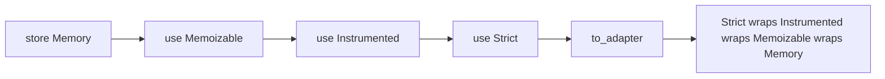
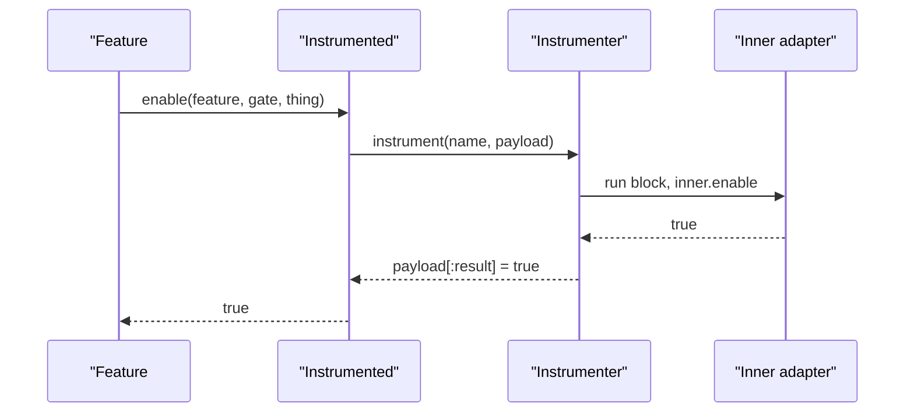

# 05 -- The decorated adapter stack: memoize, instrument, enforce

Flipper's power comes from wrapping adapters. A decorator adapter takes another adapter, adds one behavior, and exposes the same eleven-method contract. You stack them like an onion. The `AdapterBuilder` assembles the stack:

```ruby
# Source: lib/flipper/adapter_builder.rb, lines 10-18
class AdapterBuilder
  def initialize(&block)
    @stack = []

    # Default to memory adapter
    store Flipper::Adapters::Memory

    block.arity == 0 ? instance_eval(&block) : block.call(self) if block
  end
```

`store` sets the innermost adapter. `use` pushes a wrapper onto the stack. `to_adapter` folds the wrappers over the store, outermost first:

```ruby
# Source: lib/flipper/adapter_builder.rb, lines 40-42
def to_adapter
  @stack.reverse.inject(@store.call) { |adapter, wrapper| wrapper.call(adapter) }
end
```



`Flipper::Configuration` drives the same builder for the global instance. `adapter` reads or sets the store; `use` adds a wrapper; `default` sets the block that builds the DSL:

```ruby
# Source: lib/flipper/configuration.rb, lines 25-31
def adapter(&block)
  if block_given?
    @builder.store(block)
  else
    @builder.to_adapter
  end
end
```

## Memoizable: cache per request

The DSL wraps your adapter in `Memoizable` by default (`lib/flipper/dsl.rb` line 25: `adapter = Adapters::Memoizable.new(adapter) if memoize`). When memoization is on, `get` caches each feature's values:

```ruby
# Source: lib/flipper/adapters/memoizable.rb, lines 54-60
def get(feature)
  if memoizing?
    cache.fetch(key_for(feature.key)) { cache[key_for(feature.key)] = @adapter.get(feature) }
  else
    @adapter.get(feature)
  end
end
```

Memoization is off by default and turned on per request by the middleware. Any write expires the relevant cache entry:

```ruby
# Source: lib/flipper/adapters/memoizable.rb, lines 133-144
def memoize=(value)
  cache.clear
  @memoize = value
end

def memoizing?
  !!@memoize
end
```

This means one request can ask `enabled?` for the same feature many times but hit the underlying store once.

## Instrumented: events on every operation

`Instrumented` wraps an adapter and emits an event for each operation. The event name is `"adapter_operation.flipper"`, and the payload carries the operation, adapter name, feature name, gate name, and the value being written:

```ruby
# Source: lib/flipper/adapters/instrumented.rb, lines 116-128
def enable(feature, gate, thing)
  default_payload = {
    operation: :enable,
    adapter_name: @adapter.name,
    feature_name: feature.name,
    gate_name: gate.name,
    thing_value: thing.value,
  }

  @instrumenter.instrument(InstrumentationName, default_payload) do |payload|
    payload[:result] = @adapter.enable(feature, gate, thing)
  end
end
```

The instrumenter is pluggable. The default is `Instrumenters::Noop`, which just yields:

```ruby
# Source: lib/flipper/instrumenters/noop.rb, lines 3-7
class Noop
  def self.instrument(_name, payload = {})
    yield payload if block_given?
  end
end
```

Pass `ActiveSupport::Notifications` (via the Rails engine) or a custom instrumenter to receive the events.



## Strict and ActorLimit: enforce rules

`Strict` is a wrapper that raises when you check a feature that was never added, so typos fail loudly instead of silently returning false. The handler can be `:raise`, `:warn`, a proc, or `:noop`:

```ruby
# Source: lib/flipper/adapters/strict.rb, lines 59-71
def assert_feature_exists(feature)
  return if self.class.sync_mode
  return if @adapter.features.include?(feature.key)

  case handler
  when Proc then handler.call(feature)
  when :warn then warn NotFound.new(feature.key).message
  when :noop, false, nil
   # noop
  else # truthy or :raise
   raise NotFound.new(feature.key)
  end
end
```

`ActorLimit` is another wrapper that raises when a feature's actor gate would exceed a limit, protecting adapters that slow down with thousands of rows:

```ruby
# Source: lib/flipper/adapters/actor_limit.rb, lines 39-45
def enable(feature, gate, resource)
  if gate.is_a?(Flipper::Gates::Actor) && !self.class.sync_mode && over_limit?(feature)
    raise LimitExceeded, "Actor limit of #{@limit} exceeded for feature #{feature.key}. See https://www.flippercloud.io/docs/features/actors#limitations"
  else
    super
  end
end
```

Each wrapper has its own thread-local sync mode that suspends enforcement while a background sync brings local state in line with a remote source, so sync does not trip its own guardrails.

## Cross-References

- The base `Wrapper` class and the full set of decorators (failover, failsafe, dual write, read-only) are summarized in [09-composition.md](./09-composition.md).
- The Rails engine wires Memoizable, Strict, and ActorLimit for you: [09-composition.md](./09-composition.md).

## The Aha Moment

**Aha:** Behavior is added by wrapping, not by subclassing the store. `Memoizable`, `Instrumented`, `Strict`, and `ActorLimit` are each an object with the same adapter interface that holds another adapter and forwards to it, doing one extra thing on the way. The `AdapterBuilder` is the proof: `use` pushes a wrapper and `store` sets the base, and `to_adapter` folds them into one object — so configuration is literally a list of `use` calls, and the printed `adapter_stack` string shows that list back to you.

Continue to [06-activerecord-redis-adapters.md](./06-activerecord-redis-adapters.md).
