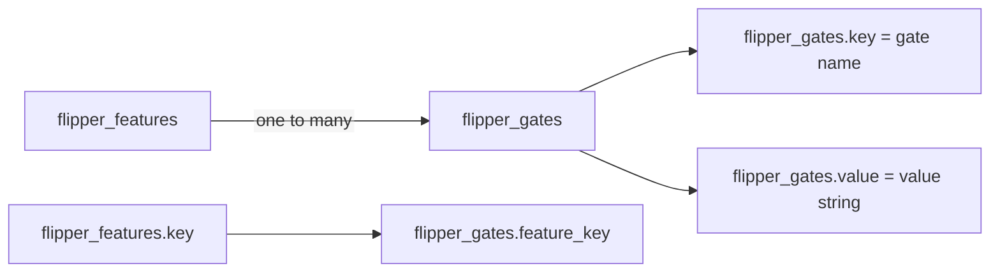
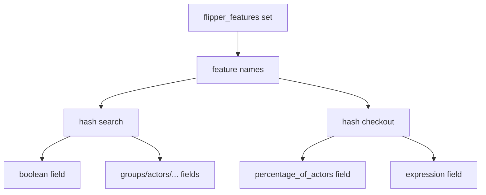

# 06 -- Two real adapters: ActiveRecord and Redis

Every storage backend implements the same eleven-method contract. Two real adapters show the two common shapes: a relational database with two tables, and a key-value store with a set plus one hash per feature.

## ActiveRecord: two tables

The ActiveRecord adapter stores features in a `flipper_features` table and gate values in a `flipper_gates` table. The generator creates both:

```ruby
# Source: lib/generators/flipper/templates/migration.erb, lines 9-21 (ERB suffix omitted)
create_table <%= feature_table.inspect %> do |t|
  t.string :key, null: false
  t.timestamps null: false
end
add_index <%= feature_table.inspect %>, :key, unique: true

create_table <%= gate_table.inspect %> do |t|
  t.string :feature_key, null: false
  t.string :key, null: false
  t.text :value
  t.timestamps null: false
end
add_index <%= gate_table.inspect %>, [:feature_key, :key, :value], unique: true, length: { value: 255 }
```



Each enabled actor or group is its own gate row, so a feature with many actors has many rows. The adapter maps rows back to the six-key hash shape. `get` pulls the rows for one feature and buckets them by gate key:

```ruby
# Source: lib/flipper/adapters/active_record.rb, lines 90-93
def get(feature)
  gates = with_connection(@gate_class) { @gate_class.where(feature_key: feature.key).pluck(:key, :value) }
  result_for_gates(feature, gates)
end
```

The `enable` and `disable` methods switch on the gate's `data_type` just like Memory, but translate each type into row operations. A boolean clears then sets one row. A set inserts a row, ignoring a duplicate-key error:

```ruby
# Source: lib/flipper/adapters/active_record.rb, lines 147-162
def enable(feature, gate, thing)
  case gate.data_type
  when :boolean
    set(feature, gate, thing, clear: true)
  when :integer
    set(feature, gate, thing)
  when :json
    set(feature, gate, thing, json: true)
  when :set
    enable_multi(feature, gate, thing)
  else
    unsupported_data_type gate.data_type
  end

  true
end
```

`get_all` joins the two tables with an outer join and reads everything in one query, then groups the rows and rebuilds the hash for each feature (`lib/flipper/adapters/active_record.rb` lines 112-138).

## Redis: one set and one hash per feature

The Redis adapter stores the list of feature names in a set at `flipper_features`, and each feature's gate values in one hash. The key for a feature is its name, optionally prefixed:

```ruby
# Source: lib/flipper/adapters/redis.rb, lines 14-20
def features_key
  "#{key_prefix}flipper_features"
end

def key_for(feature_name)
  "#{key_prefix}#{feature_name}"
end
```



`enable` writes the gate into the feature's hash. A boolean clears the hash first and sets the boolean field. A set writes a field of the form `gate/value`. A JSON gate stores the serialized expression:

```ruby
# Source: lib/flipper/adapters/redis.rb, lines 94-112
def enable(feature, gate, thing)
  ensure_not_features_key!(feature)
  feature_key = key_for(feature.key)
  case gate.data_type
  when :boolean
    clear(feature)
    with_connection { |conn| conn.hset feature_key, gate.key, thing.value.to_s }
  when :integer
    with_connection { |conn| conn.hset feature_key, gate.key, thing.value.to_s }
  when :set
    with_connection { |conn| conn.hset feature_key, to_field(gate, thing), 1 }
  when :json
    with_connection { |conn| conn.hset feature_key, gate.key, Typecast.to_json(thing.value) }
  else
    unsupported_data_type gate.data_type
  end

  true
end
```

On the read side, set-valued gates are stored as fields prefixed with `gate/`, and the adapter re-derives the set by grepping the field names:

```ruby
# Source: lib/flipper/adapters/redis.rb, lines 215-227
def to_field(gate, thing)
  "#{gate.key}/#{thing.value}"
end

def fields_to_gate_value(fields, gate)
  regex = %r{^#{Regexp.escape(gate.key.to_s)}/}
  keys = fields.grep(regex)
  values = keys.map { |key| key.split('/', 2).last }
  values.to_set
end
```

So an actor with `flipper_id` of `"User;99"` enabled on feature `search` becomes the Redis hash field `"actors/User;99"` with value `1`. `get_multi` uses a Redis pipeline to fetch many hashes in one round trip (`lib/flipper/adapters/redis.rb` lines 182-190).

Both adapters register themselves as the default global adapter when their entry file loads, so `require "flipper/adapters/redis"` (or the `flipper-redis` gem) makes `Flipper` use Redis without further setup.

## Cross-References

- The four data types both adapters switch on come from the gate contract in [02-adapter-storage-contract.md](./02-adapter-storage-contract.md).
- The Memory adapter performs the same dispatch with a plain hash, shown in [02-adapter-storage-contract.md](./02-adapter-storage-contract.md).

## The Aha Moment

**Aha:** Storage backends differ only in how they map the six-key hash onto their primitives. ActiveRecord maps a set to many rows and a boolean to a clear-then-insert; Redis maps a set to fields of a hash and a boolean to a single field. The four data types (`boolean`, `integer`, `set`, `json`) are the Rosetta stone — once an adapter can encode and decode those four, it is a complete Flipper backend, and every other concern (gates, groups, percentages, expressions) comes for free.

Continue to [07-expressions.md](./07-expressions.md).
