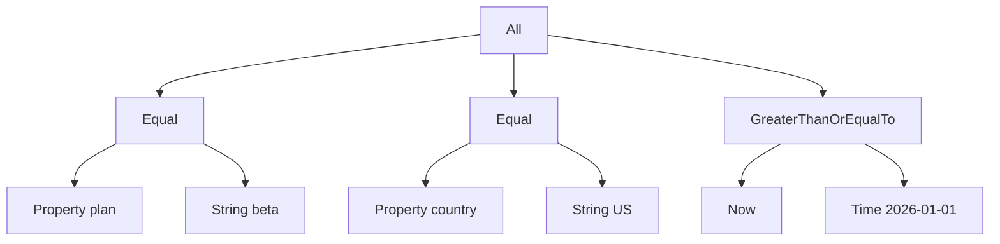

# 07 -- Expressions: a condition tree as a gate

The expression gate stores a condition tree instead of a simple value. An expression is a nested structure of named functions and constants. You can target "users on the beta plan in the US after a date" as one flag rule. The tree is built from a hash and evaluated against actor properties.

`Expression.build` converts a hash, string, number, boolean, or symbol into an expression. A hash's first key names the function and its value supplies the arguments, recursively built:

```ruby
# Source: lib/flipper/expression.rb, lines 11-30
def self.build(object)
  return object if object.is_a?(self) || object.is_a?(Constant)

  case object
  when Hash
    name = object.keys.first
    args = object.values.first
    unless name
      raise ArgumentError, "#{object.inspect} cannot be converted into an expression"
    end

    new(name, Array(args).map { |o| build(o) })
  when String, Numeric, FalseClass, TrueClass
    Expression::Constant.new(object)
  when Symbol
    Expression::Constant.new(object.to_s)
  else
    raise ArgumentError, "#{object.inspect} cannot be converted into an expression"
  end
end
```

`evaluate` resolves each argument and calls the function, passing the context to functions that declare a `context` keyword:

```ruby
# Source: lib/flipper/expression.rb, lines 43-49
def evaluate(context = {})
  if call_with_context?
    function.call(*args.map {|arg| arg.evaluate(context) }, context: context)
  else
    function.call(*args.map {|arg| arg.evaluate(context) })
  end
end
```



## The builder DSL

A fluent builder wraps the hash form. `any`, `all`, `equal`, and the comparison methods build new expressions:

```ruby
# Source: lib/flipper/expression/builder.rb, lines 8-27
def add(*expressions)
  group? ? build(name => args + expressions.flatten) : any.add(*expressions)
end

def remove(*expressions)
  group? ? build(name => args - expressions.flatten) : any.remove(*expressions)
end

def any
  any? ? self : build({ Any: [self] })
end

def all
  all? ? self : build({ All: [self] })
end

def equal(object)
  build({ Equal: [self, object] })
end
alias eq equal
```

The module-level helpers build leaves directly. `Flipper.property(:plan)` reads an actor property, `Flipper.string("beta")` is a constant, `Flipper.number(5)` a number, `Flipper.random(100)` a random draw, and `Flipper.now` the current time:

```ruby
# Source: lib/flipper.rb, lines 71-105 (selected helpers)
def any(*args)
  Expression.build({ Any: args.flatten })
end

def all(*args)
  Expression.build({ All: args.flatten })
end

def property(name)
  Expression.build({ Property: name })
end

def string(value)
  Expression.build({ String: value })
end

def number(value)
  Expression.build({ Number: value })
end

def boolean(value)
  Expression.build({ Boolean: value })
end

def random(max)
  Expression.build({ Random: max })
end

def now
  Expression.build({ Now: [] })
end
```

## How the gate evaluates it

Evaluation is a recursive descent from the root node to the constants, with the `Property` leaf reading actor state.

```mermaid
%%{init: {"sequence": {"htmlLabels": false}}}%%
sequenceDiagram
  participant Gate as "Expression gate"
  participant Expr as "Expression"
  participant Fn as "Functions"
  participant Actor as "Actor properties"

  Gate->>Expr: build(stored data)
  Gate->>Expr: evaluate(context) per actor
  Expr->>Fn: All / Equal / Property calls
  Fn->>Actor: Property digs flipper_properties
  Actor-->>Fn: value
  Fn-->>Expr: boolean
  Expr-->>Gate: true or false
```

The expression gate reads the stored tree, then evaluates it once per actor. If no actor is given, it evaluates with empty properties and a nil actor:

```ruby
# Source: lib/flipper/gates/expression.rb, lines 27-39
def open?(context)
  data = context.values.expression
  return false if data.nil? || data.empty?
  expression = Flipper::Expression.build(data)

  if context.actors.nil? || context.actors.empty?
    !!expression.evaluate(feature_name: context.feature_name, properties: DEFAULT_PROPERTIES, actor: nil)
  else
    context.actors.any? do |actor|
      !!expression.evaluate(feature_name: context.feature_name, properties: properties(actor), actor: actor)
    end
  end
end
```

Actor properties come from `flipper_properties` plus the actor's `flipper_id`. The `Property` function digs into that hash:

```ruby
# Source: lib/flipper/expressions/property.rb, lines 3-7
class Property
  def self.call(key, context:)
    context.dig(:properties, key.to_s)
  end
end
```

The combining functions are the simplest of all — `All` requires every argument to be truthy, `Any` requires at least one:

```ruby
# Source: lib/flipper/expressions/all.rb, lines 3-7
class All
  def self.call(*args)
    args.all?
  end
end
```

Comparisons reuse one base that rescues type mismatches and returns false:

```ruby
# Source: lib/flipper/expressions/comparable.rb, lines 8-14 (comments omitted)
def self.call(left, right)
  left.respond_to?(operator) && right.respond_to?(operator) && left.public_send(operator, right)
rescue ArgumentError
  false
end
```

`Equal`, `NotEqual`, `GreaterThan`, and the other comparisons are subclasses that only set the `operator` symbol (see `lib/flipper/expressions/equal.rb`).

## Cross-References

- The expression gate is one of the six gates in the check loop: [04-gate-layer.md](./04-gate-layer.md).
- Passing an expression hash as the thing to enable is covered in [01-feature-flag-core-api.md](./01-feature-flag-core-api.md).

## The Aha Moment

**Aha:** An expression is data, not code. The tree is a plain hash like `{ All: [ { Equal: [{ Property: "plan" }, { String: "beta" }] } ] }`, and every function is a tiny class with one `call`. The same `Expression.build` and `evaluate` pair is what the API sends over JSON, what the adapter stores, and what the gate runs — so a condition written in the UI, the console, or the cloud is the exact same tree the Ruby process evaluates.

Continue to [08-cloud-api-ui.md](./08-cloud-api-ui.md).
