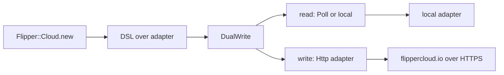
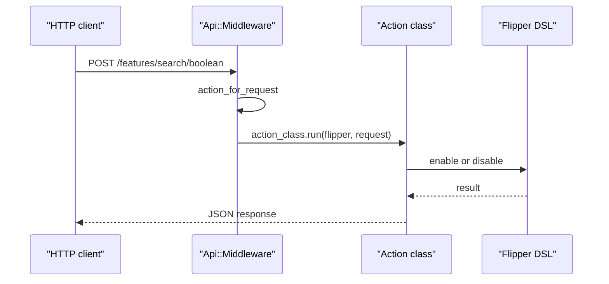

# 08 -- The web front ends: Cloud, API, and UI

Three gems expose Flipper over HTTP. Flipper Cloud stores flags remotely and keeps a local copy. The API exposes the flag operations as a REST (representational state transfer) interface. The UI renders a web page for humans.

## Flipper Cloud

Flipper Cloud uses an HTTP adapter that calls a remote service, plus a local adapter that serves reads. The local adapter stays in sync, so reads are local and fast even if the network is down. `Flipper::Cloud.app` builds the Rack middleware stack:

```ruby
# Source: lib/flipper/cloud.rb, lines 24-36 (intermediate lines omitted)
def self.app(flipper = nil, options = {})
  env_key = options.fetch(:env_key, 'flipper')
  memoizer_options = options.fetch(:memoizer_options, {})
  middleware_options = {env_key: env_key}
  middleware_options[:signature_tolerance] = options[:signature_tolerance] if options.key?(:signature_tolerance)

  app = ->(_) { [404, { Rack::CONTENT_TYPE => 'application/json'.freeze }, ['{}'.freeze]] }
  builder = Rack::Builder.new
  yield builder if block_given?
  builder.use Flipper::Middleware::SetupEnv, flipper, env_key: env_key
  builder.use Flipper::Middleware::Memoizer, memoizer_options.merge(env_key: env_key)
  builder.use Flipper::Cloud::Middleware, middleware_options
  builder.run app
end
```

The adapter itself is a `DualWrite` over a read adapter and the HTTP adapter. Reads go local; writes go remote first, then local:

```ruby
# Source: lib/flipper/cloud/configuration.rb, lines 154-157
def app_adapter
  read_adapter = sync_method == :webhook ? local_adapter : poll_adapter
  Flipper::Adapters::DualWrite.new(read_adapter, http_adapter)
end
```



The HTTP adapter translates the eleven-method contract into HTTP requests. `get` fetches one feature's gates, and a 404 means the feature simply has no values:

```ruby
# Source: lib/flipper/adapters/http.rb, lines 32-42
def get(feature)
  response = @client.get("/features/#{path_escape(feature.key)}")
  if response.is_a?(Net::HTTPOK)
    parsed_response = Typecast.from_json(response.body)
    result_for_feature(feature, parsed_response.fetch('gates'))
  elsif response.is_a?(Net::HTTPNotFound)
    default_config
  else
    raise Error, response
  end
end
```

`get_all` uses an ETag (entity tag) for conditional requests, so a poll that found no changes costs almost nothing (`lib/flipper/adapters/http.rb` lines 62-106). The default endpoint is `https://www.flippercloud.io/adapter` (`lib/flipper/cloud/configuration.rb` line 22), and the cloud gem itself is deprecated in favor of cloud support built into the `flipper` gem (`flipper-cloud.gemspec` lines 20-25).

## The API

The API gem is a Rack app that maps HTTP routes to flag operations. Each route is an action class. `Flipper::Api.app` builds the stack and the `Api::Middleware` dispatches requests to those actions:

```ruby
# Source: lib/flipper/api.rb, lines 10-24 (intermediate lines omitted)
def self.app(flipper = nil, options = {})
  env_key = options.fetch(:env_key, 'flipper')
  use_rewindable_middleware = options.fetch(:use_rewindable_middleware) {
    Gem::Version.new(Rack.release) >= Gem::Version.new('3.0.0')
  }
  app = ->(_) { [404, { Rack::CONTENT_TYPE => CONTENT_TYPE }, ['{}'.freeze]] }
  builder = Rack::Builder.new
  yield builder if block_given?
  builder.use Rack::Head
  builder.use Rack::Deflater
  builder.use Rack::RewindableInput::Middleware if use_rewindable_middleware
  builder.use Flipper::Api::JsonParams
  builder.use Flipper::Middleware::SetupEnv, flipper, env_key: env_key
  builder.use Flipper::Api::Middleware, env_key: env_key
  builder.run app
end
```

The middleware finds the action class for the request method and path, then runs it with the flipper instance:

```ruby
# Source: lib/flipper/api/middleware.rb, lines 34-46
def call!(env)
  request = Rack::Request.new(env)
  action_class = @action_collection.action_for_request(request)
  env["flipper.action_class"] = action_class
  env["flipper.action_method"] = request.request_method.downcase

  if action_class.nil?
    @app.call(env)
  else
    flipper = env.fetch(@env_key) { Flipper }
    action_class.run(flipper, request)
  end
end
```



The middleware registers eleven actions: one per gate (`ExpressionGate`, `PercentageOfTimeGate`, `PercentageOfActorsGate`, `ActorsGate`, `GroupsGate`, `BooleanGate`), plus `ClearFeature`, `Actors`, `Feature`, `Features`, and `Import` (`lib/flipper/api/middleware.rb` lines 17-27).

## The UI

The UI gem is a Rack app with server-rendered views (ERB templates) and actions for adding features, toggling gates, importing, exporting, and settings. `Flipper::UI.app` builds a stack that includes `Rack::Protection` for form authenticity and `Rack::MethodOverride` for HTML forms:

```ruby
# Source: lib/flipper/ui.rb, lines 21-51
def self.app(flipper = nil, options = {})
  env_key = options.fetch(:env_key, 'flipper')
  rack_protection_options = if options.key?(:rack_protection)
    options[:rack_protection]
  else
    {}
  end

  app = ->(_) { [200, { Rack::CONTENT_TYPE => 'text/html' }, ['']] }
  builder = Rack::Builder.new
  yield builder if block_given?

  if rack_protection_options.empty?
    builder.use Rack::Protection::AuthenticityToken
  else
    builder.use Rack::Protection, rack_protection_options
  end

  builder.use Rack::MethodOverride
  builder.use Flipper::Middleware::SetupEnv, flipper, env_key: env_key
  builder.use Flipper::UI::Middleware, flipper: flipper, env_key: env_key
  builder.run app
  klass = self
  app = builder.to_app
  app.define_singleton_method(:inspect) { klass.inspect } # pretty rake routes output
  app
end
```

The UI middleware mirrors the API middleware but registers UI actions such as `AddFeature`, `Feature`, `Features`, `Export`, `Import`, `CloudMigrate`, and `Settings`, plus `File` for static assets and `Home` as the catch-all redirect (`lib/flipper/ui/middleware.rb` lines 17-38). Both the API and the UI mount as Rack apps, so they drop into any Rack application, not just Rails.

## Cross-References

- The HTTP adapter implements the same contract as the database adapters in [06-activerecord-redis-adapters.md](./06-activerecord-redis-adapters.md).
- Cloud keeps the local adapter in sync with the synchronizer described in [09-composition.md](./09-composition.md).

## The Aha Moment

**Aha:** The web front ends are just more adapters and Rack apps around the same core. Cloud is an adapter (`Http`) plus a write-through wrapper (`DualWrite`); the API is a Rack middleware that turns HTTP verbs into `enable`/`disable` calls; the UI is the same middleware with HTML views. None of them reimplement flag logic — they only translate between HTTP and the eleven-method adapter contract, which is why they can be mounted next to any app that already uses Flipper.

Continue to [09-composition.md](./09-composition.md).
