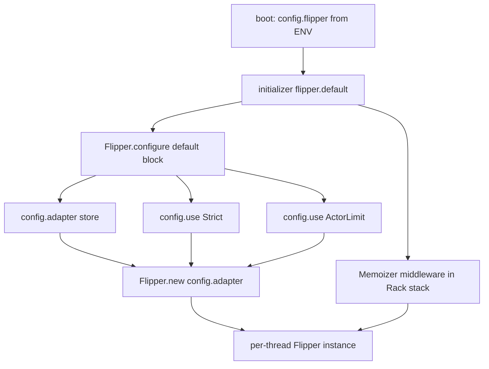
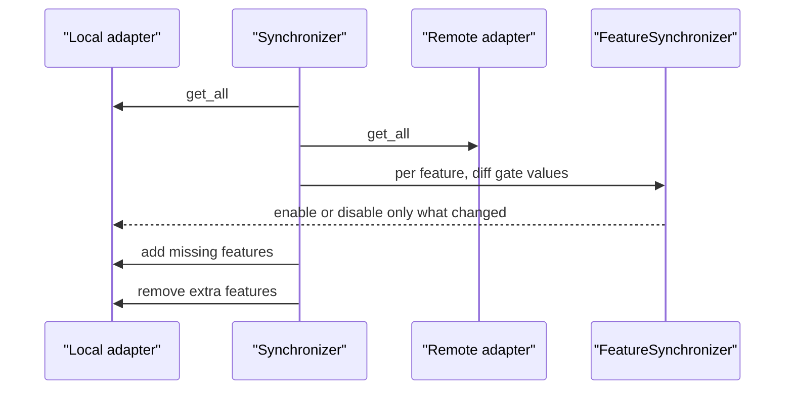

# 09 -- How it composes: the whole flag machine

The core pieces — DSL, Feature, Gates, Adapter — snap together through two mechanisms: the configuration builder and the Rails engine. Everything else is decoration.

## The Rails engine wires the pieces

`Flipper::Engine` is loaded when Rails is present (`lib/flipper.rb` line 230: `require "flipper/engine" if defined?(Rails)`). It reads environment variables into `config.flipper`, then sets the default instance. With a cloud token it builds a Cloud DSL; without one it builds a plain DSL over the configured adapter:

```ruby
# Source: lib/flipper/engine.rb, lines 47-58
Flipper.configure do |config|
  config.default do
    if cloud?
      Flipper::Cloud.new(
        local_adapter: config.adapter,
        instrumenter: app.config.flipper.instrumenter
      )
    else
      Flipper.new(config.adapter, instrumenter: app.config.flipper.instrumenter)
    end
  end
end
```

Two more initializers push the enforcement wrappers onto the adapter and mount the request memoizer:

```ruby
# Source: lib/flipper/engine.rb, lines 72-75
Flipper.configure do |config|
  config.use Flipper::Adapters::Strict, flipper.strict if flipper.strict
  config.use Flipper::Adapters::ActorLimit, flipper.actor_limit if flipper.actor_limit
end
```

```ruby
# Source: lib/flipper/engine.rb, lines 81-87
if flipper.memoize
  app.middleware.use Flipper::Middleware::Memoizer, {
    env_key: flipper.env_key,
    preload: flipper.preload,
    if: flipper.memoize.respond_to?(:call) ? flipper.memoize : nil
  }
end
```



The result is one per-thread `Flipper::DSL` whose adapter is `Memoizable` over `ActorLimit` over `Strict` over your chosen store, with the Memoizer middleware flipping memoization on per request.

## Sync, import, and export

Sync diffs two adapters and applies the minimum set of changes, with the enforcement wrappers' guardrails suspended for the duration.



A `Synchronizer` brings one adapter in line with another by diffing their `get_all` hashes and applying only the needed changes, inside the wrappers' sync mode so guardrails are suspended:

```ruby
# Source: lib/flipper/adapters/sync/synchronizer.rb, lines 41-63
def sync
  local_get_all = @local.get_all
  remote_get_all = @remote.get_all(cache_bust: @cache_bust)

  remote_get_all.each do |feature_key, remote_gates_hash|
    feature = Feature.new(feature_key, @local, instrumenter: @instrumenter)
    local_gates_hash = local_get_all.key?(feature_key) ? local_get_all[feature_key] : @local.default_config
    local_gate_values = GateValues.new(local_gates_hash)
    remote_gate_values = GateValues.new(remote_gates_hash)
    FeatureSynchronizer.new(feature, local_gate_values, remote_gate_values).call
  end

  features_to_add = remote_get_all.keys - local_get_all.keys
  features_to_add.each { |key| Feature.new(key, @local, instrumenter: @instrumenter).add }

  features_to_remove = local_get_all.keys - remote_get_all.keys
  features_to_remove.each { |key| Feature.new(key, @local, instrumenter: @instrumenter).remove }

  nil
end
```

`export` serializes the whole adapter through the JSON V1 exporter, which turns sets into arrays so they are JSON-safe:

```ruby
# Source: lib/flipper/exporters/json/v1.rb, lines 10-25
def call(adapter)
  features = adapter.get_all.transform_values do |gates|
    gates.transform_values do |value|
      value.is_a?(Set) ? value.to_a : value
    end
  end

  json = Typecast.to_json({
    version: VERSION,
    features: features,
  })

  Json::Export.new(contents: json, version: VERSION)
end
```

This is the on-disk format the UI and API use for their import and export actions, and it is the same shape the cloud synchronizer moves around.

## The rest of the ecosystem

The other gems add adapters, all under the same contract. `flipper-sequel` mirrors ActiveRecord with two `Sequel::Model` classes (`lib/flipper/adapters/sequel.rb` lines 16-30). `flipper-mongo`, `flipper-moneta`, and `flipper-rollout` wrap their respective stores. `flipper-dalli` and `flipper-active_support_cache_store` extend `CacheBase`, a read-through cache with a time-to-live and namespaced keys (`lib/flipper/adapters/cache_base.rb`). Additional decorators ship in the core: `Failover` (try the primary, fall back to the secondary on error), `Failsafe` (return safe defaults on error), `DualWrite` (write both), and `ReadOnly` (raise on writes). `Failover` shows the pattern:

```ruby
# Source: lib/flipper/adapters/failover.rb, lines 18-24
def initialize(primary, secondary, options = {})
  @primary = primary
  @secondary = secondary

  @dual_write = options.fetch(:dual_write, false)
  @errors = options.fetch(:errors, [ StandardError ])
end
```

## Testing

`Flipper::TestHelp` wires a shared Memory adapter for the test suite and resets it between examples, so tests never touch a real store:

```ruby
# Source: lib/flipper/test_help.rb, lines 5-22
def flipper_configure
  adapter = Flipper::Adapters::Memory.new

  Flipper.configure do |config|
    config.adapter { adapter }
    config.default { Flipper.new(config.adapter) }
  end
end

def flipper_reset
  Flipper.features.each(&:remove) rescue nil

  Flipper.instance = nil
end
```

## Cross-References

- The wrappers pushed by the engine are explained in [05-adapter-stack-instrumentation.md](./05-adapter-stack-instrumentation.md).
- The cloud synchronizer drives this same `Synchronizer`: [08-cloud-api-ui.md](./08-cloud-api-ui.md).

## The Aha Moment

**Aha:** Flipper is a machine assembled from one contract. The DSL, Feature, six Gates, the adapters, the wrappers, the synchronizer, the exporters, and the test helpers all speak the same six-key hash. Configuration is just choosing a store and a list of wrappers; the Rails engine does that choosing from environment variables and mounts the memoizer; sync and export just move the same hash between adapters. There is no second, special format anywhere — which is why the whole system fits in one monorepo and still feels like one library.

Continue to [README.md](./README.md).
