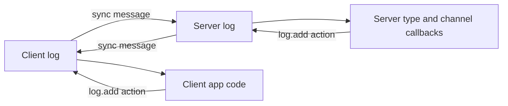
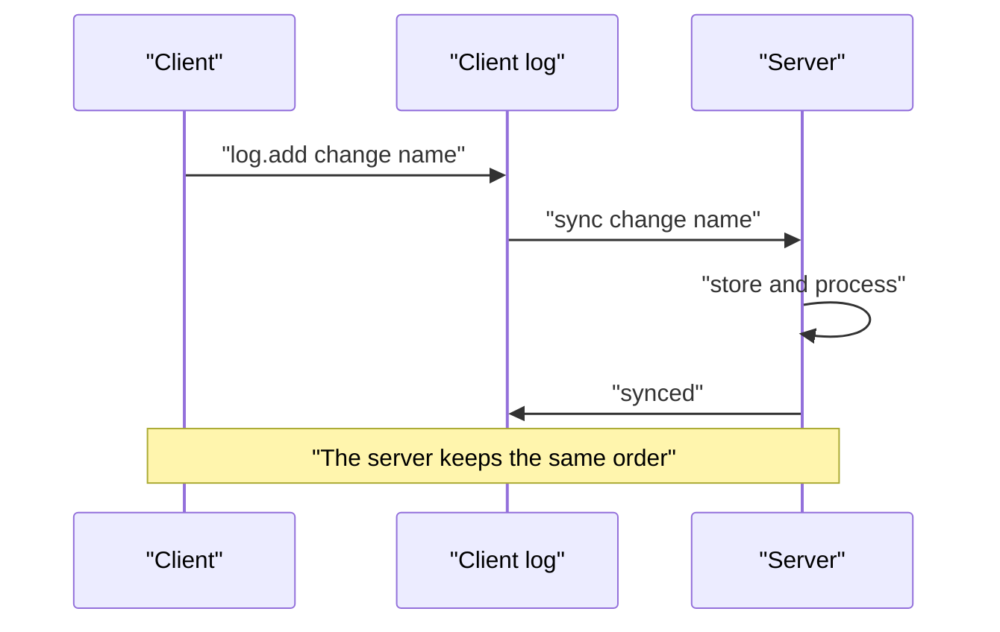
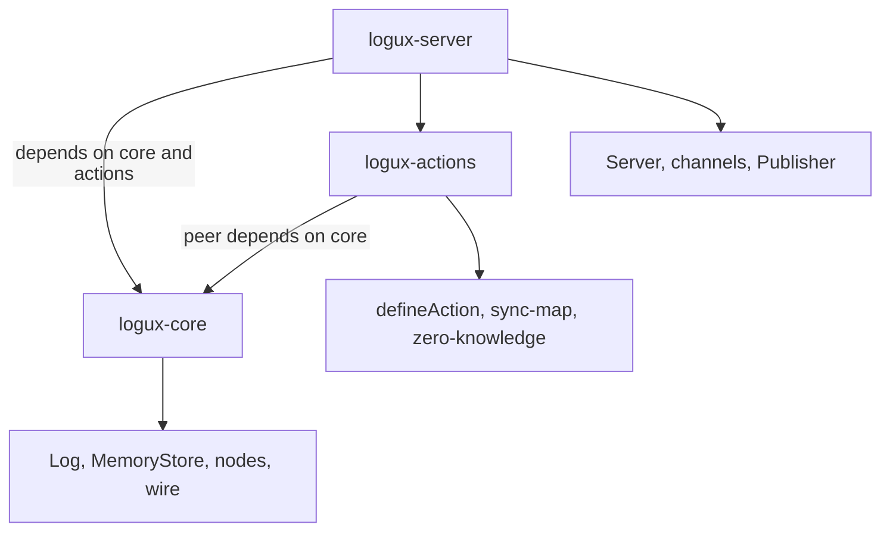

# 00 -- Logux: one action log, two directions

Logux connects a client and a server without Hypertext Transfer Protocol (HTTP) requests. The client and the server both keep a log of actions. The two logs replicate in both directions over WebSocket. Every change is a plain action object appended to that log.

The three packages under `/Users/darkvoid/GitSources/src.Ruby/` ship this idea. `logux-core` holds the log, the node primitives, and the wire protocol. `logux-server` holds the WebSocket server that syncs actions and tracks subscriptions. `logux-actions` holds the built-in action creators. Source paths below are relative to that `src.Ruby/` directory.

The `logux-core` README states the core idea:

```text
// Source: logux-core/README.md, lines 6-8
Logux is a new way to connect client and server. Instead of sending
HTTP requests (e.g., AJAX and GraphQL) it synchronizes log of operations
between client, server, and other clients.
```

The same README lists the building blocks of `@logux/core`:

```text
// Source: logux-core/README.md, lines 18-26
- `Log` to store node's actions.
- `MemoryStore` to store log in the memory.
- `BaseNode`, `ClientNode`, and `ServerNode` to synchronize actions
  from Log with other node.
- `isFirstOlder` to compare creation time of different actions.
- `WsConnection`, `Reconnect`, and `ServerConnection` to connect nodes
  via WebSocket.
- `TestLog`, `TestPair`, `TestTime`, and `eachStoreCheck`
  to test Logux application.
```

## The mental model

An action is a small object with a `type` string. You add it to the local log. The node sends it to the remote log. The remote log stores it and fires its listeners. There is no request and no response object. There is only the log and the order of actions in it.

```ts
// Source: logux-core/log/index.d.ts, lines 376-383 (documentation example)
import Log from '@logux/core'
const log = new Log({
  store: new MemoryStore(),
  nodeId: 'client:134'
})

log.on('add', beeper)
log.add({ type: 'beep' })
```

The word "action" is a shared term. The client can add an action. The server can add an action. Either side can react to an action from the other side. The log does not care which side wrote it. It cares about the order.



## Why the log wins

Order is the contract. Every action gets an identifier (`meta.id`) built from a time part and a node identifier. Every action gets a sequence number (`meta.added`) when it enters a specific log. Because both sides keep actions in the same order, two users who change the same record apply the same changes in the same order. The last write wins, and "last" is decided by the log, not by the network.



Subscriptions reuse the same mechanism. A subscription is an action of type `logux/subscribe`. The server keeps it in its log like any other action. So a reconnect replays subscriptions from the log, and the server does not need a separate session table. See [04-server-and-subscriptions.md](./04-server-and-subscriptions.md).

Offline mode is a paused sync, not a separate mode. Each side remembers the `added` watermark of the last synced action. When the connection returns, each side sends only what is newer. See [05-offline-connect-reconnect.md](./05-offline-connect-reconnect.md).

## The three packages

`@logux/core` is the foundation. It defines the action, the metadata, the `Log`, the `LogStore` contract, the node classes, and the wire protocol. `@logux/server` builds on it: it adds channels, subscriptions, access checks, and delivery. `@logux/actions` adds the vocabulary: action creators for the built-in `logux/*` actions and for the sync map and the CRDT table.



`@logux/actions` declares `@logux/core` as a peer dependency. `@logux/server` declares both as direct dependencies. The exact versions are in each root `package.json`.

## Cross-References

- [01-action-and-meta.md](./01-action-and-meta.md) — the action object and its metadata.
- [04-server-and-subscriptions.md](./04-server-and-subscriptions.md) — how the server routes and delivers actions.
- [09-composition.md](./09-composition.md) — how the three packages fit together.

## The Aha Moment
**Aha:** Logux is log replication, not request handling. The single source of truth is the ordered log, not the last response. Every feature, from subscriptions to offline sync to undo, is built by appending one more action to that log. The client and the server never talk about "requests" or "responses". They talk about "which actions do you have after position N".

Continue to [01-action-and-meta.md](./01-action-and-meta.md).
