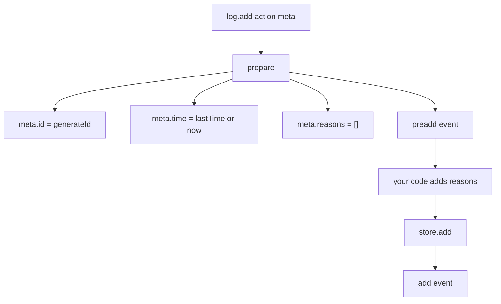
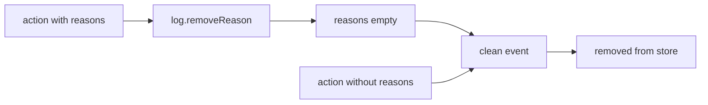

# 01 -- The action and its meta: a fact with a position

An action is small. It has a `type` string and any number of data fields. The metadata is separate. It carries the position, the lifetime, and the delivery rules. This document describes both.

## The action object

The type system gives the action only one required field. The `Action` interface requires `type`. The `AnyAction` interface allows any extra fields. The `ID` type is a plain string.

```ts
// Source: logux-core/log/index.d.ts, line 77
export type ID = string
```

```ts
// Source: logux-core/log/index.d.ts, lines 145-155
export interface Action {
  /**
   * Action type name.
   */
  type: string
}

export interface AnyAction {
  [extra: string]: unknown
  type: string
}
```

So `{ type: 'users/add', name: 'Kate' }` is a valid action. The fields are your choice. The framework never looks at them except through your callbacks.

## The meta object

The `Meta` interface is the real contract. `added`, `id`, `reasons`, and `time` are required; `indexes`, `keepLast`, and `subprotocol` are optional. The log fills `id`, `time`, and `reasons`, and the store fills `added`.

```ts
// Source: logux-core/log/index.d.ts, lines 101-141
export interface Meta {
  [extra: string]: unknown

  /**
   * Sequence number of action in current log. Log fills it.
   */
  added: number

  /**
   * Action unique ID. Log sets it automatically.
   */
  id: ID

  /**
   * Indexes for action quick extraction.
   */
  indexes?: string[]

  /**
   * Set value to `reasons` and this reason from old action.
   */
  keepLast?: string

  /**
   * Why action should be kept in log. Action without reasons will be removed.
   */
  reasons: string[]

  /**
   * Application subprotocol version.
   */
  subprotocol?: number

  /**
   * Action created time in current node time. Milliseconds since UNIX epoch.
   *
   * Log could move the action a few milliseconds to the future to keep
   * actions of the same node in the log order.
   */
  time: number
}
```

Four fields matter most.

- `id` identifies the action across all nodes. It is `time nodeId`, for example `OzcVoWD client:1`. The `time` part is the encoded creation time.
- `time` is the creation time in milliseconds. The log may move it a few milliseconds forward to keep a single node's own actions ordered.
- `added` is the sequence number in this specific log. It is the cursor for sync.
- `reasons` is the lifetime. An action with no reasons is removed from the log.

## How the log fills the meta

The `prepare` function fills `id`, `time`, and `reasons` before a write. It also fires the `preadd` event, which is where user code adds reasons.

```js
// Source: logux-core/log/index.js, lines 62-78
function prepare(log, action, meta) {
  if (typeof action.type === 'undefined') {
    throw new Error('Expected "type" in action')
  }

  let newId = false
  if (typeof meta.id === 'undefined') {
    newId = true
    meta.id = log.generateId()
    if (typeof meta.time === 'undefined') meta.time = log.lastTime
  } else if (typeof meta.time === 'undefined') {
    meta.time = log.now()
  }

  if (typeof meta.reasons === 'undefined') {
    meta.reasons = []
  }
```

The identifier comes from `generateId`. It encodes the node clock and the node identifier in a way that stays sortable as a string.

```js
// Source: logux-core/log/index.js, lines 268-273
  generateId() {
    let now = this.now()
    if (now <= this.lastTime) now = this.lastTime + 1
    this.lastTime = now
    return toCompat(now) + ' ' + this.nodeId
  }
```

The encoding `toCompat` uses the alphabet `-0-9A-Z_a-z`. The characters are in ASCII order, so sorting the encoded strings gives the same order as sorting the numbers.



## Reasons decide the lifetime

An action without reasons is transient. The log never writes it to the store: `Log#add` fires the `add` event and then the `clean` event without calling `store.add`. An action with reasons is stored and stays until every reason is removed. This is garbage collection by tags.



`keepLast` is a shortcut. It removes the named reason from the older action and adds it to the new one, so the "last value" of a key is always kept. The log code appends it during `prepare`.

Some meta keys are read-only. You cannot change `id`, `added`, `time`, `subprotocol`, or `indexes` after the fact. The `changeMeta` method enforces this.

```js
// Source: logux-core/log/index.js, lines 215-226
  async changeMeta(id, diff) {
    for (let k in diff) {
      if (
        k === 'id' ||
        k === 'added' ||
        k === 'time' ||
        k === 'subprotocol' ||
        k === 'indexes'
      ) {
        throw new Error('Meta "' + k + '" is read-only')
      }
    }
```

The `Log#type` helper subscribes to one action type. It is faster than a general `on('add')` listener with an `if`, because the event name is precomputed.

```js
// Source: logux-core/log/index.js, lines 290-294
  type(type, listener, opts = {}) {
    let event = opts.event || 'add'
    let id = opts.id || ''
    return this.emitter.on(`${event}-${type}-${id}`, listener)
  }
```

## Cross-References

- [02-log-and-node.md](./02-log-and-node.md) — the `Log` and `MemoryStore` that store these entries.
- [03-wire-protocol.md](./03-wire-protocol.md) — how `id`, `time`, and `subprotocol` travel on the wire.
- [07-processing-lifecycle.md](./07-processing-lifecycle.md) — how server-side meta keys mark processed and rejected actions.

## The Aha Moment
**Aha:** The action is only a `type` plus data. The meta is where the framework lives. `id` places the action in a global order, `added` places it in a local cursor, and `reasons` decide how long it survives. Read the meta as a contract: the log promises an ordered, deduplicated, garbage-collected set of facts, and the meta is how that promise is kept.

Continue to [02-log-and-node.md](./02-log-and-node.md).
