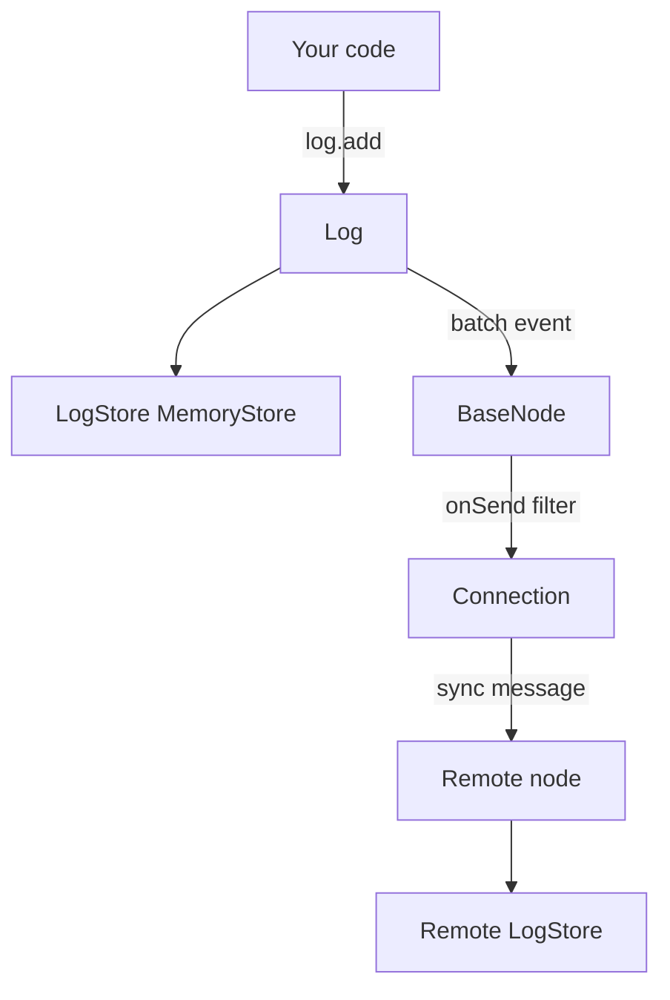
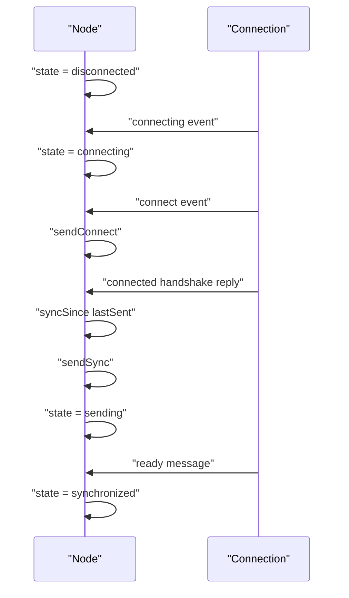

# 02 -- The log and the node: storage plus synchronization

`@logux/core` has two kinds of machinery. The `Log` stores actions. The `BaseNode`, `ClientNode`, and `ServerNode` synchronize a log with a remote node. This document covers both.

## The Log

The `Log` constructor takes a `nodeId` and a `store`. The store implements the `LogStore` contract. `MemoryStore` is the in-memory implementation.

```js
// Source: logux-core/log/index.js, lines 114-135
export class Log {
  constructor(opts = {}) {
    if (process.env.NODE_ENV !== 'production') {
      if (typeof opts.nodeId === 'undefined') {
        throw new Error('Expected node ID')
      }
      if (typeof opts.store !== 'object') {
        throw new Error('Expected store')
      }
      if (opts.nodeId.includes(' ')) {
        throw new Error('Space is prohibited in node ID')
      }
    }

    this.nodeId = opts.nodeId

    this.lastTime = 0

    this.store = opts.store

    this.emitter = createNanoEvents()
  }
```

The node identifier cannot contain a space, because the action ID uses the space to separate the time part from the node identifier.

`Log#add` accepts a single action or a batch. It runs every `preadd` first, then writes actions with reasons to the store in one call. This lets the store write a batch in one transaction.

```js
// Source: logux-core/log/index.js, lines 137-159
  async add(input, inputMeta = {}) {
    let wasBatched = Array.isArray(input)
    let entries = wasBatched ? input : [[input, inputMeta]]

    // Every `preadd` is called before the write, since the store needs
    // the final reasons of all actions to know what to write. As a result,
    // `add` of the first action is called after `preadd` of the last one.
    let newIds = []
    let writing = []
    let checking = []
    for (let i = 0; i < entries.length; i++) {
      let [action, meta = {}] = entries[i]
      let newId = prepare(this, action, meta)
      newIds.push(newId)
      entries[i] = [action, meta]
      if (meta.reasons.length > 0) {
        writing.push(entries[i])
      } else if (!newId) {
        // Actions without reasons are not stored, but an action with the same
        // ID could be stored before with a reason
        checking.push(meta.id)
      }
    }
```

## The MemoryStore and the order

`MemoryStore` keeps `entries` sorted by `isFirstOlder`. When a new entry arrives, `addEntry` inserts it before the first entry that is not older, so the array stays in log order.

```js
// Source: logux-core/memory-store/index.js, lines 107-134
function addEntry(store, action, meta) {
  let entry = [action, meta]
  let id = meta.id

  let list = store.entries
  for (let i = 0; i < list.length; i++) {
    let [, otherMeta] = list[i]
    if (id === otherMeta.id) {
      return false
    } else if (!isFirstOlder(otherMeta, meta)) {
      forEachIndex(meta, index => {
        checkIndex(store, index)
        let indexList = store.indexes[index].entries
        let j = indexList.findIndex(item => !isFirstOlder(item[1], meta))
        indexList.splice(j, 0, entry)
      })
      list.splice(i, 0, entry)
      return insert(store, entry)
    }
  }

  forEachIndex(meta, index => {
    checkIndex(store, index)
    store.indexes[index].entries.push(entry)
  })
  list.push(entry)
  return insert(store, entry)
}
```

`isFirstOlder` compares `time` first, then the node identifier, then the encoded time part of the identifier. It is the deterministic tie-break rule.

```js
// Source: logux-core/is-first-older/index.js, lines 3-41
export function isFirstOlder(firstMeta, secondMeta) {
  if (firstMeta && !secondMeta) {
    return false
  } else if (!firstMeta && secondMeta) {
    return true
  }

  if (typeof firstMeta === 'string') {
    firstMeta = { id: firstMeta, time: idToTime(firstMeta) }
  }
  if (typeof secondMeta === 'string') {
    secondMeta = { id: secondMeta, time: idToTime(secondMeta) }
  }

  if (firstMeta.time > secondMeta.time) {
    return false
  } else if (firstMeta.time < secondMeta.time) {
    return true
  }

  let first = firstMeta.id.split(' ')
  let second = secondMeta.id.split(' ')

  if (first[1] > second[1]) {
    return false
  } else if (first[1] < second[1]) {
    return true
  }

  let firstIdTime = fromCompat(first[0])
  let secondIdTime = fromCompat(second[0])
  if (firstIdTime > secondIdTime) {
    return false
  } else if (firstIdTime < secondIdTime) {
    return true
  }

  return false
}
```

## The node state machine

`BaseNode` owns the synchronization. It reads the store's last-synced watermarks, listens to the connection, and keeps a state: `disconnected`, `connecting`, `sending`, or `synchronized`. It also declares the protocol versions (`minProtocol`/`localProtocol`, both 7).

```js
// Source: logux-core/base-node/index.js, lines 41-49
export class BaseNode {
  constructor(nodeId, log, connection, options = {}) {
    this.remoteNodeId = undefined
    this.remoteProtocol = undefined
    this.remoteSubprotocol = undefined

    this.minProtocol = 7
    this.localProtocol = 7
    this.localNodeId = nodeId
```

The node initializes by loading the watermarks and the last `added` value from the store. On a fresh process, these resume where the previous process left off.

```js
// Source: logux-core/base-node/index.js, lines 166-176
  async initialize() {
    let [synced, added] = await Promise.all([
      this.log.store.getLastSynced(),
      this.log.store.getLastAdded()
    ])
    this.initialized = true
    this.lastSent = synced.sent
    this.lastReceived = synced.received
    this.lastAddedCache = added
    if (this.connection.connected) this.onConnect()
  }
```

When the log adds actions, the node listens to the `batch` event and calls `onAdd`. That method filters the actions through `onSend` and sends them as a `sync` message.

```js
// Source: logux-core/base-node/index.js, lines 182-212
  async onAdd(entries) {
    // `ready` message reports the cache, so it should be updated
    // even for the actions, which we will not send
    for (let [, meta] of entries) {
      if (this.lastAddedCache < meta.added) {
        this.lastAddedCache = meta.added
      }
    }

    if (!this.authenticated) return

    let added
    let sending = []
    for (let entry of entries) {
      let meta = entry[1]
      if (this.received && this.received[meta.id]) {
        delete this.received[meta.id]
        continue
      }

      if (typeof meta.added !== 'undefined') {
        if (typeof added === 'undefined' || meta.added > added) {
          added = meta.added
        }
      }
      sending.push(entry)
    }

    if (sending.length === 0) return

    if (this.options.onSend) {
```

`ClientNode` and `ServerNode` add defaults on top of `BaseNode`. The client fixes time and sends the `connect` message first. The server never fixes time.

```js
// Source: logux-core/client-node/index.js, lines 3-17
const DEFAULT_OPTIONS = {
  fixTime: true,
  ping: 10000,
  timeout: 70000
}

export class ClientNode extends BaseNode {
  constructor(nodeId, log, connection, options = {}) {
    super(nodeId, log, connection, {
      ...options,
      fixTime: options.fixTime ?? DEFAULT_OPTIONS.fixTime,
      ping: options.ping ?? DEFAULT_OPTIONS.ping,
      timeout: options.timeout ?? DEFAULT_OPTIONS.timeout
    })
  }
```

```js
// Source: logux-core/server-node/index.js, lines 9-24
export class ServerNode extends BaseNode {
  constructor(nodeId, log, connection, options = {}) {
    super(nodeId, log, connection, {
      ...options,
      ping: options.ping ?? DEFAULT_OPTIONS.ping,
      timeout: options.timeout ?? DEFAULT_OPTIONS.timeout
    })

    if (this.options.fixTime) {
      throw new Error(
        'Logux Server could not fix time. Set opts.fixTime for Client node.'
      )
    }

    this.state = 'connecting'
  }
```

## How the pieces connect



The state changes as actions move.



## Cross-References

- [01-action-and-meta.md](./01-action-and-meta.md) — the entries this log stores.
- [03-wire-protocol.md](./03-wire-protocol.md) — the messages the node sends and receives.
- [05-offline-connect-reconnect.md](./05-offline-connect-reconnect.md) — how the watermarks make sync resumable.

## The Aha Moment
**Aha:** The node is a translator between the log and the wire. It does not store anything itself. It owns three numbers: `lastSent`, `lastReceived`, and `lastAddedCache`. Those numbers are the entire sync state. Everything else is derived: the state string, the "sending" flag, and the decision to skip an action that came back as a duplicate.

Continue to [03-wire-protocol.md](./03-wire-protocol.md).
