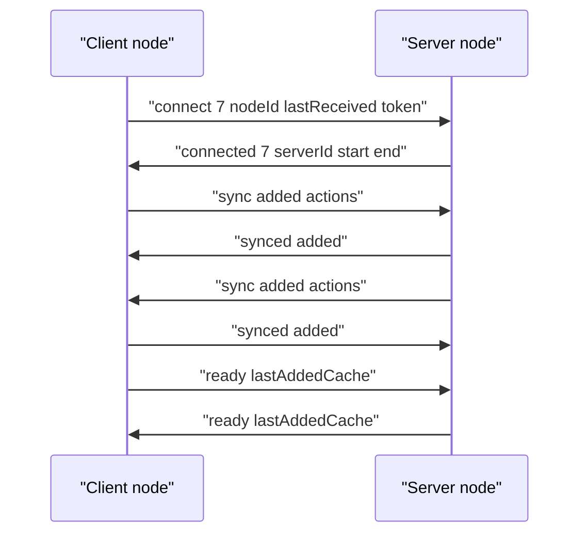
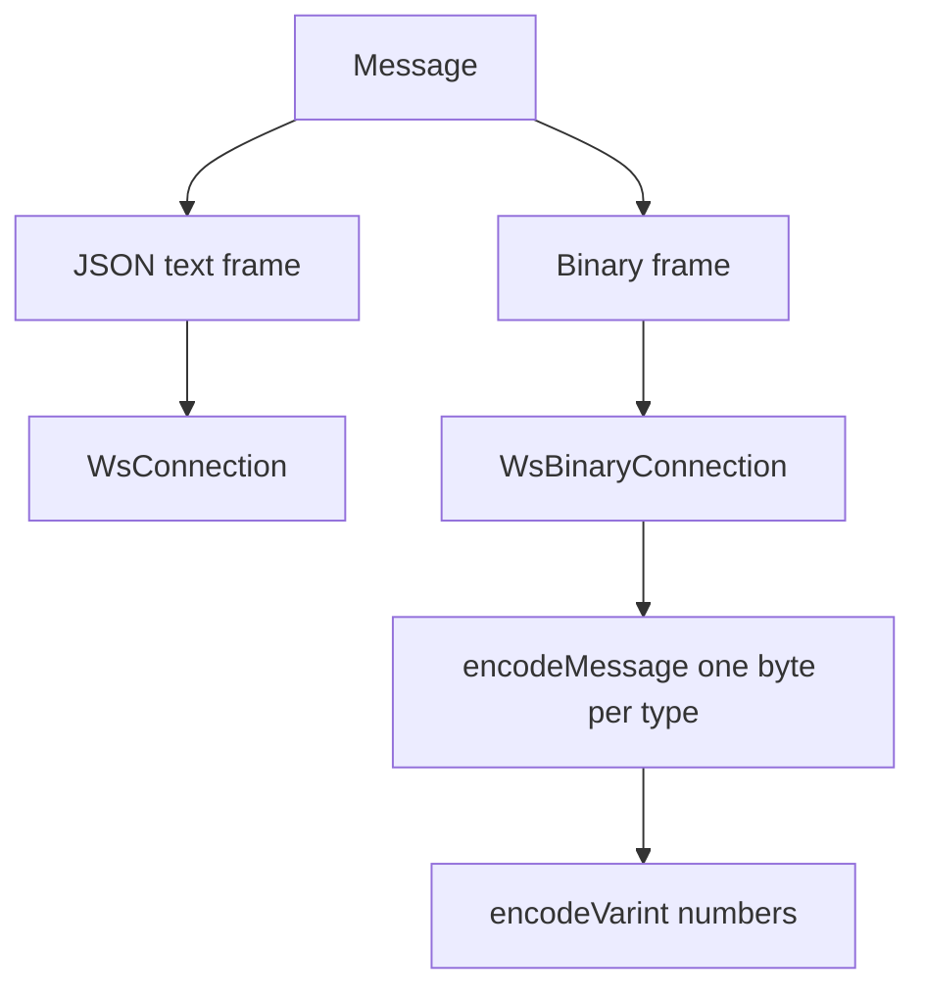

# 03 -- The wire protocol: a small message alphabet

The Logux wire protocol is a closed alphabet of ten message shapes. Each message is a JavaScript Object Notation (JSON) array whose first element is the message name. The `Message` type declares every shape. An undocumented `duilian` message exists in the validator and `BaseNode`, but it is not in the `Message` type.

```ts
// Source: logux-core/base-node/index.d.ts, lines 37-47
export type Message =
  | ['connect', number, string, number, object?]
  | ['connected', number, string, [number, number], object?]
  | ['debug', 'error', string]
  | ['error', keyof LoguxErrorOptions, unknown?]
  | ['headers', object]
  | ['ping', number]
  | ['pong', number]
  | ['ready', number]
  | ['sync', number, ...(AnyAction | SyncMeta)[]]
  | ['synced', number]
```

The protocol version is 7 in `@logux/core` 0.12. The node declares `minProtocol` and `localProtocol` both as 7. The change log for 0.12 records the move: "Moved to Protocol 7 with `ready` message."

## The handshake

The client sends `connect` with its protocol, its node identifier, its last received `added` value, and optional options such as a token and a subprotocol.

```js
// Source: logux-core/connect/index.js, lines 64-93
export async function sendConnect() {
  let message = [
    'connect',
    this.localProtocol,
    this.localNodeId,
    this.lastReceived
  ]

  let options = {}
  if (this.options.token) {
    if (typeof this.options.token === 'function') {
      options.token = await this.options.token()
    } else {
      options.token = this.options.token
    }
  }
  if (this.options.subprotocol) {
    options.subprotocol = this.options.subprotocol
  }
  if (Object.keys(options).length > 0) message.push(options)

  if (this.options.fixTime) this.connectSended = this.log.now()

  if (Object.keys(this.localHeaders).length > 0) {
    this.sendHeaders(this.localHeaders)
  }

  this.startTimeout()
  this.send(message)
}
```

The server answers `connected` with the two timestamps of the handshake, so the client can compute the time difference between the nodes.

```js
// Source: logux-core/connect/index.js, lines 144-170
export function connectedMessage(ver, nodeId, time, options) {
  if (!options) options = {}

  this.endTimeout()
  this.remoteNodeId = nodeId
  if (!checkProtocol(this, ver)) return

  this.baseTime = time[1]

  if (this.options.fixTime) {
    let now = this.log.now()
    let authTime = time[1] - time[0]
    let roundTrip = now - this.connectSended - authTime
    this.timeFix = Math.floor(this.connectSended - time[0] + roundTrip / 2)
  }

  this.remoteSubprotocol = options.subprotocol || 0

  if (!emitEvent(this)) {
    this.destroy()
    return
  }

  auth(this, nodeId, options.token, () => {
    this.syncSince(this.lastSent)
  })
}
```

The `checkProtocol` function rejects a remote protocol older than the minimum and answers with a `wrong-protocol` error.

```js
// Source: logux-core/connect/index.js, lines 33-48
function checkProtocol(node, ver) {
  node.remoteProtocol = ver

  if (ver >= node.minProtocol) {
    return true
  } else {
    node.sendError(
      new LoguxError('wrong-protocol', {
        supported: node.minProtocol,
        used: ver
      })
    )
    node.destroy()
    return false
  }
}
```

## Relative time on the wire

Timestamps on the wire are relative. The `encodeEntries` function subtracts `baseTime` and `timeFix` from every `meta.time`. The node identifier is dropped when it is the local node's own, because the receiver already knows the sender.

```js
// Source: logux-core/sync/index.js, lines 1-18
function encodeEntries(node, entries) {
  let data = []
  for (let [action, originMeta] of entries) {
    let meta = {}
    for (let key in originMeta) {
      if (key !== 'added') meta[key] = originMeta[key]
    }

    if (node.timeFix) meta.time -= node.timeFix
    meta.time -= node.baseTime

    let [time, nodeId] = originMeta.id.split(' ')
    if (nodeId === node.localNodeId) meta.id = time

    data.push(action, meta)
  }
  return data
}
```

The receiver reverses the operation in `syncMessage`, adds the entry to the log, then answers `synced`.

```js
// Source: logux-core/sync/index.js, lines 48-80
export async function syncMessage(added, ...data) {
  let entries = []
  for (let i = 0; i < data.length - 1; i += 2) {
    let action = data[i]
    let meta = data[i + 1]

    if (!meta.id.includes(' ')) {
      meta.id = meta.id + ' ' + this.remoteNodeId
    }

    meta.time = meta.time + this.baseTime
    if (this.timeFix) meta.time = meta.time + this.timeFix

    entries.push([action, meta])
  }

  let filtered = this.options.onReceive
    ? filter(this, entries)
    : Promise.resolve(entries)
  let previous = this.receiving ?? Promise.resolve()
  let current = Promise.all([previous, filtered]).then(([, ready]) =>
    add(this, ready)
  )
  this.receiving = current.then(ignore, ignore)
  try {
    await current
  } catch (e) {
    this.error(e)
    return
  }
  this.setLastReceived(added)
  this.sendSynced(added)
}
```

## Validation and errors

Every incoming message is validated by shape before it is dispatched. The `validate` function checks each message against a per-type validator.

```js
// Source: logux-core/validate/index.js, lines 110-128
export function validate(node, msg) {
  if (!isArray(msg)) return wrongFormat(node, msg)

  let name = msg[0]
  if (!isString(name)) return wrongFormat(node, msg)

  let validator = validators[name]
  if (!validator || !node[name + 'Message']) {
    node.sendError(new LoguxError('unknown-message', name))
    node.connection.disconnect('error')
    return false
  }

  if (!validator(msg)) {
    return wrongFormat(node, msg)
  } else {
    return true
  }
}
```

`LoguxError` carries a type and a human-readable description.

```js
// Source: logux-core/logux-error/index.js, lines 1-8
export class LoguxError extends Error {
  constructor(type, options, received) {
    super(type)
    this.name = 'LoguxError'
    this.type = type
    this.options = options
    this.description = LoguxError.describe(type, options)
    this.received = !!received
```

## Text versus binary

The base `WsConnection` speaks JSON text frames. The `WsBinaryConnection` adds a compact binary encoding and falls back to text if the remote sends text. The binary encoder assigns one byte to each message type and encodes numbers as variable-length integers.

```js
// Source: logux-core/ws-binary-connection/index.js, lines 437-451
    case 'sync': {
      let actionCount = (message.length - 2) / 2
      bytes = [
        0x73, // 's'
        ...encodeVarint(message[1]),
        ...encodeVarint(actionCount)
      ]
      for (let i = 2; i < message.length; i += 2) {
        // Spread as arguments breaks the stack on a big action
        for (let byte of encodeAction(ctx, message[i], message[i + 1])) {
          bytes.push(byte)
        }
      }
      break
    }
```



The message flow is symmetric after the handshake. Both sides can send `sync` and `ready`.



## Cross-References

- [02-log-and-node.md](./02-log-and-node.md) — the node that sends and receives these messages.
- [05-offline-connect-reconnect.md](./05-offline-connect-reconnect.md) — how `ping` and `ready` keep the connection alive and resumable.
- [08-builtin-actions.md](./08-builtin-actions.md) — the zero-knowledge action that uses the binary `0` encoding.

## The Aha Moment
**Aha:** The wire protocol transmits positions, not absolute timestamps. Every `meta.time` is sent as a delta from a `baseTime` agreed in the handshake, and the node identifier is dropped when it is implied. This is why the binary protocol can be so compact: the two sides share enough context after `connected` that the rest is deltas, varints, and implied identifiers.

Continue to [04-server-and-subscriptions.md](./04-server-and-subscriptions.md).
