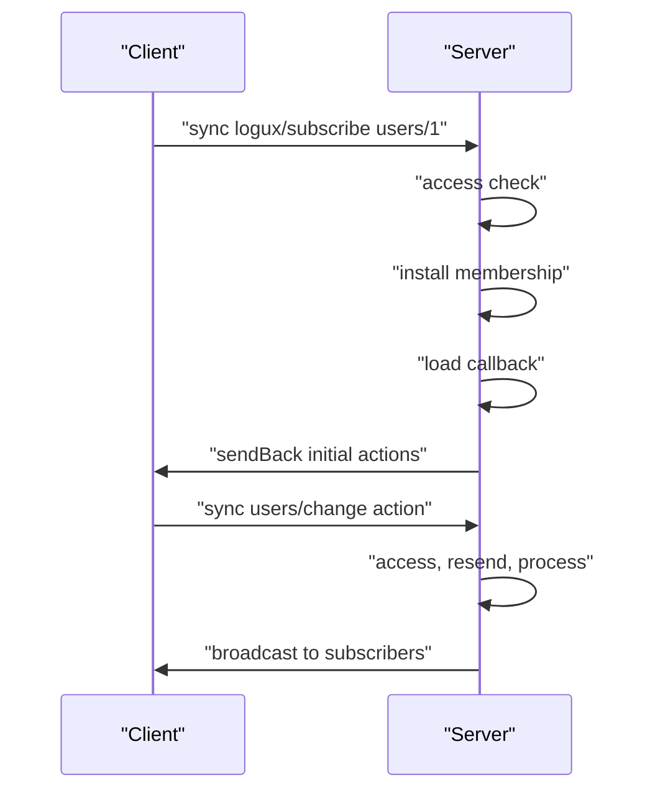
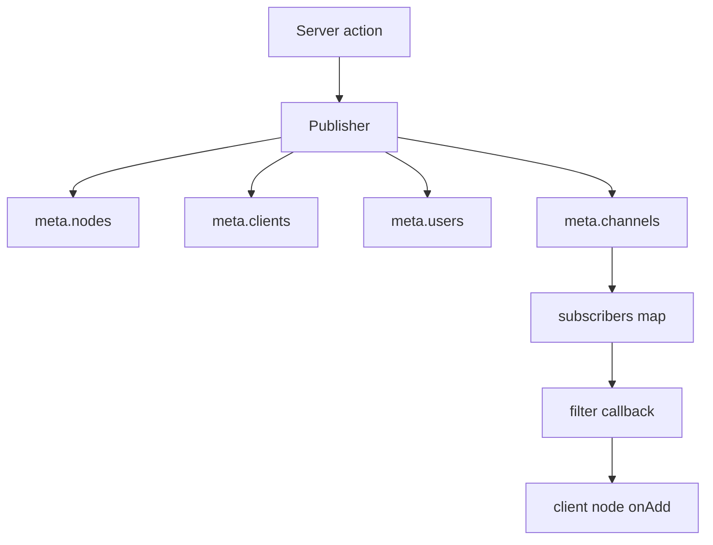

# 04 -- The server: channels, subscriptions, and delivery

`@logux/server` turns the core log into an application server. It adds three ideas: authentication, action types, and channels. An action type runs access and processing. A channel is a named subscription with an access check, an optional filter, and an initial load.

## The BaseServer and the Server

`BaseServer` holds the log, the connected clients, the type handlers, and the channel handlers. The end-user class `Server` adds a command-line option loader and a reporter on top.

The constructor requires a `subprotocol` and a `minSubprotocol`. The subprotocol is the application-level protocol, separate from the wire protocol version 7.

```js
// Source: logux-server/base-server/index.js, lines 57-62
    if (typeof this.options.subprotocol === 'undefined') {
      throw optionError('Missed `subprotocol` option in server constructor')
    }
    if (typeof this.options.minSubprotocol === 'undefined') {
      throw optionError('Missed `minSubprotocol` option in server constructor')
    }
```

The server keeps one shared `Log`. Its node identifier starts with `server:`.

```js
// Source: logux-server/base-server/index.js, lines 76-94
    this.nodeId = `server:${this.options.id || nanoid(6)}`

    if (this.options.fileUrl) {
      this.options.root = dirname(fileURLToPath(this.options.fileUrl))
    }

    this.options.root = this.options.root || process.cwd()
    if (typeof this.options.port === 'string') {
      this.options.port = parseInt(this.options.port, 10)
    }

    let store = this.options.store || new MemoryStore()

    let log
    if (this.options.time) {
      log = this.options.time.nextLog({ nodeId: this.nodeId, store })
    } else {
      log = new Log({ nodeId: this.nodeId, store })
    }
```

## Action types

`server.type(name, callbacks)` registers a handler. The handler has an `access` check, an optional `resend` rule, and an optional `process` side effect. The name can be a string or a regular expression.

```js
// Source: logux-server/base-server/index.js, lines 546-562
  type(name, callbacks, options = {}) {
    if (typeof name === 'function') name = name.type
    let handler = normalizeType(
      `Action type ${name}`,
      callbacks,
      options.queue || 'main'
    )

    if (name instanceof RegExp) {
      this.regexTypes.set(name, handler)
    } else {
      if (this.types[name]) {
        throw new Error(`Action type ${name} was already defined`)
      }
      this.types[name] = handler
    }
  }
```

`normalizeType` builds the steps. The default pipeline is access, resend, then process. Trusted server submissions skip the access check.

```js
// Source: logux-server/processing/index.js, lines 134-156
export function normalizeType(name, callbacks, queue) {
  if (!callbacks || (!callbacks.access && !callbacks.accessAndProcess)) {
    throw new Error(`${name} must have access callback`)
  }

  let steps
  if (callbacks.accessAndProcess) {
    steps = [
      denyOn403(task => {
        return callbacks.accessAndProcess(task.ctx, task.action, task.meta)
      }),
      task => runResend(task, callbacks.resend)
    ]
  } else {
    steps = [
      skipTrusted(task => runAccess(task, callbacks.access)),
      task => runResend(task, callbacks.resend),
      task => callbacks.process?.(task.ctx, task.action, task.meta)
    ]
  }

  return { duplicate: 'command', finally: callbacks.finally, queue, steps }
}
```

## Channels and subscriptions

`server.channel(pattern, callbacks)` registers a channel. The pattern supports `:params` and a `*` wildcard. The callbacks are `access`, an optional `filter`, and an optional `load`.

```js
// Source: logux-server/base-server/index.js, lines 247-259
  channel(pattern, callbacks, options = {}) {
    let channel = normalizeChannel(
      `Channel ${pattern}`,
      callbacks,
      options.queue || 'main'
    )
    if (typeof pattern === 'string') {
      channel.pattern = createPattern(pattern)
    } else {
      channel.regexp = pattern
    }
    this.channels.push(channel)
  }
```

`normalizeChannel` runs access, installs the membership in the subscribers map, and sends the initial load.

```js
// Source: logux-server/processing/index.js, lines 158-194
export function normalizeChannel(name, callbacks, queue) {
  if (!callbacks || (!callbacks.access && !callbacks.accessAndLoad)) {
    throw new Error(`${name} must have access callback`)
  }

  let steps
  if (callbacks.accessAndLoad) {
    steps = [
      denyOn403(
        notFoundOn404(async task => {
          task.loaded = await callbacks.accessAndLoad(
            task.ctx,
            task.action,
            task.meta
          )
        })
      ),
      installMembership,
      task => sendLoaded(task, () => task.loaded)
    ]
  } else {
    steps = [
      task => runAccess(task, callbacks.access),
      installMembership,
      notFoundOn404(task => sendLoaded(task, callbacks.load))
    ]
  }

  return {
    duplicate: 'connection',
    filter: callbacks.filter,
    finally: callbacks.finally,
    queue,
    steps,
    unsubscribe: callbacks.unsubscribe
  }
}
```

The subscription itself is a `logux/subscribe` action. `resolveHandler` is the only place that knows about channels; the queue, the runner, and the publisher have no subscription branches.

```js
// Source: logux-server/processing/index.js, lines 266-286
export function resolveHandler(server, action, meta) {
  let type = action.type
  if (type === 'logux/subscribe' || type === 'logux/unsubscribe') {
    let match = matchChannel(server, action.channel)
    if (type === 'logux/unsubscribe' && typeof action.channel === 'string') {
      // Unsubscribe needs no channel callbacks, but keeps the channel's queue
      return {
        duplicate: 'connection',
        queue: match ? match.handler.queue : 'main',
        steps: UNSUBSCRIBE
      }
    }
    if (!match) return WRONG_CHANNEL
    return { ...match.handler, params: match.params }
  }

  let handler =
    server.types[type] || getRegexType(server, type) || server.otherProcessor
  if (handler) return handler
  return parseId(meta.id).userId === 'server' ? SERVER_FACT : UNKNOWN_TYPE
}
```

## The Context

`Context` is the object your callbacks receive. It exposes `userId`, `clientId`, `nodeId`, `headers`, `data`, and `params`. `sendBack` sends actions to the current client only.

```js
// Source: logux-server/context/index.js, lines 3-35
export class Context {
  constructor(server, meta, task) {
    this.server = server
    this.data = {}

    let client
    if (meta.node) {
      client = meta
      this.nodeId = client.nodeId
      this.userId = client.userId
      this.clientId = client.clientId
      this.subprotocol = client.node.remoteSubprotocol
    } else {
      let parsed = parseId(meta.id)
      this.nodeId = parsed.nodeId
      this.userId = parsed.userId
      this.clientId = parsed.clientId
      this.isServer = this.userId === 'server'
      client = server.clientIds.get(this.clientId)
      if (meta.subprotocol) {
        this.subprotocol = meta.subprotocol
      } else if (client) {
        this.subprotocol = client.node.remoteSubprotocol
      }
    }

    if (client) {
      this.headers = client.node.remoteHeaders
    } else {
      this.headers = {}
    }

    if (task) this.signal = task.controller.signal
  }
```

## Delivery: the Publisher

The `resend` callback writes delivery targets into `meta.channels`, `meta.users`, `meta.clients`, and `meta.nodes`. The `Publisher` then resolves each target to connected clients and fans the action out. It never runs access, resend, or process; it only routes already stored facts.

```js
// Source: logux-server/publishing/index.js, lines 31-68
  #resolveTargets(action, meta, targets) {
    let from = parseId(meta.id).clientId
    let ignoreClients = new Set(meta.excludeClients || [])
    ignoreClients.add(from)

    if (meta.nodes) {
      for (let id of meta.nodes) {
        let client = this.server.nodeIds.get(id)
        if (client) {
          ignoreClients.add(client.clientId)
          addTarget(targets, client, action, meta)
        }
      }
    }

    if (meta.clients) {
      for (let id of meta.clients) {
        if (this.server.clientIds.has(id)) {
          let client = this.server.clientIds.get(id)
          ignoreClients.add(client.clientId)
          addTarget(targets, client, action, meta)
        }
      }
    }

    if (meta.users) {
      for (let userId of meta.users) {
        let users = this.server.userIds.get(userId)
        if (users) {
          for (let client of users) {
            if (!ignoreClients.has(client.clientId)) {
              ignoreClients.add(client.clientId)
              addTarget(targets, client, action, meta)
            }
          }
        }
      }
    }
```

The author never receives the action back: `ignoreClients` starts with the author's client ID and with any client listed in `excludeClients`.



The channel handler is the subscription; the `resend` rule is the fan-out.



## Cross-References

- [03-wire-protocol.md](./03-wire-protocol.md) — the transport under the server.
- [06-sync-map.md](./06-sync-map.md) — the sync map helper that registers types and channels for you.
- [07-processing-lifecycle.md](./07-processing-lifecycle.md) — the access, resend, and process pipeline in detail.

## The Aha Moment
**Aha:** The server is a router of stored facts, not a request handler. The `type` and `channel` callbacks decide access and write delivery metadata. Then a separate component, the Publisher, reads that metadata and fans the already stored action out to matching nodes. Subscriptions are just `logux/subscribe` actions, so subscription state lives in the log and replays after a reconnect with no separate session bookkeeping.

Continue to [05-offline-connect-reconnect.md](./05-offline-connect-reconnect.md).
