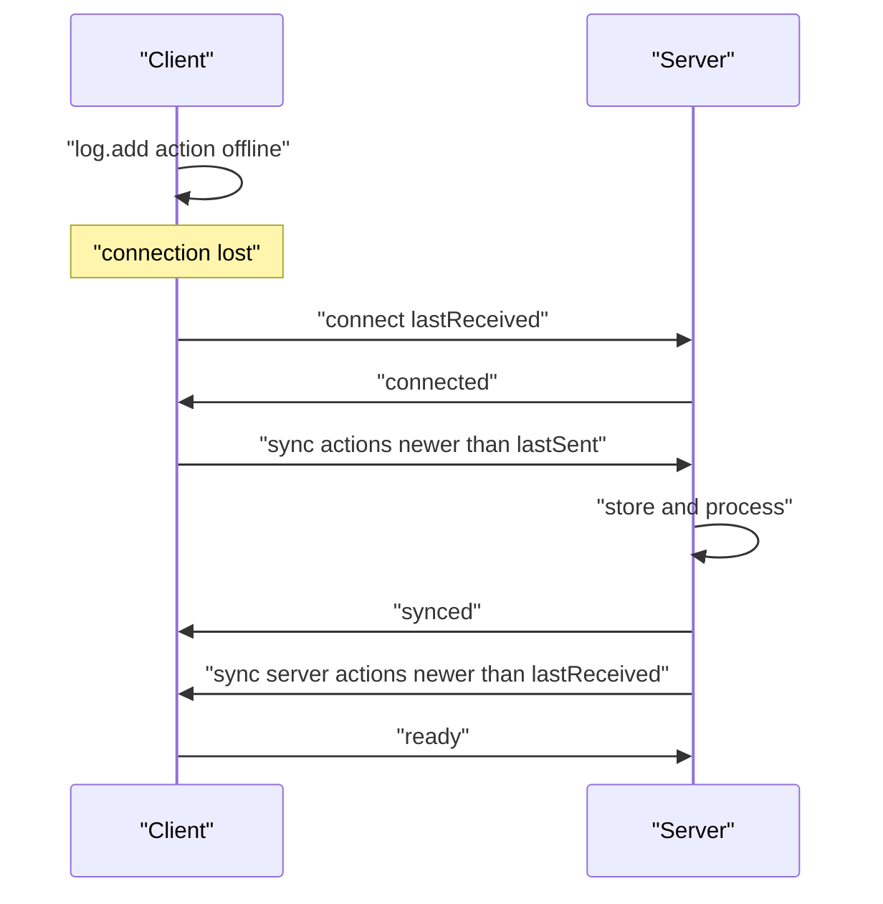
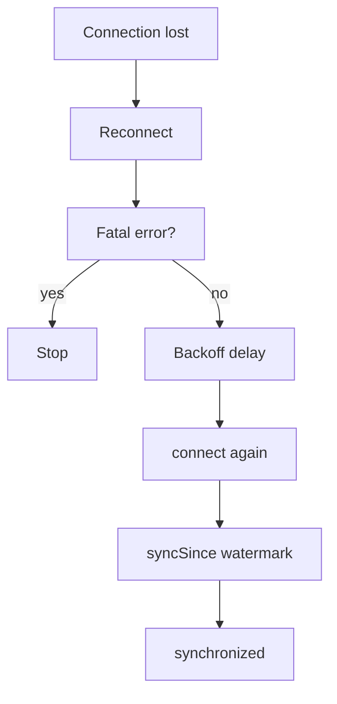

# 05 -- Offline-first: sync resumes, it does not restart

Offline is not a special mode in Logux. It is a paused sync. Each side stores a cursor, the `added` watermark, for what it last sent and received. When the connection returns, each side sends only what is newer than the other side's cursor.

## The watermarks

`BaseNode.initialize` loads `lastSent` and `lastReceived` from the store. They survive a process restart, so a browser that reloads and reconnects does not resend the whole log.

```js
// Source: logux-core/base-node/index.js, lines 166-176
  async initialize() {
    let [synced, added] = await Promise.all([
      this.log.store.getLastSynced(),
      this.log.store.getLastAdded()
    ])
    this.initialized = true
    this.lastSent = synced.sent
    this.lastReceived = synced.received
    this.lastAddedCache = added
    if (this.connection.connected) this.onConnect()
  }
```

`syncSince` reads every action newer than the remote cursor and sends it. If nothing is newer, it just confirms the sync.

```js
// Source: logux-core/base-node/index.js, lines 349-358
  async syncSince(lastSynced) {
    let data = await this.syncSinceQuery(lastSynced)
    if (!this.connected) return
    if (data.entries.length > 0) {
      this.sendSync(data.added, data.entries)
    } else {
      this.checkSynchronized()
    }
    await this.sendReady()
  }
```

## The Reconnect wrapper

`Reconnect` wraps a connection and retries it with exponential backoff. It also pauses during a browser tab freeze and resumes on focus or network recovery.

```js
// Source: logux-core/reconnect/index.js, lines 1-11
const DEFAULT_OPTIONS = {
  attempts: Infinity,
  maxDelay: 5000,
  minDelay: 1000
}

const FATAL_ERRORS = [
  'wrong-protocol',
  'wrong-subprotocol',
  'wrong-credentials'
]
```

Three errors are fatal. `wrong-protocol`, `wrong-subprotocol`, and `wrong-credentials` stop the retry loop, because retrying them cannot succeed. The wrapper watches the `error` message and turns off `reconnecting` on a fatal error.

```js
// Source: logux-core/reconnect/index.js, lines 123-148
  nextDelay() {
    let base = this.options.minDelay * 2 ** this.attempts
    let rand = Math.random()
    let deviation = rand * 0.5 * base
    if (Math.floor(rand * 10) === 1) deviation = -deviation
    return Math.min(base + deviation, this.options.maxDelay) || 0
  }

  on(...args) {
    return this.connection.on(...args)
  }

  reconnect() {
    if (this.attempts > this.options.attempts - 1) {
      this.reconnecting = false
      this.attempts = 0
      return
    }

    let delay = this.nextDelay()
    this.timer = setTimeout(() => {
      if (this.reconnecting && !this.connecting && !this.connected) {
        this.connect()
      }
    }, delay)
  }
```

## Keepalive with ping

`ping` tests the connection when it is idle. The node sends `ping` with its current `lastAddedCache`. The remote answers `pong`. The `saveReceived` call on every ping keeps the remote cursor fresh even when no actions move.

```js
// Source: logux-core/ping/index.js, lines 1-17
export function sendPing() {
  this.startTimeout()
  this.send(['ping', this.lastAddedCache])
  if (this.pingTimeout) clearTimeout(this.pingTimeout)
}

export function pingMessage(synced) {
  if (this.connected && this.authenticated) {
    this.send(['pong', this.lastAddedCache])
  }
  this.saveReceived(synced)
}

export function pongMessage(synced) {
  this.endTimeout()
  this.saveReceived(synced)
}
```

The client defaults to a ping every 10000 milliseconds and a timeout of 70000 milliseconds. The server defaults to a ping every 20000 milliseconds with the same timeout. These defaults are in `client-node/index.js` and `server-node/index.js`.

## Actions queued while offline

The client log keeps the action with a reason while it is unsynchronized. On reconnect the node sends it. The `lastAdded` watermark is per log, so the ordering is preserved.



The `ready` message ends the initial sync. It means the remote sent everything it had at connect time. The node reports `synchronized` only after it receives `ready`.

```js
// Source: logux-core/ready/index.js, lines 20-30
export async function readyMessage(added) {
  await this.receiving
  if (!this.connected) return

  if (added > this.lastReceived) this.setLastReceived(added)
  if (!this.remoteReady) {
    this.remoteReady = true
    this.checkSynchronized()
    this.emitter.emit('ready')
  }
}
```

## The LocalPair for tests

`LocalPair` is a fake connection that links two local nodes with a configurable delay. It is the backbone of the core tests, because it runs the whole node logic without a real socket.

```js
// Source: logux-core/local-pair/index.js, lines 78-84
export class LocalPair {
  constructor(delay = 1) {
    this.delay = delay
    this.left = new LocalConnection(this, 'left')
    this.right = new LocalConnection(this, 'right')
  }
}
```



## Cross-References

- [02-log-and-node.md](./02-log-and-node.md) — the watermarks and the state machine.
- [03-wire-protocol.md](./03-wire-protocol.md) — the `connect`, `sync`, `ready`, and `ping` messages.
- [09-composition.md](./09-composition.md) — how the client and server halves of this resync fit together.

## The Aha Moment
**Aha:** Offline support is one number per direction. `lastSent` and `lastReceived` are the only state that survives a disconnect. The client does not track "pending requests". It keeps unsynchronized actions with a reason and lets the node send everything newer than the remote cursor on the next connection. That is the whole trick: resumable sync falls out of a sorted log plus two cursors.

Continue to [06-sync-map.md](./06-sync-map.md).
