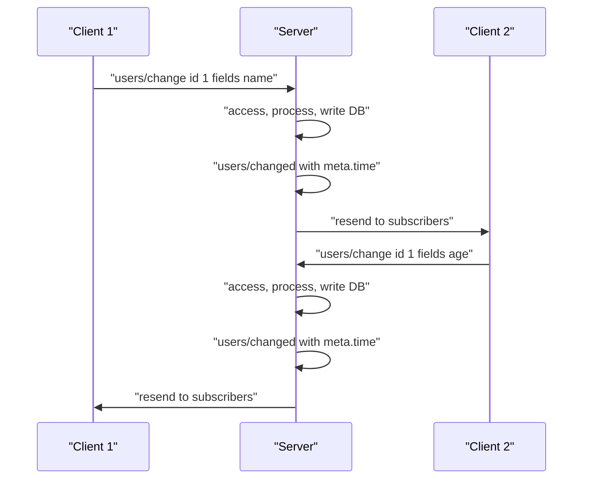
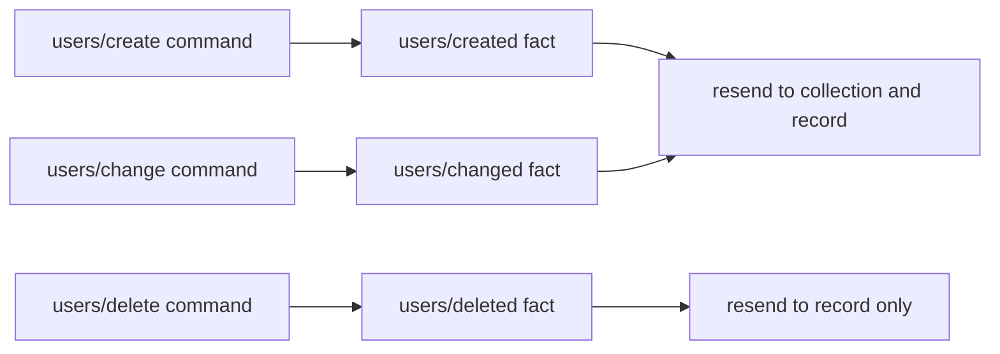

# 06 -- SyncMap: a shared key-value collection

SyncMap is a shared collection, like a dictionary that many clients edit at once. Each record has an identifier and a set of fields. Edits to different fields of the same record merge. Edits to the same field resolve by time.

## The action vocabulary

`@logux/actions` ships six action creators for every collection, named by a plural noun. The creators pair three commands with three facts.

```js
// Source: logux-actions/sync-map/index.js, lines 1-36
import { defineAction } from '../define-action/index.js'

export function defineCreatedSyncMap(plural) {
  return defineAction(`${plural}/created`)
}

export function defineCreateSyncMap(plural) {
  return defineAction(`${plural}/create`)
}

export function defineChangedSyncMap(plural) {
  return defineAction(`${plural}/changed`)
}

export function defineChangeSyncMap(plural) {
  return defineAction(`${plural}/change`)
}

export function defineDeletedSyncMap(plural) {
  return defineAction(`${plural}/deleted`)
}

export function defineDeleteSyncMap(plural) {
  return defineAction(`${plural}/delete`)
}

export function defineSyncMapActions(plural) {
  return [
    defineCreateSyncMap(plural),
    defineChangeSyncMap(plural),
    defineDeleteSyncMap(plural),
    defineCreatedSyncMap(plural),
    defineChangedSyncMap(plural),
    defineDeletedSyncMap(plural)
  ]
}
```

Create/change and created/changed carry `id` and `fields`. Delete/deleted carry only `id`. The type system spells out the shapes.

```ts
// Source: logux-actions/sync-map/index.d.ts, lines 9-39
export interface SyncMapCreateAction<
  Value extends SyncMapValues = SyncMapValues
> {
  fields: Omit<Value, 'id'>
  id: string
  type: string
}

export interface SyncMapCreatedAction<
  Value extends SyncMapValues = SyncMapValues
> {
  fields: Omit<Value, 'id'>
  id: string
  type: string
}

export interface SyncMapChangeAction<
  Value extends SyncMapValues = SyncMapValues
> {
  fields: Partial<Omit<Value, 'id'>>
  id: string
  type: string
}

export interface SyncMapChangedAction<
  Value extends SyncMapValues = SyncMapValues
> {
  fields: Partial<Omit<Value, 'id'>>
  id: string
  type: string
}
```

`change` takes a partial `fields` object. That is the merge. A `change` of one field does not touch the other fields.

## Field-level conflict resolution

Two users change the same record at the same time. If they change different fields, both changes apply. If they change the same field, the later `meta.time` wins. The server helper `addSyncMap` turns an accepted command into a fact with a timestamp.

```js
// Source: logux-server/add-sync-map/index.js, lines 90-118
export function addSyncMap(server, plural, operations) {
  let createdType = `${plural}/created`
  let changedType = `${plural}/changed`
  let deletedType = `${plural}/deleted`
  resendFinished(server, plural, createdType)
  resendFinished(server, plural, changedType)
  resendFinished(server, plural, deletedType, false)

  if (operations.load) {
    server.channel(`${plural}/:id`, {
      access(ctx, action, meta) {
        return operations.access(ctx, ctx.params.id, action, meta)
      },
      async load(ctx, action, meta) {
        if (action.creating) return
        let since = action.since ? action.since.time : 0
        let data = await operations.load(
          ctx,
          ctx.params.id,
          since,
          action,
          meta
        )
        if (data !== false) {
          await sendMap(server, changedType, data, since)
        }
      }
    })
  }
```

The application callbacks are `operations.load`, `operations.create`, `operations.change`, and `operations.delete`. Each runs your access check and your database write, then publishes the fact.

```js
// Source: logux-server/add-sync-map/index.js, lines 120-160
  if (operations.create) {
    server.type(`${plural}/create`, {
      access(ctx, action, meta) {
        return operations.access(ctx, action.id, action, meta)
      },
      async process(ctx, action, meta) {
        let result = await operations.create(
          ctx,
          action.id,
          action.fields,
          meta.time,
          action,
          meta
        )
        if (result !== false) {
          await addFinished(server, ctx, createdType, action, meta)
        }
      }
    })
  }

  if (operations.change) {
    server.type(`${plural}/change`, {
      access(ctx, action, meta) {
        return operations.access(ctx, action.id, action, meta)
      },
      async process(ctx, action, meta) {
        let result = await operations.change(
          ctx,
          action.id,
          action.fields,
          meta.time,
          action,
          meta
        )
        if (result !== false) {
          await addFinished(server, ctx, changedType, action, meta)
        }
      }
    })
  }
```

The `resendFinished` helper resends created and changed facts to the collection channel and to the record's own channel. Deleted facts (`all = false`) resend only to the record's own channel.

```js
// Source: logux-server/add-sync-map/index.js, lines 18-38
function resendFinished(server, plural, type, all = true) {
  if (all) {
    server.type(type, {
      access() {
        return false
      },
      resend(ctx, action) {
        return [plural, `${plural}/${action.id}`]
      }
    })
  } else {
    server.type(type, {
      access() {
        return false
      },
      resend(ctx, action) {
        return [`${plural}/${action.id}`]
      }
    })
  }
}
```

## ChangedAt and NoConflictResolution

The server can send a whole record on a load. It needs to know which fields carry a timestamp and which fields have no conflict rule. `ChangedAt` wraps a value with a time. `NoConflictResolution` marks a field that should not resolve conflicts.

```js
// Source: logux-server/add-sync-map/index.js, lines 1-9
const WITH_TIME = Symbol('WITH_TIME')

export function ChangedAt(value, time) {
  return { time, value, [WITH_TIME]: true }
}

export function NoConflictResolution(value) {
  return { value, [WITH_TIME]: false }
}
```



The two changes touch different fields, so both apply and both broadcast.



## Cross-References

- [04-server-and-subscriptions.md](./04-server-and-subscriptions.md) — the `type` and `channel` machinery this helper wires up.
- [07-processing-lifecycle.md](./07-processing-lifecycle.md) — how the command becomes a fact after processing.
- [08-builtin-actions.md](./08-builtin-actions.md) — the CRDT table, a related built-in for rows.

## The Aha Moment
**Aha:** SyncMap splits every mutation into a command and a fact. The client sends commands. The server accepts a command, runs the application write, and publishes the matching fact with a timestamp. Conflict resolution is per field and driven by `meta.time`, so two users editing different fields never overwrite each other, and the same field resolves to the later write.

Continue to [07-processing-lifecycle.md](./07-processing-lifecycle.md).
