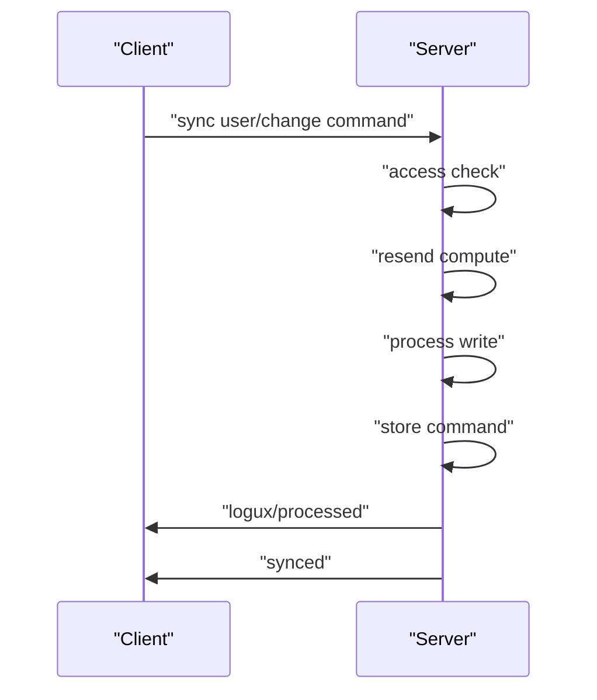
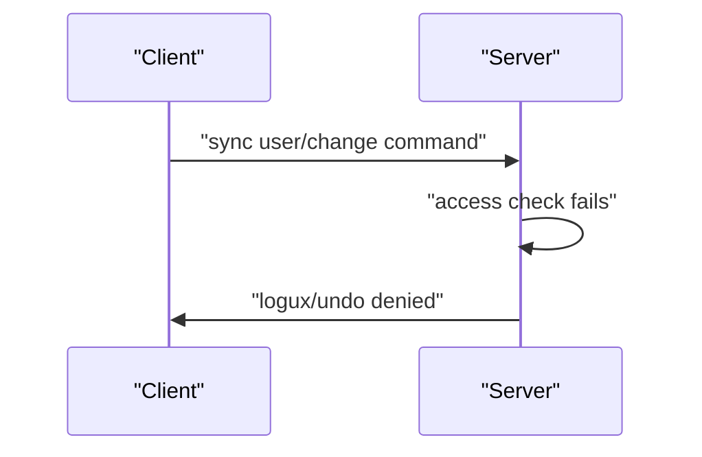

# 07 -- The lifecycle: process, processed, undo, prepare

Every client command goes through one pipeline: access, resend, process. The server then answers with a receipt: `logux/processed` for success, or `logux/undo` for rejection. Before sending history, the server sends `logux/prepare`. This document covers that lifecycle.

## The task runner

`ActionRunner.submit` prepares the meta, resolves the handler, and pushes the task into a queue. The queue key is the client plus the handler's queue name.

```js
// Source: logux-server/processing/index.js, lines 505-545
  submit({ action, client, meta = {}, trusted = false }) {
    this.server.prepareMeta(meta, client)
    let handler = resolveHandler(this.server, action, meta)

    // Reserve the duplicate key before any awaited work
    let key =
      handler.duplicate === 'connection' && client
        ? `${client.key} ${meta.id}`
        : meta.id

    let found = this.processing.get(key)
    if (found) {
      this.server.emitter.emit('report', 'duplicate', { actionId: meta.id })
      if (found.task) return found.task.promise
      let outcome = { ...found.outcome, replayed: true }
      return this.#answer({ action, client, meta, outcome }).then(() => {
        if (outcome.type === 'undo') throw undoError(meta, outcome.reason)
        return meta
      })
    }

    let task = new Task(this, { action, client, handler, key, meta, trusted })
    this.processing.start(key, task)
    this.byId.set(meta.id, task)

    let tracking = task.promise.then(ignore, ignore)
    this.active.add(tracking)
    if (client) addTo(this.clientTasks, client, tracking)
    void tracking.then(() => {
      this.active.delete(tracking)
      if (client) removeFrom(this.clientTasks, client, tracking)
    })

    if (trusted) {
      // Nested commands must not wait for the task, which awaits them
      void this.run(task)
    } else {
      this.queues.push(`${parseId(meta.id).clientId}/${handler.queue}`, task)
    }
    return task.promise
  }
```

A duplicate key means the action was already seen. If the task is still running, the caller gets the same promise. If it finished, the stored outcome is replayed. This deduplicates retries after a lost answer.

`ActionRunner.run` waits for the steps, settles the outcome, publishes the answer, and then resolves the task promise.

```js
// Source: logux-server/processing/index.js, lines 411-447
  async run(task) {
    // A task, which was answered before its turn, never runs its callbacks
    if (!task.outcome) {
      await Promise.race([this.#runSteps(task), task.abandoned])
    }
    task.settle({ type: 'processed' })
    task.cleanup()

    let failed
    try {
      await this.#answer(task)
    } catch (e) {
      // The answer was not published: do not acknowledge the completion
      e.transportFailure = true
      failed = e
    }
    this.#forget(task)

    if (task.outcome.type === 'undo' && task.queueKey) {
      for (let waiting of this.queues.cancelPending(task.queueKey)) {
        void this.server.undo(waiting.action, waiting.meta, 'error')
        void this.run(waiting)
      }
    }
    if (task.outcome.type !== 'cancelled') {
      let latency = Date.now() - task.start
      this.server.emitter.emit('processed', task.action, task.meta, latency)
    }

    if (failed) {
      task.rejectTask(failed)
    } else if (task.outcome.type === 'undo') {
      task.rejectTask(task.error || undoError(task.meta, task.outcome.reason))
    } else {
      task.resolveTask(task.meta)
    }
  }
```

## The receipt: logux/processed

On success the server writes `logux/processed` with the client ID in the delivery metadata. The `#answer` method writes it only for actions whose author is not the server.

```js
// Source: logux-server/processing/index.js, lines 465-484
  async #answer({ action, client, meta, outcome }) {
    if (outcome.type === 'processed') {
      if (!outcome.replayed) {
        // Custom `Node` classes send the log to their own client by themselves
        if (client && client.node.received) client.node.received[meta.id] = true
        await this.server.log.add([[action, meta]])
      }
      let { clientId, userId } = parseId(meta.id)
      if (userId !== 'server') {
        await this.server.log.add(
          { id: meta.id, type: 'logux/processed' },
          { clients: [clientId] }
        )
      }
    } else if (outcome.type === 'undo') {
      // The outcome was already reported when it was decided
      await this.server.publishUndo(action, meta, outcome.reason, outcome.extra)
    }
    await this.server.publisher.settled()
  }
```

The action is added to the log only after successful processing. The 0.17 change log states this explicitly: "action is added to the log and sent to clients only after successful processing. Failed actions are not sent."

## The rejection: logux/undo

`logux/undo` carries the rejected action and a reason. The server's `publishUndo` builds it and routes it back to the author.

```js
// Source: logux-server/base-server/index.js, lines 484-500
  publishUndo(action, meta, reason, extra, clientId) {
    let undoMeta = {}
    if (meta.users) undoMeta.users = meta.users.slice(0)
    if (meta.nodes) undoMeta.nodes = meta.nodes.slice(0)
    if (meta.reasons) undoMeta.reasons = meta.reasons.slice(0)
    if (meta.channels) undoMeta.channels = meta.channels.slice(0)
    if (meta.excludeClients) {
      undoMeta.excludeClients = meta.excludeClients.slice(0)
    }
    undoMeta.clients = (meta.clients || []).concat([
      clientId || parseId(meta.id).clientId
    ])
    return this.log.add(
      { ...extra, action, id: meta.id, reason, type: 'logux/undo' },
      undoMeta
    )
  }
```

The reason is one of `denied`, `error`, `unknownType`, `wrongChannel`, or `notFound`.

## The header: logux/prepare

Before the server sends history to a client, it sends `logux/prepare` with the count of actions. This lets the client show a loading state. The `FilteredNode.syncSinceQuery` appends it when there is history.

```js
// Source: logux-server/filtered-node/index.js, lines 46-63
  async syncSinceQuery(lastSynced) {
    let app = this.client.app
    let data = app.connectLoader
      ? await loadOnConnect(app, this.client, lastSynced)
      : await super.syncSinceQuery(lastSynced)

    let actions = data.entries.length
    if (actions > 0) {
      let id = app.log.generateId()
      // Entries are ordered from the newest to the oldest one,
      // so the last entry will be sent to the client first
      data.entries.push([
        { actions, type: 'logux/prepare' },
        { id, time: idToTime(id) }
      ])
    }
    return data
  }
```

The built-in action types are declared in `@logux/actions`.

```ts
// Source: logux-actions/processing/index.d.ts, lines 5-18
export interface LoguxProcessedAction {
  id: string
  type: 'logux/processed'
}

export interface LoguxUndoAction<
  RevertedAction extends Action = AnyAction,
  Reason extends string = string
> {
  action: RevertedAction
  id: string
  reason: Reason
  type: 'logux/undo'
}
```



The undo path.



## Cross-References

- [01-action-and-meta.md](./01-action-and-meta.md) — the meta the server stamps on these actions.
- [04-server-and-subscriptions.md](./04-server-and-subscriptions.md) — the access, resend, and process callbacks.
- [08-builtin-actions.md](./08-builtin-actions.md) — the `loguxProcessed`, `loguxUndo`, and `loguxPrepare` creators.

## The Aha Moment
**Aha:** Processing is acknowledgment, not transport. The client's action stays in its log with a reason until the server writes `logux/processed` back. The server writes the command to its own log only after processing succeeds, so a crash between the effect and the write replays the action idempotently. Rejection is the same shape as success: `logux/undo` is an action, so a rejection is durable, ordered, and subject to the same log rules as everything else.

Continue to [08-builtin-actions.md](./08-builtin-actions.md).
