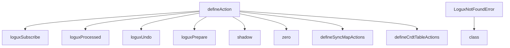
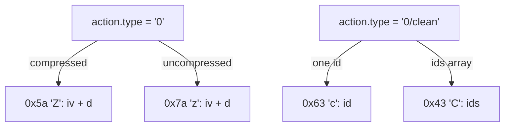

# 08 -- The built-in actions: one word each

`@logux/actions` is small. It defines action creators, not a runtime. The creators fall into groups: the action-creator helper, the subscription actions, the lifecycle actions, the sync-map actions, the CRDT table actions, the zero-knowledge actions, and two helpers. This document covers the ones not covered elsewhere.

## defineAction

The foundation is `defineAction`. It returns a function that builds an action, and it attaches a `type` string and a `match` predicate.

```js
// Source: logux-actions/define-action/index.js, lines 1-10
export function defineAction(type, creator) {
  if (!creator) {
    creator = fields => {
      return { type, ...fields }
    }
  }
  creator.type = type
  creator.match = action => action.type === type
  return creator
}
```

The type system gives the creator two shapes: a default that takes the action fields, or a custom creator with its own arguments.

```ts
// Source: logux-actions/define-action/index.d.ts, lines 46-57
interface DefineAction {
  <CreatedAction extends Action>(
    type: CreatedAction['type']
  ): ActionCreator<CreatedAction, [OmitFromUnion<CreatedAction, 'type'>]>

  <CreatedAction extends Action, CreatorArgs extends unknown[]>(
    type: CreatedAction['type'],
    creator?: (...args: CreatorArgs) => CreatedAction
  ): ActionCreator<CreatedAction, CreatorArgs>
}

export const defineAction: DefineAction
```

## Subscriptions

The three subscription actions are plain creators. `loguxSubscribe` opens a channel, `loguxSubscribed` confirms membership, and `loguxUnsubscribe` leaves it.

```js
// Source: logux-actions/subscriptions/index.js, lines 1-7
import { defineAction } from '../define-action/index.js'

export const loguxSubscribe = defineAction('logux/subscribe')

export const loguxSubscribed = defineAction('logux/subscribed')

export const loguxUnsubscribe = defineAction('logux/unsubscribe')
```

The subscribe action carries `channel`, an optional `filter`, an optional `since`, and an optional `creating` flag.

```ts
// Source: logux-actions/subscriptions/index.d.ts, lines 3-14
export interface LoguxSubscribeAction {
  channel: string
  creating?: true
  filter?: {
    [key: string]: boolean | number | string
  }
  since?: {
    id: string
    time: number
  }
  type: 'logux/subscribe'
}
```

## The lifecycle actions

The processing actions are defined in one line each, plus `loguxPrepare`.

```js
// Source: logux-actions/processing/index.js, lines 1-5
import { defineAction } from '../define-action/index.js'

export const loguxProcessed = defineAction('logux/processed')

export const loguxUndo = defineAction('logux/undo')
```

```js
// Source: logux-actions/prepare/index.js, lines 1-3
import { defineAction } from '../define-action/index.js'

export const loguxPrepare = defineAction('logux/prepare')
```

## shadow

`shadow` is only an action creator. It builds a `{ type: 'shadow', id }` action; nothing in these three repos replaces a body or drops encrypted data. The `.d.ts` docstring describes the replacement as client-side behavior in `@logux/client`, which is outside these repos and not implemented here.

```js
// Source: logux-actions/shadow/index.js, lines 1-3
import { defineAction } from '../define-action/index.js'

export const shadow = defineAction('shadow')
```

## LoguxNotFoundError

`LoguxNotFoundError` is the one class in `@logux/actions`. It signals a missing record from a channel or type handler.

```js
// Source: logux-actions/logux-not-found/index.js, lines 1-6
export class LoguxNotFoundError extends Error {
  constructor() {
    super()
    this.name = 'LoguxNotFoundError'
  }
}
```

## The CRDT table

The CRDT (Conflict-free Replicated Data Type) table is a row collection. Its creators take a table object that knows its `plural` name.

```js
// Source: logux-actions/crdt-table/index.js, lines 1-21
import { defineAction } from '../define-action/index.js'

export function defineCreatedCrdtTable(table) {
  return defineAction(`${table.plural}/created`)
}

export function defineChangedCrdtTable(table) {
  return defineAction(`${table.plural}/changed`)
}

export function defineDeletedCrdtTable(table) {
  return defineAction(`${table.plural}/deleted`)
}

export function defineCrdtTableActions(table) {
  return [
    defineCreatedCrdtTable(table),
    defineChangedCrdtTable(table),
    defineDeletedCrdtTable(table)
  ]
}
```

The created action supports a batch: either one record with an `id`, or a `records` array. The changed action supports one row or an `ids` array.

```ts
// Source: logux-actions/crdt-table/index.d.ts, lines 20-38
export type CrdtTableCreatedAction<Fields extends object = object> =
  | {
      fields: Fields
      id: string
      type: string
    }
  | { records: (Fields & { id: string })[]; type: string }

export type CrdtTableChangedAction<Fields extends object = object> =
  | {
      fields: Partial<Fields>
      id: string
      type: string
    }
  | {
      fields: Partial<Fields>
      ids: string[]
      type: string
    }
```

## Zero-knowledge actions

The zero-knowledge actions carry encrypted payloads. The action type is the string `0`, and the body holds an initialization vector (`iv`) and encrypted data (`d`).

```js
// Source: logux-actions/zero-knowledge/index.js, lines 1-23
import { defineAction } from '../define-action/index.js'

export const zero = defineAction('0')

export const zeroClean = defineAction('0/clean')

export const zeroPacker = {
  pack(action) {
    let { d, iv, ...rest } = action
    let blob = new Uint8Array(iv.length + d.length)
    blob.set(iv)
    blob.set(d, iv.length)
    return { blob, action: rest }
  },

  unpack(packed) {
    return {
      ...packed.action,
      d: packed.blob.slice(12),
      iv: packed.blob.slice(0, 12)
    }
  }
}
```

The type declares the shape.

```ts
// Source: logux-actions/zero-knowledge/index.d.ts, lines 3-12
export interface ZeroAction {
  compressed: boolean
  d: Uint8Array
  iv: Uint8Array
  type: '0'
}

export type ZeroCleanAction = {
  type: '0/clean'
} & ({ id: string } | { ids: string[] })
```

The wire protocol has a dedicated compact encoding for the `0` action and the `0/clean` action. The binary encoder recognizes them by type byte.



The full client cycle — an encrypted `0` action is written, a `shadow` replaces its body, then a `0/clean` removes the original from the store — belongs to `@logux/client`, which is outside these repos. Here there is only the vocabulary and the codec: `zero` builds a `0` action, `zeroClean` builds a `0/clean` action, and the binary encoder compacts both into dedicated type bytes.



## Cross-References

- [06-sync-map.md](./06-sync-map.md) — the sync-map creators, which use the same `defineAction` helper.
- [07-processing-lifecycle.md](./07-processing-lifecycle.md) — the `logux/processed`, `logux/undo`, and `logux/prepare` actions in use.
- [03-wire-protocol.md](./03-wire-protocol.md) — the binary encoding of the zero-knowledge `0` action.

## The Aha Moment
**Aha:** There is no magic in the built-in actions. Every one is a `defineAction` call with a reserved type string, plus at most a handful of type declarations. The framework's power is convention, not a special runtime: the server and the client agree on the `logux/*` names and on the sync-map suffixes, and everything else is just actions in the same log.

Continue to [09-composition.md](./09-composition.md).
