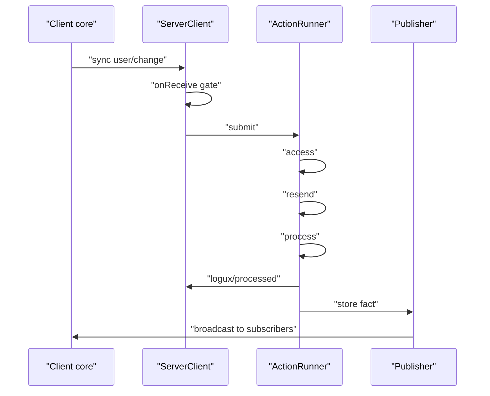
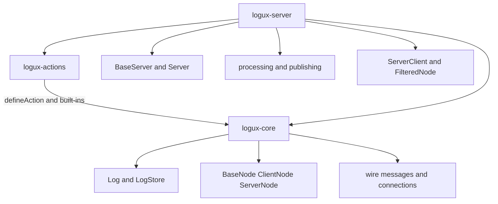

# 09 -- The whole machine: core, server, actions together

The three packages are one machine. `@logux/core` owns the log and the wire. `@logux/server` owns routing, subscriptions, and delivery. `@logux/actions` owns the shared vocabulary. They meet only at the action type string and the metadata object.

## The dependency graph

`@logux/server` depends on both `@logux/core` and `@logux/actions`. `@logux/actions` declares `@logux/core` as a peer dependency. The versions in `package.json` pin the trio together.

```json
// Source: logux-server/package.json, lines 32-39 (dependencies)
  "dependencies": {
    "@logux/actions": "^0.8.1",
    "@logux/core": "^0.12.1",
    "cookie": "^2.0.1",
    "nanoevents": "^10.0.0",
    "nanoid": "^6.0.2",
    "ws": "^8.22.0"
  },
```

```json
// Source: logux-actions/package.json, lines 44-46 (peerDependencies)
  "peerDependencies": {
    "@logux/core": "^0.12.0"
  },
```

The server's top-level `index.js` re-exports its own classes. The `Action` type is re-exported from `index.d.ts` (line 48), not the runtime file.

```js
// Source: logux-server/index.js, lines 1-16
export {
  addSyncMap,
  addSyncMapFilter,
  ChangedAt,
  NoConflictResolution
} from './add-sync-map/index.js'
export { ALLOWED_META } from './allowed-meta/index.js'
export { BaseServer, wasNot403 } from './base-server/index.js'
export { Context } from './context/index.js'
export { filterMeta } from './filter-meta/index.js'
export { PostgresStore } from './postgres-store/index.js'
export { ProcessingStore } from './processing-store/index.js'
export { ResponseError } from './request/index.js'
export { Server } from './server/index.js'
export { TestClient } from './test-client/index.js'
export { TestServer } from './test-server/index.js'
```

## The boundary: ServerClient

`ServerClient` is the seam where the core node meets the server. It builds a `FilteredNode` (a `ServerNode` subclass) and supplies the `auth`, `onReceive`, and `onSend` options that core calls.

```js
// Source: logux-server/server-client/index.js, lines 41-52
    let Node = app.options.Node || FilteredNode

    this.node = new Node(this, app.nodeId, app.log, connection, {
      auth: this.auth.bind(this),
      onReceive: this.onReceive.bind(this),
      onSend,
      ping: app.options.ping,
      ready: () => this.waitForReady(),
      subprotocol: app.options.subprotocol,
      syncBatch: app.options.syncBatch,
      timeout: app.options.timeout
    })
```

The `onReceive` filter is the gate. It rejects actions whose author is not this client, and it rejects meta keys that are not in the server's allow-list. It then hands the action to the runner.

```js
// Source: logux-server/server-client/index.js, lines 206-227
  onReceive(action, meta) {
    let actionClientId = parseId(meta.id).clientId
    let wrongUser = !this.clientId || this.clientId !== actionClientId
    let wrongMeta = Object.keys(meta).some(i => !ALLOWED_META.includes(i))
    if (wrongUser || wrongMeta) {
      this.app.reportFailure('denied', action, meta)
      void this.app.publishUndo(action, meta, 'denied', {}, this.clientId)
      return Promise.resolve(false)
    }

    if (!meta.subprotocol) {
      meta.subprotocol = this.node.remoteSubprotocol
    }

    return this.app.runner.submit({ action, client: this, meta }).then(
      () => false,
      err => {
        if (err.transportFailure) throw err
        return false
      }
    )
  }
```

`ALLOWED_META` is the smallest possible surface. Only three meta keys may arrive from a client.

```js
// Source: logux-server/allowed-meta/index.js, line 1
export const ALLOWED_META = ['id', 'time', 'subprotocol']
```

Everything else, such as `channels` or `clients`, is computed by the server's `resend` callbacks. A client cannot route its own action to arbitrary recipients.

## One action, end to end

A client adds `{ type: 'user/change', userId, name }`. The core node sends it as a `sync` message. The server's `onReceive` validates it, the runner resolves the `user/change` type, runs access, resend, and process, writes the fact, and publishes `logux/processed`. The Publisher fans the fact out to the channels the `resend` callback chose.



## The whole dependency shape



The server never re-implements the wire or the log. It only adds the layer above `onReceive`: what to do with an accepted action, and who else should see it.

## Bootstrap wiring

A client node wraps a `WsConnection` in `Reconnect` and hands them to `ClientNode`. A server is a `Server` with a `subprotocol`/`minSubprotocol` and an `auth` callback, then `listen()`.

```ts
import { ClientNode, Log, MemoryStore, Reconnect, WsConnection } from '@logux/core'

let log = new Log({ nodeId: 'client:1', store: new MemoryStore() })
let connection = new Reconnect(new WsConnection('wss://logux.example.com/'))
let client = new ClientNode('client:1', log, connection)
connection.connect()
```

```ts
import { Server } from '@logux/server'

let server = new Server({ subprotocol: 1, minSubprotocol: 1 })
server.auth(async () => true)
await server.listen()
```

## Cross-References

- [00-what-is-logux.md](./00-what-is-logux.md) — the mental model the three packages share.
- [04-server-and-subscriptions.md](./04-server-and-subscriptions.md) — the routing and delivery layer in detail.
- [05-offline-connect-reconnect.md](./05-offline-connect-reconnect.md) — the resumable sync this machine runs on.

## The Aha Moment
**Aha:** The integration surface is two things: the action type string and the meta object. Core knows nothing about users or channels. The server knows nothing about the wire encoding. Actions knows nothing about either. `onReceive` and `onSend` are the two callbacks where the server and core touch, and the built-in action type names are the shared dictionary. Everything else is a clean vertical stack.

Continue to [README.md](./README.md).
