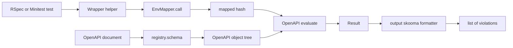
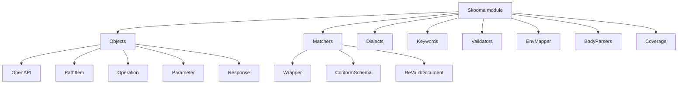

# 00 -- Skooma: validating API implementations against OpenAPI documents

Skooma is a Ruby library for validating Application Programming Interface (API) implementations against OpenAPI documents. The project README states this in one line.

> Skooma is a Ruby library for validating API implementations against OpenAPI documents.

Source: `README.md`, line 8.

The gem in this exploration is `skooma-0.4.0`, checked out at `/Users/darkvoid/GitSources/src.Ruby/skooma`. Every path below is under that root.

## The problem it solves

An OpenAPI document describes an API. It lists paths, operations, parameters, and the JavaScript Object Notation (JSON) Schema for every request body and response body. Teams who write the document first want their code to match the document. The document is the contract.

Skooma checks the contract at test time. A test performs a real Hypertext Transfer Protocol (HTTP) request. Skooma then checks two things. First, it checks that the OpenAPI document itself is a valid document. Second, it checks that the request and response match the schema of the matching operation.

This is not server middleware. Skooma does not sit in the request path of a running application. It is a test library. It runs inside RSpec or Minitest.

## Where Skooma sits

Skooma is one layer over `json_skooma`. `json_skooma` provides the JSON Schema engine: the registry, the dialects, the keywords, and the result objects. Skooma adds the OpenAPI meaning on top.

The version is a constant.

```ruby
# Source: lib/skooma/version.rb, lines 3-5
module Skooma
  VERSION = "0.4.0"
end
```

The top-level file wires the two layers together. It registers a dialect, an output formatter, and a default schema class. It also defines the one public class method, `create_registry`.

```ruby
# Source: lib/skooma.rb, lines 17-32
module Skooma
  DATA_DIR = File.join(__dir__, "..", "data")
  REGISTRY_NAME = "skooma_registry"

  class Error < StandardError; end

  JSONSkooma.register_dialect("oas-3.1", Dialects::OAS31)
  JSONSkooma::Formatters.register :skooma, OutputFormat
  JSONSkooma::Keywords::ValueSchemas.default_schema_class = Objects::Schema

  class << self
    def create_registry(name: REGISTRY_NAME)
      JSONSkooma.create_registry("2020-12", "oas-3.1", name: name, assert_formats: true)
    end
  end
end
```

The gem has three runtime dependencies.

```ruby
# Source: skooma.gemspec, lines 29-31
  spec.add_runtime_dependency "rack", ">= 2.0"
  spec.add_runtime_dependency "zeitwerk", "~> 2.6"
  spec.add_runtime_dependency "json_skooma", "~> 0.2.7"
```

`rack` supplies the request environment and body parsing helpers. `zeitwerk` auto-loads the classes by file name. `json_skooma` is the JSON Schema engine.

## The pipeline

One test call drives a small pipeline. The picture below shows it from left to right.



The document is loaded once and compiled into an object tree. Every test then maps its request environment into a plain hash and asks the tree to evaluate that hash. The result holds the violations.

## Two kinds of validation

Skooma validates in two directions.

First, document validation. The OpenAPI document itself is a JSON Schema document. `be_valid_document` and `assert_is_valid_document` check the document against the OpenAPI meta-schema. This catches a malformed document, such as a missing `info` field.

Second, request and response validation. The helpers check a real request or response against the schema embedded in the document. `conform_schema` and `assert_conform_schema` do this, as do the request-only and response-only variants (`conform_request_schema` / `conform_response_schema`) and their Minitest assert forms (`assert_conform_request_schema` / `assert_conform_response_schema`).

Both directions share one engine. A document is validated like any other instance against its meta-schema. A request is validated like any other instance against the operation schema.

## The module layout

Skooma is split into small modules. The map below shows the main ones.



`Objects` holds the OpenAPI object classes. Each class lists its keyword classes. `Dialects` registers the OpenAPI 3.1 dialect. `Keywords` holds the keyword classes. `Validators` holds the four OpenAPI format checkers. `Matchers` holds the test matchers and the shared wrapper. `EnvMapper` turns a Rack environment into the mapped hash. `BodyParsers` parses request and response bodies. `Coverage` reports which operations a test suite covered.

## What this exploration covers

- [01-loading-a-document.md](./01-loading-a-document.md) — how a document becomes a compiled object tree.
- [02-matching-an-operation.md](./02-matching-an-operation.md) — how a path and method route to one operation.
- [03-the-validation-call.md](./03-the-validation-call.md) — the call that returns the violation list.
- [04-request-validation.md](./04-request-validation.md) — parameters and request bodies.
- [05-response-validation.md](./05-response-validation.md) — response content, media type, and headers.
- [06-test-helpers-and-coverage.md](./06-test-helpers-and-coverage.md) — the RSpec and Minitest helpers and coverage reporting.

## Cross-References

- [01-loading-a-document.md](./01-loading-a-document.md) — the loading and compilation step that builds the object tree.
- [03-the-validation-call.md](./03-the-validation-call.md) — the `evaluate` call and the output formatter that produce violations.

## The Aha Moment

**Aha:** Skooma is not a validator of API traffic. It is a translator. It turns an OpenAPI document into a JSON Schema object tree, and it turns a Rack request into a JSON instance. The whole product is those two translations meeting in one `evaluate` call. Every feature — parameter coercion, body parsing, coverage, external references — is a small shim that makes the JSON Schema engine speak OpenAPI.

Continue to [01-loading-a-document.md](./01-loading-a-document.md).
