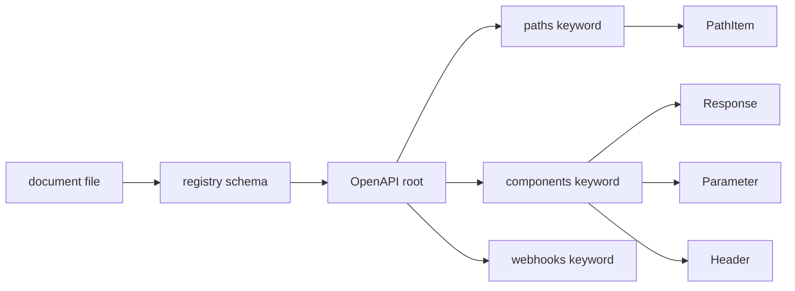
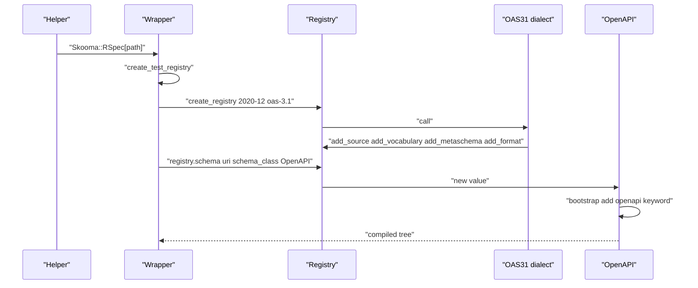

# 01 -- Loading a Document: registry, dialect, and compilation

An OpenAPI document is stored as YAML (YAML Ain't Markup Language) or JavaScript Object Notation (JSON). Skooma loads it into a registry, resolves its references, and compiles it into a tree of Ruby objects. Each object knows its keyword classes. This document shows that pipeline.

## The registry

Loading starts with a registry. `Skooma.create_registry` asks `json_skooma` for a registry that understands two dialects: the 2020-12 JSON Schema dialect and the `oas-3.1` dialect.

```ruby
# Source: lib/skooma.rb, lines 27-31
  class << self
    def create_registry(name: REGISTRY_NAME)
      JSONSkooma.create_registry("2020-12", "oas-3.1", name: name, assert_formats: true)
    end
  end
```

The `oas-3.1` dialect was registered when the gem loaded.

```ruby
# Source: lib/skooma.rb, lines 23-23
  JSONSkooma.register_dialect("oas-3.1", Dialects::OAS31)
```

A registry is a resolver. It stores sources (places to load documents from) and vocabularies (keyword classes). It caches loaded schemas by Uniform Resource Identifier (URI).

## The dialect

The dialect does four jobs when the registry is created. It adds a local source, registers the OpenAPI vocabulary, sets the meta-schema, and registers four format checkers.

```ruby
# Source: lib/skooma/dialects/oas_3_1.rb, lines 7-42
        def call(registry, **options)
          registry.add_source(
            "https://spec.openapis.org/oas/3.1/",
            JSONSkooma::Sources::Local.new(File.join(DATA_DIR, "oas-3.1").to_s, suffix: ".json")
          )

          registry.add_vocabulary(
            "https://spec.openapis.org/oas/3.1/vocab/base",
            Skooma::Keywords::OAS31::Dialect::AnyOf,
            Skooma::Keywords::OAS31::Dialect::OneOf,
            Skooma::Keywords::OAS31::Dialect::Discriminator,
            Skooma::Keywords::OAS31::Dialect::Xml,
            Skooma::Keywords::OAS31::Dialect::Properties,
            Skooma::Keywords::OAS31::Dialect::AdditionalProperties,
            Skooma::Keywords::OAS31::Dialect::Required,
            Skooma::Keywords::OAS31::Dialect::ExternalDocs,
            Skooma::Keywords::OAS31::Dialect::Example
          )

          registry.add_metaschema(
            "https://spec.openapis.org/oas/3.1/dialect/base",
            "https://json-schema.org/draft/2020-12/vocab/core",
            "https://json-schema.org/draft/2020-12/vocab/applicator",
            "https://json-schema.org/draft/2020-12/vocab/unevaluated",
            "https://json-schema.org/draft/2020-12/vocab/validation",
            "https://json-schema.org/draft/2020-12/vocab/format-annotation",
            "https://json-schema.org/draft/2020-12/vocab/meta-data",
            "https://json-schema.org/draft/2020-12/vocab/content",
            "https://spec.openapis.org/oas/3.1/vocab/base"
          )

          registry.add_format("int32", Skooma::Validators::Int32)
          registry.add_format("int64", Skooma::Validators::Int64)
          registry.add_format("float", Skooma::Validators::Float)
          registry.add_format("double", Skooma::Validators::Double)
        end
```

The source is the bundled data directory. The remote-style URI `https://spec.openapis.org/oas/3.1/` maps to local files under `data/oas-3.1/`, with a `.json` suffix. When the engine needs `https://spec.openapis.org/oas/3.1/schema/2022-10-07`, it reads `data/oas-3.1/schema/2022-10-07.json`.

The vocabulary registers the OpenAPI dialect variants of the shared 2020-12 keywords plus the OpenAPI-only keywords. The meta-schema is the OpenAPI 3.1 dialect, which combines the standard 2020-12 vocabularies with the OpenAPI base vocabulary.

## The bundled data

The `data/oas-3.1/` directory holds four folders.

| Folder | Purpose |
| --- | --- |
| schema/ | The full OpenAPI document meta-schema, per version |
| schema-base/ | The thin base schema that points at schema/ and pins the dialect |
| dialect/ | The JSON Schema dialect for OpenAPI Schema Objects |
| meta/ | The OpenAPI base vocabulary (discriminator, example, externalDocs, xml) |

The version keyword selects one `schema-base` file. The mapping is explicit.

```ruby
# Source: lib/skooma/objects/openapi/keywords/openapi.rb, lines 10-29
          MAPPING = {
            "3.1.0" => "https://spec.openapis.org/oas/3.1/schema-base/2022-10-07",
            "3.1.1" => "https://spec.openapis.org/oas/3.1/schema-base/2025-02-13",
            "3.1.2" => "https://spec.openapis.org/oas/3.1/schema-base/2025-09-15",
            "3.2.0" => "https://spec.openapis.org/oas/3.1/schema-base/2025-09-17"
          }

          LATEST = "3.2.0"

          def initialize(parent_schema, value)
            unless value.to_s.start_with? "3.1."
              raise Error, "Only OpenAPI version 3.1.x is supported, got #{value}"
            end

            parent_schema.metaschema_uri = MAPPING[value.to_s] || MAPPING[LATEST]

            parent_schema.json_schema_dialect_uri = "https://spec.openapis.org/oas/3.1/dialect/base"

            super
          end
```

Two facts matter here. First, only `3.1.x` strings are accepted; anything else raises `Error`. Second, an unknown `3.1.x` value falls back to the latest meta-schema. The `openapi` keyword also sets the JSON Schema dialect URI to the OpenAPI dialect base. Schema Objects inside the document then validate against that dialect.

## Compilation into objects

The document is not stored as a raw hash. Each node becomes a Ruby object. The root object is `Skooma::Objects::OpenAPI`. It lists the keyword classes it understands and a `bootstrap` step.

```ruby
# Source: lib/skooma/objects/openapi.rb, lines 10-28
      def kw_classes
        [
          Keywords::Info,
          Keywords::JSONSchemaDialect,
          Keywords::Paths,
          Keywords::Webhooks,
          Keywords::Components,
          Base::Keywords::Servers,
          Base::Keywords::Security,
          Base::Keywords::Tags,
          Skooma::Keywords::OAS31::Dialect::ExternalDocs
        ]
      end

      def bootstrap(value)
        # always evaluate openapi to check version,
        # and set metaschema_uri and json_schema_dialect_uri
        add_keyword(Keywords::OpenAPI.new(self, value["openapi"]))
      end
```

`kw_classes` maps each OpenAPI field name to a keyword class. `bootstrap` runs once at load time and adds the `openapi` keyword so the version is always checked.

Every keyword declares how its value compiles. For example, the `paths` keyword declares `value_schema = :object_of_schemas` and `schema_value_class = Objects::PathItem`. This tells the engine to compile each entry under `paths` as a `PathItem`, not as a raw schema.

The `components` section maps each subsection to a class.

```ruby
# Source: lib/skooma/objects/components.rb, lines 8-27
      CLASSES_MAP = {
        "schemas" => JSONSkooma::JSONSchema,
        "responses" => Response,
        "parameters" => Parameter,
        "examples" => JSONSkooma::JSONNode,
        "requestBodies" => RequestBody,
        "headers" => Header,
        "securitySchemes" => JSONSkooma::JSONNode,
        "links" => JSONSkooma::JSONNode,
        "callbacks" => JSONSkooma::JSONNode,
        "pathItems" => PathItem
      }

      def map_object_value(value)
        value.map do |k, v|
          key = k.to_s
          value = JSONSkooma::JSONNode.new(v, key: key, parent: self, item_class: CLASSES_MAP.fetch(key), **@item_params, metaschema_uri: parent.json_schema_dialect_uri)
          [key, value]
        end.to_h
      end
```

A `schema:` value inside a component is a plain JSON Schema. A `parameters:` value is a `Parameter`. The class decides which keywords apply.

## The compilation map

The picture below shows how one document becomes a typed tree.



## The load sequence

The picture below shows the load from the test helper down to the compiled tree.



## External references

A document may use `$ref` to a file on disk, such as `./responses.yaml#/UsersResponse`. When the engine resolves that reference, it treats the target document as a single JSON Schema by default. If the fragment points at a non-schema node, the engine raises `JSONSkooma::UnexpectedSchemaClassError`. Skooma rescues that error and loads the raw document instead.

```ruby
# Source: lib/skooma/external_refs.rb, lines 10-14
    def resolve_ref(uri)
      super
    rescue JSONSkooma::UnexpectedSchemaClassError
      load_external_ref(resolve_uri(uri))
    end
```

`load_external_ref` reads the raw document, walks to the fragment with a JSON pointer, and wraps the subtree in the referrer's own class. This keeps OpenAPI meaning: a reference inside `responses` loads as a `Response`, and a reference inside `schema` loads as a JSON Schema. Chained and self-recursive references work because the wrapped node re-runs reference resolution.

## Cross-References

- [00-overview.md](./00-overview.md) — the pipeline this loading step feeds.
- [02-matching-an-operation.md](./02-matching-an-operation.md) — how the compiled tree routes a request.

## The Aha Moment

**Aha:** The OpenAPI document is compiled, not parsed into a purpose-built model. Skooma reuses the JSON Schema compiler and only overrides one knob per node: which Ruby class and which keyword classes apply. An OpenAPI field like `paths` compiles because its keyword says "object of PathItems". The whole object model is a set of small class declarations layered on the JSON Schema engine, not a second parser.

Continue to [02-matching-an-operation.md](./02-matching-an-operation.md).
