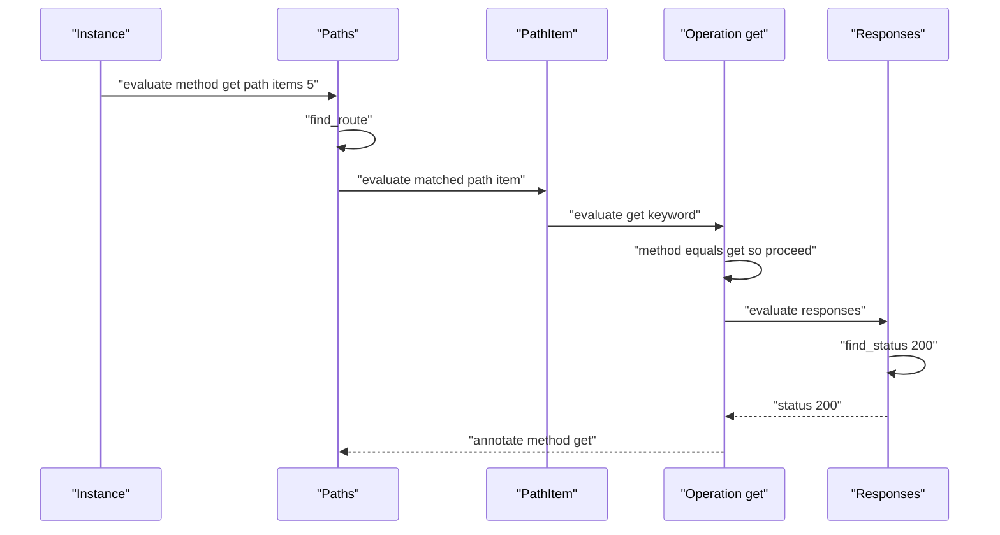
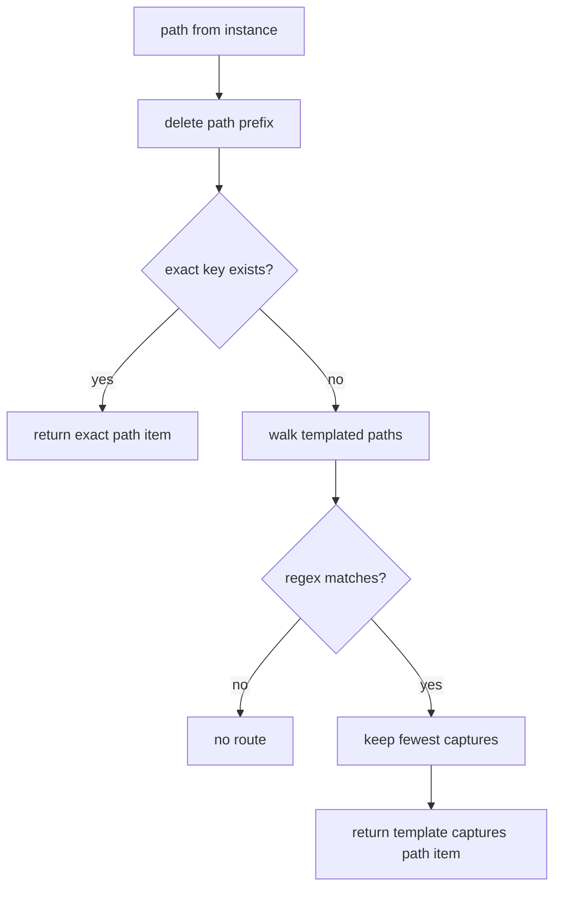

# 02 -- Matching an Operation: routing and response status

A real request arrives as a mapped hash with a method and a path. Skooma must find the one operation in the document that owns that request. This document shows the routing: from path to path item, from method to operation, and from status code to response.

## The input shape

The `EnvMapper` (described in [03-the-validation-call.md](./03-the-validation-call.md)) produces a hash like this.

Illustrative input:

```ruby
{
  "method" => "get",
  "path" => "/items/5",
  "request" => {"query" => "", "headers" => {}, "body" => nil},
  "response" => {"status" => 200, "headers" => {}, "body" => "..."}
}
```

The method is lowercased. The path is the request path. Skooma matches these against the document's `paths` map.

## Path matching

The `paths` keyword holds the routing logic. It first tries an exact match after deleting the configured path prefix. If that fails, it walks the templated paths and matches with regular expressions.

```ruby
# Source: lib/skooma/objects/openapi/keywords/paths.rb, lines 63-75
          def find_route(instance_path)
            instance_path = instance_path.delete_prefix(json.root.path_prefix)
            return [instance_path, {}, json[instance_path]] if json.key?(instance_path)
            regexp_map.reduce(nil) do |result, (path, path_regex, subschema)|
              next result unless path.include?("{") && path.include?("}")

              match = instance_path.match(path_regex)
              next result if match.nil?
              next result if result && result[1].length <= match.named_captures.length

              [path, match.named_captures, subschema]
            end
          end
```

The return value has three parts: the matched template path, the captured path attributes, and the matched path item schema. If more than one template matches, the one with the fewest captures wins.

The templates become regular expressions in `regexp_map`.

```ruby
# Source: lib/skooma/objects/openapi/keywords/paths.rb, lines 39-61
          def regexp_map
            @regexp_map ||= json.filter_map do |path, subschema|
              next unless path.include?("{") && path.include?("}")

              pattern_hash = if json.root.use_patterns_for_path_matching?
                create_hash_of_patterns(subschema)
              else
                {}
              end

              path_regex = path.gsub(ROUTE_REGEXP) do |match|
                param = match[1..-2]
                if pattern_hash.key?(param)
                  "(?<#{param}>#{pattern_hash[param]})"
                else
                  "(?<#{param}>[^/?#]+)"
                end
              end
              path_regex = Regexp.new("\\A#{path_regex}\\z")

              [path, path_regex, subschema]
            end
          end
```

By default every path parameter matches `[^/?#]+` — any characters except slash, question mark, and hash. With `use_patterns_for_path_matching: true`, Skooma reads the parameter's `pattern` (or its schema `pattern`) and uses it instead. This lets a parameter like `format` match only `(.xml|.json)`.

The captured values are stored as named captures. They become the path attributes that parameter validation reads later.

## Method matching

A path item has one keyword per Hypertext Transfer Protocol (HTTP) method: `get`, `post`, `put`, `patch`, `delete`, `options`, `head`, and `trace`. Each is a small subclass of `BaseOperation`. They differ only in the `key`.

```ruby
# Source: lib/skooma/objects/path_item/keywords/get.rb, lines 7-12
        class Get < BaseOperation
          self.key = "get"
          self.depends_on = %w[parameters]
          self.value_schema = :schema
          self.schema_value_class = Objects::Operation
        end
```

`BaseOperation` does the matching and the bookkeeping.

```ruby
# Source: lib/skooma/objects/path_item/keywords/base_operation.rb, lines 8-28
          def evaluate(instance, result)
            return result.discard unless instance["method"] == key

            if json["responses"].nil? && instance["response"]
              return result.failure("Responses are not listed for #{key.upcase} #{instance["path"]}")
            end

            json.evaluate(instance, result)

            path_item_result = result.parent
            path_item_result = path_item_result.parent until path_item_result.key.start_with?("/")

            paths_result = path_item_result.parent
            paths_result.annotate(paths_result.annotation.merge("method" => key))

            return result.success if result.passed?

            path = paths_result.annotation["current_path"]

            result.failure("Path #{path}/#{key} is invalid")
          end
```

Three things happen. First, the keyword discards itself unless the request method equals the keyword key. So a `get` request skips `post`, `put`, and so on. Second, if the operation has no `responses` but the instance has a response, it fails immediately. Third, after evaluating the operation, it annotates the matched method on the `paths` result. The coverage tracker reads that annotation later.

The operation keyword evaluates the operation object. That object lists its own keywords: tags, summary, description, parameters, requestBody, responses, callbacks, and more.

## Response status matching

The `responses` keyword finds the right response schema for a status code.

```ruby
# Source: lib/skooma/objects/operation/keywords/responses.rb, lines 12-43
          def evaluate(instance, result)
            response = instance["response"] || {}
            return result.discard unless response["status"]

            status = find_status(response)

            return result.failure("Status #{response["status"]} not found for #{instance["method"].upcase} #{instance["path"]}") unless status

            result.annotate(status)
            result.call(response["status"], status) do |status_result|
              json[status].evaluate(response, status_result)

              if status_result.passed?
                result.annotate(status)
              else
                result.failure("Res #{response["status"]} is invalid")
              end
            end
          end

          private

          def find_status(response)
            response_status = response["status"].to_s
            if json.key?(response_status)
              response_status
            elsif json.key?("#{response_status[0]}XX")
              "#{response_status[0]}XX"
            elsif json.key?("default")
              "default"
            end
          end
```

`find_status` tries three keys in order. First the exact code, such as `"200"`. Then the wildcard for the first digit, such as `"2XX"`. Then `"default"`. If none match, the validation fails with a "Status ... not found" message.

## The routing flow

The sequence below shows a `get /items/5` request through the tree.



## The route map

The picture below shows the decision tree inside `find_route`.



## Cross-References

- [01-loading-a-document.md](./01-loading-a-document.md) — how the compiled tree that routes here was built.
- [03-the-validation-call.md](./03-the-validation-call.md) — what happens after the operation is found.

## The Aha Moment

**Aha:** Routing is keyword evaluation, not a router object. The `paths` keyword compiles each template to a regular expression and picks the closest match. The method dispatch falls out of the engine itself: eight operation keywords each discard themselves when the method does not match, so only one fires. There is no separate routing table. The JSON Schema evaluation walk is the router.

Continue to [03-the-validation-call.md](./03-the-validation-call.md).
