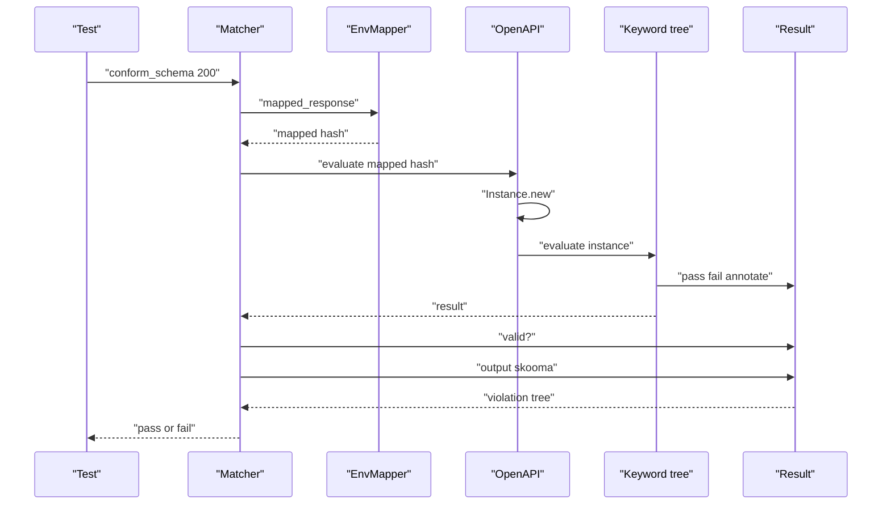
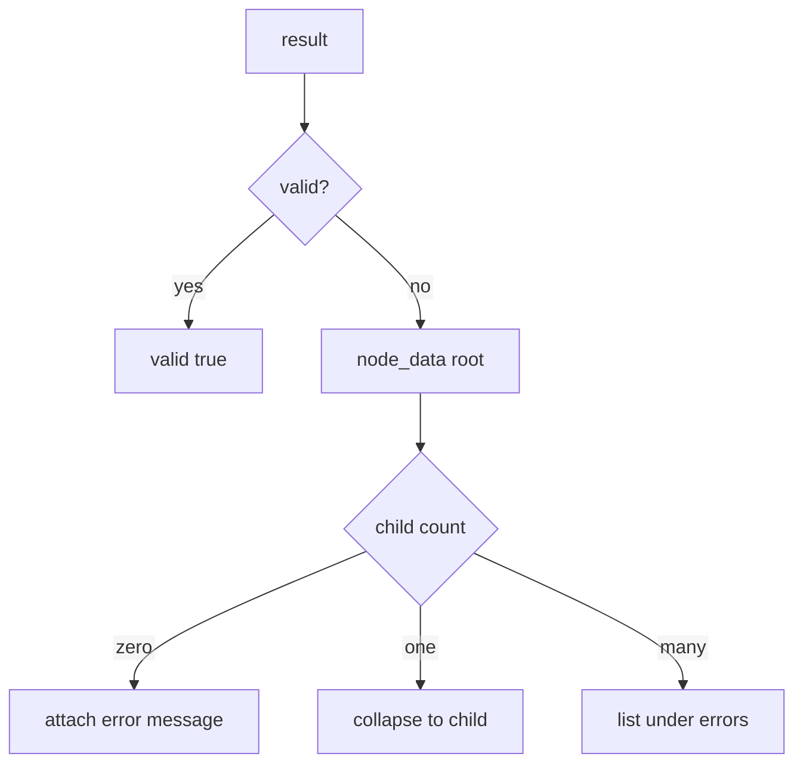

# 03 -- The Validation Call: from request to violation list

One call is the heart of Skooma: `evaluate` on the OpenAPI object tree. It takes a mapped request and returns a result. A formatter turns that result into a list of violations. This document traces that call end to end.

## Mapping the environment

Before evaluation, the test helper turns the Rack environment into a plain hash. `EnvMapper.call` does this.

```ruby
# Source: lib/skooma/env_mapper.rb, lines 9-18
      def call(env, response = nil, with_response: true, with_request: true)
        result = {
          "method" => env["REQUEST_METHOD"].downcase,
          "path" => env["action_dispatch.original_path"] || env["PATH_INFO"]
        }
        result["request"] = map_request(env) if with_request
        result["response"] = map_response(response) if response && with_response

        result
      end
```

The method is lowercased. The path prefers the Rails `action_dispatch.original_path` and falls back to `PATH_INFO`. The request and response are added as nested hashes. `map_request` collects the query string, the Hypertext Transfer Protocol (HTTP) headers, and the raw body. `map_response` collects the status, headers, and body.

The two flags matter. `with_request: false` drops the request, which a response-only check uses. `with_response: false` drops the response, which a request-only check uses.

## Wrapping in an Instance

The OpenAPI object does not evaluate the raw hash directly. It wraps the hash in an `Instance`.

```ruby
# Source: lib/skooma/objects/openapi.rb, lines 30-32
      def evaluate(instance, result = nil)
        super(Instance.new(instance), result)
      end
```

`Instance` is a `JSONSkooma::JSONNode`. Its `parse_value` splits the hash into typed child nodes.

```ruby
# Source: lib/skooma/instance.rb, lines 170-179
    def parse_value(value)
      data = {
        "method" => JSONSkooma::JSONNode.new(value["method"], key: "method", parent: self),
        "path" => JSONSkooma::JSONNode.new(value["path"], key: "path", parent: self)
      }
      data["request"] = Request.new(value["request"], key: "request", parent: self) if value["request"]
      data["response"] = Response.new(value["response"], key: "response", parent: self) if value["response"]

      ["object", data]
    end
```

The request and response are wrapped in `Instance::Request` and `Instance::Response`. Both parse the body through the body parsers before validation, so a JavaScript Object Notation (JSON) response body becomes a Ruby hash before its schema is checked. The `method` and `path` nodes are what the routing keywords read.

## The result object

Evaluation walks the keyword tree. Every keyword writes to a shared result object. A keyword can pass, fail, discard itself, or annotate the result. The result is a tree that mirrors the instance.

The test matchers call `evaluate` and then read `valid?`.

```ruby
# Source: lib/skooma/matchers/conform_request_schema.rb, lines 14-33
      def matches?(*)
        @result = @schema.evaluate(@mapped_response)

        @skooma.coverage.track_request(@result) if @mapped_response["response"]

        @result.valid?
      end

      def description
        "conform request schema"
      end

      def failure_message
        <<~MSG
          ENV:
          #{pretty(@mapped_response)}

          Validation Result:
          #{pretty(@result.output(:skooma))}
        MSG
      end
```

`@schema.evaluate` runs the whole validation. The coverage tracker records the result when a response exists. On failure, the message prints the mapped environment and the formatted validation result.

## The violation list

The result object is not printed raw. Skooma registers a formatter named `:skooma`, so `result.output(:skooma)` calls `OutputFormat`.

```ruby
# Source: lib/skooma/output_format.rb, lines 6-34
      def call(result, **_options)
        return {"valid" => true} if result.valid?

        node_data(result, true)
      end

      private

      def node_data(node, first = false)
        data = {
          "instanceLocation" => node.instance.path.to_s,
          "relativeKeywordLocation" => node.relative_path.to_s,
          "keywordLocation" => node.path.to_s
        }

        child_data = []
        node.each_children do |child|
          child_data << node_data(child) unless child.valid?
        end

        if first || child_data.length > 1
          data["errors"] = child_data
        elsif child_data.length == 1
          data = child_data[0]
        elsif node.error
          data["error"] = node.error
        end

        data
      end
```

A valid result collapses to `{"valid" => true}`. An invalid result becomes a tree of nodes. Each node carries three locations: where in the instance the problem is, where in the schema it is, and the keyword path. A node with one failing child collapses into that child, so the output shows the deepest failing keyword. A node with several failing children lists them under `errors`. A leaf carries the error message.

The README shows a real output for a missing required property.

```
# Source: README.md, lines 108-121
# Validation Result:
#
#  {"valid"=>false,
#   "instanceLocation"=>"",
#   "keywordLocation"=>"",
#   "absoluteKeywordLocation"=>"urn:uuid:1b4b39eb-9b93-4cc1-b6ac-32a25d9bff50#",
#   "errors"=>
#     [{"instanceLocation"=>"",
#       "keywordLocation"=>
#         "/paths/~1animals~1{animalId}~1feed/post/responses/200"/
#           "/content/application~1json/schema/required",
#       "error"=>
#         "The object is missing required properties"/
#           " [\"animalId\", \"food\", \"amount\"]"}]}
```

The current formatter (`lib/skooma/output_format.rb`) emits `relativeKeywordLocation`, while this older README example uses `absoluteKeywordLocation`; the two differ.

The `keywordLocation` is the JSON pointer into the document: the `required` keyword of the response schema for the `post` operation.

## The document check

The document check uses the same engine from the other side. `BeValidDocument` calls `validate` (not `evaluate`) on the OpenAPI object, which checks the document against its own meta-schema.

```ruby
# Source: lib/skooma/matchers/be_valid_document.rb, lines 8-14
      def matches?(actual)
        @actual = actual
        return false unless comparable?

        @result = @actual.validate
        @result.valid?
      end
```

`comparable?` requires the value to be a `Skooma::Objects::OpenAPI`. `validate` compiles the document as a schema instance and checks it against the meta-schema selected by the `openapi` version keyword.

## The call, end to end

The sequence below shows one request check.



## The output collapse

The picture below shows how `node_data` collapses a result tree.



## Cross-References

- [02-matching-an-operation.md](./02-matching-an-operation.md) — the routing that runs inside this evaluation.
- [05-response-validation.md](./05-response-validation.md) — the response keywords that produce these violations.

## The Aha Moment

**Aha:** The violation list is not collected. It is derived. The evaluation produces a full tree of results, and the output formatter collapses it — a valid result becomes one key, a single failure becomes its deepest leaf, and multiple failures become an `errors` array. The same result tree feeds both the failure message and the coverage tracker. One walk, three consumers.

Continue to [04-request-validation.md](./04-request-validation.md).
