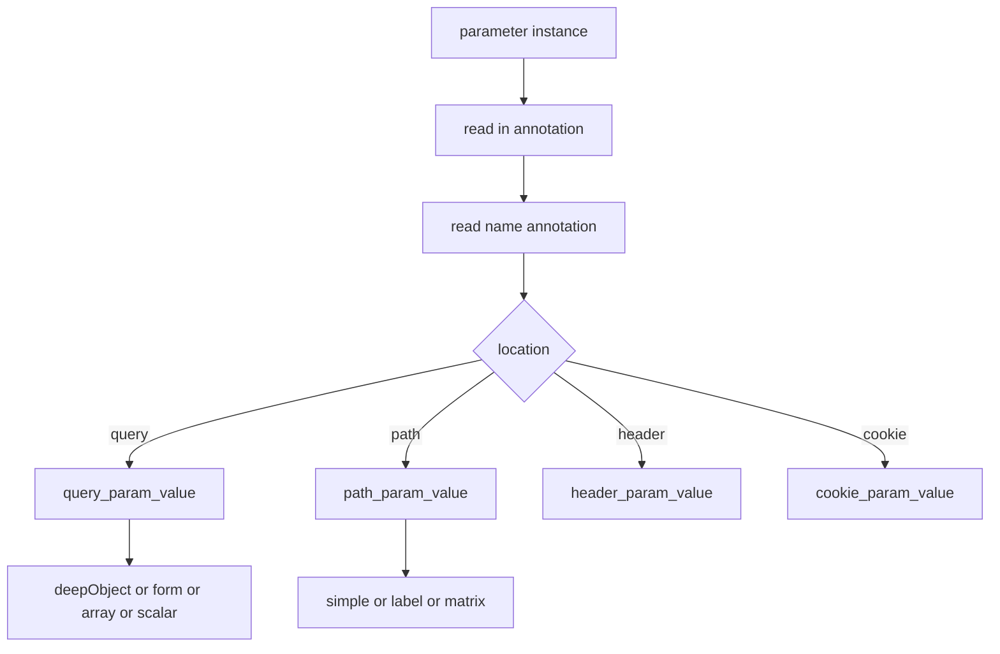
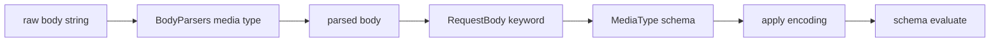

# 04 -- Request Validation: parameters, coercion, and body parsing

The request side is where Skooma does the most work. Parameters arrive as strings in a query string, path segment, header, or cookie. Skooma must deserialize them back to their declared types. The request body must be parsed from its media type. This document covers both.

## Parameters

The `parameters` keyword sits on the operation. It gathers the operation's own parameters plus the parent path item's parameters, excluding any that the operation overrides.

```ruby
# Source: lib/skooma/objects/operation/keywords/parameters.rb, lines 12-37
          def initialize(parent_schema, value)
            super
            keys = json.filter_map { |v| v["in"] && [v["in"].value, v["name"].value] }
            parent_params = parent_schema.parent["parameters"] || []
            parent_params.reject! do |v|
              v["in"] && keys.include?([v["in"].value, v["name"].value])
            end
            @parent_params = parent_params
          end

          def evaluate(instance, result)
            return result.discard unless instance.key?("request")
            return result.discard if json&.value&.empty? && @parent_params.empty?

            errors = []
            process_parameter(json, instance, result) do |subresult|
              errors << [subresult.schema_node["in"], subresult.schema_node["name"]] unless subresult.passed?
            end
            process_parameter(@parent_params, instance, result.parent.sibling(instance, "parameters")) do |subresult|
              key = [subresult.schema_node["in"], subresult.schema_node["name"]]
              errors << key unless subresult.passed?
            end
            return if errors.empty?

            result.failure("The following parameters are invalid: #{errors}")
          end
```

Each parameter is evaluated against the request. Failures accumulate and become one message listing the invalid parameters.

## Where the value comes from

`ValueParser` reads a parameter by its location. The location comes from the `in` keyword and the name from the `name` keyword. The parser also needs the declared `style` and `explode`.

```ruby
# Source: lib/skooma/objects/parameter/keywords/value_parser.rb, lines 10-24
          # https://spec.openapis.org/oas/v3.1.0#style-values
          ARRAY_STYLE_DELIMITERS = {
            "form" => ",",
            "simple" => ",",
            "spaceDelimited" => " ",
            "pipeDelimited" => "|"
          }.freeze

          # Default `style` per parameter location (OpenAPI 3.1 parameter object).
          DEFAULT_STYLE = {
            "query" => "form",
            "path" => "simple",
            "header" => "simple",
            "cookie" => "form"
          }.freeze
```

Each location has a default style. Each array style has a delimiter. `form` and `simple` use a comma. `spaceDelimited` uses a space. `pipeDelimited` uses a vertical bar.

The dispatch is by location. The query case is the richest.

```ruby
# Source: lib/skooma/objects/parameter/keywords/value_parser.rb, lines 62-94
            def query_param_value(instance, result, key, schema:)
              shape = shape_of(schema)

              # `deepObject` spreads an object across bracketed keys
              # (`filter[a]=1&filter[b]=2`) and is the only style that consumes
              # more than one query key, so it is handled before the scalar/array
              # path.
              if result.sibling(instance, "style")&.annotation == "deepObject"
                return deep_object_value(instance, key)
              end

              if shape == :object
                return form_object_value(instance, result, key, schema)
              end

              array = shape == :array
              params = parse_query(instance["query"]&.value)
              values = params[key]
              # Support the non-standard Rails/Rack/PHP bracket convention
              # (`ids[]=1&ids[]=2`) for array params declared as `name: ids`.
              values = params["#{key}[]"] if values.nil? && array
              return nil if values.nil?

              value =
                if array && !values.last.nil?
                  deserialize_array(values, instance, result)
                else
                  # the last value wins for scalars and value-less keys (e.g. `?ids`)
                  values.last
                end

              Instance::Attribute.new(value, key: key, parent: instance["query"])
            end
```

The query string is split on `&` and `;`, then percent-decoded. An exploded array is repeated keys, so it is the full value list. A non-exploded array is one delimited value. A scalar takes the last value. The non-standard `ids[]=1&ids[]=2` form maps to the array parameter named `ids`.

Path parameters use the captured named groups from routing. Header and cookie parameters read a single delimited string. Object-valued parameters support `deepObject` and `form` styles for query, and flattened key/value forms for path.

## Coercion

A parameter value is a string. Before validation, Skooma coerces it to the declared type. The parameter's `schema` keyword does this.

```ruby
# Source: lib/skooma/objects/parameter/keywords/schema.rb, lines 11-19
          def evaluate(instance, result)
            value = ValueParser.call(instance, result, schema: json)
            return result.discard if value.nil?

            # Parameters coerce deeply (their values arrive as all-strings);
            # bodies keep OAS31::Schema's shallow `coerce`, so body validation
            # is unaffected.
            json.evaluate(value.deep_coerce(json), result)
          end
```

The key distinction is in the comment. Parameters coerce deeply, so a string `"5"` inside an array or object becomes the integer `5`. Bodies coerce only shallowly, so a nested JSON value like `{"count": "5"}` stays invalid against `integer`. This keeps parameter values friendly while leaving JSON bodies strict.

## The request body

The `requestBody` keyword on an operation evaluates the request body against its content schema.

```ruby
# Source: lib/skooma/objects/operation/keywords/request_body.rb, lines 12-16
          def evaluate(instance, result)
            return result.discard unless instance.key?("request")

            json.evaluate(instance["request"], result)
          end
```

The body itself is parsed before validation. `BodyParsers` holds a registry of parsers by media type.

```ruby
# Source: lib/skooma/body_parsers.rb, lines 9-25
      DEFAULT_PARSER = ->(body, **_options) { body }

      def [](media_type)
        key = normalize_media_type(media_type)
        parsers[key] ||
          find_suffix_parser(key) ||
          find_fallback_parser(key) ||
          DEFAULT_PARSER
      end

      attr_accessor :parsers

      def register(*media_types, parser)
        media_types.each do |media_type|
          parsers[normalize_media_type(media_type)] = parser
        end
      end
```

Three parsers are built in: JavaScript Object Notation (JSON), `application/x-www-form-urlencoded`, and `multipart/form-data`. Lookup first tries the exact media type, then a suffix like `application/json` for `application/vnd.api+json`, then a fallback like `text/*` or `*/*`, then the default identity parser. Custom parsers register with `Skooma::BodyParsers.register("application/xml", ->(body, headers:) { ... })`.

The multipart parser reads file parts as binary strings so an upload validates against a `type: string` / `format: binary` schema. The Media Type Object's `encoding` field is also honored: a form field whose `contentType` is JSON is decoded before validation.

## The parameter dispatch

The picture below shows the `ValueParser` decision tree.



## The body pipeline

The picture below shows how a request body reaches the schema.



## Cross-References

- [03-the-validation-call.md](./03-the-validation-call.md) — the evaluate call these keywords run inside.
- [05-response-validation.md](./05-response-validation.md) — the mirror image on the response side.

## The Aha Moment

**Aha:** Skooma treats parameter values and body values by different rules on purpose. Parameters are strings that must be rebuilt, so they coerce deeply into the declared type. Bodies are JSON that must stay strict, so they coerce only at the top. The single `schema` keyword splits into two subclasses, one per context, and the whole behavior difference lives in that one line of `evaluate`.

Continue to [05-response-validation.md](./05-response-validation.md).
