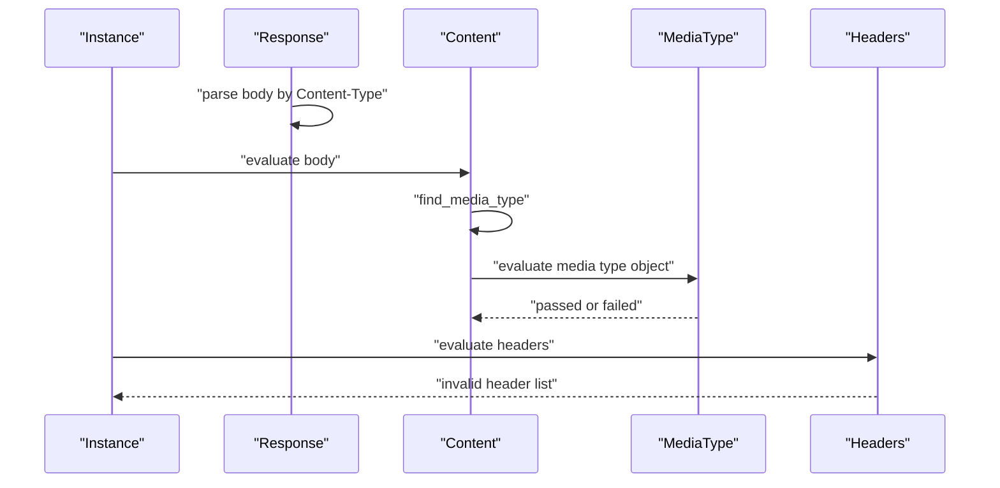
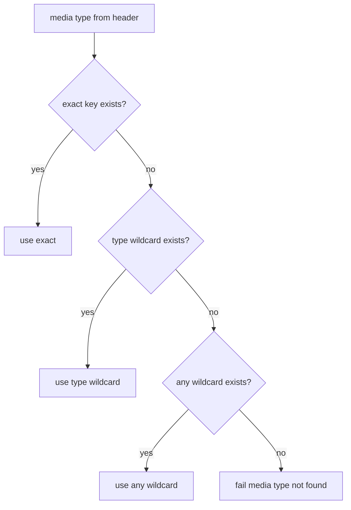

# 05 -- Response Validation: content, media type, and headers

The response side is simpler than the request side. The status code was already matched in [02-matching-an-operation.md](./02-matching-an-operation.md). What remains is to validate the response body against its content schema and the response headers against their header schemas.

## Content

The response body is a string. Skooma parses it with the body parsers (by its `Content-Type` header) and then finds the matching media type object.

```ruby
# Source: lib/skooma/objects/response/keywords/content.rb, lines 12-46
          def evaluate(instance, result)
            return result.discard unless instance["body"].value

            media_type = instance["headers"]&.[]("Content-Type")&.split(";")&.first&.strip&.downcase
            media_type_object, matched_media_type = find_media_type(media_type)

            return result.failure("Media type #{media_type} not found") unless media_type_object

            result.annotate(matched_media_type)
            result.call(instance, matched_media_type) do |media_type_result|
              media_type_object.evaluate(instance["body"], media_type_result)

              result.failure("Invalid content") unless media_type_result.passed?
            end
          end

          private

          # The key is a media type or media type range and the value describes it.
          # For requests that match multiple keys, only the most specific key is applicable.
          # e.g. text/plain overrides text/*
          def find_media_type(media_type)
            matched_media_type =
              if json.key?(media_type)
                media_type
              elsif media_type &&
                  (key = "#{media_type.split("/").first}/*") &&
                  json.key?(key)
                key
              elsif json.key?("*/*")
                "*/*"
              end

            [json[matched_media_type], matched_media_type]
          end
```

The media type is read from the response `Content-Type` header, with parameters like `; charset=utf-8` stripped. `find_media_type` picks the most specific key: the exact type first, then a range like `application/*`, then `*/*`. If nothing matches, validation fails with "Media type ... not found". The matched media type is annotated on the result, and the coverage tracker uses it.

The media type object then evaluates the parsed body against its `schema`. If the body does not match, the result fails with "Invalid content".

## The response body parse

The body is parsed when the `Instance::Response` node is built, before any keyword runs.

```ruby
# Source: lib/skooma/instance.rb, lines 128-146
    class Response < Attribute
      private

      def parse_value(value)
        data = {}
        data["status"] = JSONSkooma::JSONNode.new(value.fetch("status"), key: "status", parent: self)
        data["headers"] = Headers.new(value.fetch("headers", {}), key: "headers", parent: self)
        body_value = parse_body(value["body"], data["headers"])
        data["body"] = Attribute.new(body_value, key: "body", parent: self)
        ["object", data]
      end

      def parse_body(body, headers)
        return nil unless body

        parser = BodyParsers[headers["Content-Type"]&.value&.split(";")&.first]
        parser ? parser.call(body, headers: headers) : body
      end
    end
```

`parse_body` looks up the parser for the response content type. A JavaScript Object Notation (JSON) body becomes a Ruby hash. An unknown content type keeps the raw string. The parsed body is what the `content` keyword validates.

## Headers

The `headers` keyword iterates the header schemas in the response object and evaluates each against the response headers.

```ruby
# Source: lib/skooma/objects/response/keywords/headers.rb, lines 12-32
          def evaluate(instance, result)
            errors = []
            json.each do |key, schema|
              next if ignored_key?(key)

              result.call(instance["headers"], key) do |subresult|
                schema.evaluate(instance["headers"][key], subresult)

                errors << key unless subresult.passed?
              end
            end
            return if errors.empty?

            result.failure("The following headers are invalid: #{errors}")
          end

          private

          def ignored_key?(key)
            %w[accept content-type authorization].include?(key.downcase)
          end
```

Three header names are skipped: `accept`, `content-type`, and `authorization`. These are transport concerns that a schema rarely declares. All other declared headers are validated. Failures accumulate into one message.

A header schema's `schema` keyword skips validation when the header is absent.

```ruby
# Source: lib/skooma/objects/header/keywords/schema.rb, lines 10-14
          def evaluate(instance, result)
            return if instance.value.nil?

            super
          end
```

The `required` keyword on a header fails when the header is missing and required.

```ruby
# Source: lib/skooma/objects/header/keywords/required.rb, lines 10-14
          def evaluate(instance, result)
            if json.value && instance.value.nil?
              result.failure("Header is required")
            end
          end
```

## The response flow

The sequence below shows a response check after the status matched.



## The media type decision

The picture below shows `find_media_type`.



## Cross-References

- [03-the-validation-call.md](./03-the-validation-call.md) — how these failures become the violation list.
- [04-request-validation.md](./04-request-validation.md) — the request side, which shares the body parsers.

## The Aha Moment

**Aha:** Response validation is media-type negotiation against the document, not just schema checking. The `content` keyword first picks the most specific matching media type — exact over range over wildcard — and only then validates the parsed body against that media type's schema. The body is already a parsed Ruby value by then, because the `Instance::Response` node applied the body parsers at build time. Parsing happens once, up front; validation happens after the media type is chosen.

Continue to [06-test-helpers-and-coverage.md](./06-test-helpers-and-coverage.md).
