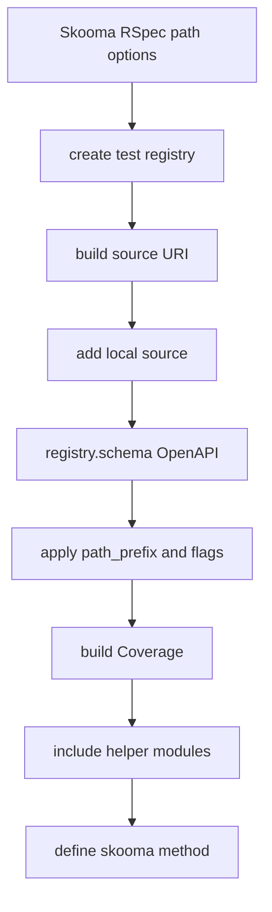
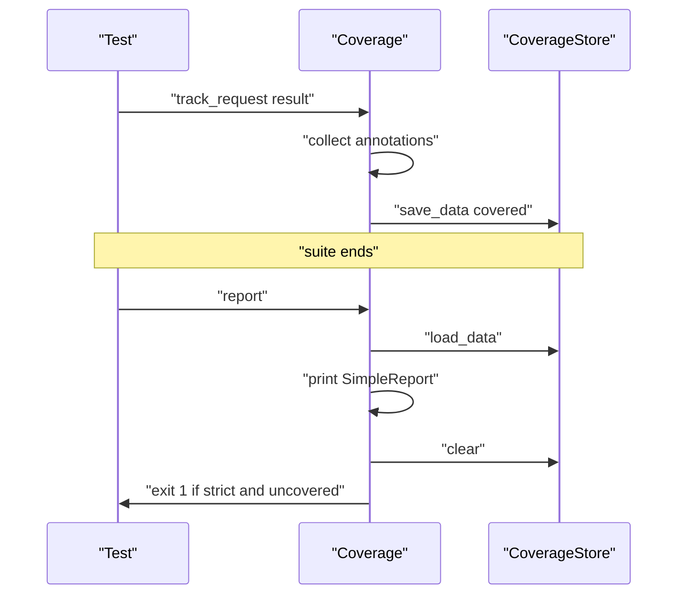

# 06 -- Test Helpers and Coverage: RSpec, Minitest, and reporting

Everything so far ran inside a test. This document shows the glue: the shared wrapper that loads the schema and injects helpers, the RSpec and Minitest helper methods, and the coverage report that runs when the suite ends.

## The wrapper

Both RSpec and Minitest helpers are subclasses of one wrapper. The wrapper is a Ruby module; calling `Skooma::RSpec[path]` builds and returns a new module to include.

```ruby
# Source: lib/skooma/matchers/wrapper.rb, lines 48-80
      def initialize(helper_methods_module, openapi_path, base_uri: "https://skoomarb.dev/", path_prefix: "", enforce_access_modes: false, use_patterns_for_path_matching: false, coverage_store: nil, **params)
        super()

        registry = create_test_registry
        pathname = Pathname.new(openapi_path)
        source_uri = "#{base_uri}#{path_prefix.delete_suffix("/").delete_prefix("/")}"
        source_uri += "/" unless source_uri.end_with?("/")
        registry.add_source(
          source_uri,
          JSONSkooma::Sources::Local.new(pathname.dirname.to_s)
        )
        @schema = registry.schema(URI.parse("#{source_uri}#{pathname.basename}"), schema_class: Skooma::Objects::OpenAPI)
        @schema.path_prefix = path_prefix
        @schema.enforce_access_modes = enforce_access_modes

        # Any object implementing CoverageStore's interface (load_data,
        # save_data, clear) can be passed via `coverage_store:` — e.g. to
        # write one file per parallel CI runner and merge afterwards.
        storage = coverage_store || Skooma::CoverageStore.new(
          file_path: File.join(Dir.pwd, "tmp", "skooma_coverage_#{Digest::SHA256.hexdigest(source_uri)[0..8]}.json")
        )
        @coverage = Coverage.new(@schema, mode: params[:coverage], format: params[:coverage_format], storage: storage)

        @schema.use_patterns_for_path_matching = use_patterns_for_path_matching

        include DefaultHelperMethods
        include helper_methods_module

        skooma_self = self
        define_method :skooma do
          skooma_self
        end
      end
```

The wrapper takes the path to the OpenAPI document and several options. It builds a source URI from the base URI plus the path prefix, registers the document directory as a local source, and loads the document as an `OpenAPI` object. Then it applies the options: `path_prefix`, `enforce_access_modes`, `use_patterns_for_path_matching`. `enforce_access_modes` enforces the OpenAPI readOnly/writeOnly access modes — readOnly properties are ignored in requests, writeOnly in responses (`lib/skooma/keywords/oas_3_1/dialect/required.rb`, lines 16-31). It builds a coverage tracker and injects two sets of methods: the shared defaults and the framework-specific helpers. A `skooma` method returns the wrapper itself.

The default methods include `mapped_response`, which bridges to `EnvMapper`, and `skooma_openapi_schema`, which exposes the loaded schema. The `request_object` and `response_object` methods support both Rails and Rack-Test.

## RSpec helpers

The RSpec subclass adds matcher factory methods.

```ruby
# Source: lib/skooma/rspec.rb, lines 11-27
    module HelperMethods
      def conform_schema(expected_status)
        Matchers::ConformSchema.new(skooma, mapped_response, expected_status)
      end

      def conform_response_schema(expected_status)
        Matchers::ConformResponseSchema.new(skooma, mapped_response(with_request: false), expected_status)
      end

      def conform_request_schema
        Matchers::ConformRequestSchema.new(skooma, mapped_response(with_response: false))
      end

      def be_valid_document
        Matchers::BeValidDocument.new
      end
    end
```

Four matchers exist. `conform_schema` checks both request and response for an expected status code. `conform_response_schema` checks only the response. `conform_request_schema` checks only the request. `be_valid_document` checks the document itself.

The RSpec wrapper registers the coverage report to run after the suite.

```ruby
# Source: lib/skooma/rspec.rb, lines 33-37
      ::RSpec.configure do |c|
        c.after(:suite) do
          at_exit { skooma_self.coverage.report }
        end
      end
```

Minitest mirrors this with `Minitest.after_run`, and its helpers assert instead of returning matchers.

## Coverage

Coverage tracks which operations a suite actually exercised. The mode is `nil`/`false` (off), `:report` (print a report), or `:strict` (print and fail when any operation is uncovered).

```ruby
# Source: lib/skooma/coverage.rb, lines 29-38
    def self.new(schema, mode: nil, format: nil, storage: nil)
      case mode
      when nil, false
        NoopCoverage.new
      when :report, :strict
        super
      else
        raise ArgumentError, "Invalid coverage: #{mode}, expected :report, :strict, or false"
      end
    end
```

The real tracker finds every defined operation (method, path, status code) in the document and remembers which ones were seen. A request is tracked by reading the annotations the routing keywords left on the result.

The default `SimpleReport` format prints the counts and the uncovered paths.

```ruby
# Source: lib/skooma/coverage.rb, lines 20-27
      def report
        puts <<~MSG
          OpenAPI schema #{URI.parse(coverage.schema.uri.to_s).path} coverage report: #{coverage.covered_paths.count} / #{coverage.defined_paths.count} operations (#{coverage.covered_percent.round(2)}%) covered.
          #{coverage.uncovered_paths.empty? ? "All paths are covered!" : "Uncovered paths:"}
          #{coverage.uncovered_paths.map { |method, path, status| "#{method.upcase} #{path} #{status}" }.join("\n")}
        MSG
      end
```

The `Coverage#report` method reloads the stored covered paths, prints, clears the store, and exits with status 1 in strict mode when anything is uncovered.

```ruby
# Source: lib/skooma/coverage.rb, lines 82-88
    def report
      stored_data = storage.load_data
      self.covered_paths = stored_data[:covered_paths]
      format.new(self).report
      storage.clear
      exit 1 if mode == :strict && uncovered_paths.any?
    end
```

## The coverage store

The store persists coverage data to a JavaScript Object Notation (JSON) file so parallel test runners can merge results. It locks the file while reading and writing.

```ruby
# Source: lib/skooma/coverage_store.rb, lines 14-30
    def load_data
      with_lock("r") do |file|
        parse_data(file.read)
      end
    end

    def save_data(new_defined_paths, new_covered_paths)
      with_lock("r+") do |file|
        existing_data = parse_data(file.read)
        merged_data = merge_data(existing_data, new_defined_paths, new_covered_paths)

        file.rewind
        file.write(JSON.generate(merged_data))
        file.flush
        file.truncate(file.pos)
      end
    end
```

`with_lock` takes an exclusive file lock with `flock`. The store merges the new paths with the existing set unions, so repeated saves accumulate. A custom store can be passed via `coverage_store:` as long as it implements `load_data`, `save_data`, and `clear`.

## The setup flow

The picture below shows the wrapper initialization.



## The coverage lifecycle

The sequence below shows coverage from request to report.



## Cross-References

- [01-loading-a-document.md](./01-loading-a-document.md) — the registry and schema loading the wrapper reuses.
- [03-the-validation-call.md](./03-the-validation-call.md) — the matchers and result object the helpers wrap.

## The Aha Moment

**Aha:** The RSpec and Minitest helpers are not two implementations. They are one wrapper plus a thin module of factory methods. The wrapper owns everything heavy — loading the schema, building the coverage tracker, bridging to the environment — and the framework layer only decides whether a check returns a matcher (RSpec) or asserts (Minitest). Coverage is likewise one tracker whose mode flips it from a no-op to a reporter to a gate.

Continue to [README.md](./README.md).
