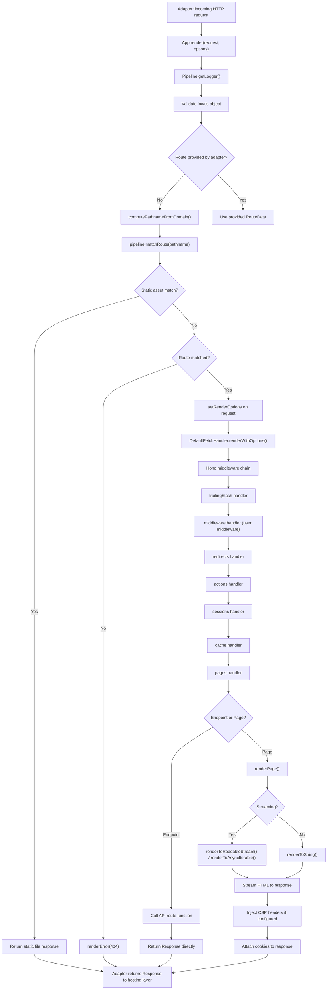
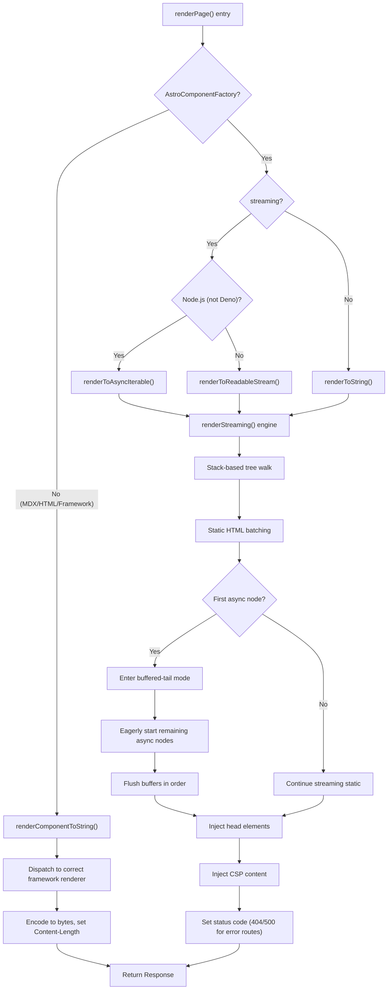

# SSR Runtime: Request Handling, Rendering, and Adapter Integration

The SSR (Server-Side Rendering) runtime in Astro 7.0.4 is the execution engine that transforms incoming HTTP requests into rendered responses. It is a layered pipeline: a `Request` enters through the `App` class, gets matched to a route via pattern-based routing, flows through a Hono-based middleware chain, and is rendered to either HTML (for pages) or JSON (for endpoints). The entire pipeline is adapter-agnostic -- the same `App` runs on Node.js, Cloudflare Workers, Vercel Edge, or any other platform that provides a standard `Request`/`Response` pair. The adapter's job is to feed requests into `App.render()` and return the resulting `Response` to the hosting layer.

## The App Class: SSR Entrypoint

The SSR application is anchored by the `App` class, exported from `packages/astro/src/core/app/entrypoints/index.js`. This is the single entrypoint that every adapter imports at runtime.

Source: `packages/astro/src/core/app/entrypoints/index.js`

```js
export type { RoutesList } from '../../../types/astro.js';
export { App } from '../app.js';
export { BaseApp, type RenderOptions, type LogRequestPayload } from '../base.js';
export { deserializeManifest, serializeRouteData } from '../manifest.js';
export { AppPipeline } from '../pipeline.js';
```

The `App` class extends `BaseApp`, which contains the bulk of the SSR logic. `App` itself is a thin concrete layer:

Source: `packages/astro/src/core/app/app.ts`

```ts
export class App extends BaseApp {
	createPipeline(streaming: boolean): AppPipeline {
		return AppPipeline.create({ manifest: this.manifest, streaming });
	}

	isDev(): boolean {
		return false;
	}

	logRequest(_options: LogRequestPayload) {}
}
```

The `App` class does three things:

1. **Creates a pipeline** -- reads the serialized manifest and builds an `AppPipeline` that handles route matching, component loading, and head element generation.
2. **Identifies itself as production** -- `isDev()` always returns `false`. The dev server uses a separate `DevApp` subclass.
3. **No-op logging** -- `logRequest` is a no-op in production; adapters or subclasses can override it.

### App Lifecycle: Request to Response

When a request arrives, the adapter calls `app.render(request)`. The `BaseApp.render()` method orchestrates the entire flow:

Source: `packages/astro/src/core/app/base.ts:351`

```ts
public async render(request: Request, {
	addCookieHeader = false,
	clientAddress = Reflect.get(request, clientAddressSymbol),
	locals,
	prerenderedErrorPageFetch = fetch,
	routeData,
	waitUntil,
}: RenderOptions = {}): Promise<Response> {
	// 1. Lazily resolve the logger destination
	await this.pipeline.getLogger();

	// 2. Validate locals if provided
	if (locals && typeof locals !== 'object') { /* return 500 error */ }

	// 3. Match a route (by domain pathname or request pathname)
	if (!routeData) {
		const domainPathname = this.computePathnameFromDomain(request);
		if (domainPathname) {
			routeData = this.pipeline.matchRoute(this.safeDecodeURI(domainPathname));
		}
	}

	// 4. Dispatch through the fetch handler
	if (this.#fetchHandler instanceof DefaultFetchHandler) {
		Reflect.set(request, appSymbol, this);
		response = await this.#fetchHandler.renderWithOptions(request, resolvedOptions);
	} else {
		setRenderOptions(request, resolvedOptions);
		Reflect.set(request, appSymbol, this);
		response = await this.#fetchHandler.fetch(request);
	}

	// 5. Check for error header -- reroute to 404/500 if needed
	if (response.headers.get(ASTRO_ERROR_HEADER)) {
		return this.renderError(request, { response, status, ... });
	}

	return response;
}
```

The render flow follows five stages: logger initialization, locals validation, route matching, dispatch through the fetch handler pipeline, and error page rerouting if the response carries an `X-Astro-Error` header.

### App.match(): Route Matching Without Rendering

The `App.match(request)` method performs route matching without rendering. It is used by adapters that need to determine which route handles a request before calling `render()`.

Source: `packages/astro/src/core/app/base.ts:300`

```ts
public match(request: Request, allowPrerenderedRoutes = false): RouteData | undefined {
	const url = new URL(request.url);
	// Prerendered routes are served as static files -- ignore them in SSR matching
	if (this.manifest.assets.has(url.pathname)) return undefined;
	let pathname = this.computePathnameFromDomain(request) ?? prependForwardSlash(this.removeBase(url.pathname));
	const routeData = this.pipeline.matchRoute(this.safeDecodeURI(pathname));
	if (!routeData) return undefined;
	if (allowPrerenderedRoutes) return routeData;
	// If the first match is a prerendered dynamic route, find a non-prerendered alternative
	if (routeData.prerender) {
		if (routeData.params.length > 0) {
			const allMatches = this.pipeline.matchAllRoutes(this.safeDecodeURI(pathname));
			return allMatches.find((r) => !r.prerender);
		}
		return undefined;
	}
	return routeData;
}
```

Key behavior: prerendered routes are excluded from SSR matching because the hosting layer serves them as static files. If a prerendered dynamic route is the first match, Astro searches for a non-prerendered route that can handle the same pattern.

### App.setClientLocales(): Client-Side Locale Hints

The `App` class exposes locale-aware methods through the `FetchState` pipeline. When a request carries locale information (via the `Accept-Language` header or URL path), the pipeline computes the current locale and preferred locales:

Source: `packages/astro/src/core/middleware/index.ts:93-100`

```ts
get preferredLocale(): string | undefined {
	return (preferredLocale ??= computePreferredLocale(request, userDefinedLocales));
},
get preferredLocaleList(): string[] | undefined {
	return (preferredLocaleList ??= computePreferredLocaleList(request, userDefinedLocales));
},
get currentLocale(): string | undefined {
	return (currentLocale ??= computeCurrentLocale(route, userDefinedLocales, defaultLocale));
}
```

These lazy getters are computed on first access and cached. They are available as `Astro.preferredLocale`, `Astro.preferredLocaleList`, and `Astro.currentLocale` within page and API route code.

### RenderOptions: What Adapters Can Configure

The `RenderOptions` interface gives adapters fine-grained control over request handling:

| Option | Type | Default | Purpose |
|--------|------|---------|---------|
| `addCookieHeader` | `boolean` | `false` | Automatically attach `Set-Cookie` headers to the response |
| `clientAddress` | `string` | `request[Symbol.for("astro.clientAddress")]` | The client IP, made available as `Astro.clientAddress` |
| `locals` | `object` | `{}` | Mutable state exposed as `Astro.locals` |
| `prerenderedErrorPageFetch` | `function` | `fetch` | Custom fetch for prerendered 404/500 pages |
| `routeData` | `RouteData` | `app.match(request)` | Override automatic route matching |
| `waitUntil` | `WaitUntilHook` | undefined | Platform hook for background work after response |

## SSR Manifest: Serialized Route Registry

The SSR manifest is the data structure that carries all route, configuration, and asset information from build time into runtime. It exists in two forms: the in-memory `SSRManifest` and the serialized `SerializedSSRManifest`.

### SerializedSSRManifest Interface

Source: `packages/astro/src/core/app/types.ts:190`

```ts
export type SerializedSSRManifest = Omit<
	SSRManifest,
	| 'middleware' | 'logger' | 'routes' | 'assets' | 'componentMetadata'
	| 'inlinedScripts' | 'clientDirectives' | 'serverIslandNameMap'
	| 'key' | 'rootDir' | 'srcDir' | 'cacheDir' | 'outDir'
	| 'publicDir' | 'buildClientDir' | 'buildServerDir'
> & {
	rootDir: string;
	srcDir: string;
	cacheDir: string;
	outDir: string;
	publicDir: string;
	buildClientDir: string;
	buildServerDir: string;
	routes: SerializedRouteInfo[];
	assets: string[];
	componentMetadata: [string, SSRComponentMetadata][];
	inlinedScripts: [string, string][];
	clientDirectives: [string, string][];
	key: string;
};
```

The serialization strips out runtime-only fields (functions, `Map`s, `Set`s, `Promise`s, `URL`s) and replaces them with JSON-serializable equivalents. `RoutesList` becomes `SerializedRouteInfo[]`, `URL`s become `string`s, `Map`s become `[key, value][]` tuples, and the encryption `key` becomes an encoded `string`.

### Manifest Injection During Build

The serialized manifest is produced by a Vite plugin at `packages/astro/src/manifest/serialized.ts`. It registers a virtual module `virtual:astro:manifest` that resolves to `\0virtual:astro:manifest`.

Source: `packages/astro/src/manifest/serialized.ts:33-34`

```ts
export const SERIALIZED_MANIFEST_ID = 'virtual:astro:manifest';
export const SERIALIZED_MANIFEST_RESOLVED_ID = '\0' + SERIALIZED_MANIFEST_ID;
```

During `dev` or `sync` commands, the plugin creates the manifest in-memory:

```ts
const serialized = await createSerializedManifest(settings, await getEncodedKey());
manifestData = JSON.stringify(serialized);
```

During `build`, it emits a placeholder token:

```ts
manifestData = `'${MANIFEST_REPLACE}'`;
```

The placeholder is replaced by `plugin-manifest.ts` in the `build:post` phase with the actual serialized manifest JSON. This two-phase approach decouples manifest generation from the Vite bundling process, allowing the manifest to reference chunk hashes that only exist after the full build completes.

Source: `packages/astro/src/manifest/serialized.ts:100-103`

### Deserialization at Runtime

The virtual module generates code that deserializes the manifest and reattaches runtime imports:

Source: `packages/astro/src/manifest/serialized.ts:112-136`

```ts
const code = `
	import { deserializeManifest as _deserializeManifest } from 'astro/app';
	import { renderers } from '${ASTRO_RENDERERS_MODULE_ID}';
	import { routes } from '${ASTRO_ROUTES_MODULE_ID}';
	import { pageMap } from '${VIRTUAL_PAGES_MODULE_ID}';

	const _manifest = _deserializeManifest((${manifestData}));

	const manifest = Object.assign(_manifest, {
		renderers,
		actions: () => import('${ACTIONS_ENTRYPOINT_VIRTUAL_MODULE_ID}'),
		middleware: () => import('${MIDDLEWARE_MODULE_ID}'),
		sessionDriver: () => import('${VIRTUAL_SESSION_DRIVER_ID}'),
		serverIslandMappings: () => import('${SERVER_ISLAND_MANIFEST}'),
		routes: manifestRoutes,
		pageMap,
	});
	export { manifest };
`;
```

The deserialization restores the non-serializable fields (`renderers`, `routes`, `pageMap`, `middleware`, `actions`, `sessionDriver`, `serverIslandMappings`) from virtual module imports. The serialized manifest contains only the data; the runtime glue reassembles it into a full `SSRManifest`.

Aha: The manifest is deliberately split between serializable data and runtime imports. This design means the build output is a pure JSON blob that can be inspected, logged, or transmitted, while the code references are rehydrated dynamically from Vite's virtual module graph. The placeholder replacement mechanism (`MANIFEST_REPLACE`) is what allows Astro to defer manifest generation until after all chunks are finalized, avoiding the chicken-and-egg problem of needing chunk hashes before they exist.

### Route Matching at Runtime

Route matching uses regex patterns compiled from route definitions. Each route has a `pattern` (a `RegExp`) and `segments` (an array describing path segments and their parameter types). The `Pipeline.matchRoute()` method tests the incoming pathname against each route's pattern in priority order.

When a route matches, parameters are extracted from the regex captures and decoded. For example, a route `/blog/[...slug]` produces a pattern that matches `/blog/anything/here` and extracts `{ slug: 'anything/here' }`.

## Request Handling: From URL to Response

### APIContext Creation

The `APIContext` object is the primary interface available to API routes, middleware, and pages. It is created by `createContext()` in `packages/astro/src/core/middleware/index.ts`.

Source: `packages/astro/src/core/middleware/index.ts:56-134`

```ts
function createContext({
	request, params = {}, userDefinedLocales = [],
	defaultLocale = '', locals = {}, clientAddress,
}: CreateContext): APIContext {
	const url = new URL(request.url);

	const context: Omit<APIContext, 'getActionResult' | 'callAction'> = {
		cookies: new AstroCookies(request),
		request,
		params,
		site: undefined,
		generator: ASTRO_GENERATOR,   // "Astro v7.0.4"
		props: {},
		rewrite: (_reroutePayload) => Promise.resolve(new Response(null)),
		routePattern: '',
		redirect(path, status) {
			return new Response(null, { status: status || 302, headers: { Location: path } });
		},
		isPrerendered: false,
		get preferredLocale() { /* lazy */ },
		get preferredLocaleList() { /* lazy */ },
		get currentLocale() { /* lazy */ },
		url,
		get originPathname() { return getOriginPathname(request); },
		get clientAddress() {
			if (clientAddress) return clientAddress;
			throw new AstroError(AstroErrorData.StaticClientAddressNotAvailable);
		},
		get locals() { /* lazy validation */ },
		set locals(_) { throw new AstroError(AstroErrorData.LocalsReassigned); },
		session: undefined,
		cache: new DisabledAstroCache(),
		csp: undefined,
		logger: { info() {}, warn() {}, error() {} },
	};
	return Object.assign(context, {
		getActionResult: createGetActionResult(context.locals),
		callAction: createCallAction(context),
	});
}
```

The context object exposes:
- `cookies` -- an `AstroCookies` instance for reading/writing request cookies
- `request` -- the incoming `Request` object
- `params` -- extracted route parameters
- `url` -- a `URL` object parsed from the request
- `redirect()` -- a helper to create redirect responses
- `locals` -- mutable request-scoped state (read-only assignment)
- `clientAddress` -- the client IP, provided by the adapter
- `generator` -- the string `"Astro v7.0.4"` for `X-Generator` header

### Request URL Parsing

The URL parsing flow:

1. `new URL(request.url)` extracts the full URL
2. `app.removeBase(pathname)` strips the configured `base` prefix
3. `collapseDuplicateLeadingSlashes(pathname)` normalizes `//admin` to `/admin` to prevent middleware authorization bypass
4. `safeDecodeURI(pathname)` decodes the pathname, falling back to the raw value on malformed percent sequences (e.g., `%C0%AF`, a common path-traversal scanner payload)

Source: `packages/astro/src/core/app/base.ts:270-279`

```ts
private safeDecodeURI(pathname: string): string {
	try {
		return decodeURI(pathname);
	} catch (e: any) {
		// Malformed request paths are expected client input (commonly from automated scanners)
		this.adapterLogger.debug(e.toString());
		return pathname;
	}
}
```

This defensive decode prevents malformed paths from escaping as uncaught exceptions.

### Parameter Extraction

Parameters are extracted during route matching. Each route's `segments` array describes the structure: static segments, dynamic parameters (`[param]`), rest parameters (`[...param]`), and optional parameters (`[[param]]`). The regex pattern captures these as groups, and the pipeline reconstructs the params object.

## Adapter Integration

### The AstroAdapter Interface

Source: `packages/astro/src/types/public/integrations.ts:215-242`

```ts
export type AstroAdapter = {
	name: string;
	previewEntrypoint?: string | URL;
	adapterFeatures?: AstroAdapterFeatures;
	supportedAstroFeatures: AstroAdapterFeatureMap;
	client?: AstroAdapterClientConfig;
} & (AdapterExplicitProperties | AdapterAutoProperties);
```

The `AstroAdapter` interface has two resolution modes:

- **`entrypointResolution: 'auto'`** (recommended) -- The adapter provides a `serverEntrypoint` that is a valid module. The adapter is responsible for the full module shape.
- **`entrypointResolution: 'explicit'`** (deprecated, legacy) -- The adapter provides a `createExports()` function and an `exports` list. Astro generates the server entrypoint by stitching these exports together.

### Adapter Features

Source: `packages/astro/src/types/public/integrations.ts:86-135`

The `AstroAdapterFeatures` interface declares build-time capabilities:

| Feature | Type | Description |
|---------|------|-------------|
| `edgeMiddleware` | `boolean` | Deploys middleware as a separate edge function (deprecated, use `middlewareMode`) |
| `middlewareMode` | `'classic' \| 'edge'` | Controls when middleware executes |
| `buildOutput` | `'static' \| 'server'` | Forces a specific output shape |
| `staticHeaders` | `boolean` | Supports setting response headers for static pages |
| `preserveBuildClientDir` | `boolean` | Preserves client/server directory structure in static builds |
| `preserveBuildServerDir` | `boolean` | Preserves server directory structure in static builds |

The `AstroAdapterFeatureMap` declares runtime feature support:

| Feature | Description |
|---------|-------------|
| `staticOutput` | Can serve static pages |
| `hybridOutput` | Can serve a mix of static and SSR pages |
| `serverOutput` | Can serve on-demand rendered pages |
| `i18nDomains` | Supports i18n domain routing |
| `envGetSecret` | Supports `getSecret()` from `astro:env/server` |
| `sharpImageService` | Supports built-in Sharp image transformation |

### createExports(): Generating Adapter Output

In the legacy `explicit` resolution mode, Astro's build process calls the adapter's `createExports()` function to generate the adapter-specific server entrypoint. This function receives the serialized manifest and the app configuration, and returns an object with the exports the hosting platform needs (e.g., `handler` for Vercel, `fetch` for Cloudflare Workers).

For the `auto` resolution mode, the adapter's `serverEntrypoint` module directly imports from `astro/app` and creates its own `App` instance. Astro no longer generates the exports -- the adapter controls the entire server module.

### createHeadersAndCookies(): Response Headers

Cookies written via `Astro.cookies.set()` are collected into an outgoing map on the `AstroCookies` instance. When the response is finalized, `getSetCookiesFromResponse()` iterates the consumed cookies:

Source: `packages/astro/src/core/cookies/response.ts:18-28`

```ts
export function* getSetCookiesFromResponse(response: Response): Generator<string, string[]> {
	const cookies = getCookiesFromResponse(response);
	if (!cookies) return [];
	for (const headerValue of cookies.consume()) {
		yield headerValue;
	}
	return [];
}
```

When `addCookieHeader: true` is passed to `App.render()`, the cookies are automatically added to the response's `Set-Cookie` header. Otherwise, adapters can read them via `App.getSetCookieFromResponse(response)`.

### NoAdapterInstalled Error

When `output: 'server'` or `output: 'hybrid'` is configured without an adapter, Astro throws a `NoAdapterInstalled` error. Server islands also require an adapter -- attempting to use server islands without one throws `NoAdapterInstalledServerIslands`.

## Rendering Pipeline

### render() Entrypoint

The `renderPage()` function in `packages/astro/src/runtime/server/render/page.ts` is the main rendering entrypoint for pages. It receives an `SSRResult`, a component factory, props, children, and a streaming flag.

Source: `packages/astro/src/runtime/server/render/page.ts:12-131`

```ts
export async function renderPage(
	result: SSRResult,
	componentFactory: AstroComponentFactory | NonAstroPageComponent,
	props: any,
	children: any,
	streaming: boolean,
	route?: RouteData,
): Promise<Response> {
	// Non-Astro components (MDX, .html, framework components)
	if (!isAstroComponentFactory(componentFactory)) {
		const str = await renderComponentToString(result, componentFactory.name, componentFactory, pageProps, {}, true, route);
		const bytes = encoder.encode(str);
		return new Response(bytes, { headers: [['Content-Type', 'text/html'], ['Content-Length', bytes.byteLength.toString()]], status: result.response.status });
	}

	// Astro components
	let body: BodyInit | Response;
	if (streaming) {
		if (isNode && !isDeno) {
			body = await renderToAsyncIterable(result, componentFactory, props, children, true, route);
		} else {
			body = await renderToReadableStream(result, componentFactory, props, children, true, route);
		}
	} else {
		body = await renderToString(result, componentFactory, props, children, true, route);
	}

	if (body instanceof Response) return body;

	// Finalize response with CSP, Content-Length, and error status codes
	const headers = new Headers(init.headers);
	if (result.shouldInjectCspMetaTags) {
		headers.set('content-security-policy', renderCspContent(result));
	}
	if (!streaming && typeof body === 'string') {
		body = encoder.encode(body);
		headers.set('Content-Length', body.byteLength.toString());
	}
	return new Response(body, { ...init, headers, status, statusText });
}
```

### Endpoint Handling

API routes (`.ts`/`.js` files in `src/pages/api/`) export functions that return `Response` objects. When the rendering pipeline detects an endpoint route (type `endpoint` in `RouteData`), it imports the module and calls the exported function with the `APIContext`. The returned `Response` is passed directly to the adapter -- no HTML rendering occurs.

### Error Page Handling

Astro supports custom 404 and 500 error pages. When a route returns an `X-Astro-Error` header, `BaseApp.renderError()` is invoked:

Source: `packages/astro/src/core/app/base.ts:466-468`

```ts
public async renderError(request: Request, options: RenderErrorOptions): Promise<Response> {
	return this.#errorHandler.renderError(request, options);
}
```

The error handler:
1. Checks for a user-provided `404.astro` or `500.astro` page
2. Falls back to prerendered error pages if available
3. Uses the default built-in 404 page (`DEFAULT_404_COMPONENT = 'astro-default-404.astro'`) if nothing else exists
4. For 404/500 routes, the response status code is forcibly set (404 or 500) regardless of what the page returns

Source: `packages/astro/src/core/routing/astro-designed-error-pages.ts:4-9`

```ts
export function ensure404Route(manifest: RoutesList) {
	if (!manifest.routes.some((route) => route.route === '/404')) {
		manifest.routes.push(DEFAULT_404_ROUTE);
	}
	return manifest;
}
```

### HTML Streaming Support

The `renderStreaming()` function in `packages/astro/src/runtime/server/render/streaming.ts` implements Astro's streaming HTML renderer. It uses an explicit stack-based tree walk that interleaves static HTML with dynamic expressions:

Source: `packages/astro/src/runtime/server/render/streaming.ts:58-90`

```ts
export async function renderStreaming(
	root: unknown,
	result: SSRResult,
	destination: RenderDestination,
): Promise<void> {
	const stack: unknown[] = [root];
	let batch = '';        // Static HTML buffer
	let buffered = false;  // Entered after first async node
	let firstAsync: Promise<void> | null = null;
	const tail: Array<string | RendererFlusher> = [];

	// Walk the tree, emitting static HTML in batches
	// When an async node is encountered, switch to buffered-tail mode
	// Remaining async nodes are started eagerly and flushed in order
}
```

Key streaming behaviors:

1. **Forward pass with stack** -- No recursion; the entire tree is walked with an explicit stack.
2. **Static batching** -- Consecutive static HTML parts are accumulated into a single buffer and written in one `destination.write()` call.
3. **Buffered-tail mode** -- When the first async node is encountered, the engine switches to buffered mode. All remaining dynamic nodes are started eagerly (so their async work runs in parallel) and the results are flushed in order.
4. **Tag caching** -- HTML element tags (`<p>`, `</li>`, etc.) are cached in a `Map` to avoid rebuilding the same string thousands of times in markdown-heavy pages.

Aha: The streaming engine is fundamentally an in-order async queue disguised as a synchronous stack. The first async component triggers a mode switch -- everything after it runs in parallel but is flushed sequentially. This means your page structure before the first `await` streams immediately (no buffering needed), while content after the first `await` is buffered but parallelized. The design ensures that slow data fetches in later parts of the page don't block earlier content from reaching the browser.

## Server Islands

Server islands are Astro components that are rendered on-demand via a separate endpoint, allowing parts of a page to load independently.

### Island Discovery

The `vitePluginServerIslands` at `packages/astro/src/core/server-islands/vite-plugin-server-islands.ts` discovers server island components during the build. When it encounters a `server:*` directive in an Astro or MDX file, it registers the component as an island.

Source: `packages/astro/src/core/server-islands/vite-plugin-server-islands.ts:8-14`

```ts
export const SERVER_ISLAND_MANIFEST = 'virtual:astro:server-island-manifest';
const RESOLVED_SERVER_ISLAND_MANIFEST = '\0' + SERVER_ISLAND_MANIFEST;
export const SERVER_ISLAND_MAP_MARKER = '$$server-islands-map$$';
const serverIslandMapReplaceExp = /['"]\$\$server-islands-map\$\$['"]/g;
const serverIslandNameMapReplaceExp = /['"]\$\$server-islands-name-map\$\$['"]/g;
```

### Island Map Injection

The plugin generates two maps:
- `serverIslandMap` -- Maps island names to their dynamic `import()` functions
- `serverIslandNameMap` -- Maps island names to their display names

During `dev`, these maps are populated directly from discovered islands. During `build`, placeholder tokens (`$$server-islands-map$$`) are emitted in the virtual module and replaced during `renderChunk` with actual chunk references.

Source: `packages/astro/src/core/server-islands/vite-plugin-server-islands.ts:163-191`

```ts
renderChunk(code, chunk) {
	if (!code.includes(SERVER_ISLAND_MAP_MARKER)) return;
	if (command === 'build') {
		const mapSource = serverIslandsState.createImportMapSourceFromReferences(
			(referenceId) => this.getFileName(referenceId),
			(fileName) => `${dots}/${fileName}`,
		);
		const nameMapSource = serverIslandsState.createNameMapSource();
		return {
			code: code
				.replace(serverIslandMapReplaceExp, mapSource)
				.replace(serverIslandNameMapReplaceExp, nameMapSource),
			map: null,
		};
	}
}
```

The `hasServerIslands()` function checks whether the prerender environment discovered any islands:

```ts
export function hasServerIslands(environment: BuildEnvironment): boolean {
	const plugins = environment.config.plugins ?? [];
	const serverIslandsPlugin = plugins.find((p) => p.name === 'astro:server-islands');
	return typeof serverIslandsPlugin?.api?.hasServerIslands === 'function'
		&& serverIslandsPlugin.api.hasServerIslands();
}
```

Server islands require an adapter -- the plugin throws `NoAdapterInstalledServerIslands` if no adapter is configured in server mode.

## Session Management

Astro's session API (`Astro.session`) provides server-side session storage backed by a configurable driver.

### Session Drivers

Source: `packages/astro/src/core/session/drivers.ts`

```ts
import { builtinDrivers } from 'unstorage';

const unstorageDrivers = Object.fromEntries(
	Object.entries(builtinDrivers)
		.filter(([name]) => !name.includes('-'))
		.map(([name, entrypoint]) => [
			name,
			name === 'fs' ? (config) => ({
				entrypoint: builtinDrivers.fsLite,
				config: { base: '.astro/session', ...config },
			}) : (config) => ({ entrypoint, config }),
		]),
);

export const sessionDrivers = unstorageDrivers;
```

Astro's session system is built on **unstorage**, providing access to all unstorage drivers (memory, filesystem, Redis, Cloudflare KV, etc.). Drivers are imported dynamically at runtime via a factory pattern.

### Session Configuration

Source: `packages/astro/src/core/session/types.ts:27-42`

```ts
export interface BaseSessionConfig {
	cookie?: string | (Omit<AstroCookieSetOptions, 'httpOnly' | 'expires' | 'encode'> & { name?: string });
	ttl?: number;  // Session duration in seconds
}
```

Configuration is typically set in `astro.config.ts`:

```ts
export default defineConfig({
	session: {
		driver: sessionDrivers.memory(),  // or sessionDrivers.fs()
		cookie: { name: 'my-session', sameSite: 'strict' },
		ttl: 3600,  // 1 hour
	},
});
```

### The AstroSession Class

Source: `packages/astro/src/core/session/runtime.ts:34-498`

The `AstroSession` class manages the full session lifecycle:

- **Session ID** -- A v4 UUID stored in the session cookie (default name: `astro-session`). Generated via `crypto.randomUUID()`.
- **Data serialization** -- Uses `devalue` (Rich Harris's serialization library) for safe serialization of complex types including `URL` objects, `Map`, `Set`, `Date`, `RegExp`, `Error`, and more.
- **Lazy loading** -- Session data is loaded from storage only when `get()` is called, and only if a session cookie exists. Anonymous requests never hit the storage backend.
- **Partial data** -- When `set()` is called before `get()`, a partial data object is created in memory. This avoids blocking on storage reads when only writing new data.
- **Persistence** -- The `[PERSIST_SYMBOL]` method saves dirty data to storage at the end of each request. Adapters call this via `state.finalizeAll()`.

```ts
async [PERSIST_SYMBOL]() {
	if (!this.#dirty && !this.#toDestroy.size) return;
	const storage = await this.#ensureStorage();
	if (this.#dirty && this.#data) {
		const serialized = stringify(data);  // devalue stringify
		await storage.setItem(this.#ensureSessionID(), serialized);
		this.#dirty = false;
	}
	// Clean up destroyed sessions
	if (this.#toDestroy.size > 0) {
		await Promise.all([...this.#toDestroy].map((id) => storage.removeItem(id)));
		this.#toDestroy.clear();
	}
}
```

The session API also supports `destroy()` (clears session and cookie), `regenerate()` (creates new session ID, preserves data), and `load(sessionID)` (loads a specific session by ID).

Aha: The session system avoids loading storage data for anonymous requests by checking for the session cookie before initializing the storage driver. This means a site with sessions doesn't incur a storage read on every page view -- only on requests that carry a session cookie. The partial-data mechanism (`#partial` flag) further optimizes this: when you only call `session.set()`, the system skips the storage read entirely and writes directly on persist.

## Cookies

The `AstroCookies` class handles all cookie operations.

### AstroCookies Class

Source: `packages/astro/src/core/cookies/cookies.ts:69-288`

```ts
class AstroCookies implements AstroCookiesInterface {
	#request: Request;
	#requestValues: Record<string, string | undefined> | null;
	#outgoing: Map<string, [string, string, boolean]> | null;
	#consumed: boolean;

	constructor(request: Request) {
		this.#request = request;
		this.#requestValues = null;
		this.#outgoing = null;
		this.#consumed = false;
	}
}
```

The cookies class maintains three pieces of state:
- `#requestValues` -- Parsed incoming cookies from the `Cookie` header (lazily parsed on first access)
- `#outgoing` -- Outgoing cookie values set via `set()` or `delete()` (serialized `Set-Cookie` headers)
- `#consumed` -- Whether the cookies have been sent to the browser (prevents late `set()` calls)

### Cookie Operations

**Getting a cookie:**

```ts
get(key: string): AstroCookie | undefined {
	// Check outgoing Set-Cookie values first
	if (this.#outgoing?.has(key)) {
		let [serializedValue, , isSetValue] = this.#outgoing.get(key)!;
		if (isSetValue) return new AstroCookie(serializedValue);
		else return undefined;
	}
	const values = this.#ensureParsed();
	if (key in values) {
		return new AstroCookie(decodeURIComponent(values[key]));
	}
}
```

Outgoing values take priority over incoming ones. If you set a cookie and then get it in the same request, you see the new value.

**Setting a cookie:**

```ts
set(key: string, value: string | Record<string, any>, options?: AstroCookieSetOptions): void {
	if (this.#consumed) { /* warn: set after cookies sent */ }
	let serializedValue = typeof value === 'string' ? value : JSON.stringify(value);
	this.#ensureOutgoingMap().set(key, [
		serializedValue,
		serialize(key, serializedValue, serializeOptions),
		true,
	]);
}
```

Objects are automatically stringified via `JSON.stringify()`. Plain objects use `toString()` if they have a custom implementation.

**Deleting a cookie:**

```ts
delete(key: string, options?: AstroCookieDeleteOptions): void {
	this.#ensureOutgoingMap().set(key, [
		'deleted',
		serialize(key, 'deleted', { expires: new Date(0), ...sanitizedOptions }),
		false,
	]);
}
```

Deleted cookies are set to the value `"deleted"` with an expiry of `Thu, 01 Jan 1970 00:00:00 GMT` (`new Date(0)`). The `maxAge` and `expires` options are explicitly stripped from the delete options.

### Response Integration

Cookies are attached to responses via a Symbol:

Source: `packages/astro/src/core/cookies/response.ts:5-7`

```ts
export function attachCookiesToResponse(response: Response, cookies: AstroCookies) {
	Reflect.set(response, astroCookiesSymbol, cookies);
}
```

The `getSetCookiesFromResponse()` function retrieves and consumes them:

```ts
export function* getSetCookiesFromResponse(response: Response): Generator<string, string[]> {
	const cookies = getCookiesFromResponse(response);
	if (!cookies) return [];
	for (const headerValue of cookies.consume()) {
		yield headerValue;
	}
	return [];
}
```

The `consume()` method marks the cookies as sent, and any subsequent `set()` calls emit a warning.

## Hono Integration

Astro uses Hono as its internal request routing framework. Hono is a lightweight, web-standard-compatible router that runs on any JavaScript runtime (Node.js, Cloudflare Workers, Deno, Bun, Vercel Edge).

### Why Hono?

Hono was chosen because:

1. **Edge-compatible** -- It uses the standard `Request`/`Response` APIs, not Node-specific APIs.
2. **Framework-agnostic** -- Hono doesn't impose a component model or rendering strategy. Astro controls rendering entirely on its own terms.
3. **RegexTree router** -- Hono's router supports the same pattern syntax Astro uses for route matching, making it a natural fit.
4. **Minimal overhead** -- Hono adds negligible latency compared to heavier frameworks.

### The Hono Middleware Pipeline

Source: `packages/astro/src/core/hono/index.ts`

```ts
export function getFetchState(context: HonoContextLike): FetchState {
	const state = context.get?.(FETCH_STATE_KEY) as FetchState | undefined;
	if (state) return state;
	const nextState = new FetchState(context.req.raw);
	context.set?.(FETCH_STATE_KEY, nextState);
	return nextState;
}

export function astro(): HonoMiddlewareHandler {
	return async (context, _next) => fetchAstro(getFetchState(context));
}

export function middleware(): HonoMiddlewareHandler {
	return async (context, honoNext) => fetchMiddleware(getFetchState(context), async () => {
		await honoNext();
		return context.res;
	});
}

export function pages(): HonoMiddlewareHandler {
	return async (context, _honoNext) => fetchPages(getFetchState(context));
}
```

Each Hono middleware handler wraps a corresponding `FetchState` operation. The `FetchState` object carries all per-request state (cookies, session, params, locale) through the pipeline.

The Hono handlers are organized as a middleware chain:

| Handler | Purpose |
|---------|---------|
| `astro()` | Populates `Astro.*` context properties |
| `trailingSlash()` | Handles trailing slash redirects |
| `middleware()` | Runs user-defined middleware |
| `redirects()` | Processes redirect routes |
| `actions()` | Handles Astro Actions (form submissions) |
| `pages()` | Renders page components |
| `sessions()` | Initializes and persists sessions |
| `cache()` | Handles response caching |
| `i18n()` | Processes i18n response headers |

Aha: The Hono integration is deliberately thin. Astro doesn't use Hono's routing, templates, or response helpers -- it uses Hono only as a middleware composition layer. Each "handler" is a wrapper around a `FetchState` operation, and the Hono context is just a carrier for the `FetchState` object. This means Astro could theoretically swap Hono for another middleware framework without changing any rendering logic. Hono is the plumbing, not the architecture.

## Complete Request Flow

The following diagram shows the full request-to-response path through the Astro SSR runtime:



## Rendering Pipeline Architecture

The rendering pipeline shows how component trees become HTML:



## Rewrites

The rewrites system at `packages/astro/src/core/rewrites/` handles URL rewriting without changing the browser URL. When a middleware calls `context.rewrite()`, the pipeline:

1. Calls `findRouteToRewrite()` to locate the target route
2. Creates a new `FetchState` with the rewritten pathname
3. Renders the target route and returns its response

Rewrites differ from redirects: redirects return a `302` response that tells the browser to navigate to a new URL, while rewrites internally render a different route and return its content under the original URL.

## The ASTRO_GENERATOR Constant

Every response carries the `generator` property set to `ASTRO_GENERATOR`:

Source: `packages/astro/src/core/constants.ts:4`

```ts
export const ASTRO_GENERATOR = `Astro v${ASTRO_VERSION}`;
```

This is used in the `X-Generator` response header to identify the Astro version that rendered the response.

---

**Cross-references:**
- [00-overview.md](./00-overview.md) -- Astro architecture at a glance
- [01-architecture.md](./01-architecture.md) -- Full dependency graph and module map
- [02-vite-plugins.md](./02-vite-plugins.md) -- Vite plugin system that produces the SSR manifest
- [03-routing.md](./03-routing.md) -- Route pattern matching and parameter extraction
- [04-middleware.md](./04-middleware.md) -- Middleware pipeline and FetchState
- [05-adapters.md](./05-adapters.md) -- Adapter API and platform integrations
