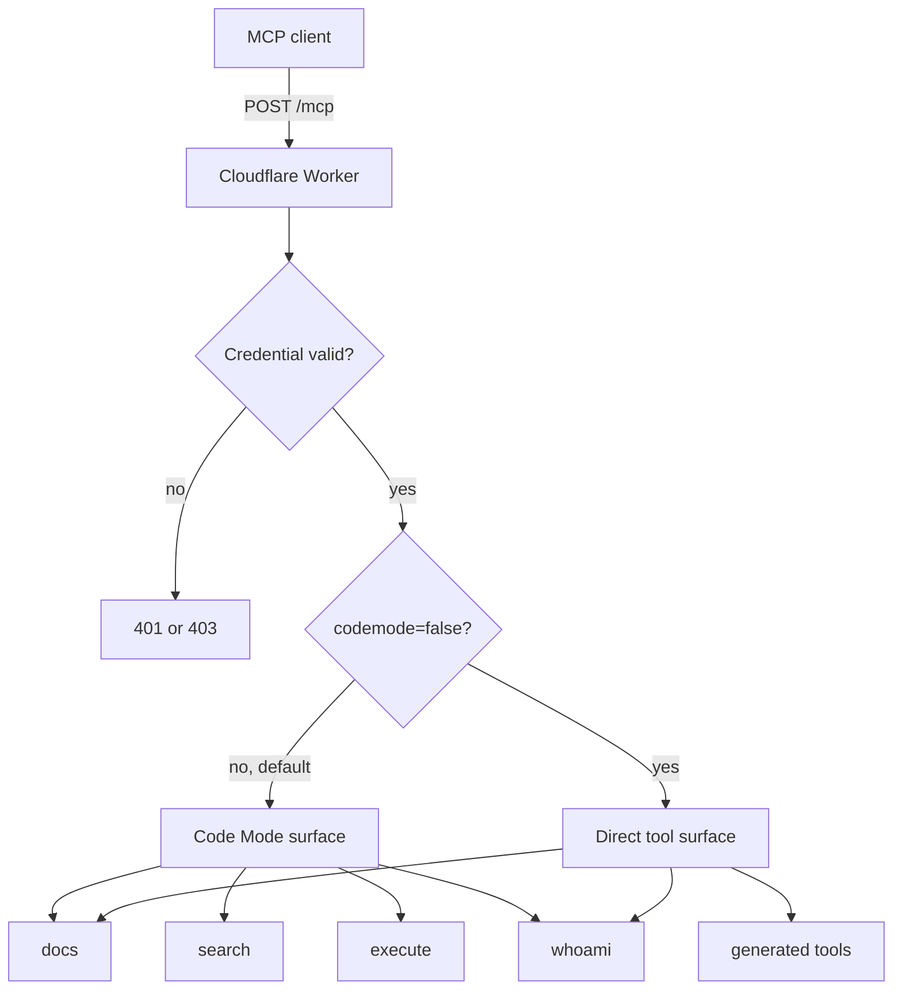
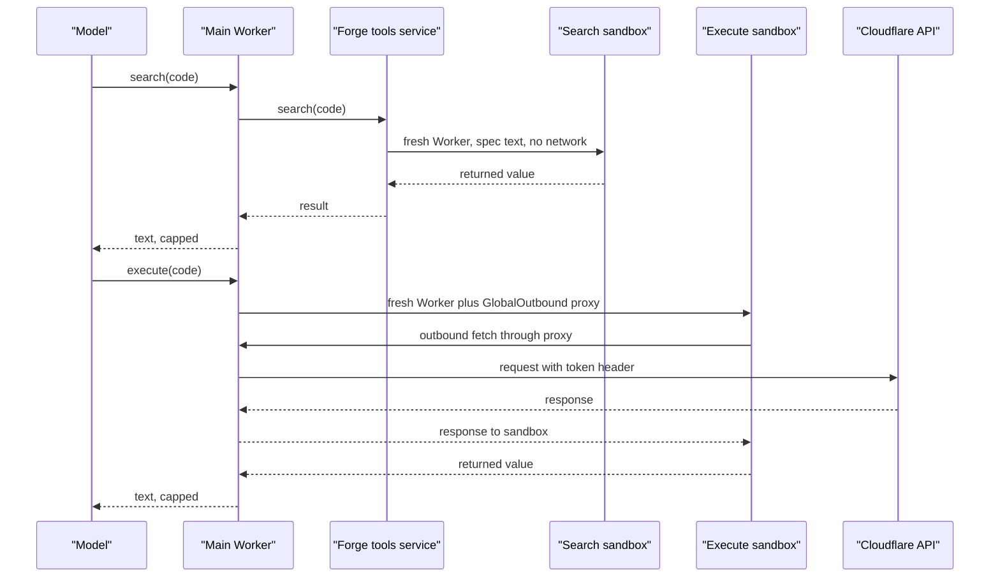

# Overview — Why Code Mode

## What the server is

`cloudflare-mcp` is a remote Model Context Protocol (MCP) server for the
Cloudflare Application Programming Interface (API). Its own description says it
exposes the entire API through the Code Mode pattern (`README.md:3`,
`AGENTS.md:5`).

Code Mode is a tool design. The server does not give the model one tool per API
endpoint. It gives the model a small set of tools, and the model writes
JavaScript that searches a server-side document and calls the API. The document
stays on the server. The package name is `cloudflare-mcp`; the deployed Worker
is `cloudflare-api-mcp` (`package.json:2`, `wrangler.jsonc:124`).

A client connects to one Uniform Resource Locator (URL),
`https://mcp.cloudflare.com/mcp`, and authenticates with Open Authorization
(OAuth) or a Cloudflare API token (`README.md:16-48`).

The server keeps no protocol session. It builds a fresh MCP server for each
authenticated request (`AGENTS.md:152`, `src/server.ts:66-75`). It stores no
conversation identifier and no per-client tool state. Two consequences are
visible. The metrics code emits no `session_start` event, because there is no
session to start (`src/metrics.ts:36-42`). A later request rebuilds the tool
surface from its query string (`src/mcp-handler.ts:199-249`). OAuth grants and
identity records do live in Key Value storage, but those are credential
records, not protocol sessions (`src/index.ts:29-58`). Key Value (KV) storage
is Cloudflare's key-value store.

## The problem it answers

A large API has a large tool catalog. Each MCP tool carries a name, a
description, and a JavaScript Object Notation (JSON) schema. The model reads
the catalog before it calls anything. The repository states the cost in a
table (`README.md:7-12`):

| Approach | Tools | Token cost | Share of a 200K context |
| --- | ---: | ---: | ---: |
| Raw OpenAPI document in the prompt | none | ~2,000,000 | 977% |
| Native MCP, full schemas | 2,594 | 1,170,523 | 585% |
| Native MCP, required parameters only | 2,594 | 244,047 | 122% |
| Code Mode | 3 | ~1,100 | 0.5% |

Native MCP means a server that registers one tool for each endpoint and sends
each tool's full JSON schema.

The Code Mode row counts three tools. The table does not name them. This study
infers that they are `docs`, `search`, and `execute`, because those are the
three tools that work on the API or its documentation. The deployed surface has
four tools: `whoami` reports identity and is separate
(`README.md:101-106`). The share column passes 100 percent because a catalog
can be larger than a 200,000-token context.

One row looks inconsistent. The exact OpenAPI cost is probably 1,954,000
tokens, which is 977 percent of 200,000. The table shows that value rounded to
2,000,000. The rounded value would give 1,000 percent. The other rows agree
with their rounded values. This study keeps the source numbers unchanged.

The table is a claim in the repository text, not a measurement this study can
repeat. The generated catalog in this checkout holds 3,040 tool names, and the
spec artifact holds 3,763 operations (`src/generated/forge-mcp`,
`src/generated/spec/spec.json.txt:1`). The mismatch is discussed in
[13-limitations-and-open-questions.md](13-limitations-and-open-questions.md).

The design answer is simple. Do not send the catalog to the model. Send a
small set of tools that let the model read a server-side catalog and run code
against the API (`README.md:91-95`).

## The surface the client sees

The default surface has four tools (`README.md:97-106`, `src/server.ts:91-98`):

- `docs` searches Cloudflare developer documentation.
- `search` runs read-only code against the OpenAPI document.
- `execute` runs code that calls the Cloudflare API.
- `whoami` returns the identity behind the credential.

A client can ask for direct tools instead with `?codemode=false`
(`README.md:50-56`, `src/mcp-handler.ts:49-57`). In that mode the server
registers one tool for each generated API method, about 3,000
(`README.md:52`). `docs` and `whoami` remain available (`src/server.ts:83-88`).

A second switch, `&experimentalOutputSchema=true`, adds generated output
schemas and structured content. It works only with direct tools and only for
the 2026-07-28 protocol path (`src/server.ts:25-33`, `src/mcp-handler.ts:53-55`).

The diagram follows `src/index.ts:61-93` and `src/server.ts:66-100`.

## What Code Mode actually does

`search` and `execute` are both code runners, but they run different code in
different places for different reasons.

`search` runs code with no network access. The forge tools service builds a
sandbox, places the pre-resolved spec inside it as a text module, and calls the
model's function (`src/forge-tools/search.ts:26-53`). The model's function runs
inside that sandbox. It reads the parsed spec object, because the sandbox
imports the spec text as a module and parses it once when the module loads. The
model gets the returned value, capped unless it asks for the whole result
(`src/tools/search.ts:94-101`).

`execute` runs code with restricted network access. The main Worker builds a
new dynamic Worker. It puts the model's code into the module source. It
attaches an outbound proxy that adds the API token and allows only the
configured API host (`src/tools/execute.ts:99-124`, `src/tools/execute.ts:60-88`).
The sandbox gets a `cloudflare.request()` function. That function builds a
Hypertext Transfer Protocol (HTTP) request and calls `fetch`
(`src/tools/execute.ts:262-324`).

The core property is this: the API token is never a value inside the sandbox.
The token lives in the parent Worker. The sandbox can only send a request
through the proxy, and the proxy adds the header (`src/tools/execute.ts:67-73`).
See [05-the-isolate-boundary.md](05-the-isolate-boundary.md).

> **Aha:** The saving is not that code is shorter than JSON. The saving is
> that the large document never crosses the model boundary. The model writes a
> query, and the document stays on the server. The same design keeps the token
> outside the sandbox, so code execution does not expose the credential.

The diagram shows the service boundary, not the binding names. It omits the
`LOADER` bindings and draws the proxy path through the main Worker. Documents
[04-execute-tool.md](04-execute-tool.md) and
[05-the-isolate-boundary.md](05-the-isolate-boundary.md) give the
binding-level view.

The two paths are separate. `search` has no credential. The `execute` sandbox
can send a request that carries the credential, but the credential value never
exists inside the sandbox.

## What this study covers

Documents `02` through `05` follow the mechanism end to end. Documents `06` and
`07` cover the generated code and its generator. Documents `08` through `12`
cover serving, authentication, permission explanations, result shaping, and
operations. Document `13` lists contradictions and claims that the repository
cannot prove.

## Related documents

- [01-repository-map.md](01-repository-map.md)
- [02-the-code-mode-surface.md](02-the-code-mode-surface.md)
- [03-search-tool.md](03-search-tool.md)
- [04-execute-tool.md](04-execute-tool.md)
- [05-the-isolate-boundary.md](05-the-isolate-boundary.md)
- [13-limitations-and-open-questions.md](13-limitations-and-open-questions.md)
