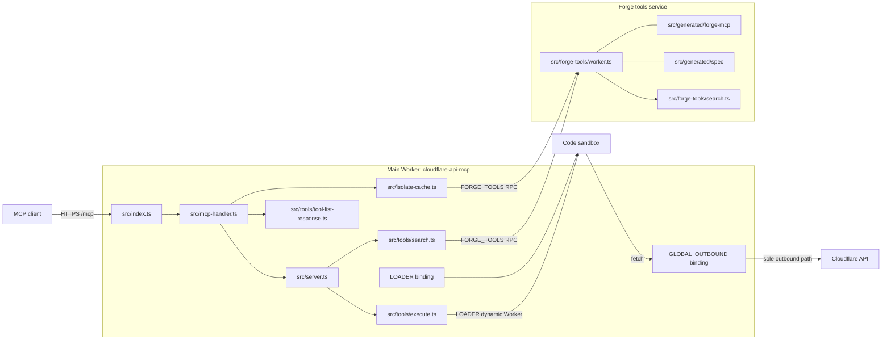
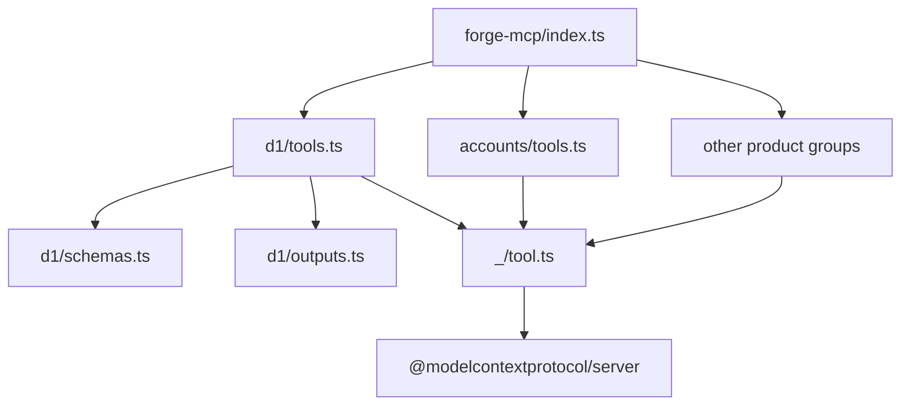

# Repository Map

## Two Workers in one repository

This document uses short forms. MCP means Model Context Protocol. OAuth means
Open Authorization. A URL means Uniform Resource Locator. JSON means JavaScript
Object Notation. HTTPS means Hypertext Transfer Protocol Secure. SDK means
Software Development Kit. KiB means kibibyte (1,024 bytes). MiB means mebibyte
(1,048,576 bytes). MB means megabyte (1,000,000 bytes). The disk-usage command
`du` reports KiB.

The repository deploys two Cloudflare Workers, each a deployed program that
runs in an isolate. The main Worker is
`cloudflare-api-mcp` and it serves the MCP endpoint and the OAuth endpoints
(`wrangler.jsonc:3`, `wrangler.jsonc:123-177`). The second Worker is the forge
tools service, `cloudflare-api-mcp-forge-tools`, and it holds the generated
tools (`wrangler.forge-tools.jsonc:1-12`). The main Worker reaches the second
Worker through a service binding named `FORGE_TOOLS`
(`wrangler.jsonc:39-42`).

A Cloudflare Worker is a deployed program that runs in an isolate. An isolate
is a small JavaScript runtime with its own memory. A service binding is a
private Remote Procedure Call (RPC) link from one Worker to another; it is not
a public URL.

The separation is a compile-cost choice. Workerd, the Cloudflare runtime,
compiles every uploaded module at Worker start. The project guide says the
generated code is about 10 megabytes and that a lazy import still cost about
27 milliseconds per isolate (`AGENTS.md:200`). The measured tool tree below is
27 mebibytes, so the guide's size figure does not match this checkout. A cold
isolate must compile the modules it imports before it runs. A large tree adds
that cost to each cold start. A separate Worker keeps the compile cost out of
Code Mode isolates (`src/forge-tools/worker.ts:1-14`).



`LOADER` and `GLOBAL_OUTBOUND` are bindings of the main Worker. The diagram
shows them as separate nodes, because two different paths use them.

The main Worker also binds `LOADER`, the Dynamic Worker Loader, and
`GLOBAL_OUTBOUND`, a service binding to its own `GlobalOutbound` entrypoint
(`wrangler.jsonc:28-43`). `src/index.ts:19-22` re-exports `GlobalOutbound`
because Wrangler resolves that entrypoint from the entry module.

## Source tree, with the files that matter

The following tree is the hand-written source. It is not a full copy of
`src/generated`. Some entries use short names. A cron is scheduled work. MCP
Events is the event subscription extension, and MCP Skills is the skills
extension. Analytics Engine is Cloudflare's metrics store. A scope challenge is
a request for an OAuth scope.

```
src/
├── index.ts                 OAuth provider, routes, cron
├── mcp-handler.ts           /mcp validation, mode switch, legacy JSON path
├── server.ts                per-request server and tool registration
├── spec-processor.ts        $ref resolution and account/zone path split
├── spec-release.ts          pinned release tag and artifact names
├── truncate.ts              structural result cap
├── isolate-cache.ts         hourly artifact and tool-list cache
├── api-permissions.ts       scope and permission decision
├── api-refusals.ts          refusal detection and explanation headers
├── metrics.ts               Analytics Engine datapoints
├── response-validation.ts   background direct-tool response check
├── response-schema-check.ts JSON Schema validation
├── scope-challenge.ts       insufficient_scope challenge
├── clients.ts               client-specific challenge delivery
├── constants.ts             server identity, user agent, sandbox types
├── auth/                    OAuth handler, token modes, identity probes
├── tools/                   docs, search, execute, whoami, direct tools
├── forge-tools/             generated-tool service and its search sandbox
├── events/                  MCP Events mapping to Cloudflare resources
├── skills/                  MCP Skills extension and R2 sync
├── lib/                     isolate caches and schema memoisation
└── generated/               committed generated code and spec artifacts
```

The entries match `src/` and `AGENTS.md:18-79`, with one correction. The
project guide lists `src/executor.ts` (`AGENTS.md:25`), but no such file exists.
The executor is `src/tools/execute.ts`. This contradiction is recorded in
[13-limitations-and-open-questions.md](13-limitations-and-open-questions.md).

## The generated trees

Two generated directories dominate the repository size.

| Path | Measured size | Files | What it holds |
| --- | ---: | ---: | --- |
| `src/generated/forge-mcp/` | 27,692 KiB (27.0 MiB) | 2,154 | generated direct tools, shared schemas, forge runtime |
| `src/generated/spec/spec.json.txt` | 26,325,766 bytes | 1 | processed OpenAPI document, one line |
| `src/generated/spec/products.json.txt` | 2,258 bytes | 1 | product names |
| `src/generated/spec/permissions.json.txt` | 384,991 bytes | 1 | permissions by path and method |

The measurements come from `du`, `find`, and `ls` on this checkout. The `du`
value is in KiB, which this document also gives in MiB. The generated tool
tree holds 1,033 `tools.ts` files and 3,040 tool names
(`src/generated/forge-mcp`). The index has 1,033 tool-group import lines plus
one runtime type import, for 1,034 import lines in total
(`src/generated/forge-mcp/index.ts:1-1037`). The group count matches the
`tools.ts` file count. The 3,040 tool names are fewer than the 3,763 spec
operations. Some operations are merged or filtered; document
[13-limitations-and-open-questions.md](13-limitations-and-open-questions.md)
records the mismatch.

`src/generated/forge-mcp/source.json` names the release:
`openapi@15ac0d2e3d0c91428f37b5678c168c1c2b3146b0`. `src/spec-release.ts:1-9`
reads that value into `SPEC_RELEASE`. The same file names the three spec
artifacts. `SPEC_RELEASE` labels schema-mismatch events with the release
(`src/response-validation.ts:79`). The search sandbox does not read it; it
reads the `spec.json.txt` text module instead (`src/forge-tools/search.ts:31-33`).

The spec artifact is one JSON line. A parse of
`src/generated/spec/spec.json.txt:1` finds 2,345
path templates and 3,763 operations: 1,840 `GET`, 795 `POST`, 366 `PUT`, 488
`DELETE`, and 274 `PATCH`. The top-level object has one key, `paths`.

## The generated tool package shape

Each product group is a directory. A group can hold:

- `tools.ts`, the tool definitions.
- `schemas.ts`, shared input models.
- `outputs.ts`, shared response models.
- Nested subgroup directories, each with its own `tools.ts`.

The `d1` group is a valid sample. D1 is Cloudflare's managed Structured Query
Language (SQL) database product. The group holds `tools.ts`, `schemas.ts`, and
`outputs.ts` (`src/generated/forge-mcp/d1`). Its `tools.ts` begins with a
generated-code banner and imports `OPERATION`, `Tool`, and `encodePath` from
`../_/tool.js` (`src/generated/forge-mcp/d1/tools.ts:1-4`). The import names
`.js` because TypeScript output uses that extension for a `.ts` source file.
The source file is `_/tool.ts`. The group imports response models from
`./outputs.js` and input models from `./schemas.js`
(`src/generated/forge-mcp/d1/tools.ts:5-23`). `OPERATION` and `encodePath` are
explained in [06-generated-code-sample.md](06-generated-code-sample.md).



The diagram follows `src/generated/forge-mcp/index.ts:1-30` and
`src/generated/forge-mcp/d1/tools.ts:1-23`. The index ends by spreading every
group into one `tools` array (`src/generated/forge-mcp/index.ts`, last 20 lines).

## Source files by role

| Role | Main files |
| --- | --- |
| Entry and routing | `src/index.ts`, `src/mcp-handler.ts` |
| Server and tools | `src/server.ts`, `src/tools/*` |
| Code execution | `src/tools/execute.ts`, `src/forge-tools/search.ts` |
| Generation | `scripts/generate-tools.ts`, `src/generated/*` |
| Authentication | `src/auth/*`, `src/index.ts` |
| Permissions | `src/api-permissions.ts`, `src/api-refusals.ts` |
| Results | `src/truncate.ts`, `src/response-validation.ts` |
| Caching | `src/lib/isolate.ts`, `src/isolate-cache.ts` |
| Operations | `wrangler.jsonc`, `wrangler.forge-tools.jsonc`, `src/metrics.ts` |

Package dependencies are small. Runtime dependencies are
`@cfworker/json-schema`, `@cloudflare/workers-oauth-provider`,
`@modelcontextprotocol/server` version `2.3.1`, `hono`, `yaml`, and `zod`
(`package.json:27-34`). The generator, `@cloudflare/forge`, is a development
dependency pinned to a `pkg.pr.new` build of a forge commit
(`package.json:36`). `pkg.pr.new` is a preview package registry that builds a
package from one commit.

> **Aha:** The generated code is committed, not built during deploy. The
> deploy ships source that a reviewer can read, and the release pin is a file
> in the tree. A spec change therefore arrives as a reviewable pull request,
> not as a runtime fetch (`AGENTS.md:183-184`).

## Committed generated output and tooling

Lint skips the generated tree (`package.json:17`). The formatter does not list
it (`package.json:19`). Tests build the forge tools service with
`wrangler deploy --dry-run` and run it as an auxiliary Worker
(`AGENTS.md:204`). The six-hourly workflow regenerates the tools and opens a
pull request when the code changes (`.github/workflows/forge-tools.yml`).

## Related documents

- [00-overview.md](00-overview.md)
- [06-generated-code-sample.md](06-generated-code-sample.md)
- [07-generation-pipeline.md](07-generation-pipeline.md)
- [08-request-path.md](08-request-path.md)
- [12-operations.md](12-operations.md)
