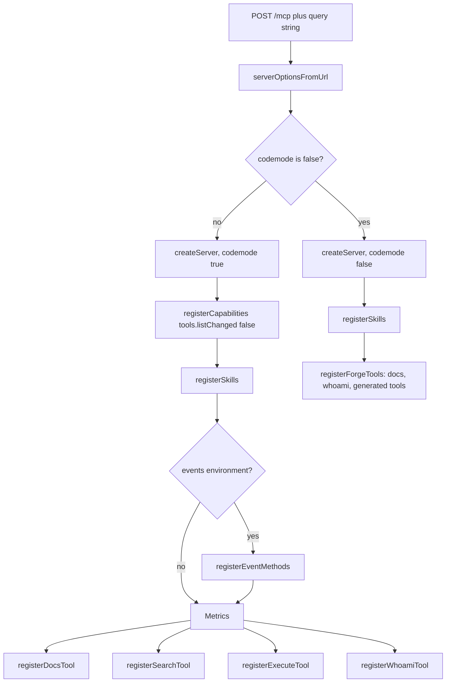
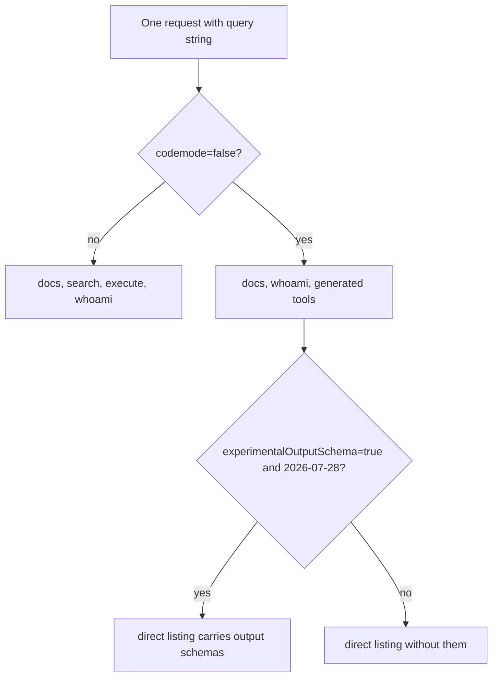

# The Code Mode Surface

## Four tools, two modes

This document uses short forms. OAuth means Open Authorization. URL means
Uniform Resource Locator. SDK means Software Development Kit.

Model Context Protocol (MCP) is the protocol this server answers. In the
default mode the server registers `docs`, `search`, `execute`, and `whoami`
(`src/server.ts:91-98`). The first three cover discovery of
documentation, discovery of endpoints, and calls to the Cloudflare
Application Programming Interface (API). The fourth reports the identity behind
the credential (`README.md:101-106`).

A client changes the mode with a query parameter. `?codemode=false` registers
one direct tool for each generated API method (`src/mcp-handler.ts:49-57`,
`src/server.ts:83-88`). The default is Code Mode because the parser treats only
the exact string `false` as off (`src/mcp-handler.ts:53`).

| Parameter | Accepted values | Default | Effect |
| --- | --- | --- | --- |
| `codemode` | any value; only `false` turns it off | on | `false` registers direct tools |
| `experimentalOutputSchema` | any value; only `true` turns it on | off | adds output schemas to direct tools for requests on the 2026-07-28 MCP protocol version |
| `truncateToolResult` | any value; `false` turns the cap off, `true` forces it on | on in Code Mode, off in direct mode | caps `search` and `execute` results |
| `scopeChallenge` | `http` or `tool` | the client's own delivery behavior | overrides challenge delivery, for testing |

The parameter handling is in `src/mcp-handler.ts:49-63`, and the defaults are
in `src/server.ts:18-41`. The last row is a test override, not a product
feature (`src/mcp-handler.ts:59-63`). A scope challenge is a 403 response that
names an OAuth scope the caller must grant. `http` delivers it as that
response. `tool` delivers it inside the tool result. The mechanism is in
[10-permissions-and-refusals.md](10-permissions-and-refusals.md).

The server reads only the exact strings. `codemode=0` does not turn Code Mode
off. `experimentalOutputSchema=1` does not turn output schemas on.

The diagram follows `src/server.ts:75-99`. The direct branch returns before
the search and execute tools are registered (`src/server.ts:83-89`). The nodes name
registration functions: `registerSkills` is in `src/skills/handlers.ts`,
`registerEventMethods` is in `src/events/methods.ts`, and the rest are in
`src/tools`.

`registerCapabilities({ tools: { listChanged: false } })` declares that the
server will never send a `tools/list_changed` notification
(`src/server.ts:78-81`). The tool set is fixed for the life of one request, so
such a notification would be false.

## `docs`

`docs` takes one string argument, `query`. It calls `env.AI.autorag`, a
Cloudflare Artificial Intelligence (AI) Search instance named `docs-mcp-rag`
(`src/tools/docs-search.ts:155-171`). An AI Search instance is a managed
retrieval service. A binding is a Worker configuration entry that gives the
Worker access to another service. The instance returns documentation chunks,
meaning text fragments
that match the query. Each fragment has a similarity score, source identifier,
URL, title, and text (`src/tools/docs-search.ts:19-25`). The tool returns both
text and `structuredContent`. Structured content is a machine-readable result
that MCP carries next to the text. The text uses `<result>`, `<url>`, `<title>`,
and `<text>` elements (`src/tools/docs-search.ts:101-113`,
`src/tools/docs-search.ts:173-185`).

The tool is registered in both modes. In direct mode it is one entry in the
precomputed tool listing, with its own wire definition
(`src/tools/docs-search.ts:57-99`). The AI Search call retries up to five times
with exponential backoff (`src/tools/docs-search.ts:216-235`).

If the `AI` binding is absent, the tool returns a clear error instead of
throwing (`src/tools/docs-search.ts:101-104`). The top-level default
configuration has no `ai` block. The staging and production blocks add one
(`wrangler.jsonc:69-72`, `wrangler.jsonc:124-127`).

## `search`

`search` takes `code`, a JavaScript async arrow function, and an optional
`truncate` Boolean (`src/tools/search.ts:62-67`). The value crosses the
protocol as source text, not as an executable object. The sandbox splices that
text into a module and calls it. The description lists
products and the `spec` types, then gives three examples: find endpoints by
product, read a request body schema, and read parameters
(`src/tools/search.ts:26-58`).

Two functions share the name `runSearch`. The main Worker has a small
`runSearch` wrapper. It calls `env.FORGE_TOOLS.search(code)`, a Remote
Procedure Call (RPC) to the forge tools service, and returns the inner value
or throws the inner error (`src/tools/search.ts:15-19`). The service has its
own `runSearch(loader, code)`, which builds the sandbox
(`src/forge-tools/search.ts:26-53`). The handler formats the result with the
truncation policy (`src/tools/search.ts:94-101`). The main Worker never holds
the 27 mebibyte spec (`src/tools/search.ts:10-14`).

The tool is read-only with respect to the API, but its annotations do not claim
`readOnlyHint: true`. They set `readOnlyHint: false`, `openWorldHint: false`,
and `destructiveHint: false` (`src/tools/search.ts:87-92`). The three hints are
MCP tool annotations for clients. `readOnlyHint` says a call does not modify
state. `openWorldHint` says a call reaches an external system. `destructiveHint`
says a call can destroy data. The reason for the conservative setting is not
stated. The annotation cannot grant network access. The sandbox configuration
controls network access, and the tool description and the sandbox are the
contract.

## `execute`

`execute` takes `code`, an optional `account_id`, and an optional `truncate`
Boolean (`src/tools/execute.ts:419-426`). Its description embeds TypeScript
declarations for `cloudflare.request()` and `accountId`
(`src/tools/execute.ts:395-414`, `src/constants.ts:27-58`). TypeScript is a
typed language built on JavaScript. The declarations show the types that the
model should use.

The description is identical for every client. The comment states the reason:
MCP clients cache tool metadata and may serve one user's list to another. The
description therefore must not name an account or depend on token shape
(`src/tools/execute.ts:387-394`). Account resolution happens only in the
handler (`src/tools/execute.ts:463-476`).

The handler resolves the account, calls `runExecute`, formats a success, or
builds a failure with account hints, GraphQL guidance, and a scope challenge
(`src/tools/execute.ts:441-516`). The mechanism is in
[04-execute-tool.md](04-execute-tool.md).

## `whoami`

`whoami` takes no arguments. It returns `{ id }`, plus `name` for an account
token or `email` for a user token (`src/tools/whoami.ts:80-97`). The `id` is
`user:<id>` or `account:<id>`. The source calls this format a permanent
contract because clients store it across reconnects (`src/tools/whoami.ts:80-87`).

`_meta` is MCP's reserved metadata field on a tool. The tool carries
`_meta['openai/profile']` and an OAuth security scheme with `user:read` and
`account:read` (`src/tools/whoami.ts:39-48`). An account token belongs to one
Cloudflare account. A user token belongs to a user and can reach that user's
accounts. `openai/profile` is an OpenAI extension key. The scheme lists the
scopes the profile call needs. This marker lets ChatGPT tell connected accounts
apart (`README.md:118`).

## The direct-tool surface

With `?codemode=false`, `tools/list` returns `docs`, `whoami`, and the
generated tools (`src/tools/forge-tools.ts:54-60`). The generated tools live in
the forge tools service. The main Worker asks for the listing once per isolate
and caches it (`src/isolate-cache.ts:69-89`).

The listing is large. The source comment says about 3,800 tools and 3.7
mebibytes (`src/tools/tool-list-response.ts:59-64`). The measured generated
count is 3,040 tool names, so the comment is probably stale or counts another
surface. A 2025-era request is an MCP request on a protocol version before
2026-07-28. The SDK helper `isLegacyRequest` decides that, and the exact
version list is in the external SDK (`src/tools/tool-list-response.ts:1`,
`src/tools/tool-list-response.ts:55`). The listing is encoded once per isolate.
A legacy `tools/list` request gets that encoded listing directly. Such a
request must be a single `tools/list` call with no cursor
(`src/tools/tool-list-response.ts:13-21`,
`src/tools/tool-list-response.ts:74-87`).

Tool names come from forge. A name joins the group and the method with an
underscore, such as `d1_list` or `zeroTrust_access_applications_list`
(`AGENTS.md:205`). Arguments are grouped by location: `path`, `query`,
`headers`, and `body` (`README.md:52`, `AGENTS.md:205`). The schema nests each
argument under the part of the HTTP request where it goes.

The rule is per request, not stored state. The same client can use both modes
by changing the query string of the same URL
(`src/mcp-handler.ts:49-57`).

## Result shaping differs by mode

In Code Mode, the default cap is on. `search` and `execute` each accept a
`truncate` argument. When the argument is absent, the connection default
applies. That default comes from the request's `truncateToolResult` query
parameter (`src/server.ts:34-40`, `src/truncate.ts:41-50`). The cap is about
6,000 tokens (`src/truncate.ts:19-22`).

In direct mode, the default cap is off. The README explains that clients which
disable Code Mode usually run their own code mode. They parse each result, so a
cap would lose data (`README.md:85`). A caller can still set
`?truncateToolResult=true` (`src/mcp-handler.ts:51-55`).

## Metrics wrapping

`attachMetrics` replaces the server's `registerTool` method with a wrapper
(`src/metrics.ts:320-371`). The server calls it before it registers the four
Code Mode tools, so the wrapper is in place for all of them
(`src/server.ts:83-99`). Every tool registered after that call records a
`tool_call` event. The event goes to the `MCP_METRICS` Analytics
Engine dataset. Analytics Engine is Cloudflare's metrics store. The wrapper
also copies `tool.title` into `annotations.title` when the annotations lack a
title (`src/metrics.ts:338-345`).

Direct tools are not wrapped by that function. The direct branch returns before
`attachMetrics` runs. Its own `tools/call` handler registers no tools, so a
wrapper would see no calls. The handler records one event per call instead
(`src/tools/forge-tools.ts:94`).

> **Aha:** The tool surface is deliberately token-independent. Tool
> descriptions, schemas, and account guidance are the same for every user.
> This is unusual for a multi-tenant server. It follows from client behavior: a
> client may cache a tool list and show it to a different client.
> The design moves all user-specific data into results, not metadata
> (`src/tools/execute.ts:387-394`, `src/forge-tools/policy.ts:9-13`).

## Related documents

- [03-search-tool.md](03-search-tool.md)
- [04-execute-tool.md](04-execute-tool.md)
- [08-request-path.md](08-request-path.md)
- [10-permissions-and-refusals.md](10-permissions-and-refusals.md)
- [11-results-and-validation.md](11-results-and-validation.md)
