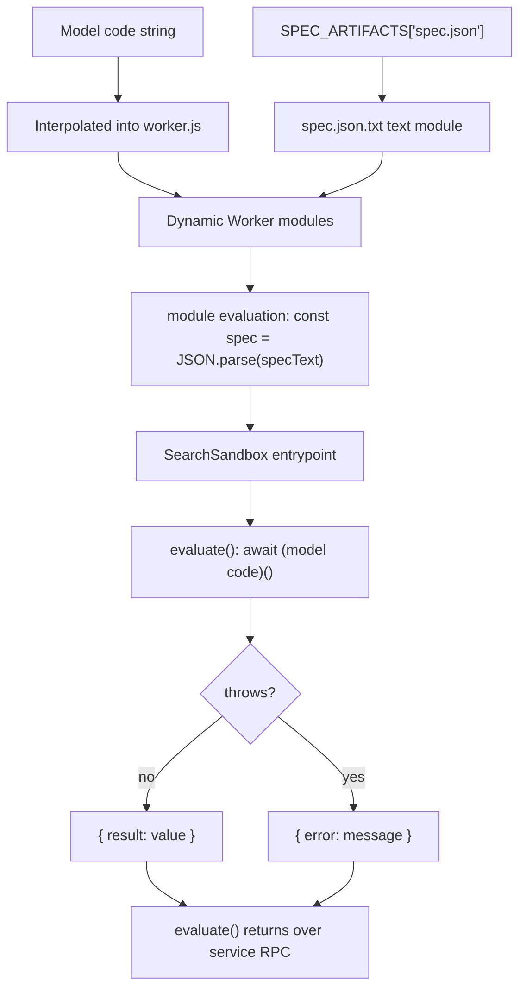

# The `search` Tool

## What the model sends and receives

This document uses short forms. MCP means Model Context Protocol. API means
Application Programming Interface. JSON means JavaScript Object Notation. RPC
means Remote Procedure Call.

The model sends one JavaScript async arrow function, as source text. The
function receives no arguments. It reads a module-scope object named `spec`,
which the sandbox builds from the spec text below, and returns any value
(`src/tools/search.ts:62-67`, `src/openapi.ts:28-51`). The name is a binding in
the sandbox module, not a property of `globalThis`.

The return value crosses back as one MCP result. The server renders it as text,
pretty-printed if it is not a string. The server caps the text when the
connection default is on, unless the call sets `truncate: false`
(`src/tools/search.ts:94-101`, `src/truncate.ts:59-87`). The connection default
is the value set by the request's `truncateToolResult` query parameter.

The tool description gives the model three facts and three examples
(`src/tools/search.ts:26-58`):

- All `$ref` references are resolved inline. A `$ref` is a JSON Schema
  reference to another schema.
- Response schemas describe the body as the API sends it, usually the
  Cloudflare envelope with `success`, `errors`, `messages`, `result`, and
  optional `result_info`.
- The available products are listed, truncated to 30 names plus the total.

The examples show iteration over `spec.paths`, access to a `requestBody`
schema, and access to parameters (`src/tools/search.ts:33-58`).

## The path to the sandbox

`search` does not run code in the main Worker. The handler calls
`env.FORGE_TOOLS.search(code)`, a service binding Remote Procedure Call
(`src/tools/search.ts:15-19`). The forge tools service implements `search` as
`runSearch(this.env.LOADER, code)` (`src/forge-tools/worker.ts:93-96`).

The service uses its own `LOADER` binding to create a new dynamic Worker for
each call (`src/forge-tools/search.ts:26-30`). A dynamic Worker is a Worker that
the loader builds at run time from a module map. The Worker name is
`cloudflare-search-` plus a random Universally Unique Identifier (UUID)
(`src/forge-tools/search.ts:27`).

```mermaid
sequenceDiagram
  participant M as "Model"
  participant Main as "Main Worker"
  participant Forge as "Forge tools service"
  participant Loader as "Worker Loader"
  participant Box as "Search sandbox"
  M->>Main: tools/call search with code
  Main->>Forge: RPC search(code)
  Forge->>Loader: LOADER.get with new UUID
  Loader->>Box: start worker.js plus spec.json.txt
  Box->>Box: JSON.parse(specText)
  Box->>Box: await code()
  Box-->>Forge: result or error
  Forge-->>Main: SearchOutcome
  Main-->>M: text content, truncated by policy
```

The caller chain is `src/tools/search.ts:15-19`,
`src/forge-tools/worker.ts:93-96`, and `src/forge-tools/search.ts:26-53`.

## The sandbox source

The loader receives a module map with two modules
(`src/forge-tools/search.ts:31-49`):

- `spec.json.txt`, a text module holding the processed spec.
- `worker.js`, the sandbox source.

The sandbox source imports the spec text and parses it once at module
evaluation, before any `evaluate` call (`src/forge-tools/search.ts:36-37`). The
result is one module-scope `const spec`. The single `evaluate` call on that
Worker reads the object. The source then defines an entrypoint with an
`evaluate`
method (`src/forge-tools/search.ts:39-47`). The method runs the model's code and
wraps the outcome:

```javascript
try {
  return { result: await (${code})() };
} catch (err) {
  return { error: err instanceof Error ? err.message : String(err) };
}
```

This exact shape is at `src/forge-tools/search.ts:41-45`. The model's code is
interpolated into the module source as text.

The sandbox has `globalOutbound: null` (`src/forge-tools/search.ts:29`). It has
no network path. It also receives no credentials and no bindings. Apart from
the model code spliced into `worker.js`, its only input is the spec text.
`SPEC_ARTIFACTS` is a table of the three spec strings
(`src/forge-tools/spec.ts:11-15`). Its keys are `spec.json`,
`products.json`, and `permissions.json`. The module name adds `.txt` for the
text-module import, so the key `spec.json` becomes the module
`spec.json.txt`. Only the first string enters this sandbox. The main Worker
reads the other two (`src/isolate-cache.ts:51-98`).

A text module is a Worker module whose export is a string. The runtime stores
the string and hands it to the importer. It does not run a parser at module
load.



The source is `src/forge-tools/search.ts:26-53`.

The parent calls `worker.getEntrypoint().evaluate()`
(`src/forge-tools/search.ts:52`). That call is the boundary crossing. The
sandbox runs the model's function inside `evaluate`. The result is a
`SearchOutcome`: `{ result }` or `{ error }` (`src/forge-tools/search.ts:5-10`).
The service returns it over RPC.

The main Worker's wrapper unwraps it. If `error` is present, the wrapper throws
a new `Error` with that message. Otherwise it returns `result`
(`src/tools/search.ts:16-18`). The model therefore receives the value, not the
`{ result: ... }` wrapper.

## Why a fresh isolate, and why a text module

The source states two design reasons.

First, a fresh isolate runs each call because dynamic Worker isolates disallow
`eval` (`src/forge-tools/search.ts:19-23`). Code cannot be passed as a string
into a warm isolate and evaluated there. The code must be part of the module
source. A new worker, with a new name, is the way to give each call its own
source.

Second, the spec is a separate text module. The source says splicing the 27
megabyte string into the module source built a new string on every call. That
cost about 117 milliseconds of Central Processing Unit (CPU) time per search,
mostly garbage collection (`src/forge-tools/search.ts:21-25`). Splicing also
copies the whole string into a new source string on each call. A text module
hands the stored string over as is, so no copy happens per call.

The spec artifact is 26,325,766 bytes in this checkout
(`src/generated/spec/spec.json.txt`). The source comment calls it `27MB`
(`src/forge-tools/search.ts:22`). That is 26.3 MB, or 25.1 MiB, by measurement.

> **Aha:** `search` is not a special query language. It is arbitrary
> JavaScript against a parsed JSON object, with no network and no credential.
> The "tool" is the sandbox boundary. The OpenAPI document is data inside that
> boundary, not context inside the model.

## The `spec` object shape

The processed spec has one top-level key, `paths`. Each path template maps to
an object of methods (`src/openapi.ts:28-51`). Each operation can hold:

| Field | Meaning |
| --- | --- |
| `summary` | short operation summary |
| `x-api-token-group` | API token permissions the endpoint accepts |
| `description` | long operation description |
| `tags` | product tags, with the extracted product first |
| `parameters` | path and query parameters |
| `requestBody` | request body schema |
| `responses` | response schemas by status |

The fields are defined in `src/openapi.ts:4-22` and produced in
`src/spec-processor.ts:132-140`.

`processSpec` resolves every `$ref` inline before storage
(`src/spec-processor.ts:56-85`, `src/spec-processor.ts:110-147`). A circular
reference becomes `{ $circular: ref }` instead of recursing forever
(`src/spec-processor.ts:67-70`). `ref` is the reference string, such as
`#/components/schemas/D1Database`. The model sees that marker in place of the
repeated schema.

Forge merges operations that exist under both accounts and zones into one path
with `{account_or_zone}`. `processSpec` splits each merged path back into two
paths, one with `accounts` and one with `zones` (`src/spec-processor.ts:18-40`).
The placeholder does not remain in the stored spec. Code Mode therefore sees
paths it can call as written. The merge exists because Forge's source groups
the two variants; the split restores the API's real routes.

## What the model usually writes

A typical search loops over `Object.entries(spec.paths)`, then over each
method, and filters by tag or summary. The description includes this exact
pattern (`src/tools/search.ts:36-46`). The result is a small array of method,
path, and summary objects.

The model can also return a full schema. The description shows a
`requestBody` read and a `parameters` read (`src/tools/search.ts:49-58`). This
is how a model learns argument names before it writes an `execute` call.

## Errors and limits

The sandbox catches errors from the model's code and returns the message as a
string (`src/forge-tools/search.ts:41-45`). The service returns
`{ error }`. The main Worker throws a new `Error` with that message
(`src/tools/search.ts:16-18`). The tool handler catches it and formats it as a
tool error (`src/tools/search.ts:99-101`).

The loader call passes only `compatibilityDate: '2026-01-12'`
(`src/forge-tools/search.ts:28`). A compatibility date selects the runtime
behavior version for the Worker. It sets no `limits` field. The type
declaration allows `limits` with `cpuMs` and `subRequests`
(`worker-configuration.d.ts:3674-3677`), but the repository does not set them
for `search`. The actual platform default is not in this repository, so this
study cannot state the CPU ceiling or the wall-clock ceiling. See
[13-limitations-and-open-questions.md](13-limitations-and-open-questions.md).

The result cap is the only result-size control. It applies after the code
returns, so it does not stop a search from building a large value in memory
inside the sandbox (`src/truncate.ts:73-87`).

## Why search lives in the forge tools service

If the main Worker ran `search`, it would hold the 26.3 megabyte spec in every
warm isolate. The main Worker instead calls the service, which already ships
the spec with the generated tools (`src/tools/search.ts:10-14`,
`src/forge-tools/worker.ts:1-14`). The main Worker caches only `products.json`
and `permissions.json`, not `spec.json` (`src/isolate-cache.ts:13-24`).

The trade is one RPC hop per search. The gain is that Code Mode isolates stay
small and the spec has one home.

## Related documents

- [02-the-code-mode-surface.md](02-the-code-mode-surface.md)
- [04-execute-tool.md](04-execute-tool.md)
- [05-the-isolate-boundary.md](05-the-isolate-boundary.md)
- [06-generated-code-sample.md](06-generated-code-sample.md)
- [11-results-and-validation.md](11-results-and-validation.md)
