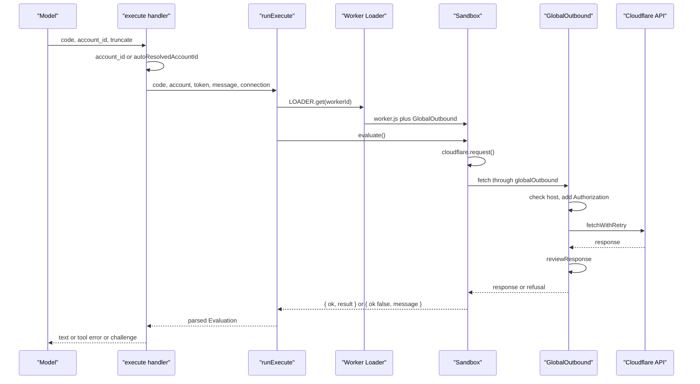
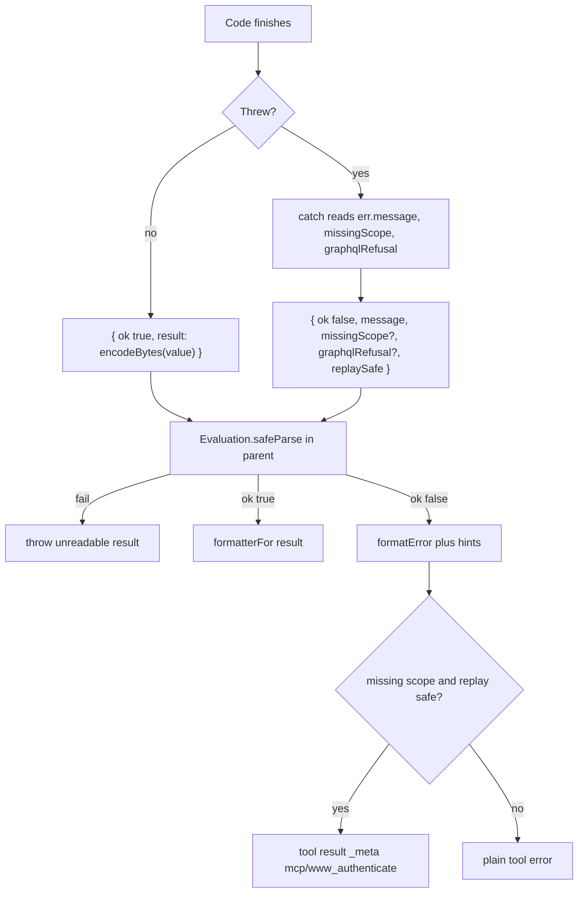

# The `execute` Tool

## Input and description

`execute` calls the Cloudflare Application Programming Interface (API). It
takes three arguments (`src/tools/execute.ts:419-426`). In this document, JSON
means JavaScript Object Notation, UTF means Unicode Transformation Format, and
RPC means Remote Procedure Call. GraphQL is the query language name. A token is
a small text unit that a model context counts.

| Argument | Type | Required | Meaning |
| --- | --- | --- | --- |
| `code` | string | yes | JavaScript async arrow function |
| `account_id` | string | no | account to run against |
| `truncate` | Boolean | no | cap the result at about 6,000 tokens |

The description embeds TypeScript declarations for the request options type,
the response envelope type, the `cloudflare.request` function, and `accountId`
(`src/tools/execute.ts:395-414`, `src/constants.ts:27-58`).
`CloudflareRequestOptions` describes the `method`, `path`, `query`, `body`, and
`contentType` fields. The sandbox also reads an undocumented `rawBody` field
(`src/tools/execute.ts:264-268`). Older descriptions documented it; the current
one does not. `CloudflareEnvelope` describes the usual response body:
`success`, `errors`, `messages`, `result`, and optional `result_info`
(`src/constants.ts:29-58`). The description tells the model three rules:

- The code must be an async arrow function.
- A failed request throws an `Error` with method, path, status, and Cloudflare
  errors.
- For a Hypertext Transfer Protocol (HTTP) 401 or 403, the error also names
  the permission. It says whether reconnecting will help
  (`src/tools/execute.ts:403-404`).

The description also gives a multipart `FormData` example for a Worker upload
(`src/tools/execute.ts:406-414`). That example is the only body-encoding case
that needs the exact `Blob` and `FormData` shape.

## The call path

The handler resolves the account, then calls `runExecute` with five values.
The values are the code, the effective account identifier, the API token, the
unresolved account message, and the connection (`src/tools/execute.ts:463-476`).
The unresolved account message is the text that the `accountId` getter throws
when no account is known (see below).

The account comes from two sources. An explicit `account_id` wins. Otherwise
`autoResolvedAccountId` returns the fixed account of an account token, or the
only account of a single-account user token (`src/auth/account-access.ts:16-30`).
It returns `undefined` for a user token with several accounts. In that case
account-independent calls still run, and code that reads `accountId` fails with
guidance (`src/tools/execute.ts:457-461`).

The connection is a `Connection` union (`src/api-permissions.ts:5-18`). An
`oauth` connection holds the granted scopes. A `direct` connection holds no
scope list, because the server does not know the token's permissions. The
connection reaches the proxy as a prop, so the proxy can explain a refusal
(`src/tools/execute.ts:121-123`).



The sequence follows `src/tools/execute.ts:99-124`, `src/tools/execute.ts:326-345`,
`src/tools/execute.ts:60-88`, and `src/tools/execute.ts:463-516`.

## Building the dynamic Worker

`runExecute` starts with a worker identifier:
`cloudflare-api-` plus a random Universally Unique Identifier (UUID)
(`src/tools/execute.ts:107`). A new identifier means a new isolate for every
call.

The account prelude has two forms (`src/tools/execute.ts:109-117`):

```javascript
const accountId = "<id>";
```

when an account is resolved, or a throwing getter on `globalThis` when it is
not:

```javascript
Object.defineProperty(globalThis, "accountId", { configurable: true, get() {
  throw new Error("<message>");
} });
```

The second form lets account-independent calls such as `GET /accounts` run.
Code that reads `accountId` then fails at once with guidance, instead of
building a path with an empty segment (`src/tools/execute.ts:109-117`).

The loader call passes these fields (`src/tools/execute.ts:119-124`):

- `compatibilityDate: '2026-01-12'`, the runtime behavior version.
- `globalOutbound`, a `GlobalOutbound` entrypoint with props.
- `mainModule: 'worker.js'` and one module, `worker.js`.

The props are the API token, the caller label `codemode_execute_tool_call`, and
the connection (`src/tools/execute.ts:121-123`). The label appears in retry log
lines. The connection tells the
outbound proxy which scopes the session holds, so it can explain a refusal.

The sandbox learns the API base in the module source. `runExecute` reads
`env.CLOUDFLARE_API_BASE` (`src/tools/execute.ts:106`) and inserts the value as
`const apiBase = ...` (`src/tools/execute.ts:129`). The value is a Worker
variable, `https://api.cloudflare.com/client/v4` in production
(`wrangler.jsonc:23`). The proxy reads the same variable for its host check
(`src/tools/execute.ts:62`).

The module source is a template string that contains the model's code at the
end (`src/tools/execute.ts:126-340`). The source ends with `await (${code})()`
inside a try/catch, the same shape as `search`. The call receives no
arguments. The source cannot use `eval`, so code must be part of the module.
This reason is stated for `search`
(`src/forge-tools/search.ts:19-23`) and for `execute`
(`src/tools/execute.ts:91-98`).

## The `GlobalOutbound` proxy

`GlobalOutbound` extends `WorkerEntrypoint` with props `apiToken`,
`fetchWithRetryCaller`, and `connection` (`src/tools/execute.ts:45-49`,
`src/tools/execute.ts:60`). Its `fetch` method does five things:

1. Reads the allowed host from `CLOUDFLARE_API_BASE`.
2. Reads the requested host from the request Uniform Resource Locator (URL).
3. Returns 403 if the two differ.
4. Copies the request and adds `Authorization: Bearer <apiToken>`.
5. Calls `fetchWithRetry`, then `reviewResponse`.

The host check is `src/tools/execute.ts:62-66`. The header injection is
`src/tools/execute.ts:67-73`. The retry and review is
`src/tools/execute.ts:74-87`.

The token never enters the sandbox. It exists in the parent Worker as a
property of the entrypoint (`src/tools/execute.ts:67`). The sandbox can call
`fetch`, but every call leaves through this proxy.

The host check is a string comparison of `hostname`
(`src/tools/execute.ts:62-64`). It does not compare scheme or port. A request
to another path on the same host passes. A request to another host fails with
403. The repository relies on the API base value from configuration
(`wrangler.jsonc:23`, `wrangler.jsonc:172`).

`reviewResponse` can replace a response. It explains a refusal, names a missing
Open Authorization (OAuth) scope, and turns an empty list that may be
permission-filtered into a 403 (`src/api-refusals.ts:177-220`). It treats a
response as possibly filtered when the connection is OAuth, the method is
`GET`, the response is OK JSON, and the declared body length is below a fixed
maximum. It replaces the empty list only when the catalog shows that the
connection lacks a permission the endpoint needs, and the endpoint is not one
that baseline permissions can always read (`src/api-permissions.ts:377-387`,
`src/api-refusals.ts:139-148`). The sandbox reads the explanation from response
headers (`src/tools/execute.ts:152-161`).

## The `cloudflare.request` function inside the sandbox

The sandbox defines `cloudflare` as an object with one async method,
`request` (`src/tools/execute.ts:264-324`). The method does this:

1. Reads `method`, `path`, `query`, `body`, `contentType`, and `rawBody`.
2. Builds a URL from the API base plus the path.
3. Sets each defined query value with `searchParams.set`.
4. Encodes the body with `encodeBody`.
5. Sends `fetch` with the method, content type, and body.
6. Reads the response media type.
7. Returns text or bytes for non-JSON.
8. Parses JSON, handles GraphQL, and throws on failure.

The steps are at `src/tools/execute.ts:265-323`.

### Body encoding

`encodeBody` has clear rules (`src/tools/execute.ts:211-223`). Object bodies
become JavaScript Object Notation (JSON) text.

| Body value | Content type | Sent as |
| --- | --- | --- |
| `undefined` or `null` | any | no body |
| bytes, `Blob`, `FormData`, `URLSearchParams`, stream | any | as is, with `contentType` |
| string, with a non-JSON content type | non-JSON | as is |
| string that is already JSON | JSON or none | as is |
| other string | JSON or none | JSON string value |
| object, array, number, Boolean | any | JSON text, typed `application/json` if absent |
| any value, with the `rawBody` flag set | any | as is, legacy flag |

The string rows are exclusive. A string is serialized as a JSON value only
when the content type is JSON or absent. With another content type, the string
is sent unchanged as the request body. The third row covers the unchanged case.
The fourth and fifth rows cover the JSON cases (`src/tools/execute.ts:211-223`).

`FormData` is special. If the caller gives a content type without a boundary,
the code drops the header. It lets `fetch` add its own multipart header with the
boundary (`src/tools/execute.ts:217-220`).

Binary body types are recognized in `isRawBody`
(`src/tools/execute.ts:190-195`). The comment explains that the old `rawBody`
flag is still honoured for older code but is no longer documented
(`src/tools/execute.ts:266-268`).

### Response conversion

For a non-JSON response, a failed status throws, and a successful response
returns a string or a `Uint8Array` (`src/tools/execute.ts:288-299`). The
`decodeBody` function tests a list of binary media types, then tries a strict
UTF-8 decode; if the decode fails, it returns bytes
(`src/tools/execute.ts:174-188`).

For a JSON response, the code parses the body (`src/tools/execute.ts:301`). The
GraphQL branch runs first. GraphQL is a query language for an API, and
Cloudflare serves it at `/graphql` (`src/tools/execute.ts:368-376`). If the
response has errors and no data, the code throws an `Error` with the messages
joined (`src/tools/execute.ts:303-314`). Partial data returns with its errors,
as the API sent it (`src/tools/execute.ts:302-304`). That return skips the
normal status check. A complete GraphQL response therefore never reaches the
`success === false` test.

A normal response throws if the status is not OK or if `success === false`
(`src/tools/execute.ts:316-322`). The error text uses `apiError`, which builds
a message with method, path, status, and Ray ID. A Ray ID is Cloudflare's
per-request identifier, read from the `cf-ray` response header
(`src/tools/execute.ts:153-155`). Then comes the raw body, then the refusal
hint (`src/tools/execute.ts:148-161`).

### Returned bytes

If the model returns bytes, `encodeBytes` converts them to
`{ base64, byteLength }` (`src/tools/execute.ts:225-250`). It walks arrays and
plain objects. Other objects are left as they are, and the final JSON
serialization decides their form. This keeps binary data representable in
JSON.

## How a failure becomes the result object

The sandbox does not return the thrown `Error` itself. The catch block builds a
plain object (`src/tools/execute.ts:326-338`):

```javascript
{
  ok: false,
  message: err instanceof Error ? err.message : String(err),
  missingScope: typeof err?.missingScope === "string" ? err.missingScope : undefined,
  graphqlRefusal: err?.graphqlRefusal === "zone" ||
    err?.graphqlRefusal === "account" ? err.graphqlRefusal : undefined,
  replaySafe: sentRequests.every(({ read, status }) => read || status === 401 || status === 403)
}
```

`apiError` builds `message` (`src/tools/execute.ts:152-163`). It joins three
parts with blank lines. The first part is `Cloudflare API error: <method>
<path> returned HTTP <status>` plus the Ray ID when present. The second part is
the response body. For JSON it is pretty-printed JSON. For other media types it
is the first 500 characters of the text. The third part is the decoded
`X-Cloudflare-MCP-Refusal-Hint` header, when present.

`missingScope` comes from another header, `X-Cloudflare-MCP-Missing-Scope`
(`src/api-refusals.ts:20`, `src/api-refusals.ts:234`). The proxy sets both
headers (`src/api-refusals.ts:232-234`). `apiError` copies the scope onto the
error object (`src/tools/execute.ts:159-160`). The sandbox does not decide the
scope; it only relays the header.

`graphqlRefusal` is different. The sandbox computes it from the GraphQL error
messages (`src/tools/execute.ts:255-263`). A message that names the zone
analytics permission gives `"zone"`. The account analytics permission, or the
exact phrase `authorization denied`, gives `"account"`. The zone check runs
first. Any other failure gives `undefined`. The catch block copies the value
only when it is one of those two strings.

The parent then applies the Zod union. Zod is a TypeScript schema library. A
malformed object becomes the unreadable-result error, not a tool failure with
hints.

## The result contract

The sandbox returns a value that the parent parses with a Zod union
(`src/tools/execute.ts:27-43`). The union has two shapes:

```typescript
{ ok: true, result: unknown }
{ ok: false, message: string, missingScope?: string,
  graphqlRefusal?: 'zone' | 'account', replaySafe: boolean }
```

`graphqlRefusal` is an optional tag on a GraphQL failure. It says whether the
missing permission is a zone analytics permission or an account analytics
permission (`src/tools/execute.ts:369-376`). `replaySafe` says whether the
parent may run the same code again after a new authorization. The sandbox
computes it.

The comment calls the sandbox value untrusted, so it is parsed
(`src/tools/execute.ts:27`). If parsing fails, the parent throws "The code
sandbox returned an unreadable result" (`src/tools/execute.ts:344-347`).

`replaySafe` is computed inside the sandbox. The sandbox wraps
`globalThis.fetch` and records each request's method and final status
(`src/tools/execute.ts:132-146`). A request is a read when it is `GET`,
`HEAD`, or a path ending in `/graphql` (`src/tools/execute.ts:139-141`).
The comment says the GraphQL Analytics API has no mutations, so its `POST` is
a read (`src/tools/execute.ts:138`). `replaySafe` is true when every request
was a read or ended in 401 or 403 (`src/tools/execute.ts:335`). A refused
request changed nothing, so a retry after a new authorization is safe.

The parent checks the shape of this value, not its truth. Model code shares the
module scope with the recorder, so a program could in principle falsify the
record. The parent still checks the scope against the catalog and the grant. A
false `replaySafe` can cause an unusable challenge, but it cannot expose the
token or bypass the host check.



The parent flow is `src/tools/execute.ts:326-345` and
`src/tools/execute.ts:477-507`.

## Failure explanation and scope step-up

The handler adds three kinds of guidance to a failure.

First, an account hint. If the caller passed `account_id`, the handler adds an
unknown-account hint when that identifier is not in the session's known list
(`src/tools/execute.ts:483-489`). If the failure message names an account path,
the handler adds a path-specific hint (`src/tools/execute.ts:382-385`,
`src/tools/execute.ts:483-488`).

Second, a GraphQL hint. The spec does not list the GraphQL Analytics API, so
the code has a fixed request and fixed permission map
(`src/tools/execute.ts:369-376`). A zone dataset needs `Analytics Read`; an
account dataset needs `Account Analytics Read` (`src/tools/execute.ts:373-376`).
The handler explains the refusal with the normal permission explanation
(`src/tools/execute.ts:490-493`).

Third, a scope challenge, also called a step-up. A scope challenge is a result
that asks the client to authorize one more OAuth scope and then run the call
again. The sandbox can report the value of the
`X-Cloudflare-MCP-Missing-Scope` header as `missingScope`
(`src/api-refusals.ts:20`). The parent accepts it only when it is a catalog
scope the connection does not hold (`src/tools/execute.ts:353-367`). A catalog
scope is one in the production OAuth scope list. The connection is the request's
`Connection` value. The comment explains why: the sandbox is untrusted, so a
lying program could ask for any scope. The check limits it to a scope it could
also get by calling an endpoint that needs it (`src/tools/execute.ts:353-359`).

A challenge is offered only when `replaySafe` is true. If earlier requests may
have changed resources, the handler returns the failure with a message that
says an automatic retry is unsafe (`src/tools/execute.ts:350-351`,
`src/tools/execute.ts:500-503`). This is a careful choice: a step-up triggers a
new authorization and a replay, and a replay of a write is not safe.

> **Aha:** The sandbox is allowed to fail in a rich way, but the parent trusts
> none of it without a check. The error shape is schema-checked, the scope is
> checked against the catalog and the current grant, and the replay flag gates
> the challenge. The flag itself is only a hint from the sandbox. The design
> treats model-written code as an unreliable narrator, not as a trusted
> extension of the server.

## What the sandbox can and cannot do

The sandbox can:

- Build requests to the configured API host.
- Read the response body as JSON, text, or bytes.
- Return any JSON-representable value.
- Call `fetch` to the API host, including paths outside the spec.

The sandbox cannot:

- Read the API token.
- Reach another host.
- Use `eval` or dynamic code generation.
- Persist state between calls, because each call gets a new isolate.

The first three limits come from the loader configuration
(`src/tools/execute.ts:119-124`) and the proxy check
(`src/tools/execute.ts:62-66`). The fourth comes from the new worker identifier
(`src/tools/execute.ts:107`).

The loader call does not set `limits`. The type declaration permits `cpuMs` and
`subRequests` (`worker-configuration.d.ts:3674-3677`), but `execute` passes
neither. The wall-clock timeout, memory ceiling, and subrequest ceiling are
platform defaults, not repository values. The repository also sets no
`compatibilityFlags` on the dynamic Worker
(`src/tools/execute.ts:119-124`).

## Behaviour of `fetch` inside the sandbox

The sandbox wraps `globalThis.fetch` before the model's code runs
(`src/tools/execute.ts:135-146`). The wrapper records each request for the
replay check. It does not block a call. The outbound restriction is enforced by
`globalOutbound`, not by the wrapper.

A model can call `fetch` directly, with an absolute URL. The proxy sees the
request. If the host is not the API host, the proxy returns 403
(`src/tools/execute.ts:62-66`). The model can also call `cloudflare.request`,
which is the documented path.

The proxy builds a new `Headers` list from the incoming headers. Then it adds
its own `Authorization` entry at the end (`src/tools/execute.ts:68-73`). The
proxy's entry is always present, so a model cannot remove the server token.

If the incoming request already has an `Authorization` header, the new list has
two values with the same name. `Headers` may combine them. The repository does
not state which value the API receives, and the result depends on the runtime
and on the API. This is an undefined case. It is not a way to read the token,
because the sandbox cannot read the proxy's entry. It is also not a reliable
way to replace the token, because the proxy's entry remains in the list.

## Errors outside the sandbox

Some failures never reach the sandbox result. The loader can fail to build the
Worker. The entrypoint can reject the call. The parent can reject the parsed
result, as in the unreadable-result error (`src/tools/execute.ts:344-347`). A
failure of the loader RPC also lands here.

The handler catches any such error and formats it as a tool error
(`src/tools/execute.ts:508-513`). It adds the unknown-account hint when the
caller passed an identifier (`src/tools/execute.ts:510-511`). It adds no
GraphQL hint and no scope challenge, because there is no sandbox result to
read. The same account hint is the only recovery guidance.

## Related documents

- [03-search-tool.md](03-search-tool.md)
- [05-the-isolate-boundary.md](05-the-isolate-boundary.md)
- [10-permissions-and-refusals.md](10-permissions-and-refusals.md)
- [11-results-and-validation.md](11-results-and-validation.md)
- [13-limitations-and-open-questions.md](13-limitations-and-open-questions.md)
