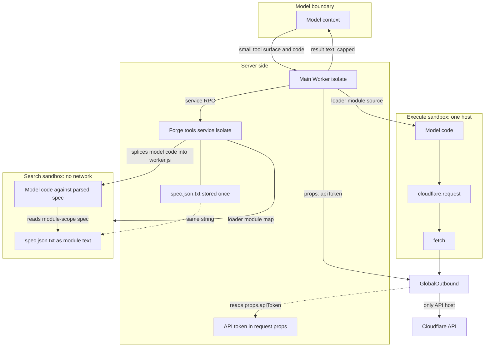
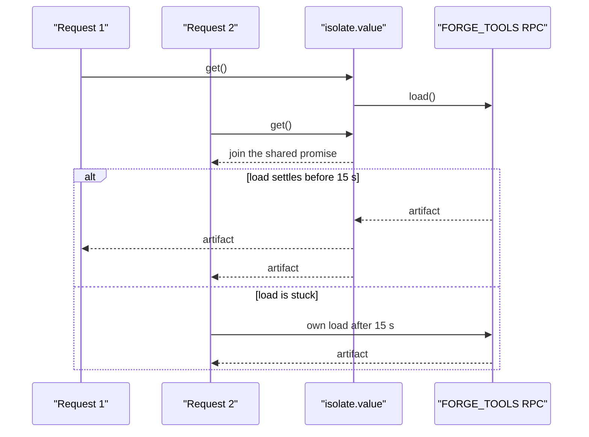

# The Isolate Boundary

## Three boundaries, not one

This document uses short forms. JSON means JavaScript Object Notation. TTL
means Time To Live. ASCII means American Standard Code for Information
Interchange. UTF means Unicode Transformation Format. CPU means Central
Processing Unit. URL means Uniform Resource Locator.

The server separates three things that are easy to confuse:

1. The model boundary. What the model reads and writes.
2. The sandbox boundary. What model-written code can reach.
3. The credential boundary. Where the Cloudflare Application Programming
   Interface (API) token exists.

The design keeps the large OpenAPI document and the token on the server side of
the model boundary. It keeps the token outside the sandbox. It keeps the
sandbox inside a network path that only reaches one host. A Remote Procedure
Call (RPC) carries data between the two Workers.

Four names recur. The forge tools service is the second Worker, and it holds
the generated tools and the spec. `GlobalOutbound` is a Worker entrypoint that
acts as the sandbox's only outbound path. The loader is the Dynamic Worker
Loader binding, `LOADER`, which builds a Worker from a module map. Both Workers
bind it (`wrangler.jsonc:28-32`, `wrangler.forge-tools.jsonc:16-20`). Props are
the values that the parent passes with an entrypoint binding. The sandbox
module cannot read them (`src/tools/execute.ts:45-49`,
`src/tools/execute.ts:119-124`).

The token is a property of `GlobalOutbound`, not a module value in the sandbox
(`src/tools/execute.ts:45-49`, `src/tools/execute.ts:119-124`). The spec is a
text module in the forge tools service (`src/forge-tools/search.ts:31-32`). A
text module is a module whose default export is a string; the runtime stores
the string and gives it to the importer. The service holds one string. The
loader passes that same string to each search sandbox as module text.

`cloudflare.request` is the documented request helper inside the execute
sandbox (`src/tools/execute.ts:262-324`). It builds a URL, encodes the body,
and calls `fetch`. It is a convenience wrapper. It does not bypass the proxy,
because every `fetch` leaves through `GlobalOutbound`.

The two sandboxes are separate. The `search` sandbox runs in the forge tools
service, has no network, and holds the spec. The `execute` sandbox runs in the
main Worker, has one outbound host, and holds no spec. The diagram shows both.

## Per-call isolation

Every `execute` call gets a new worker identifier:
`cloudflare-api-` plus a random Universally Unique Identifier (UUID)
(`src/tools/execute.ts:107`). Every `search` call gets a new identifier too:
`cloudflare-search-` plus a random identifier
(`src/forge-tools/search.ts:27`).

The source gives the reason for a fresh isolate in both places. Dynamic Worker
isolates disallow `eval`, so code cannot be passed as data into a warm isolate
(`src/tools/execute.ts:91-98`, `src/forge-tools/search.ts:19-23`). The code
must be in the module source. A new worker is the supported way to supply new
source per call.

A consequence is that the sandbox cannot keep state between calls. A cache
inside the model's code has no lifetime beyond one call. Another consequence is
that a slow or broken program cannot poison a warm sandbox for the next user.

## What each side can see

| Item | Model | Main Worker | Search sandbox | Execute sandbox |
| --- | --- | --- | --- | --- |
| Tool names and descriptions | yes | yes | no | no |
| Full OpenAPI document | no | no | yes | no |
| API token value | no | yes, in props | no | no |
| Outbound proxy props | no | yes | no | no |
| Session scopes | no | yes | no | only response headers |
| Result value | yes, as text | yes | yes | yes |
| Another user's data | no | no per-user cache | no | no |

The table follows the code paths. The main Worker reads the token from the
request's credential record, `props.accessToken` (`src/tools/execute.ts:448`). It passes the
value to the proxy as the `apiToken` prop (`src/tools/execute.ts:121-123`). The
execute sandbox receives only the module source and any response the proxy
returns. The module source defines the `cloudflare` object. The search sandbox
receives only the module source and the spec text.

The model does see a result in text. A result may contain customer data that
the API returned. That is expected: the model asked for it. The design prevents
the token and the generated API catalog from crossing, not the answer.

## Isolate-lifetime caches

`src/lib/isolate.ts` provides four cache shapes. A warm isolate serves many
requests, so a value that does not depend on the request should be built once
(`src/lib/isolate.ts:1-19`). The module also states a hard rule: no cache may
hold per-request or per-user data, because one isolate serves every user
(`src/lib/isolate.ts:17-19`).

| Helper | Shape | Use |
| --- | --- | --- |
| `isolate.value` | async load, shared by concurrent requests, optional TTL | spec artifacts, tool lists |
| `isolate.lazy` | synchronous value built on first use | serialized tool listing |
| `isolate.map` | keyed values, cleared at a count or size cap | validators, skill bytes, JSON Schema conversions |
| `isolate.derived` | value keyed on another cached object's identity | operation index, encoded listing |

The helpers are `isolate.value` at `src/lib/isolate.ts:67-109`, `isolate.lazy`
at `src/lib/isolate.ts:125-135`, `isolate.map` at
`src/lib/isolate.ts:169-205`, and `isolate.derived` at
`src/lib/isolate.ts:225-239`. `isolate.derived` keys on another cached object's
identity. Identity here means the object reference, not its contents. A new
object gives a new cache entry even when its fields are equal.

A shared load has a wait limit. If another request started a load and has not
finished, a second request waits 15 seconds, then starts its own load
(`src/lib/isolate.ts:41-54`, `src/lib/isolate.ts:90-103`). The comment explains
that a load is Input/Output (I/O) owned by the request that began it. A
cancelled request may never settle its promise
(`src/lib/isolate.ts:44-49`). The fallback prevents a stuck load from blocking
every later request.

A map clears the whole map when an insert would pass a cap
(`src/lib/isolate.ts:160-168`). The comment says this is cheaper than tracking
recent use and fits caches whose working set is far below the cap. A value
larger than the cap is returned but not stored (`src/lib/isolate.ts:176-178`).

The sequence follows `src/lib/isolate.ts:90-103`.

## What the caches hold

| Cache | Where | TTL or cap | Source |
| --- | --- | --- | --- |
| `products.json` | main Worker | 1 hour | `src/isolate-cache.ts:91-98` |
| `permissions.json` | main Worker | 1 hour | `src/isolate-cache.ts:59-67` |
| generated tool list | main Worker | 1 hour | `src/isolate-cache.ts:69-89` |
| skills manifest and index | main Worker | 1 hour | `src/isolate-cache.ts:107-124` |
| skill file bytes | main Worker | 16 mebibyte cap | `src/isolate-cache.ts:130-152` |
| serialized direct-tool listing | main Worker | keyed on list identity | `src/tools/tool-list-response.ts:13-21` |
| operation lookup index | main Worker | keyed on `paths` identity | `src/api-permissions.ts:100-121` |
| argument validators | forge service | default map cap | `src/forge-tools/plan.ts:80-82` |
| JSON Schema conversions | both | keyed per schema and option | `src/lib/isolate-json-schema.ts:15-31` |

The one-hour Time To Live (TTL) is shorter than the six-hour skills sync. A
warm isolate can miss the most recent sync by up to one hour. It cannot miss
two syncs, because it reloads the manifest before the next six-hour boundary
(`src/isolate-cache.ts:20-26`, `src/skills/sync.ts:80-84`).

The generated tool list crosses the service RPC boundary as one JavaScript
Object Notation (JSON) string, not as thousands of objects. The service builds
the string once per isolate (`src/forge-tools/worker.ts:29-37`). The main
Worker parses it once per isolate (`src/isolate-cache.ts:78-89`). Later listings
in the same isolate reuse the parsed array. The comment measures the parse at
hundreds of milliseconds of Central Processing Unit (CPU) for about 3,000
nested objects (`src/isolate-cache.ts:78-83`).

## Large values and transport limits

`spec.json` is close to the RPC message limit. The service can return any spec
artifact as a stream, because a stream has no message-size limit
(`src/forge-tools/worker.ts:98-105`). The comment puts the file near the 32
mebibyte RPC limit (`src/forge-tools/worker.ts:99-101`).

The main Worker uses that stream path for `products.json` and
`permissions.json`. It reads them as text (`src/isolate-cache.ts:36-38`,
`src/isolate-cache.ts:59-67`, `src/isolate-cache.ts:91-98`). It never asks the
service for `spec.json`; `search` runs inside the service
(`src/isolate-cache.ts:10-18`). The search sandbox gets the big string as module
text, not over RPC (`src/forge-tools/search.ts:31-32`). The stream path and the
module path are two different transports.

The spec is stored as an all-ASCII JSON string. `asciiJson` escapes every
character above `U+007F` as `\uXXXX` (`scripts/generate-tools.ts:146-157`). That
range includes the Latin-1 supplement, so the stored string is pure ASCII. The
comment gives the reason (`scripts/generate-tools.ts:147-151`). The document
has 710 characters outside Latin-1. Those are the characters that matter for
this cost. JavaScript strings are UTF-16, and the runtime uses a one-byte form
only when every code unit fits in one byte. One character outside Latin-1
forces the whole string into the two-byte form. That form would hold 26.7
million code units at two bytes each, about 53 megabytes. Escaping avoids that
form. The escaped output is longer than the input, but each character in the
stored string is one byte.

The search sandbox receives the spec as a text module, not as a string built
into the module source. The source says splicing the 26.3 megabyte string into
the module source cost about 117 milliseconds of CPU per search
(`src/forge-tools/search.ts:21-25`).

> **Aha:** The boundary is enforced by data flow, not by a permission check
> inside model code. The code could call any function it can reach, but it
> cannot reach the token, and its `fetch` cannot reach another host. The
> security argument does not depend on the model agreeing to the rules.

## Failure at the boundary

The parent treats the sandbox result as untrusted. A Zod union parses it, and
an unreadable value becomes an error (`src/tools/execute.ts:27-43`,
`src/tools/execute.ts:344-347`). Zod is a TypeScript schema library. The union
allows `{ ok: true, result }` or `{ ok: false, message, missingScope?,
graphqlRefusal?, replaySafe }` (`src/tools/execute.ts:27-43`). The parent also
distrusts a reported missing scope. It checks the scope against the permission
catalog and against the scopes the connection holds
(`src/tools/execute.ts:353-367`).

The proxy can return a 403 with an explanation header. The sandbox turns that
into an `Error` with the explanation in its message
(`src/tools/execute.ts:148-161`). If model code lets that error escape, the
parent can explain the refusal to the model. If the code catches the error and
throws a different one, the parent sees only the new message. It cannot recover
the proxy explanation from that message.

The outbound proxy adds a retry layer. Its defaults are three attempts, a base
delay of one second, a factor of two, a five-second maximum, and jitter
(`src/utils/fetch-retry.ts:16-24`). It retries only a 429 response. Any other
response returns at once (`src/utils/fetch-retry.ts:124-126`). A server
`Retry-After` value that exceeds
the maximum is not retried. The caller gets the 429 at once with the server's
guidance (`src/utils/fetch-retry.ts:49-70`).

## What the boundary does not guarantee

The repository does not set CPU or subrequest limits on either dynamic Worker
(`src/tools/execute.ts:119-124`, `src/forge-tools/search.ts:27-30`). The type
declaration allows `cpuMs` and `subRequests` (`worker-configuration.d.ts:3674-3677`).
The platform default applies, and the repository does not record it.

The code checks only the host, not the scheme, port, or path
(`src/tools/execute.ts:62-66`). A path outside the API base still reaches the
same host. The API decides whether that path is valid.

The proxy adds an `Authorization` header. If model code already supplied one,
the resulting `Headers` object has two values with the same name. The
repository does not normalize this case, so the outcome depends on the runtime
and on the API. The sandbox still cannot read the server token, because the
token exists only in the parent entrypoint's props. Whether the API receives
one value, the other, or a combined value is undefined. A model should not set
`Authorization` itself.

## Related documents

- [03-search-tool.md](03-search-tool.md)
- [04-execute-tool.md](04-execute-tool.md)
- [07-generation-pipeline.md](07-generation-pipeline.md)
- [12-operations.md](12-operations.md)
- [13-limitations-and-open-questions.md](13-limitations-and-open-questions.md)
