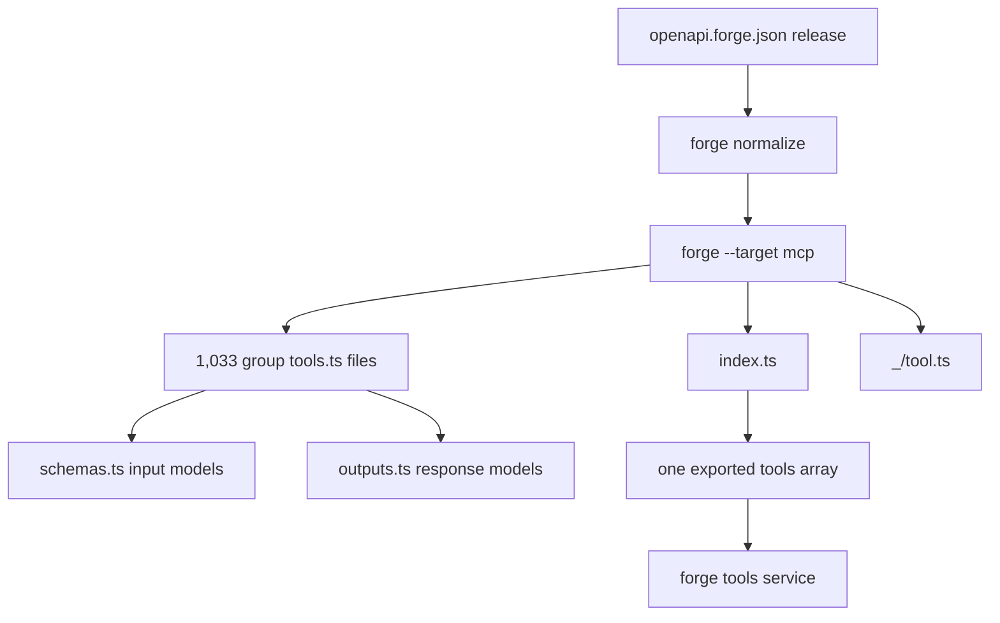
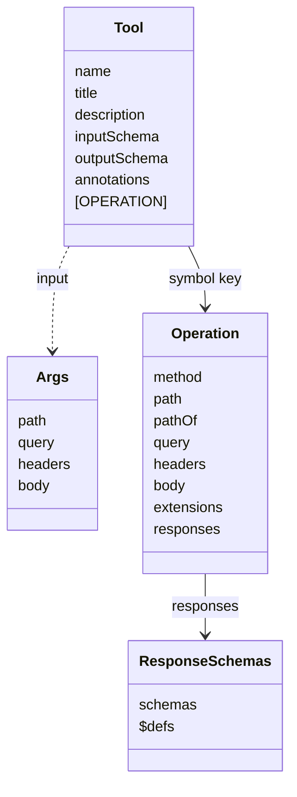

# Generated Code — A Measured Sample

This sample describes generated code for the Cloudflare Application Programming
Interface (API). In this document, KiB means kibibyte (1,024 bytes). MiB means
mebibyte (1,048,576 bytes). MB means megabyte (1,000,000 bytes). JSON means
JavaScript Object Notation. SDK means Software Development Kit. The `du` tool
reports KiB, so the measured values below give KiB first and MiB in
parentheses.

## Sampling rule

The generated tree is large. This study samples it. It does not enumerate every
product or every tool. Forge is Cloudflare's code generator, installed as
`@cloudflare/forge`. It turns the OpenAPI document into these packages. The
sample is:

- The `d1` product group, as one complete group.
- The shared forge runtime in `_/tool.ts`.
- The top-level `index.ts`.
- One spec artifact, `spec.json.txt`, parsed once.
- The two smaller spec artifacts, measured by size.

A different product group may be larger. The generator is one program, so the
shape should repeat. The counts below are exact for this checkout and this
sample.

## Measured size

| Path | Measurement |
| --- | --- |
| `src/generated/forge-mcp/` | 27,692 KiB (27 MiB, about 28 MB), 144 top-level entries, 2,154 files |
| `tools.ts` files | 1,033 |
| tool names in `tools.ts` files | 3,040 |
| `src/generated/spec/spec.json.txt` | 26,325,766 bytes |
| `src/generated/spec/products.json.txt` | 2,258 bytes |
| `src/generated/spec/permissions.json.txt` | 384,991 bytes |

The measurements come from `du`, `find`, `grep`, and `ls` on this checkout.
The tool name count matches the generator's own counter pattern, which reads
lines of the form `name: "..."` in each `tools.ts`
(`scripts/generate-tools.ts:191-202`).

The spec artifact parse gives 2,345 path templates and 3,763 operations. The
method split is `GET` 1,840, `POST` 795, `PUT` 366, `DELETE` 488, and `PATCH`
274. The only top-level key is `paths`.

## The index

`src/generated/forge-mcp/index.ts` starts with a generated-code banner and a
comment that disables lint (`src/generated/forge-mcp/index.ts:1-2`). It imports
one `tools` array from each group, for example `abuseReports/appeals/tools.js`
and `accounts/billing/tools.js` (`src/generated/forge-mcp/index.ts:4-12`). It
ends with one exported array that spreads every group's tools
(`src/generated/forge-mcp/index.ts`, last 20 lines).

The index has 1,033 tool-group import lines. It also has one runtime type
import from `./_/tool.js` (`src/generated/forge-mcp/index.ts:1-4`). The total is
1,034 import lines. The tool tree has 1,033 `tools.ts` files, so the group
imports map one to one.



The generate-and-replace step is `scripts/generate-tools.ts:108-120`. The
service import is
`src/forge-tools/worker.ts:15-18`. `forge normalize` runs first, because Forge
reads only its own `x-forge-*` extensions (`scripts/generate-tools.ts:108-111`).

## Anatomy of one tool

The `d1` group is one product group, named after the D1 Structured Query
Language (SQL) database product. It starts with a generated-code banner and
imports the runtime symbols `OPERATION`, `Tool`, and `encodePath`
(`src/generated/forge-mcp/d1/tools.ts:1-4`). `Tool` is the Model Context
Protocol (MCP) shape. `OPERATION` is a symbol key that holds the hidden API
operation, explained below. `encodePath` fills path parameters. The group
imports nine response models from `./outputs.js` and six input models from
`./schemas.js` (`src/generated/forge-mcp/d1/tools.ts:5-23`).

The first tool is `d1_create` with title "Create D1 Database"
(`src/generated/forge-mcp/d1/tools.ts:25-28`). Its description ends with the
method and path template (`src/generated/forge-mcp/d1/tools.ts:30`). Its
`inputSchema` has `body` and `path` properties; `path` holds `account_id`
(`src/generated/forge-mcp/d1/tools.ts:31-83`).

The tool also has an `outputSchema`, annotations, and the hidden operation
(`src/generated/forge-mcp/d1/tools.ts:84-123`). The operation is hidden because
it sits under a symbol key. A symbol key does not appear in `JSON.stringify`,
so the wire listing never shows it. The operation block is:

```typescript
[OPERATION]: {
  method: "POST",
  path: "/accounts/{account_id}/d1/database",
  pathOf: encodePath`/accounts/${"account_id"}/d1/database`,
  body: { mediaTypes: ["application/json"] },
  extensions: {
    "x-api-token-group": ["D1 Write"],
    "x-forge-epilogue": "This command acts on remote D1 Databases."
  },
  responses: {
    schemas: {
      "200": { "allOf": [ ... ] },
      "4XX": { "$ref": "#/$defs/d1_api-response-common-failure" }
    },
    $defs: { ... }
  },
}
```

The exact structure starts at `src/generated/forge-mcp/d1/tools.ts:124`. The
excerpt elides only repeated schema content; the field names, values, and
order are as written.

In `pathOf`, the expression `${"account_id"}` yields the parameter name, not a
value. `encodePath` looks that name up in the `path` argument and
percent-encodes the result. The `{account_id}` form in `path` is the OpenAPI
template. The `pathOf` form fills that template at call time.

The operation is under a symbol, not a string key. The runtime defines
`OPERATION` as `Symbol.for('@cloudflare/forge/mcp/operation')`
(`src/generated/forge-mcp/_/tool.ts:73-80`). The comment gives one reason and
one property. `JSON.stringify` leaves a symbol key out, so a tool sent as a
list entry has only the Model Context Protocol (MCP) shape. `Symbol.for` also
gives every copy of the runtime the same symbol
(`src/generated/forge-mcp/_/tool.ts:74-80`).



The classes summarize `src/generated/forge-mcp/_/tool.ts:19-91` and
`src/generated/forge-mcp/d1/tools.ts:124-160`. `ResponseSchemas` is the shape of
the `responses` field: a `schemas` map by status, plus a `$defs` map of shared
definitions. `Args` is the call arguments, grouped by location. `Args` is not a
field of `Tool` or `Operation`. The SDK validates a call's arguments against
`inputSchema` before `buildRequest` reads them.

## The runtime

`_/tool.ts` is generated but stable. It imports `fromJsonSchema`, `McpServer`,
and related types from `@modelcontextprotocol/server`
(`src/generated/forge-mcp/_/tool.ts:4-12`). `fromJsonSchema` converts a JSON
Schema object into the SDK's schema type. The runtime defines:

- `Args`, the call arguments grouped by location.
- `Operation`, the hidden API method.
- `Tool`, an MCP tool plus the operation.
- `operation(tool)`, the symbol read.
- `encodePath`, a tagged template that fills path parameters.
- `buildRequest`, the request builder.
- `registerTools`, an optional helper for serving the tools.

The definitions are at `src/generated/forge-mcp/_/tool.ts:19-160` and
`src/generated/forge-mcp/_/tool.ts:336-424`.

`buildRequest` fills the path, appends query parameters, sets headers, and
encodes a body (`src/generated/forge-mcp/_/tool.ts:136-160`). It returns plain
data: method, Uniform Resource Locator (URL), headers, and optional body
(`src/generated/forge-mcp/_/tool.ts:43-49`). That plain data crosses a Remote
Procedure Call (RPC) from the service to the main Worker as it is.

`encodePath` rejects an empty path parameter, because an empty segment would
drop part of the path (`src/generated/forge-mcp/_/tool.ts:111-125`). This is
one of the few runtime checks that protects against a subtly wrong request.

## Shared schema files

`schemas.ts` holds input models. `outputs.ts` holds response models. The `d1`
outputs file starts with the generated banner and imports the `JSONObject` type
(`src/generated/forge-mcp/d1/outputs.ts:1-4`). Each export is a JavaScript
Object Notation (JSON) Schema object, for example
`d1_api$$response$$common` (`src/generated/forge-mcp/d1/outputs.ts:6-20`).

The double dollar signs in names come from the generator's name escape. Each
hyphen in a source schema name becomes `$$` in the generated identifier, so
`d1_api-response-common` becomes `d1_api$$response$$common`. The result is a
valid TypeScript identifier, and collisions are unlikely.

The response models can use `$ref` inside the generated file, such as
`"$ref": "#/$defs/d1_messages"` (`src/generated/forge-mcp/d1/outputs.ts:8-12`).
`$ref` is a JSON Schema reference to another schema. The fragment after `#`
names a location in the same document. The tool's operation carries a `$defs`
map that resolves those references at call time
(`src/generated/forge-mcp/d1/tools.ts:108-113`). The search spec resolves all
`$ref` values before storage instead. The resolver is `resolveRefs`
(`src/spec-processor.ts:56-85`), and `processSpec` calls it
(`src/spec-processor.ts:110-147`).

## The spec artifact

`spec.json.txt` is one line of JSON. It is a text module, so importing it costs
a string, not a parse (`src/forge-tools/spec.ts:6-15`). A text module is a
module whose default export is a string. The `.txt` suffix makes the bundler
treat the file that way. The search sandbox parses the string once per search
(`src/forge-tools/search.ts:36-37`).

The processed spec keeps only the fields that search and permission
explanations need: `summary`, `x-api-token-group`, `description`, `tags`,
`parameters`, `requestBody`, and `responses`
(`src/spec-processor.ts:132-140`). A sample operation for
`POST /accounts/{account_id}/d1/database` holds those fields, with
`x-api-token-group: ["D1 Write"]` and a full request body schema
(`src/generated/spec/spec.json.txt:1`).

The two smaller artifacts have narrow jobs:

- `products.json.txt` backs the product list in the `search` description
  (`src/isolate-cache.ts:91-98`).
- `permissions.json.txt` maps each path and method to its accepted permissions
  (`src/isolate-cache.ts:51-67`). It lets `execute` explain a refusal
  (`src/api-refusals.ts:186-195`).

## What the sample shows about direct tools

The generated tool is both a listing entry and a call plan. The listing path
uses the MCP fields. The call path reads the operation, validates arguments,
builds a request, and sends it (`src/forge-tools/plan.ts:51-78`).

The forge tools service never registers these tools on an MCP server. It sends
the listing to the main Worker and plans each call
(`src/forge-tools/worker.ts:63-110`). The optional `registerTools` helper in the
runtime is generated but unused by this repository's service.

The service applies one policy layer after generation. `cloudflareTool` makes
`path.account_id` optional and gives it one description, so the listing does
not depend on the session (`src/forge-tools/cloudflare.ts:16-60`). A merged
tool is a tool whose route exists under both accounts and zones. Forge merges
those two routes into `/{account_or_zone}/{account_or_zone_id}/...`
(`src/forge-tools/cloudflare.ts:20-25`). The policy also makes a merged tool's
`account_or_zone_id` optional, and `path` itself optional when no path
parameter remains required (`src/forge-tools/cloudflare.ts:22-52`).

> **Aha:** The generated code holds two representations in one object. The
> visible half is a normal MCP tool schema. The invisible half is an API
> operation under a symbol. One artifact serves listing, validation, request
> building, and response checking. The symbol keeps the invisible half out of
> the wire format without a second data structure.

## What this sample does not show

The sample does not show every naming pattern. It does not show every schema
construct. It does not measure the compile time or memory cost of the full
tree. The guide gives one figure, about 10 MB of generated code
(`AGENTS.md:200`), but the measured source directory is 27,692 KiB (27 MiB,
about 28 MB). The guide also gives a service bundle of about 51 MB, with about
31 MB of it the spec (`AGENTS.md:200`). Those two guide figures imply about
20 MB of tool code. That value is nearer to the 27 MiB source measurement than
10 MB is. This study cannot explain the 10 MB figure. It could count a
minified module graph, or a subset of the tree. The repository does not state
which quantity that figure measures, so the conflict remains open. See
[13-limitations-and-open-questions.md](13-limitations-and-open-questions.md).

The sample also does not show a tool with a non-JSON response. It does not show
a tool with no output schema. It does not show a tool whose name collides with
another. Those cases exist in the generator's logic, but this study did not
enumerate them.

## Related documents

- [01-repository-map.md](01-repository-map.md)
- [03-search-tool.md](03-search-tool.md)
- [07-generation-pipeline.md](07-generation-pipeline.md)
- [11-results-and-validation.md](11-results-and-validation.md)
- [13-limitations-and-open-questions.md](13-limitations-and-open-questions.md)
